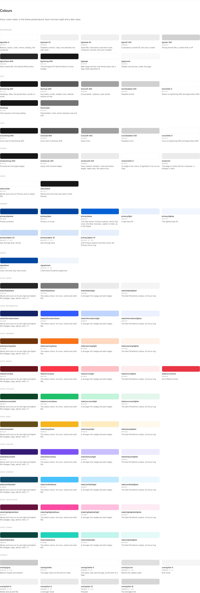
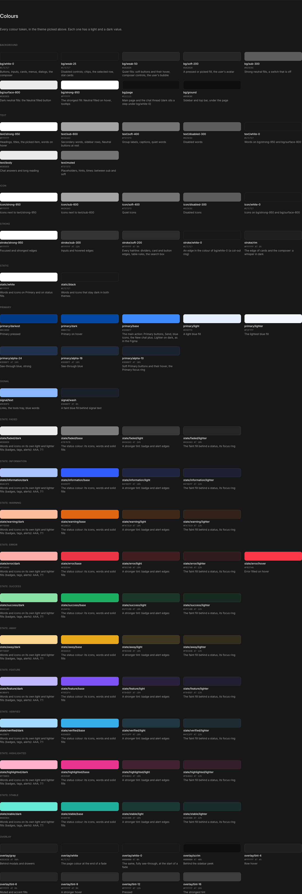
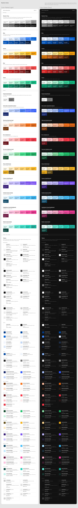

<!-- Copied from the design copy (neutrino-frontend-v3) by scripts/sync.mjs. Edit it there, then run `npm run sync`. -->

# Color Palette

| | |
|---|---|
| Figma | [Color Palette](https://www.figma.com/design/Ao3YVgFYdQIF0znq2ToqVl?node-id=553-14956) page |
| Status | v1 approved 18 Oct 2026; tokens named as in the Figma since 18 Oct; status colours from the Figma, both themes, 21 Oct 2026 |
| In code | [`src/styles/theme-tokens.css`](../../src/styles/theme-tokens.css) (the palette block at its top), [`tokens/colors.json`](../../tokens/colors.json) |

## Light and dark

**Light**

**Dark**

Status: Colors v1, approved 18 Oct 2026, built from the design playground. Tokens named as in Nitesh's Figma, 18 Oct 2026. Status colours from his Figma's state variables, both themes, all ten (21 Oct 2026).

The page people open: `palette.html` in this folder (also published on Claude, link in `../README.md`).
Generated by `build.mjs`. Edit the data there and rerun it; never edit this file by hand.

## How the colours are built

Three layers, each pointing only at the one above it, so one change reaches every screen:

1. **Palette**: the scales below (Gray, Blue, Amber, Red, Green, and the Status families from the Figma's state variables). The only place a hex is written.
2. **Tokens**: what each job uses, with a light and a dark value. Named exactly as the variables in Nitesh's Figma (`bg/white-0`, `text/sub-600`, `stroke/soft-200`, `state/error/base` ...), so a designer and a developer say the same name. A few Neutrino-only tokens sit beside them, marked "Neutrino only".
3. **Components and screens**: use tokens only. Never a palette step, never a hex.

Change a palette step and every token on it follows. Point a token at another step and every component using it follows, in both themes.

The same tokens also come as plain CSS variables in `tokens.css` (light on `:root`, dark inside `.nt-dark`), for anything outside the app: the review canvas, a teammate's prototype. It is generated too; never edit it.

## Rules

1. Use only the tokens on this page. Never invent a hex, never use a Tailwind palette class.
2. Pick a token by its job (the tables under Tokens), not by how it looks. Use the same token the Figma frame uses: `get_variable_defs` on the frame names it.
3. Every token has a light and a dark value. Never hard-code one theme.
4. Need a colour that has no token? Stop and ask Nitesh, then add it here first.
5. In code, token `bg/white-0` is the CSS variable `--bg-white-0` and the Tailwind colour `bg-white-0`. So classes read `bg-bg-white-0`, `text-text-sub-600`, `text-icon-sub-600`, `border-stroke-soft-200`, `bg-state-error-lighter`, `bg-primary-base`. New components use only these.
6. The older product names in `styles/theme-tokens.css` (`bg-surface-canvas`, `text-text-primary`, `text-danger` ...) now point at these tokens, so they follow too. Move a screen to the token names when it is rebuilt.
7. Trap: `bg-primary` is shadcn's near-black, not the brand blue. The brand blue is `bg-primary-base`.

## Changing a colour (when Nitesh asks)

1. Edit the data in `design-system/colors/build.mjs`: a value in a scale, or which step a token uses.
2. Run `node design-system/colors/build.mjs`. It rewrites this file, `palette.html` and the palette block at the top of `styles/theme-tokens.css`.
3. Every screen follows on its own, because every colour points at a token and every token at the palette.
4. Republish `design-system/colors/palette.html` with the Artifact tool (same file path, same link).
5. Add a line to `../DECISIONS.md`.
6. Run `bash scripts/check-colours.sh`.
7. Run `node design-system/colors/check.mjs`. It resolves every colour in both themes and lists each one that changed since the last commit, and any that no longer resolves. Only the colours you meant to change should be on the list.

Never type a colour straight into `theme-tokens.css` or a component. Add it to the palette first, then to a token.

## Scales

### Neutral / Gray

Pure neutral, no tint. 500 is the primary grey. The steps sit close together at both ends, where screens live: light screens use 0 to 300, dark screens 700 to 950.

| Step | Hex | Name |
|---|---|---|
| 0 | #FFFFFF |  |
| 50 | #FAFAFA |  |
| 100 | #F0F0F0 |  |
| 200 | #EBEBEB |  |
| 300 | #D1D1D1 |  |
| 400 | #A3A3A3 |  |
| 500 (primary) | #737373 |  |
| 600 | #5C5C5C |  |
| 700 | #262626 |  |
| 800 | #171717 |  |
| 900 | #111111 |  |
| 950 | #0E0E0E |  |

### Blue

The brand's one blue, hue 258.5. 500 is cobalt, the primary blue. The named steps are the brand light's own stops.

| Step | Hex | Name |
|---|---|---|
| 50 | #F2F7FF |  |
| 100 | #E5EFFE | Mist |
| 200 | #CBE0FF | Light |
| 300 | #8CB9FD | Pale |
| 400 | #3D8BFF | Cherenkov |
| 500 (primary) | #0461D5 | Cobalt |
| 600 | #0254BB |  |
| 700 | #0047A2 | Ink |
| 800 | #013B88 |  |
| 900 | #012F6E | Navy |
| 950 | #02193C | Deep |

### Amber

Warning. Words in amber use 700 on light and 400 on dark.

| Step | Hex | Name |
|---|---|---|
| 50 | #FFFBEB |  |
| 100 | #FEF3C7 |  |
| 200 | #FDE68A |  |
| 300 | #FCD34D |  |
| 400 | #FBBF24 |  |
| 500 (primary) | #F59E0B |  |
| 600 | #D97706 |  |
| 700 | #B45309 |  |
| 800 | #92400E |  |
| 900 | #78350F |  |
| 950 | #451A03 |  |

### Red

Errors and destructive actions. Words in red use 600 on light and 400 on dark.

| Step | Hex | Name |
|---|---|---|
| 50 | #FEF2F2 |  |
| 100 | #FEE2E2 |  |
| 200 | #FECACA |  |
| 300 | #FCA5A5 |  |
| 400 | #F87171 |  |
| 500 (primary) | #EF4444 |  |
| 600 | #DC2626 |  |
| 700 | #B91C1C |  |
| 800 | #991B1B |  |
| 900 | #7F1D1D |  |
| 950 | #450A0A |  |

### Green

Success. Words in green use 700 on light and 400 on dark.

| Step | Hex | Name |
|---|---|---|
| 50 | #ECFDF5 |  |
| 100 | #D1FAE5 |  |
| 200 | #A7F3D0 |  |
| 300 | #6EE7B7 |  |
| 400 | #34D399 |  |
| 500 (primary) | #10B981 |  |
| 600 | #059669 |  |
| 700 | #047857 |  |
| 800 | #065F46 |  |
| 900 | #064E3B |  |
| 950 | #022C22 |  |

### Faded (state/faded)

The Figma's own greys for the faded state, where they differ from the Gray scale: its faint fill and its base.

| Step | Hex | Name |
|---|---|---|
| 100 | #F5F5F5 |  |
| 500 (primary) | #7B7B7B |  |

### Information (state/information)

Information, the Badge's Blue. A status blue, apart from the brand's.

| Step | Hex | Name |
|---|---|---|
| 50 | #EBF1FF |  |
| 200 | #C0D5FF |  |
| 300 | #AAC3FE |  |
| 400 | #4D82FF |  |
| 450 | #476CFF |  |
| 500 (primary) | #335CFF |  |
| 950 | #122368 |  |

### Warning (state/warning)

Warning, the Badge's Orange.

| Step | Hex | Name |
|---|---|---|
| 50 | #FFF3EB |  |
| 200 | #FFD9C0 |  |
| 300 | #FFBD9D |  |
| 400 | #FFA468 |  |
| 500 (primary) | #FA7319 |  |
| 600 | #E16614 |  |
| 950 | #71330A |  |

### Error (state/error)

Errors and destructive actions, the Badge's Red.

| Step | Hex | Name |
|---|---|---|
| 50 | #FFEBEC |  |
| 200 | #FFC0C5 |  |
| 300 | #FEADA9 |  |
| 400 | #FF6875 |  |
| 500 (primary) | #FB3748 |  |
| 600 | #E93544 |  |
| 950 | #681219 |  |

### Success (state/success)

Success, the Badge's Green.

| Step | Hex | Name |
|---|---|---|
| 50 | #E3F7EC |  |
| 200 | #C2F5DA |  |
| 300 | #8AE1A5 |  |
| 400 | #3EE089 |  |
| 500 (primary) | #1FC16B |  |
| 600 | #1DAF61 |  |
| 950 | #0B4627 |  |

### Away (state/away)

Away, the Badge's Yellow.

| Step | Hex | Name |
|---|---|---|
| 50 | #FFFAEB |  |
| 200 | #FFECC0 |  |
| 300 | #FFD68F |  |
| 400 | #FFD268 |  |
| 450 | #FBC64B |  |
| 500 (primary) | #F6B51E |  |
| 600 | #E6A819 |  |
| 950 | #624C18 |  |

### Feature (state/feature)

Feature, the Badge's Purple.

| Step | Hex | Name |
|---|---|---|
| 50 | #EFEBFF |  |
| 200 | #CAC0FF |  |
| 300 | #C0B8FE |  |
| 400 | #8C71F6 |  |
| 450 | #784DEF |  |
| 500 (primary) | #7D52F4 |  |
| 950 | #351A75 |  |

### Verified (state/verified)

Verified, the Badge's Sky.

| Step | Hex | Name |
|---|---|---|
| 50 | #EBF8FF |  |
| 200 | #C0EAFF |  |
| 300 | #A2DBFE |  |
| 400 | #68CDFF |  |
| 500 (primary) | #47C2FF |  |
| 600 | #35ADE9 |  |
| 950 | #124B68 |  |

### Highlighted (state/highlighted)

Highlighted, the Badge's Pink.

| Step | Hex | Name |
|---|---|---|
| 50 | #FFEBF4 |  |
| 200 | #FFC0DF |  |
| 300 | #FFB0CD |  |
| 400 | #FF68B3 |  |
| 500 (primary) | #FB4BA3 |  |
| 600 | #E9358F |  |
| 950 | #68123D |  |

### Stable (state/stable)

Stable, the Badge's Teal.

| Step | Hex | Name |
|---|---|---|
| 50 | #E4FBF8 |  |
| 200 | #C2F5EE |  |
| 300 | #66E9D4 |  |
| 400 | #3FDEC9 |  |
| 500 (primary) | #22D3BB |  |
| 600 | #1DAF9C |  |
| 950 | #0B463E |  |

## Tokens

What each theme uses, job by job. "In code" is the CSS variable and the Tailwind colour name.

### Background

| Token | Used for | Light | Dark | In code | Product names that use it |
|---|---|---|---|---|---|
| `bg/white-0` | Buttons, inputs, cards, menus, dialogs, the composer | Gray 0 (#FFFFFF) | Gray 800 (#171717) | `--bg-white-0`, `bg-white-0` | --color-surface-3, --color-surface-4, --color-raised, --color-card |
| `bg/weak-25` | Disabled controls; chips, the selected row, stat cards | Gray 100 (#F0F0F0) | Gray 800 (#171717) | `--bg-weak-25`, `bg-weak-25` | --color-surface-2, --color-stat, --color-nav-item-active, --color-nav-primary-bg, --color-chip |
| `bg/weak-50` | Quiet fills: soft buttons and their hover, composer controls, the user's bubble | Gray 100 (#F0F0F0) | Gray 700 (#262626) | `--bg-weak-50`, `bg-weak-50` | --color-user-bubble, --color-send-disabled-bg, --color-composer-control, --color-card-hover |
| `bg/soft-200` | A pressed or picked fill, the user's avatar | Gray 200 (#EBEBEB) | Gray 700 (#262626) | `--bg-soft-200`, `bg-soft-200` | --color-avatar-user, --color-chip-active |
| `bg/sub-300` | Strong neutral fills, a switch that is off | Gray 300 (#D1D1D1) | Gray 600 (#5C5C5C) | `--bg-sub-300`, `bg-sub-300` |  |
| `bg/surface-800` | Dark neutral fills: the Neutral filled button | Gray 700 (#262626) | Gray 200 (#EBEBEB) | `--bg-surface-800`, `bg-surface-800` |  |
| `bg/strong-950` | The strongest fill: Neutral filled on hover, tooltips | Gray 800 (#171717) | Gray 0 (#FFFFFF) | `--bg-strong-950`, `bg-strong-950` |  |
| `bg/page` (Neutrino only) | Main page and the chat thread (dark sits a step under bg/white-0) | Gray 0 (#FFFFFF) | Gray 900 (#111111) | `--bg-page`, `bg-page` | --color-surface-canvas, --color-thread-bg, --color-bot-glyph |
| `bg/ground` (Neutrino only) | Sidebar and top bar, under the page | Gray 50 (#FAFAFA) | Gray 950 (#0E0E0E) | `--bg-ground`, `bg-ground` | --color-surface-1, --color-app-bg, --color-nav-bg |

### Text

| Token | Used for | Light | Dark | In code | Product names that use it |
|---|---|---|---|---|---|
| `text/strong-950` | Headings, titles, the picked item, words on hover | Gray 800 (#171717) | Gray 0 (#FFFFFF) | `--text-strong-950`, `text-strong-950` | --color-bot-mark, --color-text-primary, --color-accent, --color-accent-fg, --color-nav-fg-strong, --color-nav-primary-fg, --color-segment-fg-active |
| `text/sub-600` | Secondary words, sidebar rows, Neutral buttons at rest | Gray 600 (#5C5C5C) | Gray 400 (#A3A3A3) | `--text-sub-600`, `text-sub-600` | --color-text-secondary, --color-nav-fg |
| `text/soft-400` | Group labels, captions, quiet words | Gray 400 (#A3A3A3) | Gray 500 (#737373) | `--text-soft-400`, `text-soft-400` | --color-text-faint, --color-text-caption, --color-nav-fg-label, --color-segment-fg, --color-search-fg, --color-effort-rest, --color-effort-tick |
| `text/disabled-300` | Disabled words | Gray 300 (#D1D1D1) | Gray 600 (#5C5C5C) | `--text-disabled-300`, `text-disabled-300` | --color-send-disabled-fg |
| `text/white-0` | Words on bg/strong-950 and bg/surface-800 | Gray 0 (#FFFFFF) | Gray 800 (#171717) | `--text-white-0`, `text-white-0` |  |
| `text/body` (Neutrino only) | Chat answers and long reading | Gray 800 (#171717) | Gray 200 (#EBEBEB) | `--text-body`, `text-body` | --color-text-body |
| `text/muted` (Neutrino only) | Placeholders, hints, times: between sub and soft | Gray 500 (#737373) | Gray 500 (#737373) | `--text-muted`, `text-muted` | --color-text-tertiary, --color-text-muted |

### Icon

| Token | Used for | Light | Dark | In code | Product names that use it |
|---|---|---|---|---|---|
| `icon/strong-950` | Icons next to text/strong-950 | Gray 800 (#171717) | Gray 0 (#FFFFFF) | `--icon-strong-950`, `icon-strong-950` |  |
| `icon/sub-600` | Icons next to text/sub-600 | Gray 600 (#5C5C5C) | Gray 400 (#A3A3A3) | `--icon-sub-600`, `icon-sub-600` |  |
| `icon/soft-400` | Quiet icons | Gray 400 (#A3A3A3) | Gray 500 (#737373) | `--icon-soft-400`, `icon-soft-400` |  |
| `icon/disabled-300` | Disabled icons | Gray 300 (#D1D1D1) | Gray 600 (#5C5C5C) | `--icon-disabled-300`, `icon-disabled-300` |  |
| `icon/white-0` | Icons on bg/strong-950 and bg/surface-800 | Gray 0 (#FFFFFF) | Gray 800 (#171717) | `--icon-white-0`, `icon-white-0` |  |

### Stroke

| Token | Used for | Light | Dark | In code | Product names that use it |
|---|---|---|---|---|---|
| `stroke/strong-950` | Focused and strongest edges | Gray 800 (#171717) | Gray 0 (#FFFFFF) | `--stroke-strong-950`, `stroke-strong-950` |  |
| `stroke/sub-300` | Inputs and hovered edges | Gray 300 (#D1D1D1) | White at 12% (rgba(255, 255, 255, 0.12)) | `--stroke-sub-300`, `stroke-sub-300` | --color-border-line-3, --color-search-border-hover |
| `stroke/soft-200` | Every hairline: dividers, card and button edges, table rules, the search box | Gray 200 (#EBEBEB) | White at 9% (rgba(255, 255, 255, 0.09)) | `--stroke-soft-200`, `stroke-soft-200` | --color-border-line-1, --color-border-line-2, --color-rail-border, --color-search-border, --color-panel-border |
| `stroke/white-0` | An edge in the colour of bg/white-0 (a cut-out ring) | Gray 0 (#FFFFFF) | Gray 800 (#171717) | `--stroke-white-0`, `stroke-white-0` |  |
| `stroke/rim` (Neutrino only) | The edge of cards and the composer: a whisper in dark | Gray 200 (#EBEBEB) | White at 3% (rgba(255, 255, 255, 0.03)) | `--stroke-rim`, `stroke-rim` | --color-composer-border, --color-card-border |

### Static

The same in both themes.

| Token | Used for | Light | Dark | In code | Product names that use it |
|---|---|---|---|---|---|
| `static/white` | Words and icons on Primary and on status fills | Gray 0 (#FFFFFF) | Gray 0 (#FFFFFF) | `--static-white`, `static-white` | --color-send-fg |
| `static/black` | Words and icons that stay dark in both themes | Gray 800 (#171717) | Gray 800 (#171717) | `--static-black`, `static-black` |  |

### Primary

The Figma's "03-Theme", Blue mode: the brand's blue.

| Token | Used for | Light | Dark | In code | Product names that use it |
|---|---|---|---|---|---|
| `primary/darkest` | Primary pressed | Blue 800 (#013B88) | Blue 800 (#013B88) | `--primary-darkest`, `primary-darkest` |  |
| `primary/dark` | Primary on hover | Blue 700 (#0047A2) | Blue 700 (#0047A2) | `--primary-dark`, `primary-dark` |  |
| `primary/base` | The main action: Primary buttons, Send, blue icons, the New chat plus. Lighter on dark, as in the Figma | Blue 500 (#0461D5) | Blue 400 (#3D8BFF) | `--primary-base`, `primary-base` | --color-send-bg, --color-nav-new-fg, --color-tray-icon |
| `primary/light` | A light blue fill | Blue 100 (#E5EFFE) | Blue 100 (#E5EFFE) | `--primary-light`, `primary-light` |  |
| `primary/lighter` | The lightest blue fill | Blue 50 (#F2F7FF) | Blue 50 (#F2F7FF) | `--primary-lighter`, `primary-lighter` |  |
| `primary/alpha-24` | See-through blue, strong | Blue 500 at 24% (rgba(4, 97, 213, 0.24)) | Blue 400 at 24% (rgba(61, 139, 255, 0.24)) | `--primary-alpha-24`, `primary-alpha-24` |  |
| `primary/alpha-16` | See-through blue | Blue 500 at 16% (rgba(4, 97, 213, 0.16)) | Blue 400 at 16% (rgba(61, 139, 255, 0.16)) | `--primary-alpha-16`, `primary-alpha-16` |  |
| `primary/alpha-10` | Soft Primary buttons and their hover, the Primary focus ring | Blue 500 at 10% (rgba(4, 97, 213, 0.1)) | Blue 400 at 10% (rgba(61, 139, 255, 0.1)) | `--primary-alpha-10`, `primary-alpha-10` |  |

### Signal

Neutrino only: blue words on the chat screens. Blue icons use primary/base.

| Token | Used for | Light | Dark | In code | Product names that use it |
|---|---|---|---|---|---|
| `signal/text` (Neutrino only) | Links, the tools tray, blue words | Blue 700 (#0047A2) | Blue 300 (#8CB9FD) | `--signal-text`, `signal-text` | --color-tray-fg |
| `signal/wash` (Neutrino only) | A faint blue fill behind signal text | Blue 500 at 6% (rgba(4, 97, 213, 0.06)) | Blue 400 at 8% (rgba(61, 139, 255, 0.08)) | `--signal-wash`, `signal-wash` | --color-composer-tray |

### State: faded

| Token | Used for | Light | Dark | In code | Product names that use it |
|---|---|---|---|---|---|
| `state/faded/dark` | Words and icons on its own light and lighter fills (badges, tags, alerts): AAA, 7:1 | Gray 700 (#262626) | Gray 200 (#EBEBEB) | `--state-faded-dark`, `state-faded-dark` |  |
| `state/faded/base` | The status colour: its icons, words and solid fills | Faded 500 (#7B7B7B) | Faded 500 (#7B7B7B) | `--state-faded-base`, `state-faded-base` |  |
| `state/faded/light` | A stronger tint: badge and alert edges | Gray 200 (#EBEBEB) | Gray 400 at 24% (rgba(163, 163, 163, 0.24)) | `--state-faded-light`, `state-faded-light` |  |
| `state/faded/lighter` | The faint fill behind a status, its focus ring | Faded 100 (#F5F5F5) | Gray 400 at 10% (rgba(163, 163, 163, 0.1)) | `--state-faded-lighter`, `state-faded-lighter` |  |

### State: information

| Token | Used for | Light | Dark | In code | Product names that use it |
|---|---|---|---|---|---|
| `state/information/dark` | Words and icons on its own light and lighter fills (badges, tags, alerts): AAA, 7:1 | Information 950 (#122368) | Information 300 (#AAC3FE) | `--state-information-dark`, `state-information-dark` |  |
| `state/information/base` | The status colour: its icons, words and solid fills | Information 500 (#335CFF) | Information 500 (#335CFF) | `--state-information-base`, `state-information-base` | --color-info |
| `state/information/light` | A stronger tint: badge and alert edges | Information 200 (#C0D5FF) | Information 450 at 18% (rgba(71, 108, 255, 0.18)) | `--state-information-light`, `state-information-light` |  |
| `state/information/lighter` | The faint fill behind a status, its focus ring | Information 50 (#EBF1FF) | Information 450 at 12% (rgba(71, 108, 255, 0.12)) | `--state-information-lighter`, `state-information-lighter` | --color-info-bg |

### State: warning

| Token | Used for | Light | Dark | In code | Product names that use it |
|---|---|---|---|---|---|
| `state/warning/dark` | Words and icons on its own light and lighter fills (badges, tags, alerts): AAA, 7:1 | Warning 950 (#71330A) | Warning 300 (#FFBD9D) | `--state-warning-dark`, `state-warning-dark` |  |
| `state/warning/base` | The status colour: its icons, words and solid fills | Warning 500 (#FA7319) | Warning 600 (#E16614) | `--state-warning-base`, `state-warning-base` | --color-warn |
| `state/warning/light` | A stronger tint: badge and alert edges | Warning 200 (#FFD9C0) | Warning 500 at 18% (rgba(250, 115, 25, 0.18)) | `--state-warning-light`, `state-warning-light` |  |
| `state/warning/lighter` | The faint fill behind a status, its focus ring | Warning 50 (#FFF3EB) | Warning 500 at 12% (rgba(250, 115, 25, 0.12)) | `--state-warning-lighter`, `state-warning-lighter` | --color-warn-bg |

### State: error

| Token | Used for | Light | Dark | In code | Product names that use it |
|---|---|---|---|---|---|
| `state/error/dark` | Words and icons on its own light and lighter fills (badges, tags, alerts): AAA, 7:1 | Error 950 (#681219) | Error 300 (#FEADA9) | `--state-error-dark`, `state-error-dark` |  |
| `state/error/base` | The status colour: its icons, words and solid fills | Error 500 (#FB3748) | Error 600 (#E93544) | `--state-error-base`, `state-error-base` | --color-danger |
| `state/error/light` | A stronger tint: badge and alert edges | Error 200 (#FFC0C5) | Error 500 at 18% (rgba(251, 55, 72, 0.18)) | `--state-error-light`, `state-error-light` |  |
| `state/error/lighter` | The faint fill behind a status, its focus ring | Error 50 (#FFEBEC) | Error 500 at 12% (rgba(251, 55, 72, 0.12)) | `--state-error-lighter`, `state-error-lighter` | --color-danger-bg |
| `state/error/hover` (Neutrino only) | Error filled on hover | Error 600 (#E93544) | Error 500 (#FB3748) | `--state-error-hover`, `state-error-hover` |  |

### State: success

| Token | Used for | Light | Dark | In code | Product names that use it |
|---|---|---|---|---|---|
| `state/success/dark` | Words and icons on its own light and lighter fills (badges, tags, alerts): AAA, 7:1 | Success 950 (#0B4627) | Success 300 (#8AE1A5) | `--state-success-dark`, `state-success-dark` |  |
| `state/success/base` | The status colour: its icons, words and solid fills | Success 500 (#1FC16B) | Success 600 (#1DAF61) | `--state-success-base`, `state-success-base` | --color-ok |
| `state/success/light` | A stronger tint: badge and alert edges | Success 200 (#C2F5DA) | Success 500 at 18% (rgba(31, 193, 107, 0.18)) | `--state-success-light`, `state-success-light` |  |
| `state/success/lighter` | The faint fill behind a status, its focus ring | Success 50 (#E3F7EC) | Success 500 at 12% (rgba(31, 193, 107, 0.12)) | `--state-success-lighter`, `state-success-lighter` | --color-ok-bg |

### State: away

| Token | Used for | Light | Dark | In code | Product names that use it |
|---|---|---|---|---|---|
| `state/away/dark` | Words and icons on its own light and lighter fills (badges, tags, alerts): AAA, 7:1 | Away 950 (#624C18) | Away 300 (#FFD68F) | `--state-away-dark`, `state-away-dark` |  |
| `state/away/base` | The status colour: its icons, words and solid fills | Away 500 (#F6B51E) | Away 600 (#E6A819) | `--state-away-base`, `state-away-base` |  |
| `state/away/light` | A stronger tint: badge and alert edges | Away 200 (#FFECC0) | Away 450 at 18% (rgba(251, 198, 75, 0.18)) | `--state-away-light`, `state-away-light` |  |
| `state/away/lighter` | The faint fill behind a status, its focus ring | Away 50 (#FFFAEB) | Away 450 at 12% (rgba(251, 198, 75, 0.12)) | `--state-away-lighter`, `state-away-lighter` |  |

### State: feature

| Token | Used for | Light | Dark | In code | Product names that use it |
|---|---|---|---|---|---|
| `state/feature/dark` | Words and icons on its own light and lighter fills (badges, tags, alerts): AAA, 7:1 | Feature 950 (#351A75) | Feature 300 (#C0B8FE) | `--state-feature-dark`, `state-feature-dark` |  |
| `state/feature/base` | The status colour: its icons, words and solid fills | Feature 500 (#7D52F4) | Feature 500 (#7D52F4) | `--state-feature-base`, `state-feature-base` |  |
| `state/feature/light` | A stronger tint: badge and alert edges | Feature 200 (#CAC0FF) | Feature 450 at 18% (rgba(120, 77, 239, 0.18)) | `--state-feature-light`, `state-feature-light` |  |
| `state/feature/lighter` | The faint fill behind a status, its focus ring | Feature 50 (#EFEBFF) | Feature 450 at 12% (rgba(120, 77, 239, 0.12)) | `--state-feature-lighter`, `state-feature-lighter` |  |

### State: verified

| Token | Used for | Light | Dark | In code | Product names that use it |
|---|---|---|---|---|---|
| `state/verified/dark` | Words and icons on its own light and lighter fills (badges, tags, alerts): AAA, 7:1 | Verified 950 (#124B68) | Verified 300 (#A2DBFE) | `--state-verified-dark`, `state-verified-dark` |  |
| `state/verified/base` | The status colour: its icons, words and solid fills | Verified 500 (#47C2FF) | Verified 600 (#35ADE9) | `--state-verified-base`, `state-verified-base` |  |
| `state/verified/light` | A stronger tint: badge and alert edges | Verified 200 (#C0EAFF) | Verified 500 at 18% (rgba(71, 194, 255, 0.18)) | `--state-verified-light`, `state-verified-light` |  |
| `state/verified/lighter` | The faint fill behind a status, its focus ring | Verified 50 (#EBF8FF) | Verified 500 at 12% (rgba(71, 194, 255, 0.12)) | `--state-verified-lighter`, `state-verified-lighter` |  |

### State: highlighted

| Token | Used for | Light | Dark | In code | Product names that use it |
|---|---|---|---|---|---|
| `state/highlighted/dark` | Words and icons on its own light and lighter fills (badges, tags, alerts): AAA, 7:1 | Highlighted 950 (#68123D) | Highlighted 300 (#FFB0CD) | `--state-highlighted-dark`, `state-highlighted-dark` |  |
| `state/highlighted/base` | The status colour: its icons, words and solid fills | Highlighted 500 (#FB4BA3) | Highlighted 600 (#E9358F) | `--state-highlighted-base`, `state-highlighted-base` |  |
| `state/highlighted/light` | A stronger tint: badge and alert edges | Highlighted 200 (#FFC0DF) | Highlighted 500 at 18% (rgba(251, 75, 163, 0.18)) | `--state-highlighted-light`, `state-highlighted-light` |  |
| `state/highlighted/lighter` | The faint fill behind a status, its focus ring | Highlighted 50 (#FFEBF4) | Highlighted 500 at 12% (rgba(251, 75, 163, 0.12)) | `--state-highlighted-lighter`, `state-highlighted-lighter` |  |

### State: stable

| Token | Used for | Light | Dark | In code | Product names that use it |
|---|---|---|---|---|---|
| `state/stable/dark` | Words and icons on its own light and lighter fills (badges, tags, alerts): AAA, 7:1 | Stable 950 (#0B463E) | Stable 300 (#66E9D4) | `--state-stable-dark`, `state-stable-dark` |  |
| `state/stable/base` | The status colour: its icons, words and solid fills | Stable 500 (#22D3BB) | Stable 600 (#1DAF9C) | `--state-stable-base`, `state-stable-base` |  |
| `state/stable/light` | A stronger tint: badge and alert edges | Stable 200 (#C2F5EE) | Stable 500 at 18% (rgba(34, 211, 187, 0.18)) | `--state-stable-light`, `state-stable-light` |  |
| `state/stable/lighter` | The faint fill behind a status, its focus ring | Stable 50 (#E4FBF8) | Stable 500 at 12% (rgba(34, 211, 187, 0.12)) | `--state-stable-lighter`, `state-stable-lighter` |  |

### Overlay

Every see-through layer: backdrops, fades and hover tints.

| Token | Used for | Light | Dark | In code | Product names that use it |
|---|---|---|---|---|---|
| `overlay/gray` | Behind modals and drawers | Gray 700 at 24% (rgba(38, 38, 38, 0.24)) | Gray 700 at 56% (rgba(38, 38, 38, 0.56)) | `--overlay-gray`, `overlay-gray` |  |
| `overlay/white` | The page colour at the end of a fade | Gray 0 (#FFFFFF) | Gray 800 (#171717) | `--overlay-white`, `overlay-white` |  |
| `overlay/white-0` | The same, fully see-through, at the start of a fade | Gray 0 at 0% (rgba(255, 255, 255, 0)) | Gray 800 at 0% (rgba(23, 23, 23, 0)) | `--overlay-white-0`, `overlay-white-0` |  |
| `overlay/scrim` (Neutrino only) | Behind the sidebar peek | Black at 12% (rgba(0, 0, 0, 0.12)) | Black at 40% (rgba(0, 0, 0, 0.4)) | `--overlay-scrim`, `overlay-scrim` | --color-scrim |
| `overlay/tint-4` (Neutrino only) | Row hover | Black at 4% (rgba(0, 0, 0, 0.04)) | White at 4% (rgba(255, 255, 255, 0.04)) | `--overlay-tint-4`, `overlay-tint-4` | --color-overlay-1 |
| `overlay/tint-6` (Neutrino only) | Muted and accent fills | Black at 6% (rgba(0, 0, 0, 0.06)) | White at 6% (rgba(255, 255, 255, 0.06)) | `--overlay-tint-6`, `overlay-tint-6` | --color-overlay-2 |
| `overlay/tint-9` (Neutrino only) | A stronger hover | Black at 9% (rgba(0, 0, 0, 0.09)) | White at 9% (rgba(255, 255, 255, 0.09)) | `--overlay-tint-9`, `overlay-tint-9` | --color-overlay-3 |
| `overlay/tint-12` (Neutrino only) | Pressed | Black at 12% (rgba(0, 0, 0, 0.12)) | White at 12% (rgba(255, 255, 255, 0.12)) | `--overlay-tint-12`, `overlay-tint-12` | --color-overlay-4 |
| `overlay/tint-16` (Neutrino only) | The strongest tint | Black at 16% (rgba(0, 0, 0, 0.16)) | White at 16% (rgba(255, 255, 255, 0.16)) | `--overlay-tint-16`, `overlay-tint-16` | --color-overlay-strong |

## Outside the tokens

* Shadows: still typed into `styles/theme-tokens.css`. The Figma has shadow tokens; they move here next.
* Code highlighting: not decided yet.
* Chat answers (charts and dashboards) run in their own frame and get these tokens from `public/artifact-runtime/neutrino-theme.js`, which this build writes: the tokens light and dark, Tailwind's colour names pointed at them, Inter, and the house chart blocks' classes. The frame follows the app's theme live. Chart series, in order: primary/base, Green, Amber, Red, Blue 300, Gray, Blue 800 (Blue 200 on dark), Green 300. Claude's pick on 19 Oct 2026; waits for Nitesh.
* Some product names in `styles/theme-tokens.css` still point at a palette step directly (the voice glow, the effort track, the home light). They follow the palette, but not a token yet.
* The playground's "Light greys" comparison sets (`data-greys`) still override when picked in the Versions menu.

## What changed when the tokens went in (18 Oct 2026)

| Theme | Before | Now |
|---|---|---|
| Both | The roles (Page, Raised, Fill, Line ...) | Renamed to the Figma's tokens (bg/page, bg/white-0, bg/weak-25, stroke/soft-200 ...), same colours |
| Dark | Error words Red 400 #F87171 | state/error/base Red 500 #EF4444, so white words stay readable on a red fill |
| Dark | Send and every Primary fill Blue 500 #0461D5; blue icons Blue 400 (Signal icon) | primary/base Blue 400 #3D8BFF for both, as the Figma's primary-base turns lighter on dark |
| Both | Status fills: the status colour at 10% | state/*/lighter: the 50 step on light, the colour at 10 to 16% on dark |
| Both | Hover tints and the peek scrim typed into theme-tokens.css | overlay/tint-* and overlay/scrim, here with every other colour |
| Both | Status colours from Tailwind's red, amber and green and the brand blue (21 Oct 2026) | The Figma's state variables, exactly, both themes; five more states (away, feature, verified, highlighted, stable) |

## What changed when the palette went in (18 Oct 2026)

The playground used more greys than the scale has room for. Each moved to the nearest step.

| Theme | Playground before | Now |
|---|---|---|
| Light | #F7F7F7 chips, stat cards, the user's bubble, composer controls, card hover, the send button at rest | Gray 100 #F0F0F0 |
| Light | #F7F7F7 code block, #F1F1F1 its header | Gray 50 #FAFAFA, Gray 100 #F0F0F0 |
| Light | #7B7B7B muted text, #71717A code comments | Gray 500 #737373 (passes contrast on white, 4.7:1) |
| Light | #059669 success words (3.8:1, too faint) | Green 700 #047857 (5.5:1) |
| Light | Black 3% sidebar row hover | Overlay 1, black 4% |
| Dark | #161616 composer and cards, #1A1A1A chips and stat cards | Gray 800 #171717 |
| Dark | #212121 bubble, #222222 send at rest and picked segment, #282828 composer controls, #2A2A2A avatar, #1A1A1A card hover | Gray 700 #262626 |
| Dark | #2E2E2E reasoning rail, white 6% lines and search box, white 10% search hover | Line white 9%, Line strong white 12% |
| Dark | #141414 sidebar row hover | Overlay 1, white 4% |
| Dark | #B0B0B0 sidebar rows and secondary text | Gray 400 #A3A3A3 (a hair dimmer, still 7.7:1) |
| Dark | #8A8A8A, #7D7D7D, #7B7B7B, #707070, #6E6E6E, #5E5E5E muted, label and caption text | Gray 500 #737373 |
| Dark | #4D4D4D send icon at rest | Gray 600 #5C5C5C |
| Dark | #E5E5E5 answer text, #C8C8C8 code text, #141414 code header | Gray 200 #EBEBEB, Gray 300 #D1D1D1, Gray 900 #111111 |
| Dark | #F7F7F7 accent | Gray 0 #FFFFFF |
| Dark | #4D82FF New chat plus (from the Figma frame), #273C8D its dashed ring | Blue 400 #3D8BFF, Blue 800 #013B88 |

## The palette page

## Files here

* [palette.html](palette.html): the palette page people open. Download it and open it in a browser.
* [tokens.css](tokens.css): every token as a plain CSS variable (light on `:root`, dark inside `.nt-dark`), for a prototype outside the app.

Colours are changed in the design copy, in one place (`design-system/colors/build.mjs`); this repo is then brought up to date with `npm run sync`.
