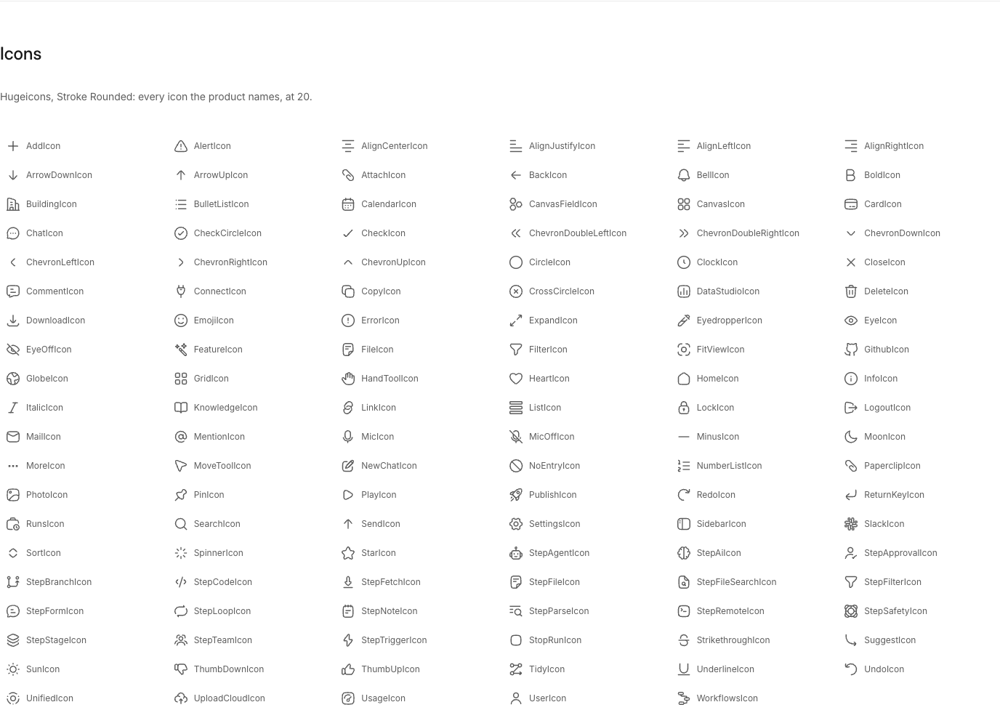
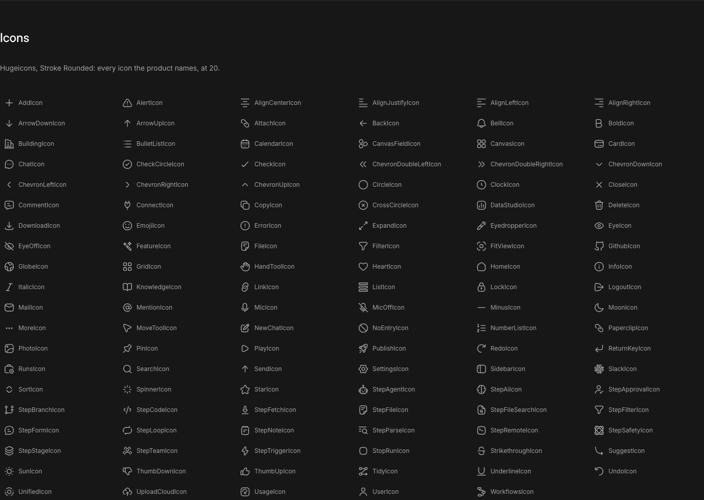

<!-- Copied from the design copy (neutrino-frontend-v3) by scripts/sync.mjs. Edit it there, then run `npm run sync`. -->

# Icons

| | |
|---|---|
| Figma | [Icons](https://www.figma.com/design/Ao3YVgFYdQIF0znq2ToqVl?node-id=41-136) page |
| Status | Decided 14 Oct 2026: Hugeicons, Stroke Rounded |
| In code | [`src/components/ui/icons.tsx`](../../src/components/ui/icons.tsx) |

## Light and dark

**Light**



**Dark**



Status: decided 14 Oct 2026 (`../DECISIONS.md`): Hugeicons, Stroke Rounded. Page written 23 Oct 2026 from that decision and `components/ui/icons.tsx`.

Figma: the Icons page (41:136) of https://www.figma.com/design/Ao3YVgFYdQIF0znq2ToqVl.

## Rules

1. Every icon is Hugeicons, Stroke Rounded, from the free MIT set (`@hugeicons/core-free-icons`, drawn by `@hugeicons/react`).
2. Icons come only through `components/ui/icons.tsx`, with one name per use (`SearchIcon`, `CloseIcon`, `ChevronDownIcon` ...). To change an icon, change its one line there and every screen follows.
3. Never lucide, never remix, never the AI sparkle (Nitesh). Unified is an atom, not a sparkle.
4. The stroke is 1.75 on Hugeicons' 24 grid, so a 16 icon still draws about 1.2px. An icon is 16 unless its component's page names another size.
5. An icon takes its colour from the icon tokens (`text-icon-sub-600`, `text-icon-soft-400`, `text-icon-strong-950` ...), never a hex.
6. Icons are decoration (`aria-hidden`): the button or link around one carries its name.

## The one exception (24 Oct 2026)

The Status Badge's five marks are filled, as the Figma's Status Badge [1.1] draws them: a disc with a tick, a triangle with "!", a disc with "!", a disc with "i", a disc with a slash. Nitesh asked for the badge to match exactly, icons included, so these five are the Figma's own vectors on its 16 grid (`solid()` in `components/ui/icons.tsx`), not Hugeicons. Every other icon follows the rules above.

## Where the product stands

The chat home, the rail, the design system's components and the Workflow Studio use these icons. Older product screens still use lucide; they move to these when they are rebuilt.

## The set

140 icons, each a name in `src/components/ui/icons.tsx` for the Hugeicons glyph it draws.

```tsx
import { SearchIcon } from "@/components/ui/icons";

<SearchIcon size={16} className="text-icon-sub-600" />
```

| Name | Hugeicons glyph |
|---|---|
| `NewChatIcon` | PencilEdit02Icon |
| `UnifiedIcon` | Atom01Icon |
| `KnowledgeIcon` | BookOpen01Icon |
| `DataStudioIcon` | Analytics01Icon |
| `WorkflowsIcon` | WorkflowSquare03Icon |
| `CanvasIcon` | DashboardSquare01Icon |
| `ChatIcon` | BubbleChatIcon |
| `SidebarIcon` | SidebarLeftIcon |
| `SearchIcon` | Search01Icon |
| `AttachIcon` | Attachment01Icon |
| `AddIcon` | PlusSignIcon |
| `PhotoIcon` | Image01Icon |
| `FileIcon` | File01Icon |
| `MicIcon` | Mic01Icon |
| `MicOffIcon` | MicOff01Icon |
| `SendIcon` | ArrowUp02Icon |
| `ConnectIcon` | Plug01Icon |
| `CloseIcon` | Cancel01Icon |
| `ExpandIcon` | ArrowExpand01Icon |
| `ChevronLeftIcon` | ArrowLeft01Icon |
| `BackIcon` | ArrowLeft02Icon |
| `ChevronRightIcon` | ArrowRight01Icon |
| `ChevronDownIcon` | ArrowDown01Icon |
| `ChevronDoubleLeftIcon` | ArrowLeftDoubleIcon |
| `ChevronDoubleRightIcon` | ArrowRightDoubleIcon |
| `MoonIcon` | Moon02Icon |
| `ListIcon` | ListViewIcon |
| `CopyIcon` | Copy01Icon |
| `CheckIcon` | Tick02Icon |
| `InfoIcon` | InformationCircleIcon |
| `CardIcon` | CreditCardIcon |
| `EyeIcon` | ViewIcon |
| `EyeOffIcon` | ViewOffSlashIcon |
| `EmojiIcon` | SmileIcon |
| `SlackIcon` | SlackGlyph |
| `GithubIcon` | GithubGlyph |
| `UserIcon` | UserGlyph |
| `MailIcon` | Mail01Icon |
| `LockIcon` | SquareLock02Icon |
| `CalendarIcon` | Calendar03Icon |
| `HomeIcon` | Home01Icon |
| `GridIcon` | GridViewIcon |
| `StarIcon` | StarGlyph |
| `PinIcon` | PinGlyph |
| `DeleteIcon` | Delete02Icon |
| `BellIcon` | Notification01Icon |
| `SunIcon` | Sun03Icon |
| `CheckCircleIcon` | CheckmarkCircle02Icon |
| `AlertIcon` | Alert02Icon |
| `ErrorIcon` | AlertCircleIcon |
| `NoEntryIcon` | UnavailableIcon |
| `CrossCircleIcon` | CancelCircleIcon |
| `CircleIcon` | CircleGlyph |
| `MinusIcon` | MinusSignIcon |
| `SortIcon` | UnfoldMoreIcon |
| `ChevronUpIcon` | ArrowUp01Icon |
| `SettingsIcon` | Settings02Icon |
| `FeatureIcon` | MagicWand01Icon |
| `MoreIcon` | MoreHorizontalIcon |
| `FilterIcon` | FilterGlyph |
| `SlidersIcon` | FilterVerticalIcon |
| `ArrowUpIcon` | ArrowUp02Icon |
| `ArrowDownIcon` | ArrowDown02Icon |
| `PaperclipIcon` | Attachment01Icon |
| `DownloadIcon` | Download01Icon |
| `CommentIcon` | Comment01Icon |
| `ClockIcon` | Clock01Icon |
| `UploadCloudIcon` | CloudUploadIcon |
| `SpinnerIcon` | Loading03Icon |
| `HeartIcon` | FavouriteIcon |
| `EyedropperIcon` | ColorPickerIcon |
| `BoldIcon` | TextBoldIcon |
| `ItalicIcon` | TextItalicIcon |
| `UnderlineIcon` | TextUnderlineIcon |
| `StrikethroughIcon` | TextStrikethroughIcon |
| `AlignLeftIcon` | TextAlignLeftIcon |
| `AlignCenterIcon` | TextAlignCenterIcon |
| `AlignRightIcon` | TextAlignRightIcon |
| `AlignJustifyIcon` | TextAlignJustifyLeftIcon |
| `LinkIcon` | Link01Icon |
| `MentionIcon` | AtIcon |
| `BulletListIcon` | LeftToRightListBulletIcon |
| `NumberListIcon` | LeftToRightListNumberIcon |
| `GlobeIcon` | GlobalIcon |
| `BuildingIcon` | Building03Icon |
| `ReturnKeyIcon` | CornerDownLeftIcon |
| `LogoutIcon` | Logout01Icon |
| `OverviewIcon` | DashboardSquare02Icon |
| `IntegrationsIcon` | Plug01Icon |
| `AgentStudioIcon` | RoboticIcon |
| `ProvidersIcon` | AiChipIcon |
| `KeyIcon` | Key01Icon |
| `RoutingIcon` | Route01Icon |
| `PrivacyIcon` | SecurityCheckIcon |
| `MembersIcon` | UserMultipleIcon |
| `InvitationsIcon` | Mail01Icon |
| `TenantUsersIcon` | UserAccountIcon |
| `AdminsIcon` | UserShield01Icon |
| `SpendIcon` | Dollar01Icon |
| `ActivityIcon` | Activity01Icon |
| `AppearanceIcon` | PaintBoardIcon |
| `ResponsesIcon` | SlidersHorizontalIcon |
| `MemoryIcon` | BrainIcon |
| `HelpIcon` | HelpCircleIcon |
| `SwitchIcon` | UnfoldMoreIcon |
| `OpenPageIcon` | ArrowUpRight01Icon |
| `RowActionsIcon` | MoreVerticalIcon |
| `UsageIcon` | DashboardSpeed01Icon |
| `StepTriggerIcon` | FlashIcon |
| `StepAgentIcon` | RoboticIcon |
| `StepAiIcon` | AiBrain01Icon |
| `StepBranchIcon` | GitBranchIcon |
| `StepFilterIcon` | FilterGlyph |
| `StepApprovalIcon` | UserCheck01Icon |
| `StepFormIcon` | Message01Icon |
| `StepRemoteIcon` | ComputerTerminal01Icon |
| `StepTeamIcon` | UserGroupIcon |
| `StepCodeIcon` | SourceCodeIcon |
| `StepParseIcon` | SearchList01Icon |
| `StepNoteIcon` | Note01Icon |
| `StepSafetyIcon` | LifebuoyIcon |
| `StepFetchIcon` | Download04Icon |
| `StepFileSearchIcon` | FileSearchIcon |
| `StepFileIcon` | File01Icon |
| `StepLoopIcon` | RepeatIcon |
| `StepStageIcon` | Layers01Icon |
| `CanvasFieldIcon` | CellsIcon |
| `UndoIcon` | Undo02Icon |
| `RedoIcon` | Redo02Icon |
| `FitViewIcon` | CenterFocusIcon |
| `TidyIcon` | ArrangeIcon |
| `MoveToolIcon` | Cursor02Icon |
| `HandToolIcon` | HandIcon |
| `ThumbUpIcon` | ThumbsUpGlyph |
| `ThumbDownIcon` | ThumbsDownGlyph |
| `StopRunIcon` | StopGlyph |
| `SuggestIcon` | ArrowMoveDownRightIcon |
| `RunsIcon` | WorkHistoryIcon |
| `PlayIcon` | PlayGlyph |
| `PublishIcon` | Rocket01Icon |
