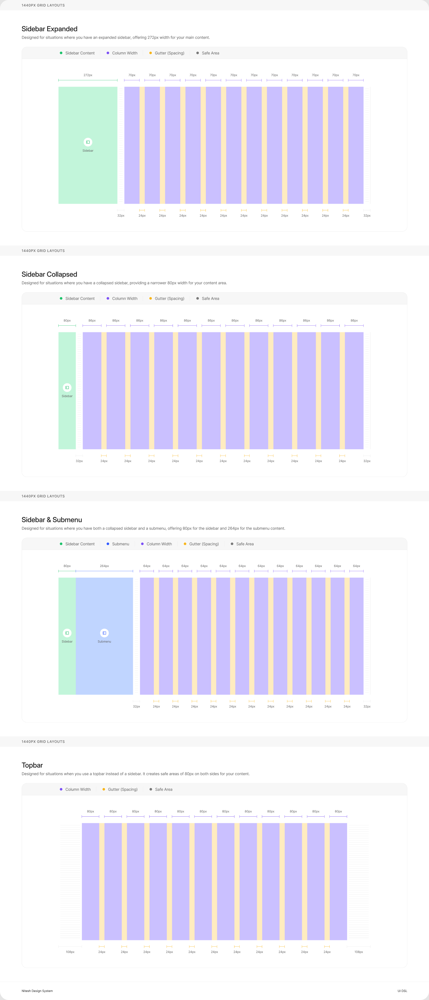

<!-- Copied from the design copy (neutrino-frontend-v3) by scripts/sync.mjs. Edit it there, then run `npm run sync`. -->

# Grid System

| | |
|---|---|
| Figma | [Grid System](https://www.figma.com/design/Ao3YVgFYdQIF0znq2ToqVl?node-id=553-14958) page |
| Status | Written 23 Oct 2026 from the Figma; not in code yet |

Status: written 23 Oct 2026, measured from the Figma's Grid System page. Not in code yet: `styles/` has no grid tokens. Waits for Nitesh's review.

Figma: "Grid System [Overview]" (node 2762:1284) on the Grid System page (553:14958) of https://www.figma.com/design/Ao3YVgFYdQIF0znq2ToqVl. The picture of that frame is `figma-grid-system.png` in this folder.

## The rule

Every layout is drawn on a screen 1440 wide: 12 columns, gutters of 24, a safe area on each side. Pick the layout by what sits at the left of the screen. The columns stretch with the screen; the gutters, the safe areas and the fixed panels keep their size.

## The four layouts (at 1440)

| Layout | Fixed at the left | Safe area, each side | Columns | Column width | Gutter |
|---|---|---|---|---|---|
| Sidebar Expanded | Sidebar 272 | 32 | 12 | 70 | 24 |
| Sidebar Collapsed | Sidebar 80 | 32 | 12 | 86 | 24 |
| Sidebar and Submenu | Sidebar 80, then a Submenu 264 | 32 | 12 | 64 | 24 |
| Topbar | Nothing: a top bar instead of a sidebar | 108 | 12 | 80 | 24 |

Each adds up to 1440. Sidebar Expanded: 272 + 32 + (12 x 70) + (11 x 24) + 32.

## In code (to decide when building)

* The gutter (24) and the safe area (32) are steps on the spacing scale: `--space-24`, `--space-32`. The Topbar's 108 is not on the scale: it is what is left when 12 columns of 80 are centred on 1440.
* In code the columns stretch: 12 equal columns with `--space-24` between them, inside the safe area. The column widths above are what they come to at 1440.

## Open

* The Figma's Topbar text says "safe areas of 80px on both sides", while its measures show columns of 80 and safe areas of 108. Which one is meant?

## The Figma's frame

