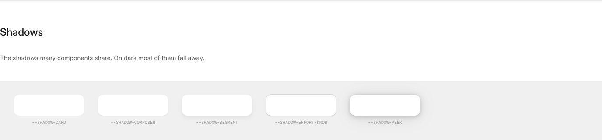
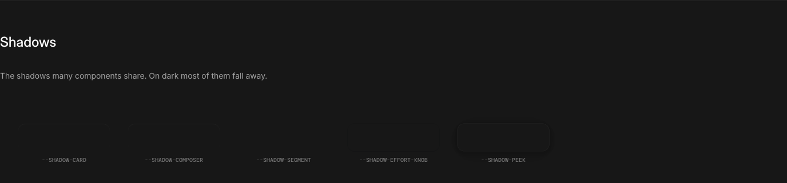

<!-- Copied from the design copy (neutrino-frontend-v3) by scripts/sync.mjs. Edit it there, then run `npm run sync`. -->

# Shadows

| | |
|---|---|
| Figma | [Shadows](https://www.figma.com/design/Ao3YVgFYdQIF0znq2ToqVl?node-id=553-14959) page |
| Status | Draft 18 Oct 2026; the shared ones are in code, the rest come with the components that use them |
| In code | [`src/styles/theme-tokens.css`](../../src/styles/theme-tokens.css) (shared), [`src/styles/sizes`](../../src/styles/sizes) (each component's own), [`tokens/shadows.json`](../../tokens/shadows.json) |

## Light and dark

**Light**

**Dark**

Status: draft, 18 Oct 2026. Read from the Figma's 27 effect styles. Not in code yet: the shadow build comes with the size tokens, before the first component is built.

The rule: like colours, a component never types a shadow. Each Figma effect style becomes one shadow token, named after it. A component page names the token; change the token and every component using it follows.

## Light and dark

* Light: each token is the Figma style, layer for layer.
* Dark: the Figma's own shadow colours go to nothing on dark (`shadow/gray/shadow-4` and `-6` are 0% there), except the 1px ring, which becomes `stroke/soft-200`. So on dark a shadow keeps only its 1px ring, and plain drop shadows disappear. Our dark theme already works this way (Dualite: flat, set apart by fill and a hairline). Proposed: every shadow token follows that rule on dark.

## The tokens

| Figma effect style | Token | Light layers | Used by |
|---|---|---|---|
| regular-shadow/x-small | `--shadow-card` (exists) | 0 1 2 0, `#0A0D14` 3% | Buttons (Stroke), inputs, cards, Checkbox Card, Key Icons, Accordion |
| regular-shadow/medium | `--shadow-regular-medium` | 0 16 32 -12, `#0E121B` 10% | Modal, Alert (Stroke), Date Picker, Color Picker |
| custom-shadows/x-small | `--shadow-custom-x-small` | inset 0 -1 1 -0.5 `#333` 6%; ring 1 `state/faded/lighter`; 0 1 2, 0 2 4 `#333` 4%; 0 4 8 -2 `#333` 6% | |
| custom-shadows/small | `--shadow-custom-small` | six layers (see the Figma) | |
| custom-shadows/medium | `--shadow-custom-medium` | inset 0 -1 1 -0.5 `#333` 6%; ring 1 `state/faded/lighter`; 0 48 48 -24, 0 24 24 -12, 0 12 12 -6, 0 6 6 -3 `#333` 4%; 0 3 3 -1.5 2%; 0 1 1 0.5 4% | Notification Feed, Time Picker example, the floating Drawer |
| custom-shadows/large | `--shadow-custom-large` | nine layers (see the Figma) | |
| card-shadow/large | `--shadow-card-large` | seven layers on `shadow/gray/*` | |
| components/tooltip | `--shadow-tooltip` | inset 0 -1 1 -0.5 `#171717` 6%; ring 1 `stroke/soft-200`; five soft drops `#171717` 2 to 4% | Tooltip (the Figma's styled tooltips) |
| components/toggle/switch | `--shadow-toggle` | 0 2 4 `#0E121B` 3%; 0 6 10 `#0E121B` 6% | Segmented Control (picked segment), Slider (the dot) |
| components/buttons/primary-focus | `--focus-primary` | ring 2 `bg/white-0`, then 4 `primary/alpha-10` | Primary focus ring |
| components/buttons/important-focus | `--focus-neutral` | ring 2 `bg/white-0`, then 4 `state/faded/light` (ours) | Neutral focus ring |
| components/buttons/error-focus | `--focus-error` | ring 2 `bg/white-0`, then 4 `state/error/lighter` (ours) | Error focus ring |
| components/fancy-buttons/neutral, primary, error, stroke | `--shadow-fancy-neutral` (and `-primary`, `-error`, `-stroke`) | a 1px ring and a 0 1 2 drop each | Fancy Button |
| colored-shadows/gray, blue, purple, orange, green, primary | `--shadow-colored-<colour>` | seven soft layers in that colour's `shadow/*` tokens | |
| components/custom-button/Button, (Hover) | `--shadow-custom-button`, `--shadow-custom-button-hover` | five layers; hover a 1px ring | |
| components/custom-input/Input (Default, Hover, Active) | `--shadow-custom-input` (and `-hover`, `-active`) | three or four layers; Active a 1.4px `primary/base` ring | |

Shadows the Figma types in on one component, with no style, become a token named after that component: `--shadow-checkbox`, `--shadow-radio`, `--shadow-switch-knob`, `--shadow-tooltip` (the Tooltip page's two layers). They are listed on their component pages.

## Open

* The Tooltip page's tooltips carry two typed-in layers, while the Figma also has a `components/tooltip` style with eight. Check which one the tooltips should use.
* The `#333333` and `#0E121B` in the shadows are raw colours. In code they become `--palette-black` at the same strength unless Nitesh wants a tinted shadow.
* Component pages written before this page name some shadows their own way (`--shadow-modal`, `--shadow-alert`, `--shadow-popover`, `--shadow-notification-feed` ...). When the shadow build is set up, each points at the token for its Figma style above.

## In code today

| Token | Light | Dark |
|---|---|---|
| `--shadow-card` | `0 1px 2px rgba(10, 13, 20, 0.03)` | `inset 0 1px 0 rgba(255, 255, 255, 0.03)` |
| `--shadow-composer` | `0 1px 2px rgba(10, 13, 20, 0.03), 0 2px 4px rgba(27, 28, 29, 0.04)` | `inset 0 1px 0 rgba(255, 255, 255, 0.03)` |
| `--shadow-segment` | `0 2px 4px rgba(14, 18, 27, 0.03), 0 6px 10px rgba(14, 18, 27, 0.06)` | `0 2px 4px rgba(14, 18, 27, 0.03), 0 6px 10px rgba(14, 18, 27, 0.06)` |
| `--shadow-effort-knob` | `0 0 0 1px rgba(0, 0, 0, 0.1), 0 1px 3px rgba(10, 13, 20, 0.12)` | `0 1px 3px rgba(0, 0, 0, 0.5)` |
| `--shadow-peek` | `0 0 0 0.5px rgba(0, 0, 0, 0.08), 0 4px 40px rgba(0, 0, 0, 0.06), 0 3px 20px rgba(0, 0, 0, 0.08), 0 3px 12px rgba(0, 0, 0, 0.08), 0 2px 8px rgba(0, 0, 0, 0.08), 0 1px 1px rgba(0, 0, 0, 0.08)` | `0 0 0 0.5px rgba(255, 255, 255, 0.08), 0 4px 40px rgba(0, 0, 0, 0.1), 0 3px 20px rgba(0, 0, 0, 0.125), 0 3px 12px rgba(0, 0, 0, 0.125), 0 2px 8px rgba(0, 0, 0, 0.125), 0 1px 1px rgba(0, 0, 0, 0.125)` |
