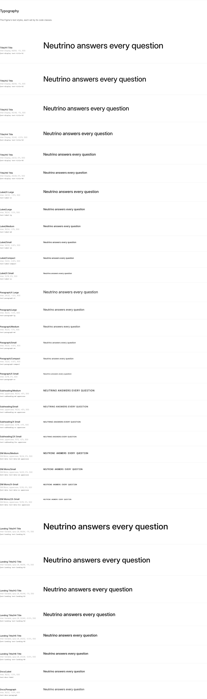
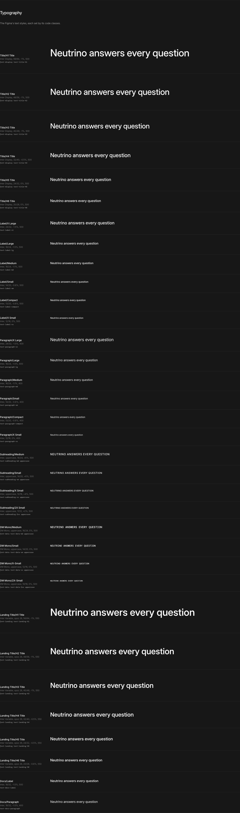

<!-- Copied from the design copy (neutrino-frontend-v3) by scripts/sync.mjs. Edit it there, then run `npm run sync`. -->

# Typography

| | |
|---|---|
| Figma | [Typography](https://www.figma.com/design/Ao3YVgFYdQIF0znq2ToqVl?node-id=553-14957) page |
| Status | Decided 14 Oct 2026; all 34 styles checked against the Figma 18 Oct 2026 |
| In code | [`src/styles/typography-tokens.css`](../../src/styles/typography-tokens.css), [`tokens/typography.json`](../../tokens/typography.json) |

## Light and dark

**Light**

**Dark**

Status: decided 14 Oct 2026 (Inter, the 34 Figma styles). Checked against the Figma on 18 Oct 2026: every style matches in size, line height, letter spacing and weight.

The values live in `styles/typography-tokens.css`. This page says which code class is which Figma style, so a page or a component never guesses. The research behind the faces is in `8Bit Product/design-system/typography/`, next to this repo.

## Rules

1. Every word on screen uses one of the classes below. Never set a font size, line height, letter spacing or weight by hand.
2. Take the style from the Figma frame (`get_design_context` or the text node's `textStyleId`), then use its class from the table. Never pick by eye.
3. Title styles go with `font-display`; Landing styles with `font-landing`; DM Mono styles with `font-data`. Everything else is `font-sans`, the default.
4. Subheading and DM Mono styles are uppercase in the Figma: add `uppercase`.
5. No 600 or 700 on words. Never Hanken Grotesk. Tiempos Text only for a few big headings in the playground (`heading-serif`).

## Figma style to code class

| Figma style | Face | Size / line height | Letter spacing | Weight | Code |
|---|---|---|---|---|---|
| Title/H1 Title | Inter Display | 56/64 | -1% | 500 | `font-display text-title-h1` |
| Title/H2 Title | Inter Display | 48/56 | -1% | 500 | `font-display text-title-h2` |
| Title/H3 Title | Inter Display | 40/48 | -1% | 500 | `font-display text-title-h3` |
| Title/H4 Title | Inter Display | 32/40 | -0.5% | 500 | `font-display text-title-h4` |
| Title/H5 Title | Inter Display | 24/32 | 0% | 500 | `font-display text-title-h5` |
| Title/H6 Title | Inter Display | 20/28 | 0% | 500 | `font-display text-title-h6` |
| Label/X Large | Inter | 24/32 | -1.5% | 500 | `text-label-xl` |
| Label/Large | Inter | 18/24 | -1.5% | 500 | `text-label-lg` |
| Label/Medium | Inter | 16/24 | -1.1% | 500 | `text-label-md` |
| Label/Small | Inter | 14/20 | -0.6% | 500 | `text-label-sm` |
| Label/Compact | Inter | 13/20 | -0.6% | 500 | `text-label-compact` |
| Label/X Small | Inter | 12/16 | 0% | 500 | `text-label-xs` |
| Paragraph/X Large | Inter | 24/32 | -1.5% | 400 | `text-paragraph-xl` |
| Paragraph/Large | Inter | 18/24 | -1.5% | 400 | `text-paragraph-lg` |
| Paragraph/Medium | Inter | 16/24 | -1.1% | 400 | `text-paragraph-md` |
| Paragraph/Small | Inter | 14/20 | -0.6% | 400 | `text-paragraph-sm` |
| Paragraph/Compact | Inter | 13/20 | -0.6% | 400 | `text-paragraph-compact` |
| Paragraph/X Small | Inter | 12/16 | 0% | 400 | `text-paragraph-xs` |
| Subheading/Medium | Inter, uppercase | 16/24 | +6% | 500 | `text-subheading-md uppercase` |
| Subheading/Small | Inter, uppercase | 14/20 | +6% | 500 | `text-subheading-sm uppercase` |
| Subheading/X Small | Inter, uppercase | 12/16 | +4% | 500 | `text-subheading-xs uppercase` |
| Subheading/2X Small | Inter, uppercase | 11/12 | +2% | 500 | `text-subheading-2xs uppercase` |
| DM Mono/Medium | DM Mono, uppercase | 16/24 | 0% | 500 | `font-data text-data-md uppercase` |
| DM Mono/Small | DM Mono, uppercase | 14/20 | 0% | 500 | `font-data text-data-sm uppercase` |
| DM Mono/X-Small | DM Mono, uppercase | 12/16 | 0% | 500 | `font-data text-data-xs uppercase` |
| DM Mono/2X-Small | DM Mono, uppercase | 10/16 | 0% | 500 | `font-data text-data-2xs uppercase` |
| Landing Title/H1 Title | Inter Variable, opsz 26 | 56/64 | -1% | 550 | `font-landing text-landing-h1` |
| Landing Title/H2 Title | Inter Variable, opsz 26 | 48/56 | -1% | 550 | `font-landing text-landing-h2` |
| Landing Title/H3 Title | Inter Variable, opsz 26 | 40/48 | -1% | 550 | `font-landing text-landing-h3` |
| Landing Title/H4 Title | Inter Variable, opsz 26 | 32/40 | -0.5% | 550 | `font-landing text-landing-h4` |
| Landing Title/H5 Title | Inter Variable, opsz 26 | 24/32 | -0.5% | 550 | `font-landing text-landing-h5` |
| Landing Title/H6 Title | Inter Variable, opsz 26 | 20/28 | -0.6% | 550 | `font-landing text-landing-h6` |
| Docs/Label | Inter | 18/32 | -1.5% | 500 | `text-docs-label` |
| Docs/Paragraph | Inter | 18/32 | -1.5% | 400 | `text-docs-paragraph` |

The Figma's Landing Title styles are named "Medium" but set to weight 550 on the variable axis (checked on its text, 18 Oct 2026); code matches the 550.

## Outside the Figma styles

Product settings Nitesh uses in his AI screens without a Figma style, kept in the same file: `text-chat` (15/24), `text-chat-input`, `text-greeting`, `text-badge-plan`, `text-wordmark`, `text-nav`, `text-nav-label`. Use them only where their comment in `styles/typography-tokens.css` says.

## Checking

To check again: read the Figma's local text styles with `use_figma` (`figma.getLocalTextStylesAsync()`) and compare each with its token in `styles/typography-tokens.css`. On 18 Oct 2026 all 34 matched.

## Faces

Inter (one variable file, `src/app/fonts/InterVariable.woff2`) for 90% of the product, and DM Mono Medium for machine data (`src/app/fonts/DMMono-Medium.woff2`). Both are free (SIL Open Font License). The brand serif, Tiempos Text, is for a few big headings in the design playground only, until 8bit buys its licence: it is never in this repo.
