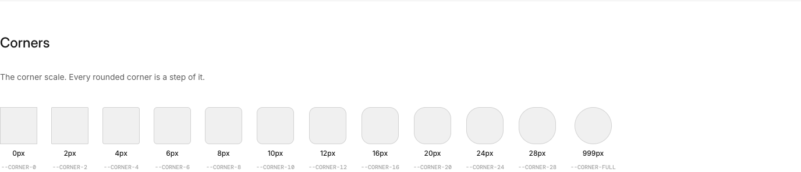
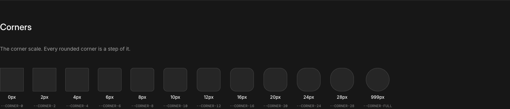
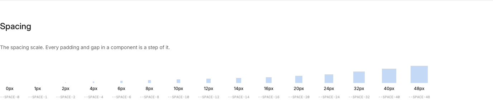
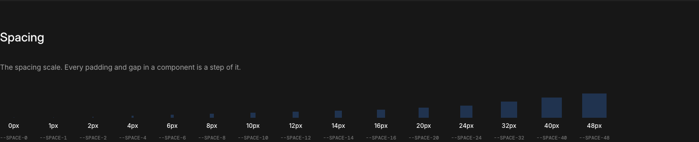

<!-- Copied from the design copy (neutrino-frontend-v3) by scripts/sync.mjs. Edit it there, then run `npm run sync`. -->

# Corner Radius

| | |
|---|---|
| Figma | [Corner Radius](https://www.figma.com/design/Ao3YVgFYdQIF0znq2ToqVl?node-id=553-14961) page |
| Status | Decided 18 Oct 2026; in code 19 Oct 2026 |
| In code | [`src/styles/size-tokens.css`](../../src/styles/size-tokens.css), [`src/styles/sizes`](../../src/styles/sizes), [`tokens/radius.json`](../../tokens/radius.json), [`tokens/spacing.json`](../../tokens/spacing.json) |

## Light and dark

### Corners

**Light**

**Dark**

### Spacing

**Light**

**Dark**

Status: decided by Nitesh 18 Oct 2026 (the rule below); in code 19 Oct 2026.

Figma: the Corner Radius page (553:14961) of https://www.figma.com/design/Ao3YVgFYdQIF0znq2ToqVl, and the Figma's variable collections 05-Spacing and 04-Radius.

## The rule (Nitesh, 18 Oct 2026)

Nitesh reads the component pages before he can see them, and changes padding, spacing, heights and corners once he does. So no size is typed into a component.

1. Every number on a component page (a height, a padding, a gap, a corner, an icon size) becomes a size token in one place.
2. Those tokens point at the Figma's two scales: spacing (05-Spacing: 0, 2, 4, 6, 8, 10, 12, 14, 16, 24, 32, 40, 48) and corners (04-Radius: 0, 2, 4, 6, 8, 10, 12, 16, 20, 24, 28, full).
3. Each component reads only its own tokens (for example `button/md/height`, `button/md/padding-x`). Change one value and that component changes everywhere; change a step on a scale and everything on that step follows.

## In code

* `styles/size-tokens.css`: the two scales, as `--space-*` and `--corner-*`, and their Tailwind names: `gap-space-12`, `px-space-16`, `rounded-corner-10`. The Button's own sizes are in this file too.
* `styles/sizes/`: one file per component (`badge.css`, `modal.css` ...), every size pointing at a step of the scales.
* The code's spacing scale has two steps the Figma's does not: 1 (one-pixel lines) and 20.

## Corners

| Token | Size | Tailwind |
|---|---|---|
| `--corner-0` | 0px | `rounded-corner-0` |
| `--corner-2` | 2px | `rounded-corner-2` |
| `--corner-4` | 4px | `rounded-corner-4` |
| `--corner-6` | 6px | `rounded-corner-6` |
| `--corner-8` | 8px | `rounded-corner-8` |
| `--corner-10` | 10px | `rounded-corner-10` |
| `--corner-12` | 12px | `rounded-corner-12` |
| `--corner-16` | 16px | `rounded-corner-16` |
| `--corner-20` | 20px | `rounded-corner-20` |
| `--corner-24` | 24px | `rounded-corner-24` |
| `--corner-28` | 28px | `rounded-corner-28` |
| `--corner-full` | 999px | `rounded-corner-full` |

## Spacing

| Token | Size | Tailwind |
|---|---|---|
| `--space-0` | 0px | `gap-space-0`, `p-space-0` ... |
| `--space-1` | 1px | `gap-space-1`, `p-space-1` ... |
| `--space-2` | 2px | `gap-space-2`, `p-space-2` ... |
| `--space-4` | 4px | `gap-space-4`, `p-space-4` ... |
| `--space-6` | 6px | `gap-space-6`, `p-space-6` ... |
| `--space-8` | 8px | `gap-space-8`, `p-space-8` ... |
| `--space-10` | 10px | `gap-space-10`, `p-space-10` ... |
| `--space-12` | 12px | `gap-space-12`, `p-space-12` ... |
| `--space-14` | 14px | `gap-space-14`, `p-space-14` ... |
| `--space-16` | 16px | `gap-space-16`, `p-space-16` ... |
| `--space-20` | 20px | `gap-space-20`, `p-space-20` ... |
| `--space-24` | 24px | `gap-space-24`, `p-space-24` ... |
| `--space-32` | 32px | `gap-space-32`, `p-space-32` ... |
| `--space-40` | 40px | `gap-space-40`, `p-space-40` ... |
| `--space-48` | 48px | `gap-space-48`, `p-space-48` ... |
