<!-- Copied from the design copy (neutrino-frontend-v3) by scripts/sync.mjs. Edit it there, then run `npm run sync`. -->

# Brand

Figma: [Brand](https://www.figma.com/design/Ao3YVgFYdQIF0znq2ToqVl?node-id=2771-1469) page.

The 8bit and Neutrino logos the product uses (from its `public/` folder). The dark files are for dark screens; on GitHub's light page a light-on-dark logo can look empty.

| File | Picture |
|---|---|
| `8bit-logo-light.svg` | 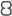 |
| `8bit-logo.svg` |  |
| `8bit-sharp-logo.png` | 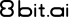 |
| `8bitlogo-dark.png` | 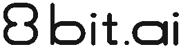 |
| `8bitlogo-dark.svg` |  |
| `8bitlogo.png` |  |
| `8bitlogo.svg` | 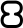 |
| `neutrino-lockup-dark.png` |  |
| `neutrino-lockup-dark.svg` |  |
| `neutrino-lockup-light.svg` | 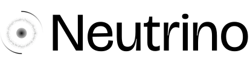 |
| `neutrino-mark-compact-dark.svg` |  |
| `neutrino-mark-compact-light.svg` | 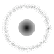 |
| `neutrino-mark-dark.svg` |  |
| `neutrino-mark-light.svg` | 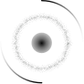 |
