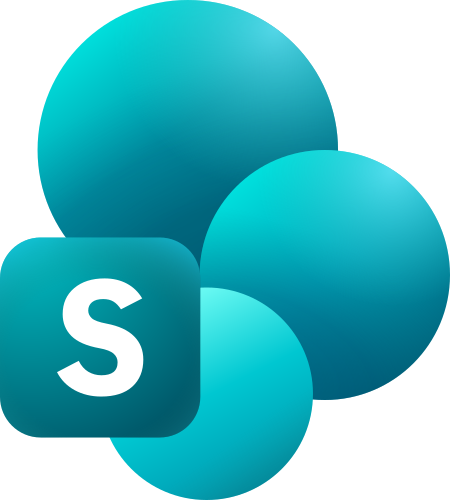

<!-- Copied from the design copy (neutrino-frontend-v3) by scripts/sync.mjs. Edit it there, then run `npm run sync`. -->

# Tool logos

Not a Figma page: the logos of the tools Neutrino connects to, as the product uses them (`public/brand/`).

| File | Picture |
|---|---|
| `8bit-ai-logo.svg` |  |
| `azure.svg` |  |
| `azureai.svg` |  |
| `bedrock.svg` |  |
| `bigquery.svg` |  |
| `claude.svg` |  |
| `confluence.svg` |  |
| `csv.svg` |  |
| `ctrls-dark.svg` |  |
| `ctrls.svg` |  |
| `databricks.svg` |  |
| `elasticsearch.svg` |  |
| `excel.svg` |  |
| `gemini.svg` |  |
| `github.svg` |  |
| `googledrive.svg` |  |
| `hashicorp_vault.svg` |  |
| `inaxus.png` |  |
| `jira.svg` |  |
| `kubernetes.svg` |  |
| `loki.svg` |  |
| `markdown.svg` |  |
| `microsoft.svg` |  |
| `minio.svg` |  |
| `mongodb.svg` |  |
| `mysql.svg` |  |
| `notion.svg` |  |
| `office365.svg` |  |
| `openai.svg` |  |
| `openrouter.svg` |  |
| `oracle.svg` |  |
| `outlook.svg` |  |
| `pdf.svg` |  |
| `postgres.svg` |  |
| `powerpoint.svg` |  |
| `razorpay_payroll-dark.svg` |  |
| `razorpay_payroll.svg` |  |
| `redshift.svg` |  |
| `sap.svg` |  |
| `sharepoint.svg` |  |
| `signoz.svg` |  |
| `slack.svg` |  |
| `smtp-dark.svg` |  |
| `smtp.svg` |  |
| `snowflake.svg` |  |
| `tally.svg` |  |
| `teams.svg` |  |
| `teradata.svg` |  |
| `trino.svg` |  |
| `word.svg` |  |
| `zabbix-tile.svg` |  |
| `zabbix.svg` |  |
| `zoho_people.svg` |  |
