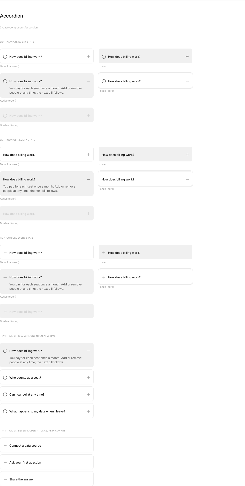
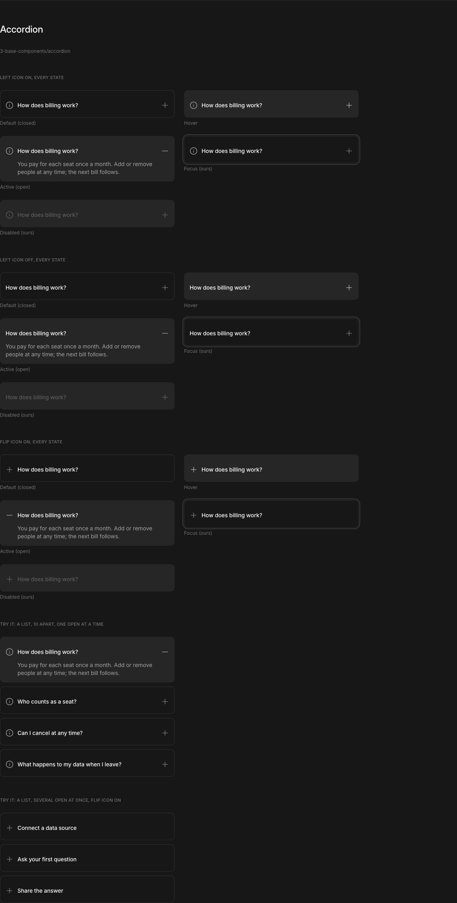

<!-- Copied from the design copy (neutrino-frontend-v3) by scripts/sync.mjs. Edit it there, then run `npm run sync`. -->

# Accordion

| | |
|---|---|
| Figma | [Accordion](https://www.figma.com/design/Ao3YVgFYdQIF0znq2ToqVl?node-id=210-4006) page |
| Status | Written 18 Oct 2026; coded 19 Oct 2026 |
| Code | [`src/components/ds/accordion.tsx`](../../src/components/ds/accordion.tsx) |
| Sizes | [`src/styles/sizes/accordion.css`](../../src/styles/sizes/accordion.css) |
| Demo | [`src/gallery/sections/accordion.tsx`](../../src/gallery/sections/accordion.tsx) |

## Light and dark

**Light**



**Dark**



## Use it

```tsx
import { Accordion, AccordionItem } from "@/components/ds/accordion";
```

Every size and state, working: run `npm run dev` and open [localhost:3100/#accordion](http://localhost:3100/#accordion).

## Spec

Status: written 18 Oct 2026, measured from the Figma. Its proposals stand until Nitesh reviews every component together on one canvas.

Figma: "Accordion [1.1]" (node 210:4022) on the Accordion page (210:4006) of https://www.figma.com/design/Ao3YVgFYdQIF0znq2ToqVl.

The rule for this page: shape, size, spacing, type and states come exactly from the Figma. Colours are the tokens the Figma frame uses, with our palette's values (`../colors/colors.md`). Every number here becomes a size token, so it can be changed later in one place (`../README.md`, "Sizes work the same way").

### Rules

1. A title a person clicks to show or hide the words under it (FAQs, help, settings explained) is this Accordion. Never build a show and hide row by hand.
2. Use only the states on this page.
3. Something missing? Stop and ask Nitesh, then add it here first.

### What it has

| Property | Options |
|---|---|
| State | Default (closed), Hover (closed, under the pointer), Active (open) |
| Left icon | On or off: an icon before the title |
| Flip Icon | Off: the plus or minus on the right. On: the plus or minus on the left, in place of the left icon |
| Words | A title; when open, a description under it |

### Layout

| Part | Value |
|---|---|
| Width | Its container's width (the Figma draws it 440) |
| Height, closed | 48 |
| Height, open | Grows with the description (94 with two lines) |
| Padding | 14 on every side |
| Gap | 10 between the icons and the words |
| Corner | 10 |
| Edge | 1px, inside, in Default only |
| Icons | 20 x 20: the left icon, and the plus (closed) or minus (open) |
| Title | `text-label-sm` (14/20, 500) |
| Description | `text-paragraph-sm` (14/20, 400), 6 below the title |

* The icons stay at the top, on the title's line, when the accordion opens.
* The words fill the space between the icons and wrap.
* Accordions in a list sit 10 apart (the Figma's Examples).

### Colours

| State | Fill | Edge | Shadow | Title | Description | Left icon | Plus or minus |
|---|---|---|---|---|---|---|---|
| Default | `bg/white-0` | `stroke/soft-200` | `--shadow-card` | `text/strong-950` | | `icon/sub-600` | `icon/soft-400` |
| Hover | `bg/weak-50` | none | none | `text/strong-950` | | `icon/sub-600` | `icon/sub-600` |
| Active (open) | `bg/weak-50` | none | none | `text/strong-950` | `text/sub-600` | `icon/sub-600` | `icon/sub-600` |

An open accordion keeps the grey fill, so it looks the same with or without the pointer on it.

Every colour is the Figma frame's own token; nothing moved.

### Open

* The Figma has no keyboard focus look. Proposed: the Neutral focus ring around the whole accordion (2px `bg/white-0`, then 4px `state/faded/light`, outside, no blur), following its corner.
* The Figma has no Disabled look. Ask Nitesh if one is needed. If so, proposed: the Hover fill with no edge, the title in `text/disabled-300` and the icons in `icon/disabled-300`, like the Text Input's Disabled.
* The Figma's Blocks frames also draw accordions by hand in other shapes: several rows in one card with lines between them, a down arrow instead of the plus, a numbered list of steps. None of them is a component. Ask Nitesh whether a grouped style (one card, rows split by lines) should become a second type.

### In code (to decide when building)

* Today's `components/ui/accordion.tsx` is the stock shadcn one (Radix Accordion); nothing uses it yet. The Accordion replaces how it looks; its name can stay.
* `components/ui/collapsible.tsx` (Radix Collapsible) is used in 2 files (`components/chat/refined/context-ring.tsx`, `components/new-assistant-message.tsx`) for show and hide that is not an Accordion; leave those as they are.
* The title is the button that opens and closes; the plus turns into the minus when open.
