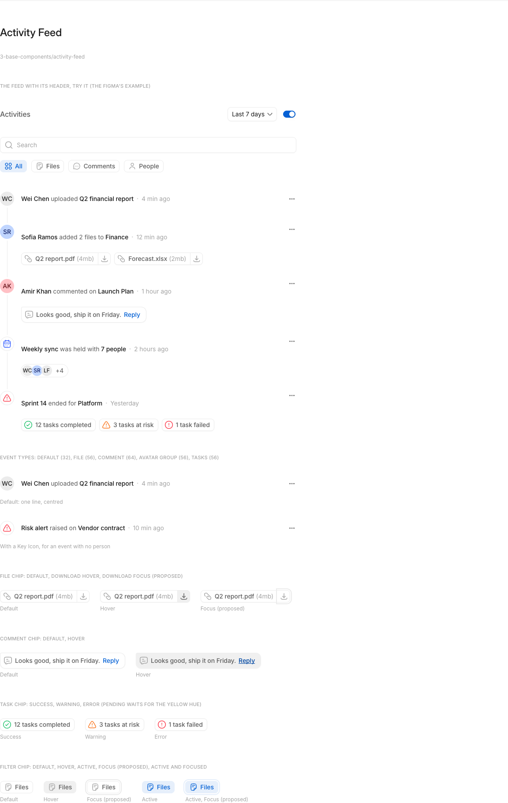
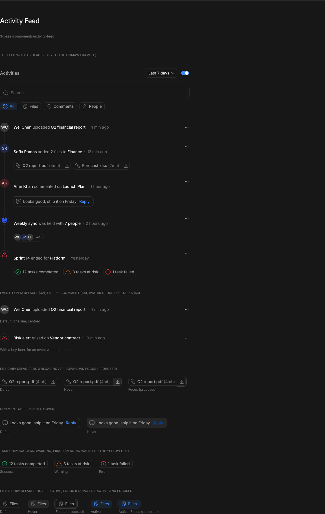

<!-- Copied from the design copy (neutrino-frontend-v3) by scripts/sync.mjs. Edit it there, then run `npm run sync`. -->

# Activity Feed

| | |
|---|---|
| Figma | [Activity Feed](https://www.figma.com/design/Ao3YVgFYdQIF0znq2ToqVl?node-id=164611-26451) page |
| Status | Written 18 Oct 2026; coded 19 Oct 2026 |
| Code | [`src/components/ds/activity-feed.tsx`](../../src/components/ds/activity-feed.tsx) |
| Sizes | [`src/styles/sizes/activity-feed.css`](../../src/styles/sizes/activity-feed.css) |
| Demo | [`src/gallery/sections/activity-feed.tsx`](../../src/gallery/sections/activity-feed.tsx) |

## Light and dark

**Light**



**Dark**



## Use it

```tsx
import {
  ActivityFeed,
  ActivityAction,
  ActivityEvent,
  ActivityFileChip,
  ActivityCommentChip,
  ActivityTaskChip,
  ActivityFilterChip,
} from "@/components/ds/activity-feed";
```

Every size and state, working: run `npm run dev` and open [localhost:3100/#activity-feed](http://localhost:3100/#activity-feed).

## Spec

Status: written 18 Oct 2026, measured from the Figma. Its proposals stand until Nitesh reviews every component together on one canvas.

Figma, on the Activity Feed page (164611:26451) of https://www.figma.com/design/Ao3YVgFYdQIF0znq2ToqVl:

* "Activity Feed [1.1]" (node 166035:46833): one event in the feed.
* "Activity Feed File Items [1.1]" (165967:4028), "Activity Feed Comment Items [1.1]" (166017:612), "Activity Feed Task Status Items [1.1]" (166035:47290): the chips under an event.
* "Activity Feed Selected Filter [1.1]" (165967:3881): the filter chips above the feed.
* The Examples frame (165978:43503) puts them together: a header, a search, the filters, and the feed with a line down its side.

The rule for this page: shape, size, spacing, type and states come exactly from the Figma. Colours are the tokens the Figma frame uses, with our palette's values (`../colors/colors.md`). Every number here becomes a size token, so it can be changed later in one place (`../README.md`, "Sizes work the same way").

### Rules

1. A record of what happened in one place, newest first (uploads, comments, meetings, alerts): Activity Feed. A person's own notifications to act on: Notification Feed (`notification-feed.md`).
2. Use only the event types and chips on this page. Something missing? Stop and ask Nitesh, then add it here first.

### An event

#### What it has

| Property | Options |
|---|---|
| Type | Default (one line), File, Comment, Avatar Group, Tasks |
| Picture | A person's Avatar, or a Key Icon for events with no person (a meeting, a risk alert, a sprint) |
| More button | Always on the right |

#### Layout

| Part | Value |
|---|---|
| Event | The feed's width (640 in the Figma), no padding, no fill |
| Row | The picture, the words, the more button, 16px apart. Default centres them on the line; the other types sit at the top |
| Picture | A 32 Avatar (`avatar.md`), or a 32 Key Icon, Small, Stroke style, in a colour (`key-components.md`). Either has a 4px ring in `stroke/white-0` outside it, which cuts the feed's line |
| Words | A column with an 8px gap: the sentence line, then the chips |
| Sentence line | The sentence, a dot (・) and the time, 2px apart |
| More button | A Compact Button, Ghost, Medium (20), fully round, `icon/sub-600` |

| Type | What sits under the sentence | Height in the Figma |
|---|---|---|
| Default | nothing | 32 |
| File | File chips in a row, 8px apart | 56 |
| Comment | A Comment chip | 64 |
| Avatar Group | A Compact Avatar Group, Stroke, 24 (`avatar.md`) | 56 |
| Tasks | Task chips in a row, 8px apart | 56 |

#### Type and colours

| Part | Type | Colour |
|---|---|---|
| Who ("Wei Chen") and what ("Q2 financial report") | `text-label-sm` (14/20, 500) | `text/strong-950` |
| The action ("uploaded") | `text-paragraph-sm` (14/20, 400) | `text/sub-600` |
| The dot (・) | `text-label-sm`, 14 wide | `text/disabled-300` |
| Time ("4 min ago") | `text-paragraph-sm` | `text/soft-400` |

Key Icon colours in the examples: Blue (`state/information`), Red (`state/error`), Purple (`state/feature`, not in the palette yet).

### The feed

From the Figma's example:

* Events stack with a 32px gap.
* A 1px `stroke/soft-200` line runs down behind the pictures, through their centres (16 in from the left). Each picture's 4px ring breaks it.
* Above the feed, 32 away: a title row ("Activities" in `text-label-md` (16/24, 500), `text/sub-600`, with a picker and a Switch on the right), then 20 below it the search (Text Input, Search, Small (36): `text-input.md`), then 16 below that the filter chips in a row, 10px apart.

### The chips

#### File chip

| Part | Value |
|---|---|
| Chip | 28 tall, width follows the name, corner 8, `bg/white-0`, a 1px `stroke/soft-200` edge outside, `--shadow-card` |
| Name part | Padding 4 top and bottom, 6 left, 10 right, gap 6: a 20 x 20 paperclip icon, then the name and its size "(4mb)", 4px apart; a 1px `stroke/soft-200` line on its right |
| Download button | 28 x 28, padding 5, an 18 x 18 download icon |

| Part | Type | Default | Hover |
|---|---|---|---|
| Name | `text-label-sm` (14/20, 500) | `text/sub-600` | the same |
| Size | `text-paragraph-sm` (14/20, 400) | `text/soft-400` | the same |
| Paperclip icon | | `icon/soft-400` | the same |
| Download button | | `bg/white-0`, `icon/soft-400` | `bg/weak-50`, `icon/sub-600` |

Hover is on the download button only.

#### Comment chip

| Part | Value |
|---|---|
| Chip | 36 tall, padding 8 top and bottom, 8 left, 14 right, gap 6, corners 4 top left and 12 the others (a speech bubble) |
| Inside | A 20 x 20 speech icon and the comment, 6px apart, then "Reply" (Link Button, Primary, Medium (20)) |

| Part | Type | Default | Hover |
|---|---|---|---|
| Chip | | `bg/white-0`, a 1px `stroke/soft-200` edge inside, `--shadow-card` | `bg/weak-50`, no edge, `--shadow-card` |
| Comment | `text-label-sm` | `text/sub-600` | the same |
| Speech icon | | `icon/soft-400` | the same |
| "Reply" | `text-label-sm` | `primary/base`, no underline | `primary/dark`, underlined |

#### Task chip

| Part | Value |
|---|---|
| Chip | 28 tall, padding 4 top and bottom, 6 left, 10 right, gap 6, corner 8, `bg/white-0`, a 1px `stroke/soft-200` edge outside, `--shadow-card` |
| Inside | A 20 x 20 status icon and the words ("12 tasks completed") in `text-label-sm`, `text/sub-600` |

| Status | Icon | Colour |
|---|---|---|
| Success | A ticked circle | `state/success/base` |
| Warning | A triangle | `state/warning/base` |
| Pending | A clock | `state/away/base` (Yellow, not in the palette yet) |
| Error | An alert mark in a circle | `state/error/base` |

#### Filter chip

| Part | Value |
|---|---|
| Chip | 28 tall, padding 4 top and bottom, 10 sides, gap 6, corner 8 |
| Inside | An 18 x 18 icon and the word in `text-label-sm` (14/20, 500) |

| State | Fill | Edge | Word | Icon |
|---|---|---|---|---|
| Default | `bg/white-0` | 1px `stroke/soft-200`, inside | `text/sub-600` | `icon/soft-400` |
| Hover | `bg/weak-50` | none | `text/sub-600` | `icon/soft-400` |
| Active (picked) | `primary/alpha-10` | none | `primary/base` | `primary/base` |

Icons: Hugeicons Stroke Rounded in code; the Figma's Remix icons are placeholders.

Every colour is the Figma frame's own token, except the one below.

### Where this differs from the Figma

| Figma | Ours | Why |
|---|---|---|
| The sentence is three separate words, 3px apart (3 is not on the spacing scale) | One sentence with normal spaces, each part in its own style | It reads and wraps as one line of text |
| "Reply" on hover has no type style (plain Inter Medium 14, underlined) | `text-label-sm`, underlined | A slip inside the Link Button; the numbers match that style exactly |

### Open

* **Two hues are not in the palette yet:** Yellow (`state/away`) for the Pending task, Purple (`state/feature`) for the meeting's Key Icon. Until they exist, only Success, Warning and Error tasks, and Blue, Red, Gray, Orange and Green Key Icons, exist in code.
* **Edges sit in two places.** The File and Task chips draw their edge outside (so each takes 30 in all); the Comment and Filter chips draw theirs inside, as everything else in the system does. Kept as drawn. Proposed: inside everywhere; ask Nitesh.
* **The Comment chip keeps its shadow on hover** while its edge goes. Elsewhere (the Text Input, the Checkbox Card) hover drops both. Kept as drawn; ask Nitesh.
* **The download button's padding is 5** (a 28 box round an 18 icon), not on the spacing scale. Kept as drawn; the size build needs a step for it, or the icon moves to 20 with padding 4.
* **No keyboard focus look** on the filters, the download button, the more button or "Reply". Proposed: the Neutral focus ring (2px `bg/white-0`, then 4px `state/faded/light`, outside, no blur); the Primary ring (`primary/alpha-10`) for an Active filter.
* **Not drawn:** loading more events, an empty feed, and grouping by day. Ask Nitesh.
* No status fill here carries white words, so the dark-theme contrast issue on the Badge does not apply.

### Build order

Made of the Avatar and the Compact Avatar Group, the Key Icons, the Link Button and the Compact Button. The example also uses the Text Input (Search) and the Switch. The Link Button and the Compact Button have no page yet (`button.md`, "Other button families"); build after them.

### In code (to decide when building)

* There is no activity feed in code yet.
