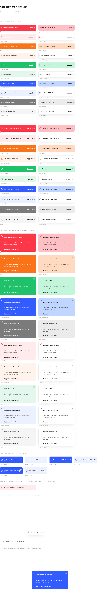
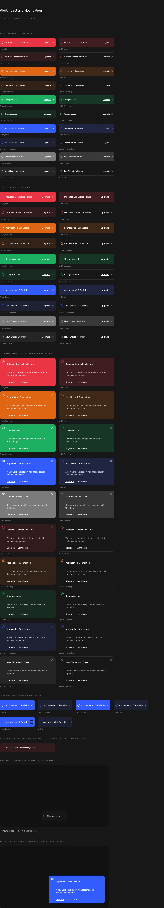

<!-- Copied from the design copy (neutrino-frontend-v3) by scripts/sync.mjs. Edit it there, then run `npm run sync`. -->

# Alert, Notification & Toast

| | |
|---|---|
| Figma | [Alert, Notification & Toast](https://www.figma.com/design/Ao3YVgFYdQIF0znq2ToqVl?node-id=169-2358) page |
| Status | Written 18 Oct 2026; coded 19 Oct 2026 |
| Code | [`src/components/ds/alert.tsx`](../../src/components/ds/alert.tsx) |
| Sizes | [`src/styles/sizes/alert.css`](../../src/styles/sizes/alert.css) |
| Demo | [`src/gallery/sections/alert.tsx`](../../src/gallery/sections/alert.tsx) |

## Light and dark

**Light**



**Dark**



## Use it

```tsx
import { ALERT_STATUS, Alert, AlertLink, AlertToaster } from "@/components/ds/alert";
```

Every size and state, working: run `npm run dev` and open [localhost:3100/#alert](http://localhost:3100/#alert).

## Spec

Status: written 18 Oct 2026, measured from the Figma. Its proposals stand until Nitesh reviews every component together on one canvas.

Figma: "Alert & Notification & Toast [1.1]" (node 169:2399) on the Alert, Notification & Toast page (169:2358) of https://www.figma.com/design/Ao3YVgFYdQIF0znq2ToqVl. The page's Examples (2880:5455) and prototypes ("Notification [Prototype]" 3245:12559, "Toast [Prototype]" 3245:12731) show where each one sits.

The rule for this page: shape, size, spacing, type and states come exactly from the Figma. Colours are the tokens the Figma frame uses, with our palette's values (`../colors/colors.md`). Every number here becomes a size token, so it can be changed later in one place (`../README.md`, "Sizes work the same way").

The Figma draws one component and uses it three ways:

* **Alert**: sits in the page or a dialog, in the flow of the content (the Figma's example: an Error alert at the top of a "Delete account" dialog).
* **Toast**: a one-line message that floats at the bottom centre of the screen after something happens ("Changes saved.").
* **Notification**: the Large size, floating at the bottom right of the screen, for news that arrives on its own ("App Version 2.0 Available", "Database Connection Failure").

### Rules

1. A message about one part of the page or one action: Alert in place, Toast after an action, Notification for news that arrives on its own. A message about the whole product, across the top of the page: Banner (`banner.md`).
2. Pick the status by meaning (Error, Warning, Success, Information, Feature for news and new features), never by colour.
3. Something missing? Stop and ask Nitesh, then add it here first.

### What it has

| Property | Options |
|---|---|
| Size | X-Small (32), Small (36): one line. Large: a title, a description and links |
| Style | Filled, Light, Lighter, Stroke |
| Status | Error, Warning, Success, Information, Feature |
| One line | The status icon, the title, a link (Link Button, underlined), the close icon |
| Large | The status icon, then the title, the description (two lines in the Figma), and two links with a dot between them ("Upgrade ∙ Learn More"), then the close icon |

There are no states (hover, focus) on the alert itself. The links are Link Buttons with their own states.

### Layout

| Size | Height | Padding | Gap | Corner | Icons (status and close) |
|---|---|---|---|---|---|
| X-Small (32) | 32 | 8 on every side | 8 | 8 | 16 x 16 |
| Small (36) | 36 | 8 top and bottom, 10 sides | 8 | 8 | 20 x 20 |
| Large | grows with the text (124 with two lines of description) | 14 top, 14 sides, 16 bottom | 12 | 12 | 20 x 20 |

* One line (X-Small, Small): a row, everything centred on the line. The title fills the space between the icon and the link.
* Large: a row, everything at the top. Between the icons, a column with a 10px gap: first the text (title, then description, 4px apart), then the links in a row with an 8px gap.
* Width: the Figma draws it 390 wide. An Alert takes its container's width (360 in the dialog example); a Toast follows its content (155 for "Changes saved."); a Notification is 390.
* The edge, in the Stroke style, is 1px and sits inside.
* Icons: Hugeicons Stroke Rounded in code; the Figma's Remix icons are placeholders. Error an alert mark in a circle, Warning a triangle, Success a ticked circle, Information an "i" in a circle, Feature a magic wand with sparkles (see Open).

#### Type

| Part | X-Small (32) | Small (36) | Large |
|---|---|---|---|
| Title | `text-paragraph-xs` (12/16, 400) | `text-paragraph-sm` (14/20, 400) | `text-label-sm` (14/20, 500) |
| Description | | | `text-paragraph-sm` (14/20, 400) |
| Link | Link Button, Small (16): `text-label-xs` (12/16, 500), underlined | Link Button, Medium (20): `text-label-sm` (14/20, 500), underlined | The same as Small; the second link has no underline |
| The dot between the links | | | `text-paragraph-sm`, 4 wide |

#### Where each one sits

| Use | Size and style in the Figma | Place |
|---|---|---|
| Alert | Any; the dialog example is Error, Lighter, X-Small (32) | In the content, full width |
| Toast | Small (36); Stroke ("Changes saved.", Success) or Lighter ("Poor Network Connection", Warning) | Bottom centre, 40 above the bottom of the screen |
| Notification | Large, usually Filled | Bottom right, 32 in from the right and from the bottom |

In the prototypes the Toast and the Notification slide up from below the screen and slide back down when closed (Figma's Smart Animate, "Quick" spring).

### Colours

Each status uses one group of state tokens (`state/<status>/...`):

| Status | Token group | In our palette |
|---|---|---|
| Error | `state/error/*` | Red |
| Warning | `state/warning/*` | Amber (our warning colour) |
| Success | `state/success/*` | Green |
| Information | `state/information/*` | Blue |
| Feature | `state/faded/*` | Gray |

Each style uses the group the same way:

| Part | Filled | Light | Lighter | Stroke |
|---|---|---|---|---|
| Fill | `base` | `light` | `lighter` | `bg/white-0` |
| Edge | none | none | none | 1px `stroke/soft-200` |
| Shadow | none | none | none | `--shadow-alert` (below) |
| Status icon | `static/white` | `base` | `base` | `base` |
| Title | `static/white` | `text/strong-950` | `text/strong-950` | `text/strong-950` |
| Description (Large) | `static/white` | `text/strong-950` at 72% | `text/strong-950` at 72% | `text/sub-600` |
| Links | `static/white` | `text/strong-950` | `text/strong-950` | `text/strong-950` |
| The dot between the links | `static/white` at 48% | `text/strong-950` at 48% | `text/strong-950` at 48% | `text/strong-950` at 48% |
| Close icon | `static/white` at 72% | `icon/strong-950` at 40% | `icon/strong-950` at 40% | `icon/strong-950` at 40% |

On Filled the links use the Link Button's Modifiable style (they take the alert's white); elsewhere its Black style.

The Stroke style's shadow is the Figma's `regular-shadow/medium`: 0 down 16, blur 32, spread -12, `#0E121B` at 10%. It becomes `--shadow-alert`.

Every colour is the Figma frame's own token, except the one below.

### Where this differs from the Figma

| Figma | Ours | Why |
|---|---|---|
| The links on Filled use `neutral/slate/0`, a raw palette colour | `static/white` | The same white, through a token |
| The underlined link word ("Upgrade") has no type style (plain Inter Medium 12 or 14, underlined) | `text-label-xs` or `text-label-sm`, underlined | A slip inside the Link Button; the numbers match those styles exactly |

### Open

* **Filled on dark.** Today our status `base` tokens are bright on dark, so white words and icons on them can't be read: Information 2.0:1, Warning 1.7:1, Success 1.9:1 (4.5:1 is the bar). Error is 3.8:1, also under the bar; Feature (Gray) is 4.7:1. On light all five pass (4.7 to 8.7:1). The Figma's own dark examples use a deeper red and orange for the Filled fill. The same issue is recorded on the Badge (`badge.md`). Settle it with the status colours, before the Filled style is built.
* **Feature is grey.** The Figma's Feature status uses `state/faded` (Gray), while elsewhere "Feature" is Purple (`state/feature`, not in the palette yet). Kept as drawn. Ask Nitesh whether it turns purple once that hue exists.
* **The Feature icon is a magic wand with sparkles,** close to the AI sparkle Nitesh dislikes. Ask him which icon Feature gets before it is built (the Banner uses the same one).
* **See-through parts.** The close icon (72% on Filled, 40% elsewhere), the Light and Lighter description (72%) and the dot (48%) are a token at reduced opacity, not a token of their own. Kept as drawn. If Nitesh prefers plain tokens: `icon/soft-400` for the close icon and `text/sub-600` for the description, as the Stroke style already uses.
* **The close icon has no hover or focus look.** Proposed: it is its own button, the size of the icon; on hover it goes to full opacity; keyboard focus gets the Neutral focus ring (2px `bg/white-0`, then 4px `state/faded/light`, outside, no blur).
* **Not drawn:** how long a Toast or Notification stays before it goes away on its own, and how several stack. Ask Nitesh.

### Build order

Uses the Link Button (Small and Medium; Modifiable and Black styles), which has no page yet (`button.md`, "Other button families"). Build after it.

### In code (to decide when building)

* Toasts today are the stock shadcn ones: `components/ui/toast.tsx` (variants `default` and `destructive`), `components/ui/toaster.tsx` (mounted in 7 layouts) and the `useToast` hook in `components/ui/use-toast.ts` (used in about 96 files, plus 43 tests). The Toast and Notification replace how they look; the hook can stay, with `variant` growing into Status (`destructive` becomes Error).
* There is no `components/ui/alert.tsx`. About 8 files draw their own `role="alert"` boxes (for example `components/tool-consent-card.tsx`, `components/connectors/data-connection.tsx`); they move to the Alert when rebuilt.
* `components/chat/refined/context-banner.tsx` (the context-limit notice above the composer) is an Alert in this system, Warning or Information, Lighter: it sits in one place on the page, not across it.
* `components/ui/alert-dialog.tsx` is a dialog, not this; it belongs to the Modal.
* The shadow becomes `--shadow-alert: 0 16px 32px -12px rgba(14, 18, 27, 0.1)` when shadows move into the token build.
