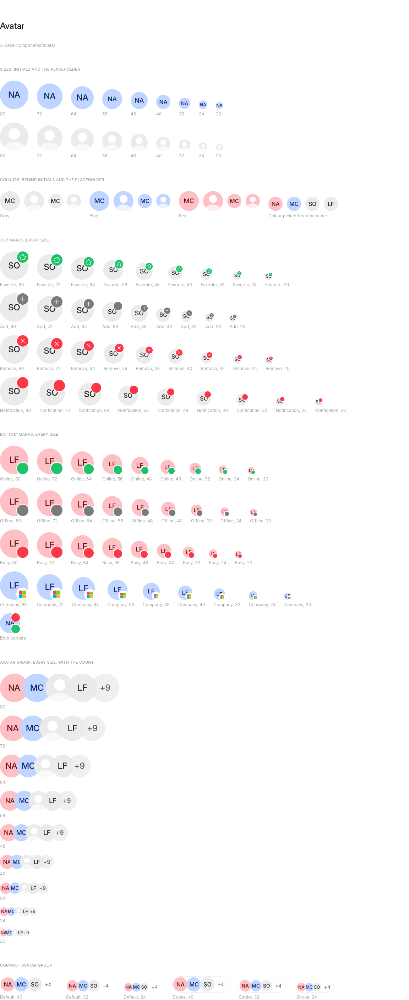
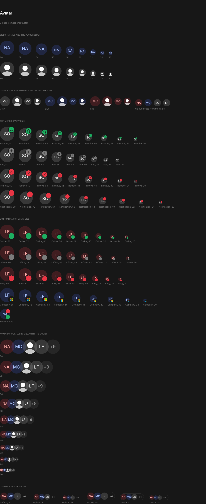

<!-- Copied from the design copy (neutrino-frontend-v3) by scripts/sync.mjs. Edit it there, then run `npm run sync`. -->

# Avatar

| | |
|---|---|
| Figma | [Avatar](https://www.figma.com/design/Ao3YVgFYdQIF0znq2ToqVl?node-id=210-4129) page |
| Status | Approved, 18 Oct 2026; coded 19 Oct 2026 |
| Code | [`src/components/ds/avatar.tsx`](../../src/components/ds/avatar.tsx) |
| Sizes | [`src/styles/sizes/avatar.css`](../../src/styles/sizes/avatar.css) |
| Demo | [`src/gallery/sections/avatar.tsx`](../../src/gallery/sections/avatar.tsx) |

## Light and dark

**Light**



**Dark**



## Use it

```tsx
import {
  AvatarTopMark,
  AvatarBottomMark,
  Avatar,
  AvatarGroup,
  CompactAvatarGroup,
} from "@/components/ds/avatar";
```

Every size and state, working: run `npm run dev` and open [localhost:3100/#avatar](http://localhost:3100/#avatar).

## Spec

Status: approved by Nitesh, 18 Oct 2026. Yellow, Sky and Purple wait for their hues (see Open).

Figma, on the Avatar page (210:4129) of https://www.figma.com/design/Ao3YVgFYdQIF0znq2ToqVl:

* "Avatar [1.1]" (node 245:18786): a person's picture, initials or a placeholder.
* "Top Status [1.1]" (245:18697) and "Bottom Status [1.1]" (245:18721): the small marks on its corner.
* "Avatar Group [1.1]" (581:6198) and "Compact Avatar Group [1.1]" (2906:14962): several avatars overlapping.

The rule for this page: shape, size, spacing, type and states come exactly from the Figma. Colours are the tokens the Figma frame uses, with our palette's values (`../colors/colors.md`). Every number here becomes a size token, so it can be changed later in one place (`../README.md`, "Sizes work the same way").

### Rules

1. Every picture of a person, or a stand-in for one, is this Avatar. Never draw a round photo by hand.
2. No photo: show the initials. No name either: show the placeholder.
3. Something missing? Stop and ask Nitesh, then add it here first.

### Avatar

#### What it has

| Property | Options |
|---|---|
| Size | 80, 72, 64, 56, 48, 40, 32, 24, 20 |
| Content | A photo; a photo on a coloured circle (for cut-out photos, memoji and illustrations); initials; a placeholder person |
| Colour (behind initials and cut-outs) | Gray, Blue, Red, Yellow, Sky, Purple |
| Top mark | Optional: Verified, Pin, Favorite, Add, Remove, Notification |
| Bottom mark | Optional: Online, Offline, Busy, Away, or a company logo |

#### Sizes

A full circle at every size. The initials:

| Avatar size | Initials type |
|---|---|
| 80, 72, 64 | `font-display text-title-h5` (24/32) |
| 56, 48 | `text-label-lg` (18/24) |
| 40 | `text-label-md` (16/24) |
| 32 | `text-label-sm` (14/20) |
| 24 | `text-label-xs` (12/16) |
| 20 | `text-subheading-2xs` (11/12, 500): ours, 24 Oct 2026, so two letters clear the circle; the Figma uses `text-label-xs` |

The placeholder person is a white head and a white body at 72% on the colour, scaled to the avatar.

#### Corner marks

One mark top right, one bottom right, each sitting on the avatar's edge:

| Avatar size | Mark size |
|---|---|
| 80 | 32 |
| 72 | 32 |
| 64 | 28 |
| 56 | 24 |
| 48 | 20 |
| 40 | 18 |
| 32 | 16 |
| 24 | 12 |
| 20 | 10 |

Each mark has a ring in `bg/white-0` around it, so it reads as cut out of the avatar.

#### Colours

| Colour | Circle | Initials | In our palette |
|---|---|---|---|
| Gray | `state/faded/light` | `state/faded/dark` | Gray |
| Blue | `state/information/light` | `state/information/dark` | Blue |
| Red | `state/error/light` | `state/error/dark` | Red |
| Brand (Neutrino only, 23 Oct 2026) | `primary/alpha-16` | `primary/base` | Blue (the brand's cobalt); the workspace's initials in the profile menu. Never picked from a name |
| Yellow | `state/away/light` | `state/away/dark` | not in the palette yet |
| Sky | `state/verified/light` | `state/verified/dark` | not in the palette yet |
| Purple | `state/feature/light` | `state/feature/dark` | not in the palette yet |

| Mark | Colour |
|---|---|
| Verified | `state/verified/base`, with a tick in `icon/white-0` |
| Pin | `state/feature/base`, with a pin in `icon/white-0` |
| Favorite | `state/success/base`, with a star in `icon/white-0` |
| Add | `state/faded/base`, with a plus in `icon/white-0` |
| Remove | `state/error/base`, with a cross in `icon/white-0` |
| Notification | A dot in `state/error/base` |
| Online | A dot in `state/success/base` |
| Offline | A dot in `state/faded/base` |
| Busy | A dot in `state/error/base` |
| Away | A dot in `state/away/base` |
| Company | The company's logo on `bg/white-0` |

### Avatar Group

* Avatars of one size in a row, each overlapping the one before, each with a 2px ring in `stroke/white-0` outside it.
* Overlap: 16 at sizes 80 to 56, 12 at 48 and 40, 6 at 32, 4 at 24 and 20.
* Optional last circle "+9": `bg/weak-50`, the count in `text/sub-600`, the same type as the avatar's initials.

### Compact Avatar Group

* A pill (full corner) holding up to three 40, 32 or 24 avatars overlapping by 2, then the count "+4" in `text-paragraph-sm` (14/20) `text/sub-600`, 8px after them.
* Padding 2 top, bottom and left, 10 right.
* Default: `bg/white-0`. Stroke: also a 1px `stroke/soft-200` edge outside.

### Where this differs from the Figma

| Figma | Ours | Why |
|---|---|---|
| Circles and initials use the raw palette (`blue/200` behind `blue/950` ...), the same in both themes | The matching state tokens (`light` behind `dark`) | Components use tokens only; on dark the circle softens and the initials lighten instead of a pale circle |

### Open

* Yellow, Sky and Purple have no hue in our palette yet (the same as the Badge). Until they do, avatars use Gray, Blue and Red.
* The Away, Verified and Pin marks use those missing hues too.

### In code (to decide when building)

* Today's `components/ui/avatar.tsx` is the stock shadcn one, used in 2 files; the Avatar replaces how it looks.
* Pick an avatar's colour from the person's name, so one person always gets the same colour.
