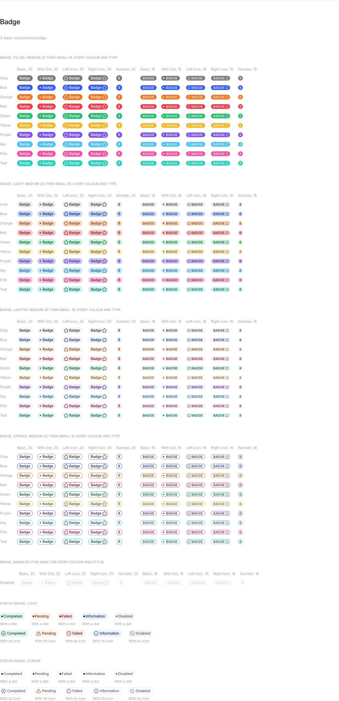
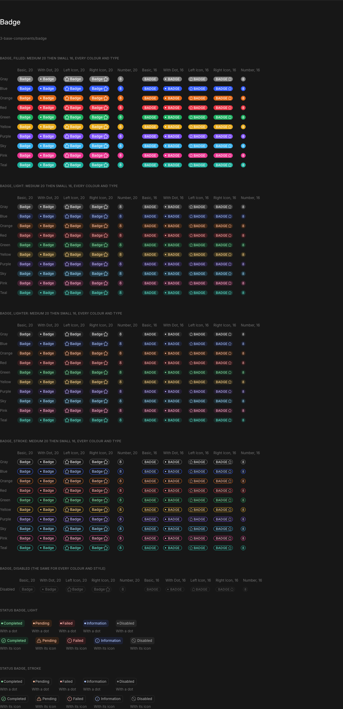

<!-- Copied from the design copy (neutrino-frontend-v3) by scripts/sync.mjs. Edit it there, then run `npm run sync`. -->

# Badge

| | |
|---|---|
| Figma | [Badge](https://www.figma.com/design/Ao3YVgFYdQIF0znq2ToqVl?node-id=119-2863) page |
| Status | Approved, 18 Oct 2026; Filled waits on the status colours; coded 19 Oct 2026 |
| Code | [`src/components/ds/badge.tsx`](../../src/components/ds/badge.tsx) |
| Sizes | [`src/styles/sizes/badge.css`](../../src/styles/sizes/badge.css) |
| Demo | [`src/gallery/sections/badge.tsx`](../../src/gallery/sections/badge.tsx) |

## Light and dark

**Light**



**Dark**



## Use it

```tsx
import { Badge, StatusBadge } from "@/components/ds/badge";
```

Every size and state, working: run `npm run dev` and open [localhost:3100/#badge](http://localhost:3100/#badge).

## Spec

Status: approved by Nitesh, 18 Oct 2026. Coded 19 Oct 2026. Since 21 Oct 2026 all ten colours are in code, in the Figma's own state colours for both themes (Nitesh: "look at the blues, the reds, the greens, the yellows, the greys").

Figma, on the Badge page (119:2863) of https://www.figma.com/design/Ao3YVgFYdQIF0znq2ToqVl:

* "Badge [1.1]" (node 118:2324): the small coloured label.
* "Status Badge [1.1]" (node 171:5100): a ready-made badge for the five everyday statuses.

The rule for this page: shape, size, spacing, type and states come exactly from the Figma. Colours are the tokens the Figma frame uses, with our palette's values (`../colors/colors.md`). Every number here becomes a size token, so it can be changed later in one place (`../README.md`, "Sizes work the same way").

### Rules

1. A label that only reports something (a status, a count, "New"): Badge. Something a person can pick or remove: Tag (`tag.md`).
2. For done, waiting, failed, information and switched off, use the Status Badge, not a Badge picked by colour.
3. Use only the styles, colours and sizes on this page. Something missing? Stop and ask Nitesh, then add it here first.

### Badge

#### What it has

| Property | Options |
|---|---|
| Size | Small (16), Medium (20) |
| Style | Filled, Light, Lighter, Stroke |
| Colour | Gray, Blue, Orange, Red, Green, Yellow, Purple, Sky, Pink, Teal (each is one of the Figma's state colours, below) |
| Type | Basic (a word), With Dot, Left Icon, Right Icon |
| Number | On: a round badge with a number in it instead of a word |
| Disabled | Off, On |

#### Layout

| Part | Small (16) | Medium (20) |
|---|---|---|
| Height | 16 | 20 |
| Corner | Fully round | Fully round |
| Word | `text-subheading-2xs uppercase` (11/12, +2%, capitals) | `text-label-xs` (12/16, 500) |
| Padding, word only | 2 top and bottom, 8 sides | 2 top and bottom, 8 sides |
| With an icon | The icon side 4, the other 8; icon 12 x 12; gap 2 | The icon side 4, the other 8; icon 16 x 16; gap 2 |
| With a dot | The dot sits in a 16 x 16 box on the left (a 4 x 4 circle in its middle), no left padding, no gap | The same, with 2 left padding |
| Number | 16 x 16, padding 2 | 20 x 20, padding 2 |

Width follows the content.

#### Colours

Each colour is one of the Figma's state tokens:

| Badge colour | Token group | In our palette |
|---|---|---|
| Gray | `state/faded/*` | Gray |
| Blue | `state/information/*` | Blue |
| Orange | `state/warning/*` | Amber (our warning colour) |
| Red | `state/error/*` | Red |
| Green | `state/success/*` | Green |
| Yellow | `state/away/*` | in the palette since 21 Oct 2026 (the Figma's values) |
| Purple | `state/feature/*` | in the palette since 21 Oct 2026 (the Figma's values) |
| Sky | `state/verified/*` | in the palette since 21 Oct 2026 (the Figma's values) |
| Pink | `state/highlighted/*` | in the palette since 21 Oct 2026 (the Figma's values) |
| Teal | `state/stable/*` | in the palette since 21 Oct 2026 (the Figma's values) |

Each style uses the colour's tokens the same way (`state/<colour>/...`):

| Style | Fill | Edge | Word, dot and icon |
|---|---|---|---|
| Filled | `base` | none | `static/white` |
| Light | `light` | none | `dark` |
| Lighter | `lighter` | none | `base` |
| Stroke | none | 1px `base` | `base` |

Disabled (every colour and style): no fill, a 1px `stroke/soft-200` edge, word `text/disabled-300`, icon `icon/disabled-300`. The Figma draws it for Gray only; Nitesh agreed on 18 Oct 2026 that any disabled badge uses it.

### Status Badge

#### What it has

| Property | Options |
|---|---|
| Status | Completed, Pending, Failed, Information, Disabled |
| Style | Light, Stroke |
| Mark | A dot, or the status's own icon |

#### Layout

* 24 tall, corner 6, padding 4 top and bottom, 4 left, 8 right.
* Word: `text-label-xs` (12/16, 500).
* With a dot: a 6 x 6 dot, gap 2. With an icon: a 16 x 16 icon, gap 4.
* Icons: the Figma's own filled marks, copied from its vectors (24 Oct 2026, Nitesh: "exactly match the way the badge looks, including the icons"): Completed a disc with a tick, Pending a triangle with "!", Failed a disc with "!", Information a disc with "i", Disabled a disc with a slash. Each mark is cut out of its shape, so it shows the badge behind it. In code: `StatusCompletedIcon`, `StatusPendingIcon`, `StatusFailedIcon`, `StatusInformationIcon`, `StatusDisabledIcon` (`components/ui/icons.tsx`; the one exception on `../icons/icons.md`).

#### Colours

| Status | Token group |
|---|---|
| Completed | `state/success/*` |
| Pending | `state/warning/*` |
| Failed | `state/error/*` |
| Information | `state/information/*` |
| Disabled | `state/faded/*` |

| Style | Fill | Edge | Word | Dot or icon |
|---|---|---|---|---|
| Light | `lighter` | none | `dark` since 21 Oct 2026 (Disabled: `text/sub-600`) | `dark` |
| Stroke | `bg/white-0` | 1px, the Figma's `stroke/soft-200`: #EBEBEB on light, #262626 on dark (`--status-badge-edge`, 24 Oct 2026) | `text/sub-600` | `base`, as the Figma (23 Oct 2026) |

The Figma's Light words are `base`; ours are `dark`, which reads 7:1 (21 Oct 2026). On Stroke the colour sits in the dot or icon, beside readable grey words, so it keeps the Figma's bright `base`: the table family's status chips (`table.md`), as Nitesh's Projects reference draws them.

### Open

* **Filled badges on dark.** Today our status `base` tokens are bright on dark, so white words on them can't be read: Blue 2.0:1, Orange 1.7:1, Green 1.9:1 (4.5:1 is the bar). Red is 3.8:1 and Gray 4.7:1. The Figma avoids this by making `base` a deeper step on dark. Settle it with the status colours, before the Badge is built.
* **Five colours wait for the palette.** Done 21 Oct 2026: Yellow, Purple, Sky, Pink and Teal are in code, from the Figma's state variables.

### In code (to decide when building)

* `components/ui/refined/status-badge.tsx` (`StatusBadge`, used in about 56 files) becomes this page's Status Badge. The refined Chip's coloured tones (accent, warn, danger) move to the Badge.
* `components/ui/badge.tsx` is the stock shadcn one, used in about 11 files; the Badge replaces how it looks.

### Readable words (21 Oct 2026)

Nitesh: "I can't even read that at all." Measured on dark, the Figma's Lighter style (words in `base` on the `lighter` tint) read 2.5 to 5.4 to 1, and blue only 2.5 inside a field. Now every style's words (and the dot and icons) use the colour's `dark` token, and on dark that token is a new 300 step picked in OKLCH: the Figma's hue angle, chroma at most 0.12, and the lowest lightness that reads 7 to 1 (WCAG AAA) on its own light and lighter tints over both `bg/white-0` and `bg/weak-50`. The dark tints are a little quieter (light 18%, lighter 12%), so the words keep their colour. The grey's words are Gray 200 on dark. The worst pair in either theme is 7.02 to 1. Filled stays the Figma's (base with white words). Picture: `revamp/screens/18-badges-aaa.jpg`.
