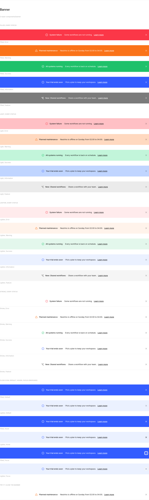
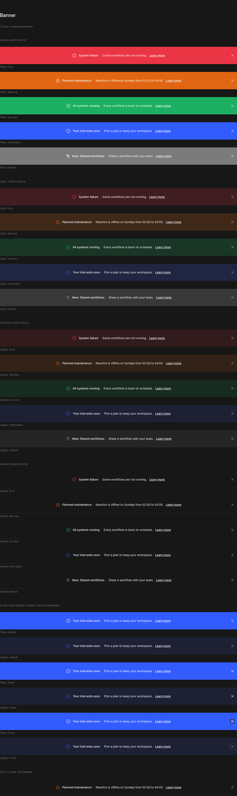

<!-- Copied from the design copy (neutrino-frontend-v3) by scripts/sync.mjs. Edit it there, then run `npm run sync`. -->

# Banner

| | |
|---|---|
| Figma | [Banner](https://www.figma.com/design/Ao3YVgFYdQIF0znq2ToqVl?node-id=224-2224) page |
| Status | Written 18 Oct 2026; coded 19 Oct 2026 |
| Code | [`src/components/ds/banner.tsx`](../../src/components/ds/banner.tsx) |
| Sizes | [`src/styles/sizes/banner.css`](../../src/styles/sizes/banner.css) |
| Demo | [`src/gallery/sections/banner.tsx`](../../src/gallery/sections/banner.tsx) |

## Light and dark

**Light**



**Dark**



## Use it

```tsx
import { Banner, BannerLink } from "@/components/ds/banner";
```

Every size and state, working: run `npm run dev` and open [localhost:3100/#banner](http://localhost:3100/#banner).

## Spec

Status: written 18 Oct 2026, measured from the Figma. Its proposals stand until Nitesh reviews every component together on one canvas.

Figma: "Banner [1.1]" (node 224:2249) on the Banner page (224:2224) of https://www.figma.com/design/Ao3YVgFYdQIF0znq2ToqVl. The page's Examples (2952:18023) show it across the top and the bottom of a screen.

The rule for this page: shape, size, spacing, type and states come exactly from the Figma. Colours are the tokens the Figma frame uses, with our palette's values (`../colors/colors.md`). Every number here becomes a size token, so it can be changed later in one place (`../README.md`, "Sizes work the same way").

### Rules

1. A message about the whole product or account, across the full width of the screen (a system failure, planned maintenance, a new feature): Banner. A message about one part of the page or one action: Alert, Toast or Notification (`alert.md`).
2. Pick the status by meaning (Error, Warning, Success, Information, Feature for news and new features), never by colour.
3. Something missing? Stop and ask Nitesh, then add it here first.

### What it has

| Property | Options |
|---|---|
| Status | Error, Warning, Success, Information, Feature |
| Style | Filled, Light, Lighter, Stroke |
| Parts | The status icon, the title, a dot, the description, a link (Link Button, underlined), the close icon |

One size. There are no states on the banner itself; the link is a Link Button with its own states.

### Layout

| Part | Value |
|---|---|
| Banner | The full width of the screen (1440 in the Figma), 44 tall, no corner |
| Padding | 12 top and bottom, 48 sides |
| Content | One row in the middle of the banner: the icon, the text and the link, 12px apart |
| Text | The title, a dot (∙), the description, 8px apart |
| Status icon | 20 x 20 |
| Close icon | 20 x 20, 12 from the right edge, centred top to bottom, outside the centred row |
| Edge (Stroke style only) | 1px along the bottom, inside |

| Part | Type |
|---|---|
| Title | `text-label-sm` (14/20, 500) |
| The dot | `text-label-sm` |
| Description | `text-paragraph-sm` (14/20, 400) |
| Link | Link Button, Medium (20): `text-label-sm`, underlined |

Icons: Hugeicons Stroke Rounded in code; the Figma's Remix icons are placeholders. The status icons are the Alert's (`alert.md`).

### Colours

Each status uses one group of state tokens (`state/<status>/...`):

| Status | Token group | In our palette |
|---|---|---|
| Error | `state/error/*` | Red |
| Warning | `state/warning/*` | Amber (our warning colour) |
| Success | `state/success/*` | Green |
| Information | `state/information/*` | Blue |
| Feature | `state/faded/*` | Gray |

| Part | Filled | Light | Lighter | Stroke |
|---|---|---|---|---|
| Fill | `base` | `light` | `lighter` | `bg/white-0` |
| Edge | none | none | none | 1px `stroke/soft-200`, bottom only |
| Status icon | `static/white` | `base` | `base` | `base` |
| Title, dot, description | `static/white` | `text/strong-950` | `text/strong-950` | `text/strong-950` |
| Link | `static/white` | `text/strong-950` | `text/strong-950` | `text/strong-950` |
| Close icon | `static/white` at 72% | `icon/strong-950` at 48% | `icon/strong-950` at 48% | `icon/strong-950` at 48% |

On Filled the link uses the Link Button's Modifiable style (it takes the banner's white); elsewhere its Black style.

Every colour is the Figma frame's own token, except the one below.

### Where this differs from the Figma

| Figma | Ours | Why |
|---|---|---|
| The link on Filled uses `neutral/slate/0`, a raw palette colour | `static/white` | The same white, through a token |
| The underlined link word has no type style (plain Inter Medium 14, underlined) | `text-label-sm`, underlined | A slip inside the Link Button; the numbers match that style exactly |

### Open

* **Filled on dark.** Today our status `base` tokens are bright on dark, so white words and icons on them can't be read: Information 2.0:1, Warning 1.7:1, Success 1.9:1 (4.5:1 is the bar). Error is 3.8:1, also under the bar; Feature (Gray) is 4.7:1. On light all five pass (4.7 to 8.7:1). The Figma's own dark examples use a deeper red and orange for the Filled fill. The same issue is recorded on the Badge (`badge.md`). Settle it with the status colours, before the Filled style is built.
* **Feature is grey.** As on the Alert, the Feature status uses `state/faded` (Gray), not Purple (`state/feature`, not in the palette yet). Kept as drawn; ask Nitesh.
* **The close icon is see-through:** 72% on Filled, 48% elsewhere (the Alert uses 40%). Kept as drawn. Ask whether the two should match, or become a plain token (`icon/soft-400`).
* **The close icon has no hover or focus look.** Proposed, as on the Alert: its own button, full opacity on hover, the Neutral focus ring on keyboard focus (2px `bg/white-0`, then 4px `state/faded/light`, outside, no blur).
* **Narrow screens are not drawn.** At 1440 the text fits on one line. How it wraps on a phone, and whether the 48 side padding shrinks, is for Nitesh to decide.

### Build order

Uses the Link Button (Medium; Modifiable and Black styles), which has no page yet (`button.md`, "Other button families"). Build after it.

### In code (to decide when building)

* There is no banner in code yet. `components/chat/refined/context-banner.tsx` is named a banner but sits above the composer, not across the screen; it belongs to the Alert (`alert.md`).
