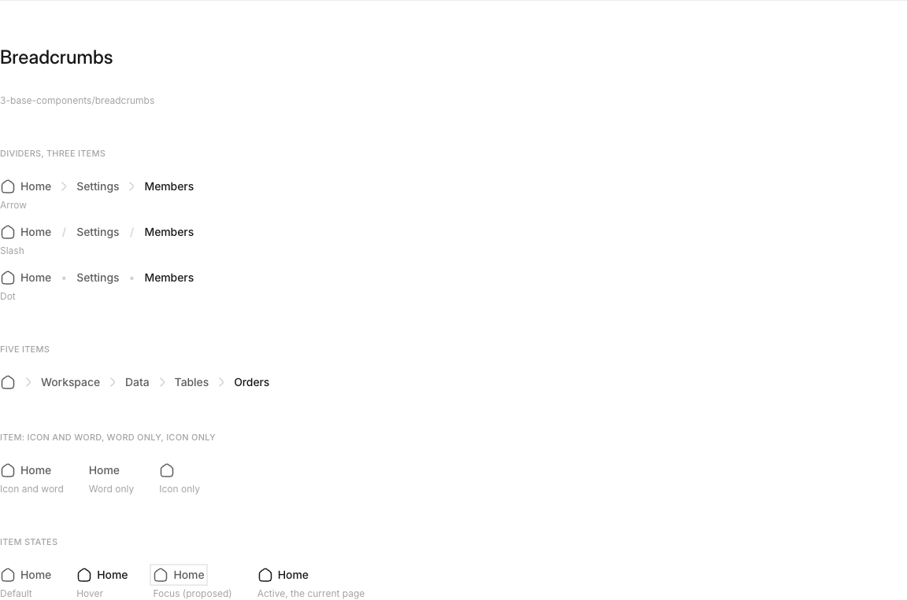
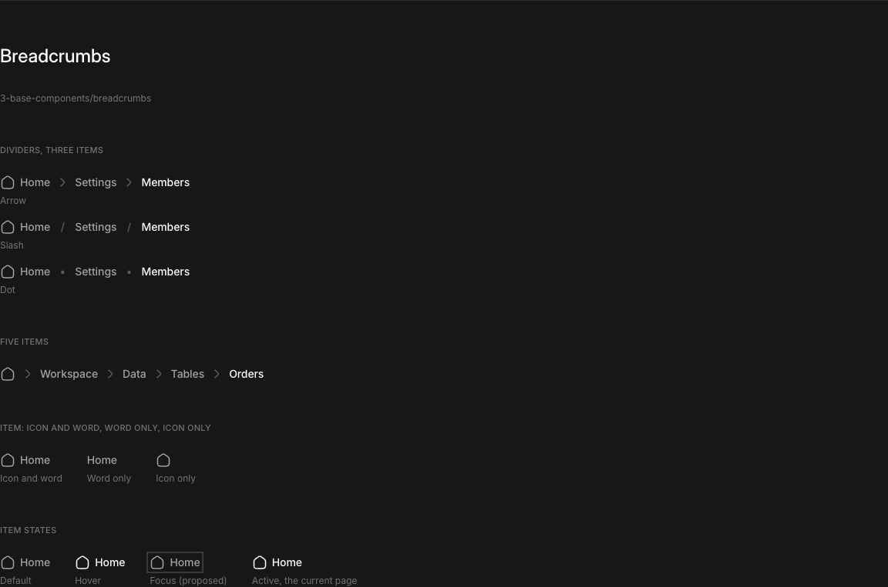

<!-- Copied from the design copy (neutrino-frontend-v3) by scripts/sync.mjs. Edit it there, then run `npm run sync`. -->

# Breadcrumbs

| | |
|---|---|
| Figma | [Breadcrumbs](https://www.figma.com/design/Ao3YVgFYdQIF0znq2ToqVl?node-id=447-8760) page |
| Status | Written 18 Oct 2026; coded 19 Oct 2026 |
| Code | [`src/components/ds/breadcrumbs.tsx`](../../src/components/ds/breadcrumbs.tsx) |
| Sizes | [`src/styles/sizes/breadcrumbs.css`](../../src/styles/sizes/breadcrumbs.css) |
| Demo | [`src/gallery/sections/breadcrumbs.tsx`](../../src/gallery/sections/breadcrumbs.tsx) |

## Light and dark

**Light**



**Dark**



## Use it

```tsx
import { Breadcrumbs, BreadcrumbItem } from "@/components/ds/breadcrumbs";
```

Every size and state, working: run `npm run dev` and open [localhost:3100/#breadcrumbs](http://localhost:3100/#breadcrumbs).

## Spec

Status: written 18 Oct 2026, measured from the Figma. Its proposals stand until Nitesh reviews every component together on one canvas.

Figma: "Breadcrumbs Group [1.1]" (node 447:8832) and "Breadcrumb Items [1.1]" (node 447:8767), on the Breadcrumbs page (447:8760) of https://www.figma.com/design/Ao3YVgFYdQIF0znq2ToqVl.

The rule for this page: shape, size, spacing, type and states come exactly from the Figma. Colours are the tokens the Figma frame uses, with our palette's values (`../colors/colors.md`). Every number here becomes a size token, so it can be changed later in one place (`../README.md`, "Sizes work the same way").

### Rules

1. The trail from the top of the product to the current page is this Breadcrumbs. The last item is the page you are on.
2. Something missing? Stop and ask Nitesh, then add it here first.

### What it has

| Property | Options |
|---|---|
| Items | 3 to 5 in the Figma |
| Divider | Arrow (a right chevron), Slash (`/`), Dot (`•`) |
| Item | An icon, a word, or both |
| Item state | Default, Hover, Active (the current page) |

### Layout

* One row, 20 tall, with a 6px gap between every item and divider.
* Item: an optional 20 x 20 icon and the word, 6px apart. Word: `text-label-sm` (14/20, 500).
* Divider: 20 x 20. The arrow is an icon; the slash and the dot are `text-label-sm`, centred.

### Colours

| Part | Default | Hover | Active |
|---|---|---|---|
| Word | `text/sub-600` | `text/strong-950` | `text/strong-950` |
| Icon | `icon/sub-600` | `icon/strong-950` | `icon/strong-950` |
| Divider | `icon/disabled-300` (arrow) or `text/disabled-300` (slash, dot) | | |

Every colour is the Figma frame's own token; nothing moved.

### Where this differs from the Figma

| Figma | Ours | Why |
|---|---|---|
| The Hover word has no type style (plain 14px) | `text-label-sm`, like the other states | A slip; the word must not change weight on hover |

### Open

* The Figma has no keyboard focus look. Proposed: the Neutral focus ring around the item (2px `bg/white-0`, then 4px `state/faded/light`), as on the Tag.

### In code (to decide when building)

* There is no breadcrumb in code yet.
