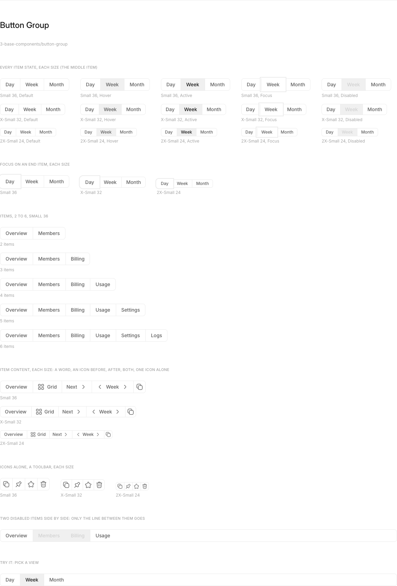
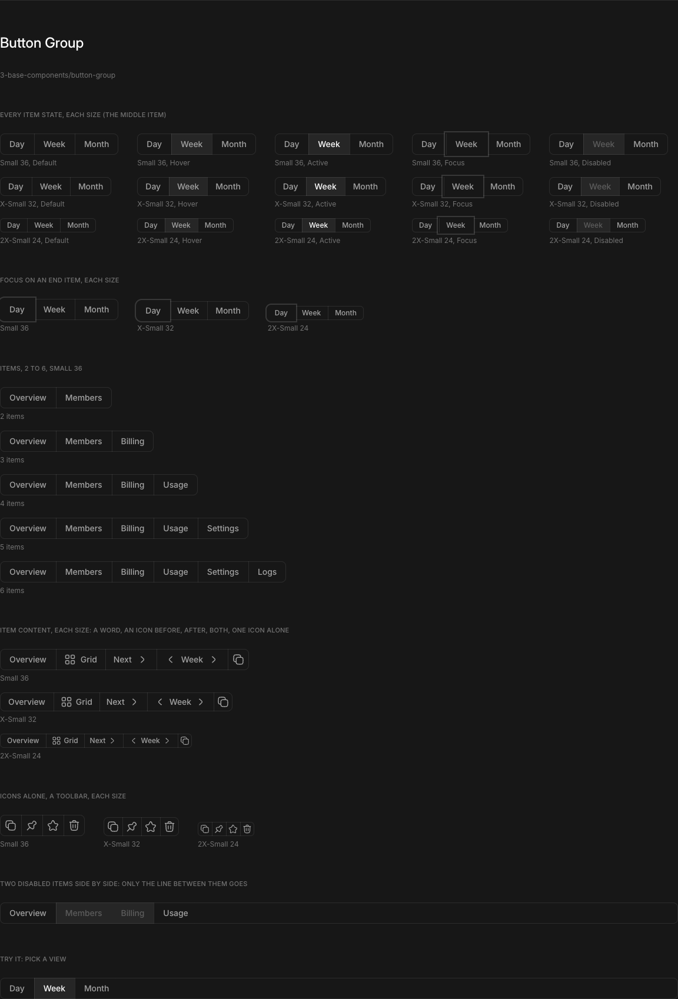

<!-- Copied from the design copy (neutrino-frontend-v3) by scripts/sync.mjs. Edit it there, then run `npm run sync`. -->

# Button Group

| | |
|---|---|
| Figma | [Button Group](https://www.figma.com/design/Ao3YVgFYdQIF0znq2ToqVl?node-id=225-2363) page |
| Status | Approved, 18 Oct 2026; coded 19 Oct 2026 |
| Code | [`src/components/ds/button-group.tsx`](../../src/components/ds/button-group.tsx) |
| Sizes | [`src/styles/sizes/button-group.css`](../../src/styles/sizes/button-group.css) |
| Demo | [`src/gallery/sections/button-group.tsx`](../../src/gallery/sections/button-group.tsx) |

## Light and dark

**Light**



**Dark**



## Use it

```tsx
import { ButtonGroup, ButtonGroupItem } from "@/components/ds/button-group";
```

Every size and state, working: run `npm run dev` and open [localhost:3100/#button-group](http://localhost:3100/#button-group).

## Spec

Status: approved by Nitesh, 18 Oct 2026, with two fixes to the Figma (below, under "Where this differs from the Figma").

Figma: "Button Group [1.1]" (node 493:8644) and its items "Button Group Items [1.1]" (node 226:4669), on the Button Group page (225:2363) of https://www.figma.com/design/Ao3YVgFYdQIF0znq2ToqVl.

The rule for this page: shape, size, spacing, type and states come exactly from the Figma. Colours are the tokens the Figma frame uses, with our palette's values (`../colors/colors.md`). Every number here becomes a size token, so it can be changed later in one place (`../README.md`, "Sizes work the same way").

### Rules

1. A row of joined buttons that pick or act on one thing (a view switch, a toolbar) is this Button Group. Never build one from separate Buttons.
2. Use only the sizes and states on this page.
3. Something missing? Stop and ask Nitesh, then add it here first.

### What it has

| Property | Options |
|---|---|
| Items | 2 to 6 |
| Size | Small (36), X-Small (32), 2X-Small (24) |
| Item state | Default, Hover, Active (the picked item), Disabled, Focus (keyboard) |
| Item content | A word; a word with an icon before, after, or both; or one icon alone (a square) |

Note: the Button Group's 2X-Small is 24 tall. The Button's 2X-Small is 28. Same name, different height, as in the Figma.

### Sizes

#### The group

| Size | Height | Corner | Edge |
|---|---|---|---|
| Small | 36 | 8 | 1px, inside |
| X-Small | 32 | 8 | 1px, inside |
| 2X-Small | 24 | 6 | 1px, inside |

Items sit side by side with no gap. The group clips them to its corners, so only the two end items look rounded. Items have square corners.

#### Each item

| Size | Padding, top and bottom | Sides, word only | Sides, word and one icon | Sides, word and two icons | Icon only | Gap | Word | Icon |
|---|---|---|---|---|---|---|---|---|
| Small | 8 | 16 | 14 | 14 | 36 x 36, padding 8 | 8 | `text-label-sm` (14/20, -0.6%) | 20 |
| X-Small | 6 | 14 | 12 | 12 | 32 x 32, padding 6 | 6 | `text-label-sm` (14/20, -0.6%) | 20 |
| 2X-Small | 4 | 12 | 10 | 10 | 24 x 24, padding 4 | 4 | `text-label-xs` (12/16, 0%) | 16 |

Icons are Hugeicons Stroke Rounded. The Figma uses Remix icons as placeholders.

Each item has a 1px edge centred on its border, so where two items meet the edges sit on the same line and read as one 1px divider.

### Colours

| Part | Default | Hover | Active | Disabled |
|---|---|---|---|---|
| Group fill | `bg/white-0` | | | |
| Group edge | `stroke/soft-200` | | | |
| Item fill | `bg/white-0` | `bg/weak-50` | `bg/weak-50` | `bg/weak-50` |
| Item edge (the dividers) | `stroke/soft-200` | `stroke/soft-200` | `stroke/soft-200` | none |
| Words | `text/sub-600` | `text/sub-600` | `text/strong-950` | `text/disabled-300` |
| Icons | `icon/sub-600` | `icon/sub-600` | `icon/strong-950` | `icon/disabled-300` |

Every colour is the Figma frame's own token; nothing moved.

#### Focus (keyboard)

The item keeps the colours of its state and gets the Neutral button's focus ring (`button.md`): two rings outside the item, no blur, first 2px in `bg/white-0`, then 2px more in `state/faded/light`.

### Where this differs from the Figma

Agreed with Nitesh, 18 Oct 2026.

| Figma | Ours | Why |
|---|---|---|
| With two icons, side padding 8, 6, 4 (the top padding) | 14, 12, 10, the same as with one icon | Looked like a slip; one icon or two should sit the same |
| No focus state | The Neutral button's focus ring | Every control needs a visible keyboard focus |

### In code (to decide when building)

* There is no shared Button Group in code yet. It will be a new component next to `components/ui/button.tsx`.
* The group's 1px edge plus each item's divider: a border on the group, and a left border on every item but the first.
* Round the first and last items to the group's corner instead of clipping the group, so the focus ring outside an item is not cut off.
