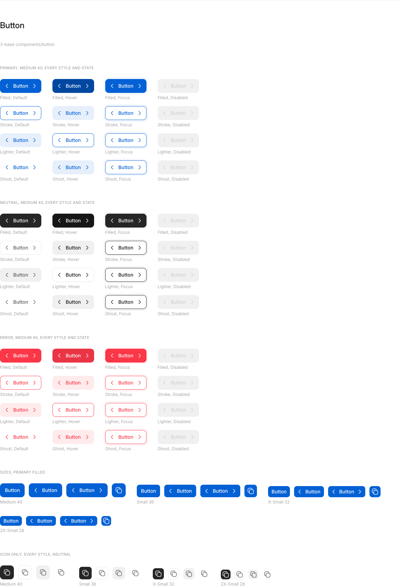
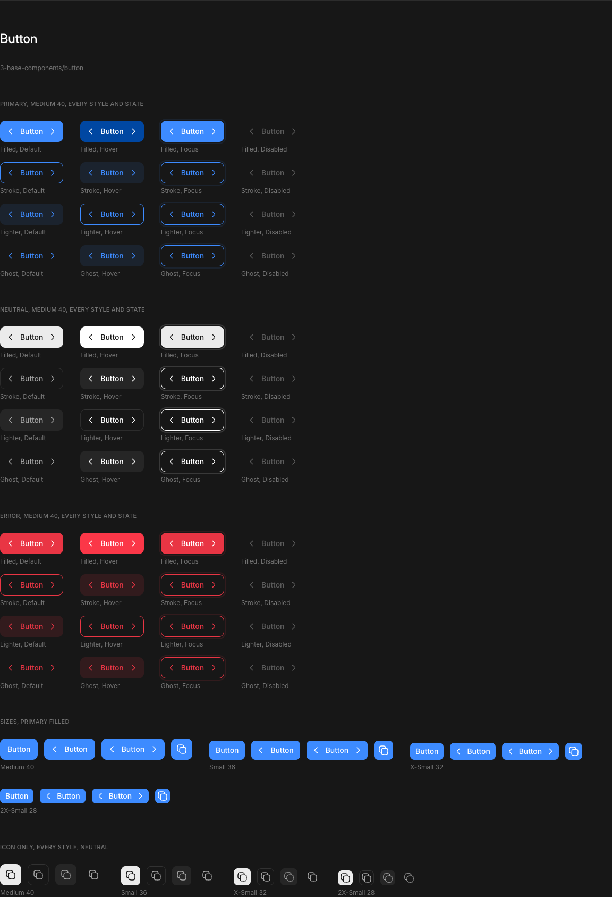
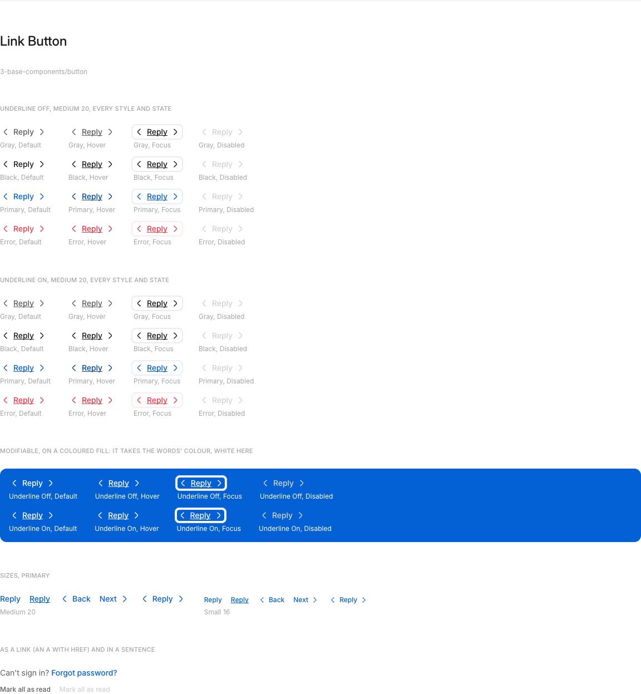
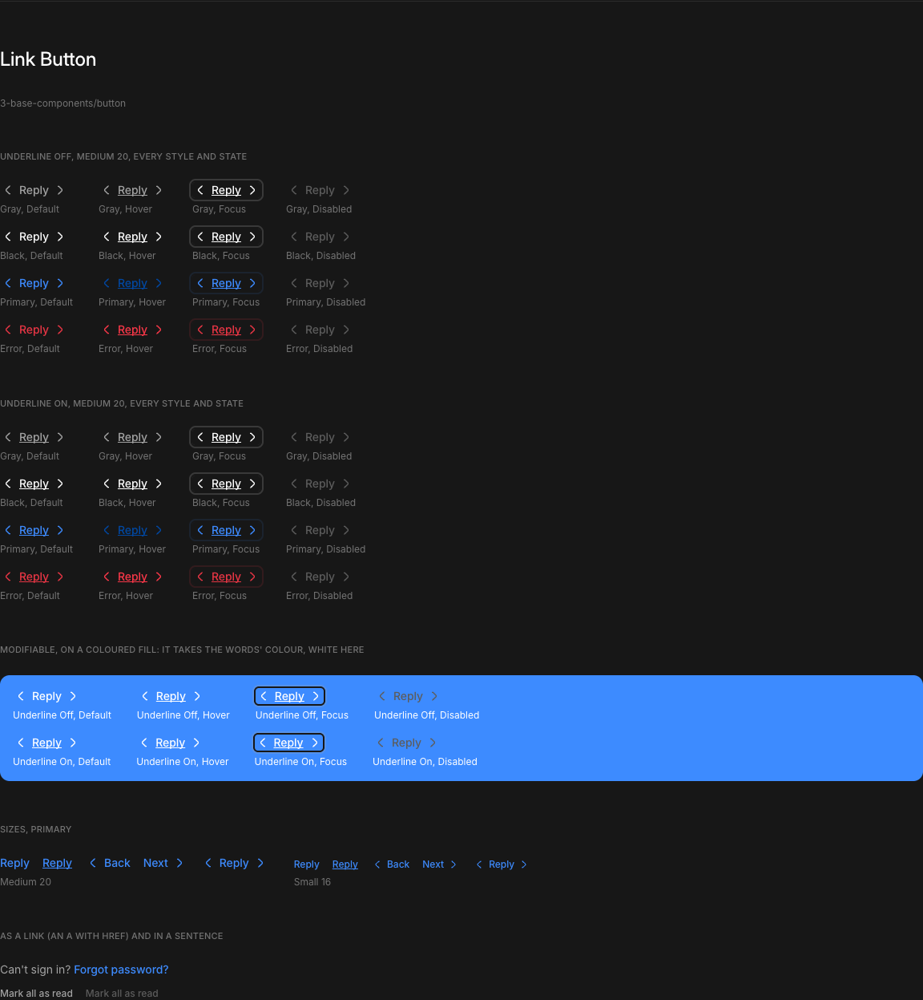
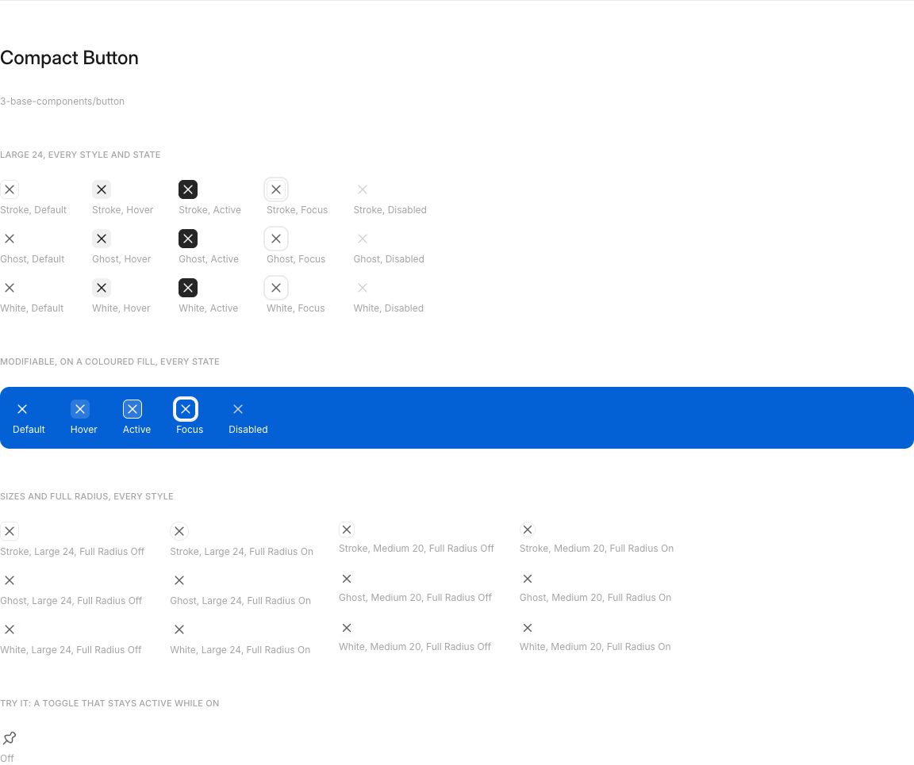
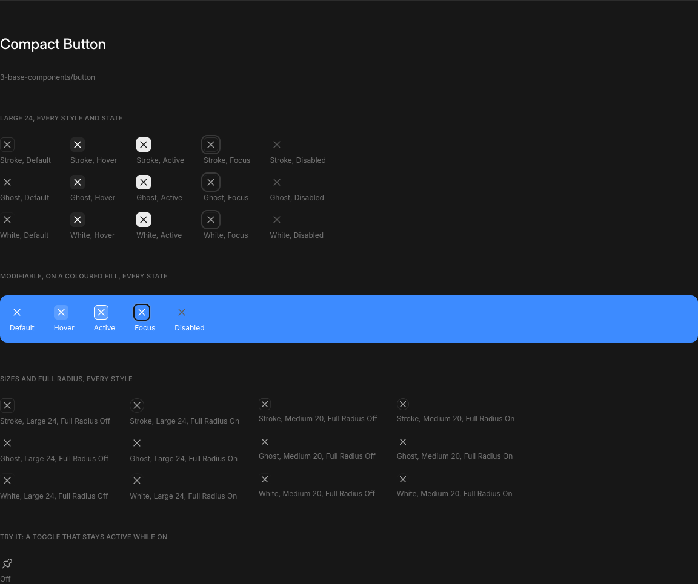
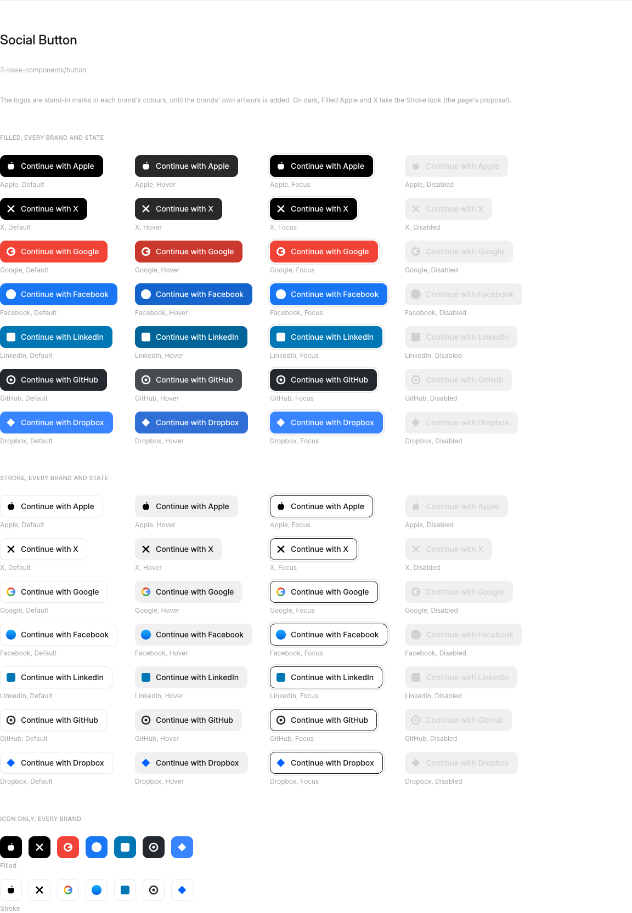
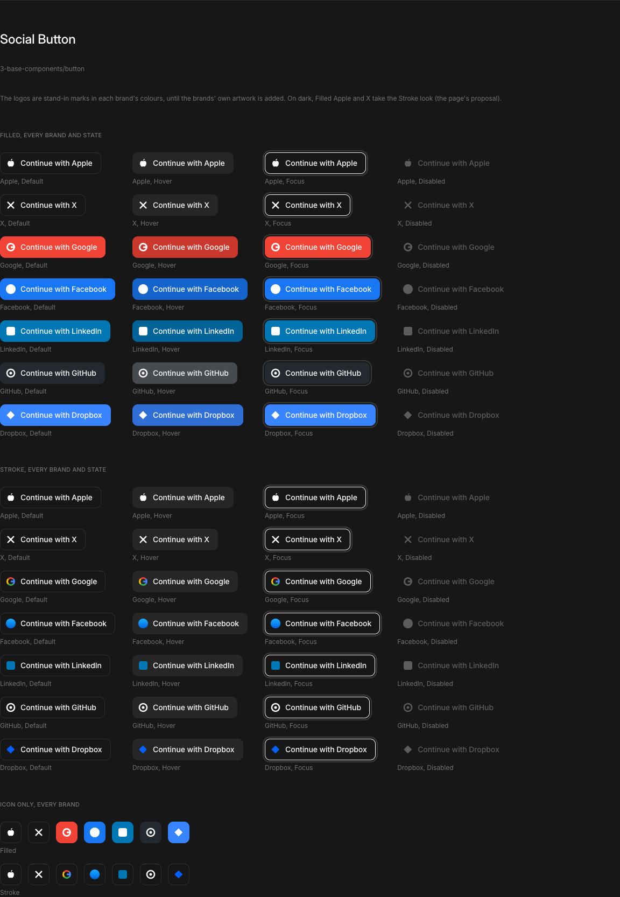
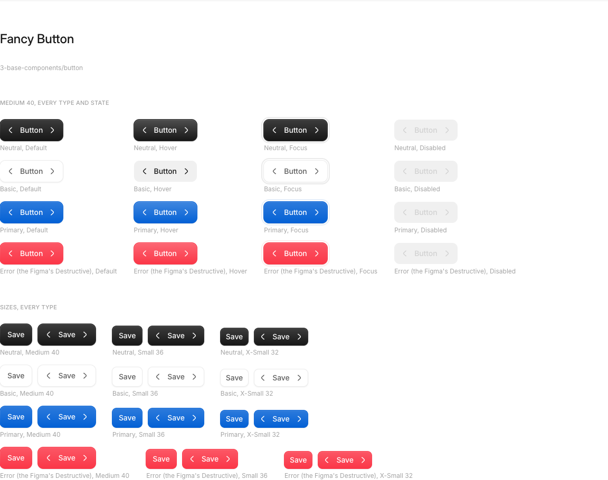
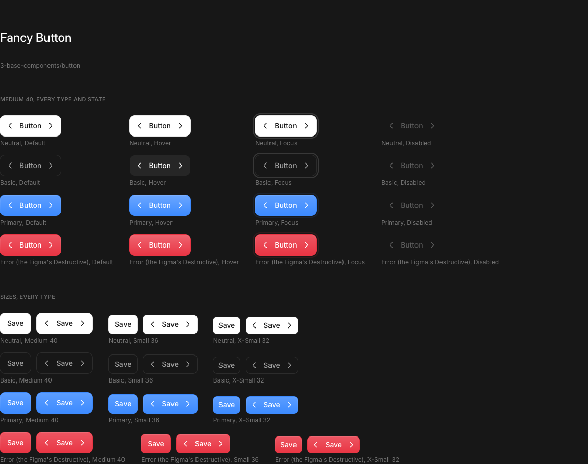

<!-- Copied from the design copy (neutrino-frontend-v3) by scripts/sync.mjs. Edit it there, then run `npm run sync`. -->

# Button

| | |
|---|---|
| Figma | [Button](https://www.figma.com/design/Ao3YVgFYdQIF0znq2ToqVl?node-id=129-605) page |
| Status, Button | Approved for now, 18 Oct 2026; coded 19 Oct 2026 |
| Status, Link Button | Written 19 Oct 2026; coded 19 Oct 2026 |
| Status, Compact Button | Written 19 Oct 2026; coded 19 Oct 2026 |
| Status, Social Button | Written 19 Oct 2026; coded 19 Oct 2026 |
| Status, Fancy Button | Written 19 Oct 2026; coded 19 Oct 2026 |
| Code | [`src/components/ds/button.tsx`](../../src/components/ds/button.tsx), [`src/components/ds/link-button.tsx`](../../src/components/ds/link-button.tsx), [`src/components/ds/compact-button.tsx`](../../src/components/ds/compact-button.tsx), [`src/components/ds/social-button.tsx`](../../src/components/ds/social-button.tsx), [`src/components/ds/fancy-button.tsx`](../../src/components/ds/fancy-button.tsx) |
| Sizes | [`src/styles/size-tokens.css`](../../src/styles/size-tokens.css), [`src/styles/sizes/link-button.css`](../../src/styles/sizes/link-button.css), [`src/styles/sizes/compact-button.css`](../../src/styles/sizes/compact-button.css), [`src/styles/sizes/social-button.css`](../../src/styles/sizes/social-button.css), [`src/styles/sizes/fancy-button.css`](../../src/styles/sizes/fancy-button.css) |
| Demo | [`src/gallery/sections/button.tsx`](../../src/gallery/sections/button.tsx), [`src/gallery/sections/link-button.tsx`](../../src/gallery/sections/link-button.tsx), [`src/gallery/sections/compact-button.tsx`](../../src/gallery/sections/compact-button.tsx), [`src/gallery/sections/social-button.tsx`](../../src/gallery/sections/social-button.tsx), [`src/gallery/sections/fancy-button.tsx`](../../src/gallery/sections/fancy-button.tsx) |

## Light and dark

### Button

**Light**



**Dark**



### Link Button

**Light**



**Dark**



### Compact Button

**Light**



**Dark**



### Social Button

**Light**



**Dark**



### Fancy Button

**Light**



**Dark**



## Use it

```tsx
import { Button } from "@/components/ds/button";
import { LinkButton } from "@/components/ds/link-button";
import { CompactButton } from "@/components/ds/compact-button";
import { SocialButton } from "@/components/ds/social-button";
import { FancyButton } from "@/components/ds/fancy-button";
```

Every size and state, working: run `npm run dev` and open [localhost:3100/#button](http://localhost:3100/#button).

## Spec

### Button

Status: approved for now by Nitesh, 18 Oct 2026. Sizes copied from the Figma; colours are the Figma's own tokens, with our palette's values. Nitesh checks it again when it appears inside the modal.

Figma: "Buttons [1.1]", https://www.figma.com/design/Ao3YVgFYdQIF0znq2ToqVl?node-id=129-1422 (the Button page is node 129:605).

The rule for this page: shape, size, spacing, type and states come exactly from the Figma. Colours come from our palette (`../colors/colors.md`), never from the Figma's own hex values. Every number here becomes a size token, so it can be changed later in one place (`../README.md`, "Sizes work the same way").

#### Rules

1. Every button in the product is this one Button. Never style a `<button>` by hand.
2. Use only the types, styles, sizes and states on this page.
3. Never change a Button's height, padding, corner or font from outside. Pick a size instead.
4. Something missing (a new size, a new style)? Stop and ask Nitesh, then add it here first.

#### What it has

| Property | Options |
|---|---|
| Type | Primary, Neutral, Error |
| Style | Filled, Stroke, Lighter, Ghost |
| State | Default, Hover, Focus, Disabled |
| Size | Medium (40), Small (36), X-Small (32), 2X-Small (28) |
| Icon only | Off, On (a square with one icon) |

A button can have an icon before the word, after it, both, or none.

When to use which type and style is not decided yet. Ask Nitesh.

#### Sizes

| Size | Height | Padding, top and bottom | Padding, sides | Gap | Corner | Icon only |
|---|---|---|---|---|---|---|
| Medium | 40 | 10 | 10 | 4 | 10 | 40 x 40, padding 10 |
| Small | 36 | 8 | 8 | 4 | 8 | 36 x 36, padding 8 |
| X-Small | 32 | 6 | 6 | 2 | 8 | 32 x 32, padding 6 |
| 2X-Small | 28 | 4 | 6 | 2 | 8 | 28 x 28, padding 4 |

The same at every size:

* Word: Inter Medium 14/20, letter spacing -0.6%. In code, `text-label-sm`.
* The word sits in its own box with 4px on each side. So icon to word is 8px on Medium and Small, 6px on X-Small and 2X-Small.
* Icons: 20 x 20, Hugeicons Stroke Rounded. The Figma uses Remix icons as placeholders.
* Width follows the content. Everything is centred.
* The edge, where a style has one, is 1px and sits inside the button, so it never changes the size.

#### Colours

Only tokens from `../colors/colors.md`, named as in the Figma. Where the Figma frame uses a token, this page uses the same one; its values come from our palette in both themes. The Figma has no dark buttons: the dark look is whatever each token is on dark.

##### Each type's colours

| Slot | Primary | Neutral | Error |
|---|---|---|---|
| Solid fill | `primary/base` | `bg/surface-800` | `state/error/base` |
| Solid fill, hover | `primary/dark` | `bg/strong-950` | `state/error/hover` |
| Words on the solid fill | `static/white` | `text/white-0` | `static/white` |
| Words at rest | `primary/base` | `text/sub-600` | `state/error/base` |
| Words on hover and focus | `primary/base` | `text/strong-950` | `state/error/base` |
| Wash | `primary/alpha-10` | `bg/weak-50` | `state/error/lighter` |
| Edge at rest | `primary/base` | `stroke/soft-200`, plus `--shadow-card` | `state/error/base` |
| Edge on focus | `primary/base` | `stroke/strong-950` | `state/error/base` |
| Focus ring | `primary/alpha-10` | `state/faded/light` | `state/error/lighter` |

Icons take the same token as the words, in the `icon/` group where there is one: `icon/sub-600`, `icon/strong-950`, `icon/white-0`, `icon/disabled-300`.

##### Style and state

| Style | Default | Hover | Focus |
|---|---|---|---|
| Filled | Solid fill, words on the solid fill | Solid fill, hover | Solid fill, plus the focus ring |
| Stroke | `bg/white-0`, edge at rest, words at rest | Wash, no edge, words on hover | `bg/white-0`, edge on focus, words on focus, plus the focus ring |
| Lighter | Wash, no edge, words at rest | `bg/white-0`, edge at rest, words on hover | Same as Stroke |
| Ghost | No fill, no edge, words at rest | Wash, no edge, words on hover | Same as Stroke |

Disabled, every type and style: `bg/weak-25`, no edge, no shadow, words `text/disabled-300`, icons `icon/disabled-300`.

##### Focus ring

Two rings outside the button, no blur: first 2px in `bg/white-0` (so it reads as a gap), then 2px more in the type's focus ring token.

##### Where this differs from the Figma frame

| Figma | Ours | Why |
|---|---|---|
| Error hover `red/700`, straight from its palette | `state/error/hover` (Neutrino only) | Every colour goes through a token |
| Error wash and ring `alpha/red/alpha-10` | `state/error/lighter` | The one faint red everywhere |
| Neutral ring, slate `#99A0AE` at 16% | `state/faded/light` | Our palette has no slate |
| Shadow `regular-shadow/x-small` | `--shadow-card` | The same shadow; shadows become tokens next |

Values, not names, also move to our palette: for example `primary/base` is our Blue 500 (Blue 400 on dark), not the Figma's #335CFF.

#### In code (to decide when building)

* The code Button today is `components/ui/button.tsx`, the stock shadcn one, used in 184 files. Changing it changes every screen.
* Its old names must keep working, or every caller gets updated.
* Proposed mapping from the old names: `default` to Primary Filled, `destructive` to Error Filled, `outline` to Neutral Stroke, `secondary` to Neutral Lighter, `ghost` to Neutral Ghost. `link` belongs to Link Buttons (below).
* Proposed sizes: `default` to Medium, `sm` to Small, `lg` to Medium, `icon` to Medium icon only. X-Small and 2X-Small are new.

#### Other button families on the same Figma page

Each has its own page: `link-button.md`, `social-button.md`, `fancy-button.md`, `compact-button.md`.

| Family | Figma node | Variants |
|---|---|---|
| Link Buttons | 168:4889 | Gray, Black, Primary, Error, Modifiable; Medium (20), Small (16); underline on or off |
| Social Buttons | 180:4264 | Apple, Github, X, Google, Facebook, Dropbox, Linkedin; Filled, Stroke |
| Fancy Buttons | 181:5291 | Neutral, Basic, Primary, Destructive; Medium, Small, X-Small |
| Compact Button | 189:3646 | Stroke, Ghost, Modifiable, White; Large (24), Medium (20); full radius on or off |

### Link Button

Status: written 18 Oct 2026, measured from the Figma. Its proposals stand until Nitesh reviews every component together on one canvas.

Figma: "Link Buttons [1.1]" (node 168:4889) on the Button page (129:605) of https://www.figma.com/design/Ao3YVgFYdQIF0znq2ToqVl.

The rule for this page: shape, size, spacing, type and states come exactly from the Figma. Colours are the tokens the Figma frame uses, with our palette's values (`../colors/colors.md`). Every number here becomes a size token, so it can be changed later in one place (`../README.md`, "Sizes work the same way").

#### Rules

1. Words that work like a link, in a sentence or at the end of a row ("Forgot password?", "Reply", "Mark all as read"), are this Link Button. Anything with a fill or an edge is the Button (`button.md`).
2. Never style an `<a>` or a bare text button by hand, and never add an underline on hover to plain words.
3. Modifiable is only for links on a coloured fill (a Filled alert or banner). Something missing? Stop and ask Nitesh, then add it here first.

#### What it has

| Property | Options |
|---|---|
| Style | Gray, Black, Primary, Error, Modifiable (white, for coloured fills) |
| State | Default, Hover, Focus, Disabled |
| Size | Medium (20), Small (16) |
| Underline | Off, On |
| Icons | An optional icon before the words and an optional icon after them (both on in the Figma) |

#### Sizes

| Size | Height | Words | Icons | Gap | Padding | Corner |
|---|---|---|---|---|---|---|
| Medium | 20 | `text-label-sm` (14/20, 500) | 20 x 20 | 4 | none | none |
| Small | 16 | `text-label-xs` (12/16, 500) | 16 x 16 | 4 | none | none |

* Width follows the content. Icons and words are centred on the line.
* Icons: Hugeicons Stroke Rounded. The Figma's arrows are placeholders.
* The underline: one solid line in the words' colour, at the font's own thickness and distance (the Figma's Auto). It runs through the letters' tails (skip ink off).
* No fill, no edge and no shadow in any state.

#### States

When the line shows:

| State | Underline Off | Underline On |
|---|---|---|
| Default | no line | line |
| Hover | line | line |
| Focus | line | line |
| Disabled | no line | no line |

So Hover and Focus always show the line, and Disabled always hides it.

#### Colours

Words and icons always share a colour: words take the `text/` token, icons the `icon/` token of the same name.

| Style | Default | Hover | Focus | Disabled |
|---|---|---|---|---|
| Gray | `text/sub-600`, `icon/sub-600` | the same | `text/strong-950`, `icon/strong-950` | `text/disabled-300`, `icon/disabled-300` |
| Black | `text/strong-950`, `icon/strong-950` | the same | the same | `text/disabled-300`, `icon/disabled-300` |
| Primary | `primary/base` | `primary/dark` | `primary/base` | `text/disabled-300`, `icon/disabled-300` |
| Error | `state/error/base` | `state/error/hover` | `state/error/base` | `text/disabled-300`, `icon/disabled-300` |
| Modifiable | `static/white` | `static/white` | `static/white` | `text/disabled-300`, `icon/disabled-300` |

Modifiable is the link on a coloured fill: the Filled Alert and Banner use it (`alert.md`, `banner.md`). Its name says its colour can follow what it sits on; the Figma draws it white.

Every colour is the Figma frame's own token, except the two below.

#### Where this differs from the Figma

| Figma | Ours | Why |
|---|---|---|
| Every underlined word (Underline On, and every Hover and Focus) has no text style: Inter Medium 14/20, -0.6% (Medium) or 12/16, 0% (Small), underlined | `text-label-sm underline` (Medium), `text-label-xs underline` (Small) | A slip; the numbers match Label/Small and Label/X Small exactly. The same slip shows on the Alert, Banner, Drawer, Rating and Activity Feed pages, which use this link |
| Error hover `red/700`, straight from its palette | `state/error/hover` (Neutrino only) | Every colour goes through a token, as on the Button |
| Modifiable `neutral/slate/0`, a palette white | `static/white` | Every colour goes through a token |

#### Open

1. Focus is hard to see. The Figma's Focus is the line (plus a darker Gray), so an underlined Primary, Error, Black or Modifiable link looks the same in Focus as in Default. Proposal: keep the Figma's look and add the focus ring of its type from `button.md`, outside, no blur: the Neutral ring (2px `bg/white-0`, then 4px `state/faded/light`, token `--focus-neutral`) for Gray, Black and Modifiable, the Primary ring (`primary/alpha-10`, `--focus-primary`) for Primary, the Error ring (`state/error/lighter`, `--focus-error`) for Error (`../shadows/shadows.md`). The link has no corner, so the ring needs one: 4 proposed.
2. Gray turns darker on Focus but not on Hover, while the Button's Neutral words darken on hover (`text/sub-600` to `text/strong-950`). Should Gray's Hover also go to `text/strong-950`? Kept as the Figma until Nitesh says.
3. Disabled Modifiable turns `text/disabled-300` grey, which may not read on a coloured fill. Ask Nitesh whether it should be white at a lower strength instead.

#### Build order

Nothing; it is words and icons. Build it before the pages that use it: the Checkbox Label, Key Components' Label, Alert, Banner, Drawer, Modal, Rating, Activity Feed and Notification Feed.

#### In code (to decide when building)

* The stock Button's `link` variant (`components/ui/button.tsx`) is used in 1 file, `app/(dashboard)/dashboards/page.tsx`. It moves to this Link Button (`button.md`, "In code").
* Other screens draw their own links with `hover:underline` (10 files, for example "Contact your admin" in `components/auth/login-form.tsx`). They move here when rebuilt.
* It is an `<a>` when it goes somewhere and a `<button>` when it does something; the look is the same.
* Proposed: Modifiable uses `currentColor`, so it follows the words of what it sits in; white is what it is on Filled alerts and banners.
* The underline in CSS: `text-decoration-skip-ink: none`, thickness and offset `auto`.

### Compact Button

Status: written 18 Oct 2026, measured from the Figma. Its proposals stand until Nitesh reviews every component together on one canvas.

Figma: "Compact Button [1.1]" (node 189:3646) on the Button page (129:605) of https://www.figma.com/design/Ao3YVgFYdQIF0znq2ToqVl.

The rule for this page: shape, size, spacing, type and states come exactly from the Figma. Colours are the tokens the Figma frame uses, with our palette's values (`../colors/colors.md`). Every number here becomes a size token, so it can be changed later in one place (`../README.md`, "Sizes work the same way").

#### Rules

1. A small icon-only control inside another component (the close icon on a modal, drawer, tooltip or notification, a row's "more" menu, the date picker's arrows) is this Compact Button. An icon button that stands on its own in a toolbar or on a page is the Button with Icon only (`button.md`).
2. Use only the styles, sizes and states on this page. Never draw a clickable icon by hand.
3. Something missing? Stop and ask Nitesh, then add it here first.

#### What it has

| Property | Options |
|---|---|
| Style | Stroke (white, an edge and a shadow), Ghost (no fill), White (white and a shadow, no edge), Modifiable (white icon, for coloured fills) |
| State | Default, Hover, Active (pressed, or on), Disabled |
| Size | Large (24), Medium (20) |
| Full Radius | Off (corner 6), On (a circle) |

One icon and nothing else. The Figma's close icon is a placeholder for any icon.

#### Sizes

| Size | Box | Padding | Icon | Corner, Full Radius Off | Corner, Full Radius On |
|---|---|---|---|---|---|
| Large | 24 x 24 | 2 | 20 x 20 | 6 | full |
| Medium | 20 x 20 | 1 | 18 x 18 | 6 | full |

* The icon is centred. Hugeicons Stroke Rounded.
* The edge, where a style has one, is 1px and sits inside, so it never changes the size.
* Shadow, where a style has one: `--shadow-card` (the Figma's `regular-shadow/x-small`: 0 down 1, blur 2, `#0A0D14` at 3%).

#### Colours

| Style | Default | Hover | Active | Disabled |
|---|---|---|---|---|
| Stroke | `bg/white-0`, 1px `stroke/soft-200` edge, `--shadow-card`; icon `icon/sub-600` | `bg/weak-50`, no edge, no shadow; icon `icon/strong-950` | `bg/surface-800`, no edge, no shadow; icon `icon/white-0` | no fill, no edge, no shadow; icon `icon/disabled-300` |
| Ghost | no fill; icon `icon/sub-600` | `bg/weak-50`; icon `icon/strong-950` | `bg/surface-800`; icon `icon/white-0` | no fill; icon `icon/disabled-300` |
| White | `bg/white-0`, `--shadow-card`, no edge; icon `icon/sub-600` | `bg/weak-50`, no shadow; icon `icon/strong-950` | `bg/surface-800`, no shadow; icon `icon/white-0` | no fill, no shadow; icon `icon/disabled-300` |
| Modifiable | no fill; icon `static/white` | white at 16% (see Open); icon `static/white` | white at 16%, 1px `static/white` edge inside; icon `static/white` | no fill; icon `icon/disabled-300` |

Stroke, Ghost and White share Hover, Active and Disabled; only their Default differs.

Modifiable is for a coloured fill, such as a Filled alert or banner, like the Link Button's Modifiable (`link-button.md`).

Every colour is the Figma frame's own token, except the ones below.

#### Where this differs from the Figma

| Figma | Ours | Why |
|---|---|---|
| Modifiable icon and edge `neutral/slate/0`, a palette white | `static/white` | Every colour goes through a token |
| Modifiable Hover and Active fill `alpha/white/alpha-16`, a palette white at 16% | No token yet (Open, 2) | `overlay/tint-16` is black at 16% on light, so it does not fit |
| Shadow `regular-shadow/x-small` | `--shadow-card` | The same shadow, as on the Button (`../shadows/shadows.md`) |

#### Open

1. No keyboard focus look. Proposal: the Neutral focus ring from `button.md` (2px `bg/white-0`, then 4px `state/faded/light`, outside, no blur; token `--focus-neutral`) on every style, following the corner (6 or full). On Modifiable, over a coloured fill, ask Nitesh whether the white gap reads well.
2. A see-through white that stays white in both themes, for the Modifiable fill. Proposal: a Neutrino-only `static/white-alpha-16` in `colors/build.mjs`. The Social Button's hover needs the same white at 16%, and a black at 16% (`social-button.md`).
3. Disabled drops the Stroke and White styles' fill, edge and shadow, leaving a faint icon, while the Button's Disabled keeps a `bg/weak-25` fill. Kept as the Figma; ask Nitesh whether that is meant.
4. Disabled Modifiable turns `icon/disabled-300`, which may not read on a coloured fill (the same question as on the Link Button).
5. On dark, `--shadow-card` disappears (`../shadows/shadows.md`, "Light and dark"), so the White style is only its fill there. Fine on a dark page, where `bg/white-0` is a step above it.

#### Build order

Nothing; it is one icon in a box. Build it before the pages that use it: the Tooltip (Large's close), Modal, Drawer, Notification Feed, Activity Feed and Date Picker (White, Large, for the arrows).

#### In code (to decide when building)

* Nothing shared today. Close buttons are drawn by hand inside `components/ui/dialog.tsx`, `components/ui/sheet.tsx` and `components/ui/toast.tsx`; they move to the Compact Button, Ghost, Large, when the Modal, Drawer and toasts are rebuilt.
* `components/shell/bar-icon-button.tsx` (36 x 36, used by 2 other files) is a bigger icon button for the bottom bar. It belongs to the Button's Icon only, not here.
* An icon on its own needs words for screen readers: every Compact Button takes a label (`aria-label`), as `bar-icon-button.tsx` already does.
* Full Radius On is the corner `full` on the radius scale.

### Social Button

Status: written 18 Oct 2026, measured from the Figma. Its proposals stand until Nitesh reviews every component together on one canvas.

Figma: "Social Buttons [1.1]" (node 180:4264) on the Button page (129:605) of https://www.figma.com/design/Ao3YVgFYdQIF0znq2ToqVl.

The rule for this page: shape, size, spacing, type and states come exactly from the Figma. Colours are the tokens the Figma frame uses, with our palette's values (`../colors/colors.md`). Every number here becomes a size token, so it can be changed later in one place (`../README.md`, "Sizes work the same way").

#### Rules

1. Signing in or connecting with another company's account ("Continue with Microsoft") is this Social Button. Never build a brand's button out of the Button by hand.
2. The logo is the brand's own artwork, at the size on this page. Never redraw or recolour it except as written here.
3. A brand that is not here (Microsoft is not)? Stop and ask Nitesh, then add it here first.

#### What it has

| Property | Options |
|---|---|
| Brand | Apple, X (Twitter), Google, Facebook, LinkedIn, GitHub, Dropbox |
| Style | Filled (the brand's colour), Stroke (white with an edge) |
| State | Default, Hover, Focus |
| Only Icon | Off (logo and words), On (a square with the logo) |

The words can be changed; the Figma says "Login with Brand".

#### Sizes

One size, as tall as the Button's Medium.

| Part | With words | Icon only |
|---|---|---|
| Height | 40 | 40 |
| Width | follows the content (166 in the Figma) | 40 |
| Padding | 10 top and bottom, 10 left, 16 right | 10 |
| Gap, logo to words | 8 | |
| Corner | 10 | 10 |
| Logo | 20 x 20 | 20 x 20 |
| Words | `text-label-sm` (14/20, 500) | |

* Everything is centred.
* The edge, in the Stroke style, is 1px and sits inside, so it never changes the size.

#### Colours

##### Filled

| Part | Default | Hover | Focus |
|---|---|---|---|
| Fill | the brand's colour (Brand colours, below) | the brand's colour with a layer on top at 16%: white for Apple, X and GitHub, black for the others | the brand's colour |
| Words and logo | `static/white` (the logo in its one-colour white form) | the same | the same |
| Ring | none | none | the Neutral focus ring |

##### Stroke

| Part | Default | Hover | Focus |
|---|---|---|---|
| Fill | `bg/white-0` | `bg/weak-50` | `bg/white-0` |
| Edge | 1px `stroke/soft-200` | none | 1px `stroke/strong-950` |
| Shadow or ring | `--shadow-card` | none | the Neutral focus ring |
| Words | `text/strong-950` | the same | the same |
| Logo | the brand's own colours (below) | the same | the same |

The Neutral focus ring is the Figma's own `components/buttons/important-focus`, the same ring as the Button's Neutral type (`button.md`): 2px `bg/white-0`, then 4px `state/faded/light`, outside, no blur. Token `--focus-neutral` (`../shadows/shadows.md`).

##### Brand colours

| Brand | Filled: fill | Filled: hover layer | Stroke: logo |
|---|---|---|---|
| Apple | #000000 | white at 16% | `social/apple`: #000000 on light, #FFFFFF on dark |
| X (Twitter) | #000000 | white at 16% | `social/twitter`: #010101 on light, #FFFFFF on dark |
| GitHub | #24292F | white at 16% | `social/github`: #24292F on light, #FFFFFF on dark |
| Google | #F14336 | black at 16% | four colours: blue #4285F4, yellow #FBBC05, red #EA4335, green #34A853 |
| Facebook | #1977F3 | black at 16% | a gradient, #0062E0 at the bottom to #19AFFF at the top |
| LinkedIn | #0077B5 | black at 16% | #0077B5 |
| Dropbox | #3984FF | black at 16% | #0061FF |

`social/apple`, `social/twitter` and `social/github` are tokens in the Figma, with a light and a dark value, so the three near-black logos turn white on dark. Every other brand colour is typed in.

Every colour that is not a brand's is the Figma frame's own token, except the two below.

#### Where this differs from the Figma

| Figma | Ours | Why |
|---|---|---|
| Focus ring in slate `#99A0AE` at 16% (`alpha/slate/alpha-16`) | `state/faded/light` | As on the Button: our palette has no slate |
| Shadow `regular-shadow/x-small` | `--shadow-card` | The same shadow, as on the Button |

#### Open

1. Brand colours are the brands' own, so this page is the one place a brand's hex is allowed. Nitesh to confirm. If yes, proposed: `social/apple`, `social/twitter` and `social/github` go into `colors/build.mjs` as tokens with their light and dark values; the Filled fills and the two hover layers go in as Neutrino-only `social/` tokens, the same in both themes; the many-coloured logos (Google, Facebook) keep their colours inside the logo file.
2. Check each brand's own rules before this ships (unsure, worth a look): Google asks for its full-colour G on a white, light grey or near-black button, so the red Filled Google may not be allowed; LinkedIn's current blue is #0A66C2 (the Figma has the older #0077B5); Facebook's is #1877F2 (the Figma has #1977F3). Inside the Figma, Dropbox's Filled #3984FF is lighter than its logo's #0061FF, and Google's Filled #F14336 is not its logo red #EA4335.
3. Microsoft is missing. Today the login offers only "Continue with Microsoft" (`components/auth/login-form.tsx`). Proposal: add Microsoft, Stroke style, with its own four-colour logo. Ask Nitesh.
4. No Disabled state. Proposal: the Button's Disabled (`bg/weak-25`, no edge, no shadow, words `text/disabled-300`) with the logo in `icon/disabled-300`. Ask Nitesh whether a brand logo may go grey.
5. Dark theme: Filled Apple and X are #000000 in both themes and almost vanish on the dark page (`bg/page` is #111111 there); `--shadow-card` also disappears on dark. Proposal: on dark, Apple and X use the Stroke style. Ask Nitesh.
6. The white and black at 16% hover layers have no token that stays the same in both themes (the same need as the Compact Button's Modifiable, `compact-button.md`).
7. No pressed state, as on the Button.

#### Build order

Nothing; it is a logo and words. The logos come from one place (below).

#### In code (to decide when building)

* Today the login form draws "Continue with Microsoft" itself, as an outline Button with an 18 x 18 logo (`components/auth/login-form.tsx`). It becomes a Social Button, Stroke, once Microsoft is added here; the logo then grows to 20.
* `components/brand-mark.tsx` (used in 10 files) already holds brand logos and turns near-black ones white on dark, the same idea as `social/github`. It has GitHub and Microsoft today; Apple, X, Google, Facebook, LinkedIn and Dropbox would be added there, so every brand logo lives in one place.
* The words are the product's: "Continue with Microsoft" today, "Login with Brand" in the Figma. This page does not set them.

### Fancy Button

Status: written 18 Oct 2026, measured from the Figma. Its proposals stand until Nitesh reviews every component together on one canvas.

Figma: "Fancy Buttons [1.1]" (node 181:5291) on the Button page (129:605) of https://www.figma.com/design/Ao3YVgFYdQIF0znq2ToqVl.

The rule for this page: shape, size, spacing, type and states come exactly from the Figma. Colours are the tokens the Figma frame uses, with our palette's values (`../colors/colors.md`). Every number here becomes a size token, so it can be changed later in one place (`../README.md`, "Sizes work the same way").

#### Rules

1. When to use a Fancy Button instead of the Button (`button.md`) is not decided. Ask Nitesh before using one.
2. Build every layer listed here, in this order. Never fake the shine with opacity, a filter or a different colour.
3. Something missing? Stop and ask Nitesh, then add it here first.

#### What it has

| Property | Options |
|---|---|
| Type | Neutral (dark), Basic (white), Primary (blue), Destructive (red) |
| State | Default, Hover, Disabled |
| Size | Medium (40), Small (36), X-Small (32) |
| Icons | An optional icon before the word and an optional icon after it (both on in the Figma) |

#### Sizes

| Size | Height | Padding, all sides | Gap | Corner |
|---|---|---|---|---|
| Medium | 40 | 10 | 4 | 10 |
| Small | 36 | 8 | 4 | 8 |
| X-Small | 32 | 6 | 4 | 8 |

The same at every size:

* Word: `text-label-sm` (14/20, 500), in its own box with 4px on each side, as on the Button. So icon to word is 8.
* Icons: 20 x 20, Hugeicons Stroke Rounded. The Figma's arrows are placeholders.
* Width follows the content. Everything is centred.
* The 1px ring (layer 4 below) is drawn outside the button as a shadow: it takes no space, so the button looks 1px bigger on every side than its height. The shine and the inside edge are cut to the corner.

#### Layers

From the bottom up, as the Figma stacks them. "Shine" is a white gradient over the fill; "inside edge" is a 1px gradient line just inside the border.

##### Neutral, Primary, Destructive

| Layer | Neutral | Primary | Destructive |
|---|---|---|---|
| 1. Fill | `bg/strong-950` | `primary/base` | `state/error/base` |
| 2. Shine | top to bottom, `static/white` 100% to 0%, the whole layer at 16% | the same | the same |
| 3. Inside edge, 1px | top to bottom, `static/white` 12% to 0% | the same | the same |
| 4. Ring, 1px outside (no offset, no blur) | `bg/surface-800` | `primary/base` | `state/error/base` |
| 5. Drop shadow | 0 down 1, blur 2, `#1B1C1D` at 48% | 0 down 1, blur 2, `#0E121B` at 24% | the same as Primary |
| Word and icons | `text/white-0`, `icon/white-0` | `static/white` | `static/white` |

Hover: only the shine changes, from 16% to 24%. Every other layer stays.

##### Basic

| Layer | Default | Hover |
|---|---|---|
| 1. Fill | `bg/white-0` | `bg/weak-50` |
| Ring, 1px outside (no offset, no blur) | `stroke/soft-200` | none |
| Drop shadow | 0 down 1, blur 3, `#0E121B` at 12% | none |
| Word | `text/sub-600` | `text/strong-950` |
| Icons | `icon/sub-600` | `icon/strong-950` |

Basic has no shine and no inside edge.

##### Disabled, every type

`bg/weak-25`, no shine, no inside edge, no ring, no shadow; word `text/disabled-300`, icons `icon/disabled-300`. The same as the Button's Disabled.

##### Shadow tokens

The ring and the drop shadow of each type are one Figma effect style, so each becomes one shadow token (`../shadows/shadows.md`):

| Figma effect style | Token | In CSS |
|---|---|---|
| `components/fancy-buttons/neutral` | `--shadow-fancy-neutral` | `0 0 0 1px var(--bg-surface-800), 0 1px 2px rgba(27, 28, 29, 0.48)` |
| `components/fancy-buttons/primary` | `--shadow-fancy-primary` | `0 0 0 1px var(--primary-base), 0 1px 2px rgba(14, 18, 27, 0.24)` |
| `components/fancy-buttons/error` | `--shadow-fancy-error` | `0 0 0 1px var(--state-error-base), 0 1px 2px rgba(14, 18, 27, 0.24)` |
| `components/fancy-buttons/stroke` (Basic) | `--shadow-fancy-stroke` | `0 0 0 1px var(--stroke-soft-200), 0 1px 3px rgba(14, 18, 27, 0.12)` |

The shine and the inside edge, in CSS:

* Shine: `linear-gradient(to bottom, rgb(255 255 255 / 0.16), rgb(255 255 255 / 0))` over the fill; `0.24` on hover.
* Inside edge: `linear-gradient(to bottom, rgb(255 255 255 / 0.12), rgb(255 255 255 / 0))`, 1px wide, following the corner.

Every colour is the Figma frame's own token, except the ones below. The colours the Figma types in directly are the drop shadows (`#1B1C1D`, `#0E121B`); they become shadow tokens with the others.

#### Where this differs from the Figma

| Figma | Ours | Why |
|---|---|---|
| Neutral's ring typed in, `#242628` | `bg/surface-800` (Gray 700 #262626 on light) | The nearest token; every colour goes through a token |
| The shine and inside edge typed in, `#FFFFFF` | `static/white` at the same strengths | Every colour goes through a token |
| Neutral Hover types its ring and shadow in, not the `components/fancy-buttons/neutral` style | `--shadow-fancy-neutral` | The same values; a slip |

Values, not names, also move to our palette: `primary/base` is our Blue 500 (Blue 400 on dark), not the Figma's #335CFF; `state/error/base` is our Red 600, not #FB3748.

#### Open

1. No Focus state. Proposal, as on the Button: the Neutral focus ring (`--focus-neutral`) for Neutral and Basic, the Primary ring (`--focus-primary`) for Primary, the Error ring (`--focus-error`) for Destructive. Each is 2px `bg/white-0`, then 4px in the ring colour, outside, no blur, drawn outside the 1px ring.
2. When to use it: the Fancy Button or the Button? Ask Nitesh (rule 1).
3. X-Small has a 4 gap here and a 2 gap on the Button. Kept as the Figma; ask Nitesh whether they should match.
4. Hover gets lighter here (the shine goes up), while the Button's Primary and Error get darker (`primary/dark`, `state/error/hover`). Kept as the Figma; worth a look side by side.
5. Dark theme: Neutral turns white (`bg/strong-950` is Gray 0 on dark), so its white shine and inside edge vanish, and its ring turns Gray 200. And by the shadow rule for dark (`../shadows/shadows.md`) the drop shadows go, leaving only the 1px rings. Ask Nitesh whether dark needs its own shine.
6. The Figma calls the red type Destructive; the Button calls it Error. Proposed: call it Error in code, so the two match.

#### Build order

Nothing; it is a word and icons. It shares its sizes, word box and icons with the Button.

#### In code (to decide when building)

* There is no Fancy Button in code today.
* Proposed: a look of the one Button (`components/ui/button.tsx`) rather than a second component, since sizes, word and icons match.
* The shine is a second background layer over the fill colour. The ring and the drop shadow are one `box-shadow`, the tokens above.
* The inside edge is a gradient line that must follow the corner. CSS `border-image` drops the corner, so it needs a pseudo-element with a mask.
