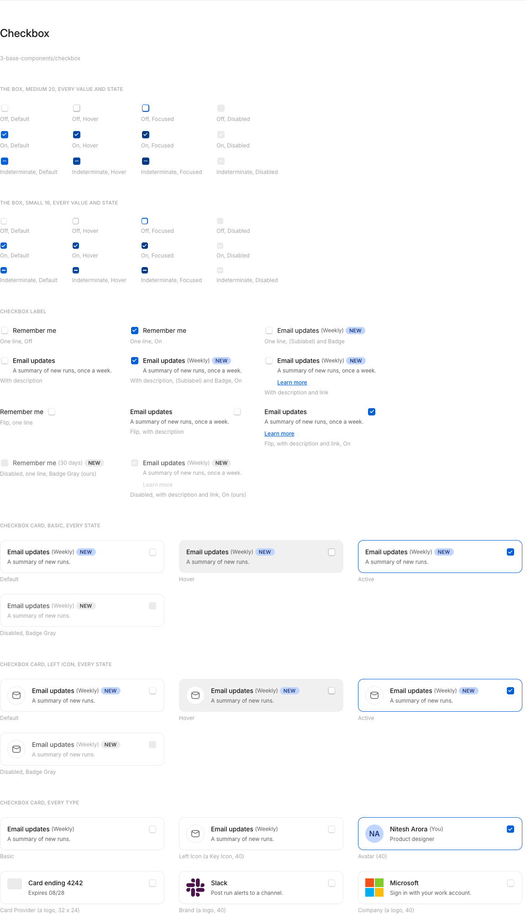
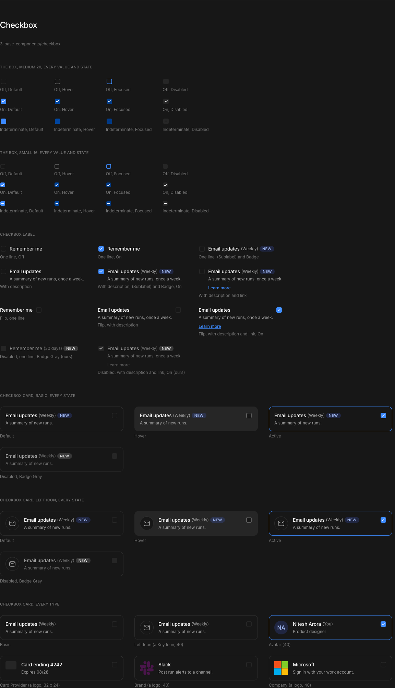

<!-- Copied from the design copy (neutrino-frontend-v3) by scripts/sync.mjs. Edit it there, then run `npm run sync`. -->

# Checkbox

| | |
|---|---|
| Figma | [Checkbox](https://www.figma.com/design/Ao3YVgFYdQIF0znq2ToqVl?node-id=227-1986) page |
| Status | Approved, 18 Oct 2026; coded 19 Oct 2026 |
| Code | [`src/components/ds/checkbox.tsx`](../../src/components/ds/checkbox.tsx) |
| Sizes | [`src/styles/sizes/checkbox.css`](../../src/styles/sizes/checkbox.css) |
| Demo | [`src/gallery/sections/checkbox.tsx`](../../src/gallery/sections/checkbox.tsx) |

## Light and dark

**Light**



**Dark**



## Use it

```tsx
import {
  Checkbox,
  ChoiceLabel,
  ChoiceCard,
  CheckboxLabel,
  CheckboxCard,
} from "@/components/ds/checkbox";
```

Every size and state, working: run `npm run dev` and open [localhost:3100/#checkbox](http://localhost:3100/#checkbox).

## Spec

Status: approved by Nitesh, 18 Oct 2026, with one addition to the Figma (below, under "Where this differs from the Figma").

Figma, on the Checkbox page (227:1986) of https://www.figma.com/design/Ao3YVgFYdQIF0znq2ToqVl:

* "Checkbox [1.1]" (node 227:2002): the box on its own.
* "Checkbox Label [1.1]" (node 231:4897): the box with its words.
* "Checkbox Card [1.1]" (node 261:3896): a card you pick, with the box in its corner.

The rule for this page: shape, size, spacing, type and states come exactly from the Figma. Colours are the tokens the Figma frame uses, with our palette's values (`../colors/colors.md`). Every number here becomes a size token, so it can be changed later in one place (`../README.md`, "Sizes work the same way").

### Rules

1. Every checkbox in the product is this one. Never style a checkbox by hand.
2. A checkbox always has its words next to it (Checkbox Label) or sits in a Checkbox Card. The bare box is only for tables and lists where the row says what it is.
3. Something missing? Stop and ask Nitesh, then add it here first.

### The box

#### What it has

| Property | Options |
|---|---|
| Size | Medium, Small |
| Value | Off, On (a tick), Indeterminate (a dash, for "some of these") |
| State | Default, Hover, Focused, Disabled |

#### Sizes

| Size | Space it takes | The box inside | Corner |
|---|---|---|---|
| Medium | 20 x 20 | 16 x 16, 2px in from each side | 4 |
| Small | 16 x 16 | 14 x 14, 1px in from each side | 4 |

When Off, the box is an edge with a raised white face: the face sits 1.5px in from the box's edge (13 x 13 on Medium, 11 x 11 on Small), corner 2.6, with a small drop shadow (0 down 2, blur 2, `#1B1C1D` at 12%).

The tick is 9.1 x 6.6 and the dash 8 x 1.5, centred, at both sizes.

#### Colours

| State | Off: edge | Off: face | On or Indeterminate: fill | Tick or dash |
|---|---|---|---|---|
| Default | `bg/soft-200` | `bg/white-0` | `primary/base` | `static/white` |
| Hover | `bg/sub-300` | `bg/white-0` | `primary/dark` | `static/white` |
| Focused | `primary/base` | `bg/white-0` | `primary/darkest` | `static/white` |
| Disabled | `bg/soft-200`, no face, no shadow | | `bg/soft-200` | `static/white` |

Focus is shown by the box itself, a blue edge or a darker fill, with no ring around it.

### Checkbox Label

#### What it has

| Property | Options |
|---|---|
| Value | Off, On (the box's own values) |
| Description | Off: one line. On: a title, a line of description, and an optional link |
| Flip | Off: box on the left. On: box on the right |
| Extras on the title line | An optional "(Sublabel)" and an optional Badge |

#### Layout

* The box (Medium, 20 x 20) and the words sit in a row with an 8px gap, the box at the top.
* One line: the label, "(Sublabel)" and the Badge in a row with a 4px gap, centred on the line.
* With description: a column with a 10px gap: first the text (the title row, then the description, 4px apart), then the link.

#### Type and colours

| Part | Type | Colour |
|---|---|---|
| Label, one line | `text-paragraph-sm` (14/20, 400) | `text/strong-950` |
| Label, with description | `text-label-sm` (14/20, 500) | `text/strong-950` |
| "(Sublabel)" | `text-paragraph-xs` (12/16) | `text/sub-600` |
| Description | `text-paragraph-xs` (12/16) | `text/sub-600` |
| Link | The Link Button, Primary, Small (16) | its own |
| Badge | The Badge, Light, Blue | its own |

The label is regular (400) on one line and medium (500) above a description, as in the Figma.

Disabled: the label `text/sub-600`, "(Sublabel)" and description `text/soft-400`, the box Disabled, the Badge Gray. The same as the Checkbox Card's Disabled.

### Checkbox Card

#### What it has

| Property | Options |
|---|---|
| Type | Basic (words only), Left Icon, Avatar, Card Provider, Brand, Company |
| State | Default, Hover, Active (picked), Disabled |

#### Layout

| Part | Value |
|---|---|
| Card | 360 wide in the Figma (it takes its container's width), 72 tall with one line of description |
| Padding | 16 on every side |
| Gap | 14 between the picture, the words and the box |
| Corner | 12 |
| Edge | 1px, inside |
| Picture on the left | 40 x 40 (a Key Icon, an Avatar, a brand or company logo); a card brand's logo is 32 x 24, corner 4 |
| Words | The Checkbox Label's title row and description (4px apart), filling the space |
| Box | Medium, on the right, at the top |

#### Colours

| State | Fill | Edge | Shadow | Label | "(Sublabel)" and description | Box |
|---|---|---|---|---|---|---|
| Default | `bg/white-0` | `stroke/soft-200` | `--shadow-card` | `text/strong-950` | `text/sub-600` | Default, Off |
| Hover | `bg/weak-50` | none | none | `text/strong-950` | `text/sub-600` | Hover, Off |
| Active | `bg/white-0` | `primary/base` | none | `text/strong-950` | `text/sub-600` | Default, On |
| Disabled | `bg/white-0` | `stroke/soft-200` | none | `text/sub-600` | `text/soft-400` | Disabled |

In Disabled the Badge turns Gray.

Every colour on this page is the Figma frame's own token; nothing moved. The one colour the Figma types in directly is the face's shadow, `#1B1C1D` at 12%; it becomes a shadow token with the others.

### Where this differs from the Figma

Agreed with Nitesh, 18 Oct 2026.

| Figma | Ours | Why |
|---|---|---|
| No Disabled look for the Checkbox Label | The Checkbox Card's Disabled look (above, under Checkbox Label) | A label that can be switched off needs a disabled look |

### Build order

The Checkbox Card and the Checkbox Label use the Badge, the Avatar, the Key Icon and the Link Button. Build them after those pages; the box can be built now.

### In code (to decide when building)

* Today's `components/ui/checkbox.tsx` is the stock shadcn one, used in 10 files. The Checkbox replaces how it looks; its name can stay.
* The face's shadow becomes a shadow token, `--shadow-checkbox: 0 2px 2px rgba(27, 28, 29, 0.12)`, when shadows move into the token build.
