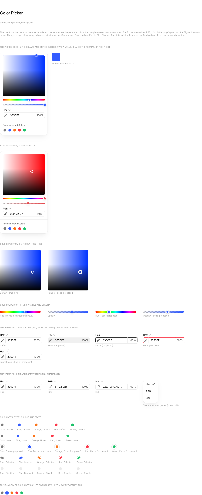
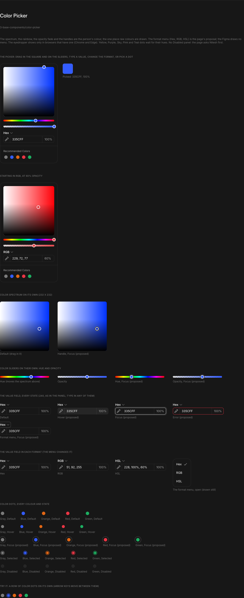

<!-- Copied from the design copy (neutrino-frontend-v3) by scripts/sync.mjs. Edit it there, then run `npm run sync`. -->

# Color Picker

| | |
|---|---|
| Figma | [Color Picker](https://www.figma.com/design/Ao3YVgFYdQIF0znq2ToqVl?node-id=553-22078) page |
| Status | Written 18 Oct 2026; coded 19 Oct 2026 |
| Code | [`src/components/ds/color-picker.tsx`](../../src/components/ds/color-picker.tsx) |
| Sizes | [`src/styles/sizes/color-picker.css`](../../src/styles/sizes/color-picker.css) |
| Demo | [`src/gallery/sections/color-picker.tsx`](../../src/gallery/sections/color-picker.tsx) |

## Light and dark

**Light**



**Dark**



## Use it

```tsx
import {
  COLOR_FORMATS,
  ColorSpectrum,
  ColorSlider,
  COLOR_DOTS,
  ColorDots,
  ColorValueField,
  ColorPicker,
} from "@/components/ds/color-picker";
```

Every size and state, working: run `npm run dev` and open [localhost:3100/#color-picker](http://localhost:3100/#color-picker).

## Spec

Status: written 18 Oct 2026, measured from the Figma. Its proposals stand until Nitesh reviews every component together on one canvas.

Figma, on the Color Picker page (553:22078) of https://www.figma.com/design/Ao3YVgFYdQIF0znq2ToqVl:

* "Color Picker [1.1]" (node 4456:115795): the whole picker panel.
* "Color Spectrum [1.1]" (node 4456:115425): the square to pick shade and brightness.
* "Color Sliders [1.1]" (node 4415:53671): the hue and opacity sliders.
* "Color Dots [1.1]" (node 3365:22464): the round swatches.

The rule for this page: shape, size, spacing, type and states come exactly from the Figma. Colours are the tokens the Figma frame uses, with our palette's values (`../colors/colors.md`). Every number here becomes a size token, so it can be changed later in one place (`../README.md`, "Sizes work the same way").

### Rules

1. A person picking any colour (a hex value, a shade, an opacity): the Color Picker. Picking from a short fixed set (a label's colour): a row of Color Dots on its own.
2. Use only the parts and states on this page. Never use the browser's colour input.
3. Something missing? Stop and ask Nitesh, then add it here first.

### What it has

| Part | Property | Options |
|---|---|---|
| Color Picker | One layout | The spectrum, the hue slider, the opacity slider, the value field, and a row of recommended colours |
| Color Sliders | Type | Hue (the rainbow), Opacity (see-through to solid) |
| Color Dots | Colour | Gray, Blue, Orange, Red, Green, Yellow, Purple, Sky, Pink, Teal |
| | State | Default, Hover, Selected, Disabled |

The Figma's Blocks also show other pickers built from these parts (with Image, Solid and Gradient tabs; saved colours with an Edit link; an "Add new color" row). They are examples, not components.

### Layout

#### The panel

| Part | Value |
|---|---|
| Panel | 272 wide, 468 tall in the Figma; corner 16; a 1px edge inside; its shadow (below) |
| Top section | Padding 16, the parts stacked with a 12px gap, a 1px line along its bottom |
| Bottom section | "Recommended Colors": padding 16, the label and the dots stacked with an 8px gap |
| Shadow | 0 down 16, blur 32, spread -12, `#0E121B` at 10% (the Figma's "regular-shadow/medium") |

The top section, top to bottom: the spectrum, the hue slider, the opacity slider, the value field. Each takes the full width inside the padding (240).

#### Color Spectrum

| Part | Value |
|---|---|
| Square | 240 x 232 in the panel (232 x 232 on its own), corner 8 |
| Colour | The picked hue, fading to white towards the left and to black towards the bottom (the black fade covers the lower 148) |
| Handle | A 16 x 16 circle filled with the picked colour, a 2px edge inside, no shadow |

#### Color Sliders

| Part | Value |
|---|---|
| Slider | 16 tall, the full width (240 in the panel, 232 on its own) |
| Track | 8 tall, fully round, centred |
| Hue track | The full rainbow, red to red |
| Opacity track | A checkerboard (at 30%) on white, under a fade from see-through on the left to the picked colour on the right |
| Handle | A 16 x 16 circle filled with the picked colour, a 2px edge inside. Its centre sits on the value, as on the Slider (`slider.md`) |
| Handle shadow | The Slider's dot shadow: 0 down 2, blur 4, `#0E121B` at 3%; and 0 down 6, blur 10, `#0E121B` at 6% |

#### The value field

| Part | Value |
|---|---|
| Format menu | A row with a 2px gap: the word "Hex" in `text-label-sm` (14/20, 500) and a 20 x 20 down arrow, 4 above the field |
| Field | 32 tall, corner 8, a 1px edge inside, three parts in a row |
| Eyedropper | 32 x 32, padding 6, a 20 x 20 icon, a 1px line on its right |
| Value | Padding 6 top and bottom, 10 at the sides; `text-paragraph-sm` (14/20, 400), e.g. "335CFF"; fills the space; a 1px line on its right |
| Opacity | 56 wide, padding 6 top and bottom, 10 at the sides; `text-paragraph-sm`, e.g. "100%" |

The field is the size of the Text Input's X-Small (32, corner 8), without its shadow.

#### Recommended Colors

* Label "Recommended Colors": `text-paragraph-xs` (12/16, 400).
* Dots: a row of Color Dots with a 4px gap. The Figma shows eight: Gray, Blue, Orange, Red, Green, Yellow, Purple, Sky.

#### Color Dots

| State | Space it takes | Dot |
|---|---|---|
| Default | 24 x 24 | A 16 x 16 circle, centred |
| Hover | 24 x 24 | Shrinks to 14 x 14, centred |
| Selected | 24 x 24 | 16 x 16, with a 2px ring inside it and a 1.5px ring outside it in the dot's own colour (no blur), so it reads as a dot in a circle |
| Disabled | 24 x 24 | 16 x 16, grey |

### Colours

#### The panel

| Part | Token |
|---|---|
| Panel and both sections | `bg/white-0` |
| Panel edge, the line under the top section | `stroke/soft-200` |
| Spectrum handle edge | `static/white` |
| Slider handle edge | `stroke/white-0` |
| "Hex" | `text/strong-950` |
| Its down arrow | `icon/soft-400` |
| Field fill | `bg/white-0` |
| Field edge and the lines inside it | `stroke/soft-200` |
| Eyedropper icon | `icon/sub-600` |
| Value | `text/strong-950` |
| Opacity | `text/sub-600` |
| "Recommended Colors" | `text/sub-600` |

The spectrum, the hue track, the fade on the opacity track and the handles show the colour being picked. They are the person's colour, not tokens.

#### Color Dots

| Dot | Token |
|---|---|
| Gray | `state/faded/base` |
| Blue | `state/information/base` |
| Orange | `state/warning/base` |
| Red | `state/error/base` |
| Green | `state/success/base` |
| Yellow, Purple, Sky, Pink, Teal | `state/away`, `state/feature`, `state/verified`, `state/highlighted`, `state/stable`: not in the palette yet |
| The inner ring when Selected | `stroke/white-0` |
| The outer ring when Selected | the dot's own colour |
| Disabled, every colour | `bg/soft-200` |

### Where this differs from the Figma

| Figma | Ours | Why |
|---|---|---|
| The dots are raw palette colours (`neutral/slate/500`, `blue/500`, `orange/500`, `red/500`, `green/500` ...) | The matching state tokens, as on the Legend Dots (`key-components.md`) | Every colour goes through a token |
| The opacity track's white under the checkerboard is a typed-in `#FFFFFF` | `static/white` | Every colour goes through a token; the checkerboard stays white in both themes |
| The panel's shadow is the Figma style "regular-shadow/medium" | `--shadow-color-picker` (below) | Shadows become tokens with the others |

### Open

* The swatches are colours a person picks and saves (for a label, for text). They may need their own fixed set, the same in both themes, rather than the state tokens, which change with the theme and are darker on light. The same question as the chart colours (`../colors/colors.md`, "Outside the tokens"). Nitesh to decide.
* Yellow, Purple, Sky, Pink and Teal have no hue in our palette yet.
* The spectrum handle's edge is `static/white`, the slider handles' edge `stroke/white-0`, which turns Gray 800 on dark. Proposal: `static/white` for both, so every handle stays a white ring on the colour.
* No keyboard focus look on any part. Proposals: the Neutral focus ring (2px `bg/white-0`, then 4px `state/faded/light`, outside, no blur) around a Color Dot, the spectrum handle and the slider handles; the value field takes the Text Input's Focus (`stroke/strong-950` edge plus the Neutral ring).
* The value field has no hover, focus or error look. Proposal: the Text Input's (`text-input.md`), with Error when the hex is not valid.
* The format menu ("Hex") opens a menu the Figma does not draw. Proposal: Hex, RGB, HSL, as a Dropdown (no page yet).
* No Disabled look for the panel. Ask Nitesh if a screen needs one.

### Build order

The Color Dots, the Color Sliders and the Color Spectrum first; the Color Picker is made of them. The format menu needs the Dropdown (no page yet). The value field shares its look with the Text Input (`text-input.md`).

### In code (to decide when building)

* There is no colour picker in code today, and no colour library in `package.json`. To decide: build it from these parts, or take a small library and restyle it to this page.
* The eyedropper uses the browser's EyeDropper, which only some browsers have; hide the button where it is missing.
* The panel's shadow becomes a shadow token, `--shadow-color-picker: 0 16px 32px -12px rgba(14, 18, 27, 0.1)`, and the handles use `--shadow-slider-thumb` (`slider.md`), when shadows move into the token build. The Figma's "regular-shadow/medium" may be shared by menus and popovers; if so the token gets a shared name then.
