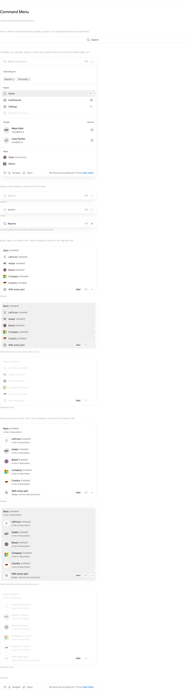
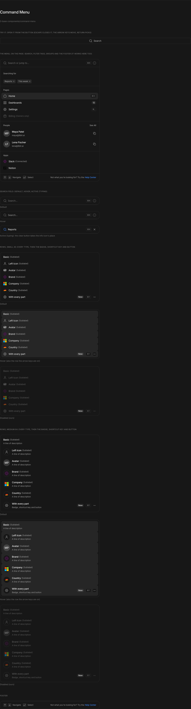

<!-- Copied from the design copy (neutrino-frontend-v3) by scripts/sync.mjs. Edit it there, then run `npm run sync`. -->

# Command Menu

| | |
|---|---|
| Figma | [Command Menu](https://www.figma.com/design/Ao3YVgFYdQIF0znq2ToqVl?node-id=4152-24764) page |
| Status | Written 18 Oct 2026; coded 19 Oct 2026 |
| Code | [`src/components/ds/command-menu.tsx`](../../src/components/ds/command-menu.tsx) |
| Sizes | [`src/styles/sizes/command-menu.css`](../../src/styles/sizes/command-menu.css) |
| Demo | [`src/gallery/sections/command-menu.tsx`](../../src/gallery/sections/command-menu.tsx) |

## Light and dark

**Light**



**Dark**



## Use it

```tsx
import {
  CommandMenuPanel,
  CommandMenu,
  CommandMenuSearch,
  CommandMenuFilters,
  CommandMenuList,
  CommandMenuGroup,
  CommandMenuItem,
  CommandMenuRow,
  CommandMenuFooter,
} from "@/components/ds/command-menu";
```

Every size and state, working: run `npm run dev` and open [localhost:3100/#command-menu](http://localhost:3100/#command-menu).

## Spec

Status: written 18 Oct 2026, measured from the Figma. Its proposals stand until Nitesh reviews every component together on one canvas.

Figma, on the Command Menu page (4152:24764) of https://www.figma.com/design/Ao3YVgFYdQIF0znq2ToqVl:

* "Command Menu Search Input [1.1]" (node 4187:559): the search field at the top.
* "Command Menu Items [1.1]" (node 4171:15653): the result rows.
* "Command Menu Footer [1.1]" (node 4172:16590): the key hints at the bottom.
* The menu that holds them is drawn in the page's examples (node 4255:54466) and blocks, not as a component.

The rule for this page: shape, size, spacing, type and states come exactly from the Figma. Colours are the tokens the Figma frame uses, with our palette's values (`../colors/colors.md`). Every number here becomes a size token, so it can be changed later in one place (`../README.md`, "Sizes work the same way").

### Rules

1. Searching or jumping anywhere in the product from the keyboard (⌘K): Command Menu. A short list of actions from a button: Dropdown (`dropdown.md`). Picking a value in a form: Select (`select.md`).
2. Something missing? Stop and ask Nitesh, then add it here first.

### The menu

| Part | Value |
|---|---|
| Width | 600 |
| Corner | 16 |
| Fill | `bg/white-0` |
| Edge | 1px `stroke/soft-200`, inside |
| Shadow | `--shadow-menu` (`dropdown.md`) |
| Order, top to bottom | The search field, an optional row of filter tags, groups of rows, the footer |
| Lines | Each part has a 1px `stroke/soft-200` line under it; the footer has its line on top, so the last group has none |

#### Filter tags (optional)

* Padding 16 top and bottom, 20 sides; the heading, then the tags 12 under it.
* Heading ("Searching for"): `text-label-xs` (12/16, 500), `text/sub-600`.
* Tags: the Tag, Gray, with its close icon (`tag.md`), 8 apart.

#### A group

* Padding 16 top, 8 sides, 12 bottom; the heading, then the rows 8 under it.
* Heading row: padding 12 on the sides; the heading in `text-label-xs`, `text/sub-600`, and an optional Link Button, Gray, Small (16), on the right ("See All").
* Rows stack with no gap.

### Search field (Command Menu Search Input)

| Part | Value |
|---|---|
| Height | 48 |
| Padding | 14 top and bottom, 20 sides |
| Gap | 8 |
| Line | 1px `stroke/soft-200` at the bottom |
| Search icon | 20 x 20 |
| Words | `text-paragraph-sm` (14/20, 400), filling the space |
| Shortcut key (optional) | "⌘K" in a key box: padding 2 top and bottom, 6 sides, corner 4, `bg/white-0`, a 1px `stroke/soft-200` edge inside; the key in `text-subheading-xs uppercase` (12/16, 500) |
| Right (optional) | A 20 x 20 info icon; while typing, a clear button instead (a Compact Button, Ghost, Medium 20) |

| State | Fill | Search icon | Words | Right |
|---|---|---|---|---|
| Default | `bg/white-0` | `icon/soft-400` | `text/soft-400` | Info icon, `icon/disabled-300` |
| Hover | `bg/white-0` | `icon/soft-400` | `text/sub-600` | Info icon, `icon/disabled-300` |
| Active (typing) | `bg/white-0` | `primary/base` | `text/strong-950` | Clear button, `icon/sub-600` |

The shortcut key is `text/soft-400` in every state.

### Rows (Command Menu Items)

#### What it has

| Property | Options |
|---|---|
| Size | Small (40), Medium (64) |
| State | Default, Hover |
| Type | Basic (words only), Left Icon, Avatar, Brand, Company, Country (a flag) |
| Words | The label and an optional "(Sublabel)"; Medium adds a description |
| Right, optional | A Badge, a shortcut key, a button |

#### Layout

| Size | Height | Padding | Gap | Corner | Picture | Label |
|---|---|---|---|---|---|---|
| Small | 40 | 10 top and bottom, 12 sides | 12 | 10 | 20 x 20 | `text-paragraph-sm` |
| Medium | 64 | 12 | 12 | 10 | 40 x 40 | `text-label-sm` (14/20, 500) |

* Left to right: the picture, the words (they fill the space), the Badge, the shortcut key, the button.
* "(Sublabel)": `text-paragraph-xs` (12/16, 400), 4 after the label. Description: `text-paragraph-xs`, 4 under the label.
* Medium pictures: an Avatar is 40 x 40 on its own. Anything else sits in a 40 circle, `bg/white-0`, a 1px `stroke/soft-200` edge inside, `--shadow-card`: an icon at 20 (padding 10), a brand or company logo or a flag at 24 (padding 8).
* Badge: Lighter, Gray, Medium (20) (`badge.md`).
* Shortcut key: the same key box as the search field's.
* Button: a Compact Button, Medium (20): Ghost at rest, White (with `--shadow-card`) on Hover.

#### Colours

| State | Fill | Label | "(Sublabel)" and description | Icon | Shortcut key |
|---|---|---|---|---|---|
| Default | `bg/white-0` | `text/strong-950` | `text/sub-600` | `icon/sub-600` | `text/soft-400` |
| Hover | `bg/weak-50` | `text/strong-950` | `text/sub-600` | `icon/sub-600` | `text/soft-400` |

Brand logos, flags and avatars keep their own colours.

### Footer (Command Menu Footer)

| Part | Value |
|---|---|
| Height | 48 |
| Padding | 14 top and bottom, 20 sides |
| Gap | 12 |
| Line | 1px `stroke/soft-200` at the top |
| Left | Key hints: up and down keys with "Navigate", the return key with "Select" |
| Key | A 20 x 20 box: padding 2, corner 4, `bg/weak-50`, a 1px `stroke/soft-200` edge inside, a 16 x 16 arrow in `icon/sub-600`; keys and their word 8 apart |
| Right | The help line ("Not what you're looking for? Try the"), then a Link Button, Primary, Small (16) ("Help Center"), 4 apart |

Words in the footer: `text-paragraph-xs`, `text/sub-600`.

Every colour is the Figma frame's own token; nothing moved. The one colour the Figma types in directly is the menu's shadow, `#0E121B` at 10% (`--shadow-menu`).

### Where this differs from the Figma

| Figma | Ours | Why |
|---|---|---|
| The smaller row is named "Small (48)" | Small (40) | It is 40 tall in every variant |

### Open

* The row you are on. The Figma has no keyboard look. Proposed: the row the arrow keys are on takes the Hover look. The search field keeps keyboard focus while you move through the rows, so the rows get no focus ring.
* Disabled rows: none in the Figma. Proposed: the Dropdown's Disabled row (words `text/disabled-300`, icons `icon/disabled-300`, pictures at 48%).
* Dark theme: the same shadow question as the Dropdown (`dropdown.md`, Open).

### Build order

The Command Menu uses the Tag, the Badge, the Avatar, the Link Button, the Compact Button, the flags and logos. Build after those pages.

### In code (to decide when building)

* Today's `components/ui/command.tsx` is the stock shadcn one (cmdk), used in 1 file, `components/data-table-filter.tsx`. The Command Menu replaces how it looks; its name can stay.
* Today ⌘K focuses the sidebar's search (`components/chat-sidebar-shell.tsx`) and the bottom bar (`components/shell/bottom-bar.tsx`). Whether ⌘K opens this Command Menu instead is for Nitesh to decide.
* The shadow is `--shadow-menu` (`dropdown.md`).
