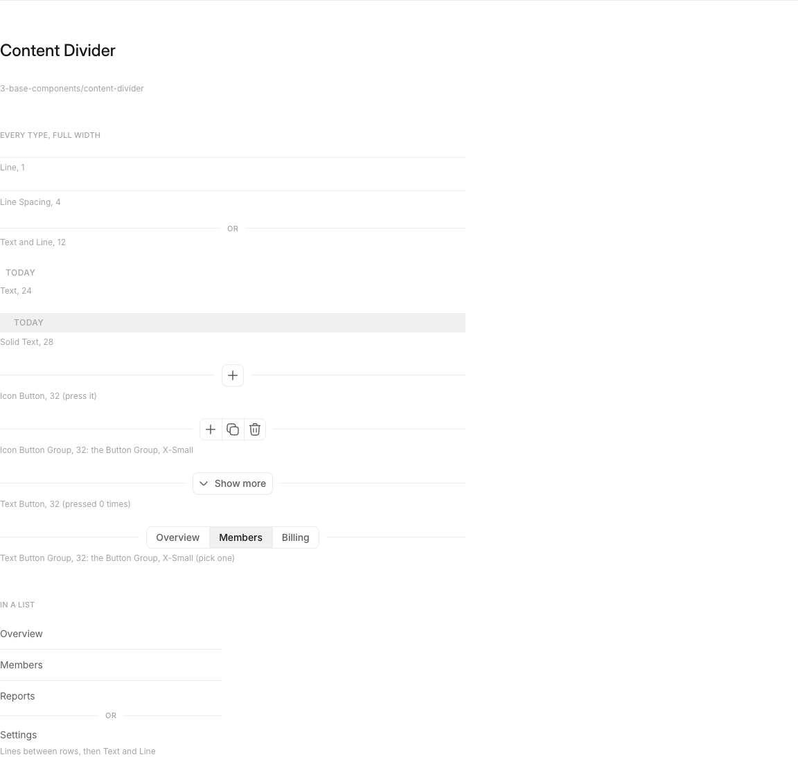
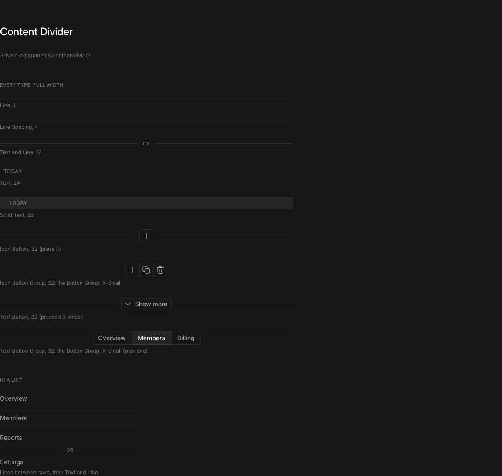

<!-- Copied from the design copy (neutrino-frontend-v3) by scripts/sync.mjs. Edit it there, then run `npm run sync`. -->

# Content Divider

| | |
|---|---|
| Figma | [Content Divider](https://www.figma.com/design/Ao3YVgFYdQIF0znq2ToqVl?node-id=414-4397) page |
| Status | Approved, 18 Oct 2026; coded 19 Oct 2026 |
| Code | [`src/components/ds/content-divider.tsx`](../../src/components/ds/content-divider.tsx) |
| Sizes | [`src/styles/sizes/content-divider.css`](../../src/styles/sizes/content-divider.css) |
| Demo | [`src/gallery/sections/content-divider.tsx`](../../src/gallery/sections/content-divider.tsx) |

## Light and dark

**Light**



**Dark**



## Use it

```tsx
import { ContentDivider } from "@/components/ds/content-divider";
```

Every size and state, working: run `npm run dev` and open [localhost:3100/#content-divider](http://localhost:3100/#content-divider).

## Spec

Status: approved by Nitesh, 18 Oct 2026.

Figma: "Content Divider [1.1]" (node 414:4401) on the Content Divider page (414:4397) of https://www.figma.com/design/Ao3YVgFYdQIF0znq2ToqVl.

The rule for this page: shape, size, spacing, type and states come exactly from the Figma. Colours are the tokens the Figma frame uses, with our palette's values (`../colors/colors.md`). Every number here becomes a size token, so it can be changed later in one place (`../README.md`, "Sizes work the same way").

### Rules

1. Every line that separates content is this Content Divider. Never draw a border or an `<hr>` by hand to split content.
2. Something missing? Stop and ask Nitesh, then add it here first.

### Types

All take the full width of their container. Lines are 1px in `stroke/soft-200`.

| Type | Height | What it is |
|---|---|---|
| Line | 1 | A single line |
| Line Spacing | 4 | A line with 1.5px of space above and below |
| Text and Line | 12 | A line, a short word in the middle ("OR"), a line; 10px gaps |
| Text | 24 | A word on its own, padding 4 top and bottom, 8 sides |
| Solid Text | 28 | A word on a grey band, padding 6 top and bottom, 20 sides |
| Icon Button | 32 | A line, an icon-only Button in the middle, a line; 10px gaps |
| Icon Button Group | 32 | A line, a Button Group of icons in the middle, a line; 10px gaps |
| Text Button | 32 | A line, a Button with a word in the middle, a line; 10px gaps |
| Text Button Group | 32 | A line, a Button Group of words in the middle, a line; 10px gaps |

### Type and colours

| Part | Type | Colour |
|---|---|---|
| The word in Text and Line | `text-subheading-2xs uppercase` (11/12) | `text/soft-400` |
| The word in Text and Solid Text | `text-subheading-xs uppercase` (12/16) | `text/soft-400` |
| The band in Solid Text | | `bg/weak-50` |
| The buttons | Button: Neutral, Stroke, X-Small (32) (`button.md`) | its own |
| The button groups | Button Group, X-Small (32) (`button-group.md`) | its own |

Every colour is the Figma frame's own token; nothing moved.

### In code (to decide when building)

* Today's `components/ui/separator.tsx` is the stock shadcn one, used in 2 files; the Line type replaces it.
* Many screens draw their own dividers with `border-*`; they move to this when rebuilt.
