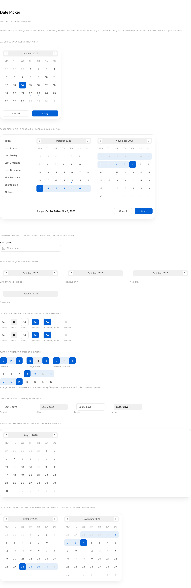
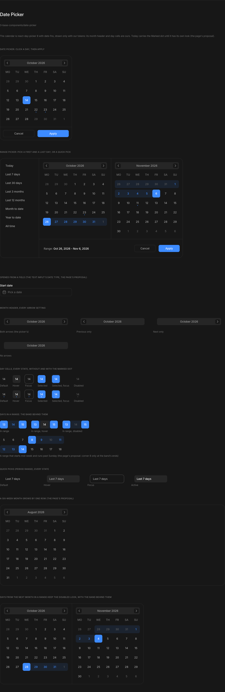

<!-- Copied from the design copy (neutrino-frontend-v3) by scripts/sync.mjs. Edit it there, then run `npm run sync`. -->

# Date Picker

| | |
|---|---|
| Figma | [Date Picker](https://www.figma.com/design/Ao3YVgFYdQIF0znq2ToqVl?node-id=435-8548) page |
| Status | Written 18 Oct 2026; coded 19 Oct 2026 |
| Code | [`src/components/ds/date-picker.tsx`](../../src/components/ds/date-picker.tsx) |
| Sizes | [`src/styles/sizes/date-picker.css`](../../src/styles/sizes/date-picker.css) |
| Demo | [`src/gallery/sections/date-picker.tsx`](../../src/gallery/sections/date-picker.tsx) |

## Light and dark

**Light**



**Dark**



## Use it

```tsx
import {
  DatePickerMonthHeader,
  DatePickerDay,
  DatePickerQuickPick,
  DATE_PICKER_QUICK_PICKS,
  DatePicker,
  RangePicker,
  DatePickerPopover,
} from "@/components/ds/date-picker";
```

Every size and state, working: run `npm run dev` and open [localhost:3100/#date-picker](http://localhost:3100/#date-picker).

## Spec

Status: written 18 Oct 2026, measured from the Figma. Its proposals stand until Nitesh reviews every component together on one canvas.

Figma, on the Date Picker page (435:8548) of https://www.figma.com/design/Ao3YVgFYdQIF0znq2ToqVl:

* "Date & Range Picker [1.1]" (node 446:7414): the whole picker, one month (Date Picker) or two months with quick picks (Range Picker).
* "Day Cells [1.1]" (node 437:175): one day in the grid.
* "Day Labels [1.1]" (node 3118:24556): the weekday letters above the grid.
* "Date Selector [1.1]" (node 442:192): the month name with its arrows.
* "Period Range [1.1]" (node 443:336): one quick pick ("Last 7 days") in the Range Picker's left column.

The rule for this page: shape, size, spacing, type and states come exactly from the Figma. Colours are the tokens the Figma frame uses, with our palette's values (`../colors/colors.md`). Every number here becomes a size token, so it can be changed later in one place (`../README.md`, "Sizes work the same way").

### Rules

1. Picking one date is the Date Picker. Picking a from and a to date is the Range Picker. Never use the browser's date input, and never draw a calendar by hand.
2. Use only the parts and states on this page.
3. Something missing? Stop and ask Nitesh, then add it here first.

### What it has

| Property | Options |
|---|---|
| Type | Date Picker (one month, picks one day), Range Picker (two months side by side, quick picks on the left, picks a range) |
| Day state | Default, Hover, Selected ("Active" in the Figma), Disabled; a day inside a range has its own look (In range, the Figma's "Range" type) |
| Marked | An optional small dot under a day's number |
| Month header | The month name, with a previous arrow, a next arrow, both or none |
| Quick pick state | Default, Hover, Active (the picked one) |
| Footer | Cancel and Apply; the Range Picker also shows the picked range in words |

The Day Cells set also has an "Empty" property, but only its Off value exists.

### Layout

#### The whole picker

| Part | Date Picker | Range Picker |
|---|---|---|
| Size in the Figma | 368 x 432 | 936 x 432 |
| Corner | 20 | 20 |
| Edge | 1px, inside | 1px, inside |
| Shadow | The Figma's `regular-shadow/medium` (below) | the same |
| Quick picks column | none | 200 wide, the full height, on the left, a 1px line on its right. Padding 20 top, 16 sides, 2 bottom; picks 8 apart |
| Months | One, 368 wide | Two, 368 wide each, a 1px line between them |
| Line under the months | 1px | 1px |
| Footer | 68 tall | 68 tall, under the two months only |

Shadow, one layer: 0 down 16, blur 32, spread -12, `#0E121B` at 10%.

#### One month

* Padding 20 on every side. Top to bottom, 8 apart: the month header, the weekday row, then one row per week.
* Rows are 328 wide: seven 40 x 40 cells, 8 apart.
* The Figma shows months that span five weeks: 364 tall. Weeks start on Monday.
* Days from the month before and after fill the first and last row, in the Disabled look.

#### Month header (Date Selector)

| Part | Value |
|---|---|
| Height | 36 |
| Corner | 8 |
| Gap | 6 |
| Padding, both arrows | 6 on every side |
| Padding, no arrows | 8 top and bottom, 6 sides |
| Padding, one arrow | 6, except 36 on the side without an arrow, so the month stays centred |
| Month name | `text-label-sm` (14/20, 500), centred, filling the space |
| Arrows | The Compact Button, White, Large (24): 24 x 24, padding 2, corner 6, a 20 x 20 arrow, `--shadow-card` |

The picker always shows both arrows.

#### Weekday labels (Day Labels)

* 40 x 40, padding 10 top and bottom, the letters centred.
* Two capital letters: MO, TU, WE, TH, FR, SA, SU.
* `text-label-sm` (14/20, 500).

#### Day cells

| Part | Value |
|---|---|
| Size | 40 x 40 |
| Padding | 10 top and bottom |
| Corner | 8 |
| Number | `text-label-sm` (14/20, 500), centred |
| Marked dot | A 3 x 3 circle, centred, its bottom 6 above the cell's bottom |

#### The range band

Behind the days of a range, each week row gets a fill with corner 8 that covers the cells and the 8px gaps between them. The first and the last day of the range are Selected; the days between are In range.

#### Quick picks (Period Range)

| Part | Value |
|---|---|
| Size | 168 x 36 (the column's width) |
| Padding | 8 top, bottom and right, 12 left |
| Corner | 8 |
| Words | `text-label-sm` (14/20, 500), on the left |

The Figma's picks: Today, Last 7 days, Last 30 days, Last 3 months, Last 12 months, Month to date, Year to date, All time.

#### Footer

| Part | Date Picker | Range Picker |
|---|---|---|
| Padding | 16 | 16, but 24 on the left |
| Gap | 16 | 16 |
| On the left | nothing | "Range:" in `text-paragraph-sm` (14/20, 400), then the dates in `text-label-sm` (14/20, 500), one line, filling the space |
| Buttons | Cancel (Button, Neutral, Stroke, Small 36) and Apply (Button, Primary, Filled, Small 36), each half the width (160) | the same two, 108 wide each, on the right |

### Colours

#### The whole picker

| Part | Token |
|---|---|
| Picker fill | `bg/white-0` |
| Edge, the lines between columns, the line above the footer | `stroke/soft-200` |
| Month header fill | `bg/weak-50` |
| Month name | `text/sub-600` |
| Arrows | `bg/white-0`, the arrow `icon/sub-600` |
| Weekday letters | `text/soft-400`, on `bg/white-0` |
| "Range:" | `text/sub-600` |
| The dates after it | `text/strong-950` |

#### Day cells

| State | Fill | Number | Marked dot |
|---|---|---|---|
| Default | `bg/white-0` | `text/sub-600` | `primary/base` |
| Hover | `bg/weak-50` | `text/strong-950` | `primary/base` |
| Selected | `primary/base` | `static/white` | `primary/lighter` |
| Disabled (and days outside the month) | `bg/white-0` | `text/disabled-300` | `icon/disabled-300` |
| In range | none, so the band shows | `primary/base` | |
| In range, hover | `bg/weak-50` | `text/strong-950` | |
| In range, disabled | `bg/white-0` | `text/disabled-300` | |
| The range band | `primary/alpha-10` | | |

#### Quick picks

| State | Fill | Words |
|---|---|---|
| Default | `bg/white-0` | `text/sub-600` |
| Hover | `bg/weak-50` | `text/sub-600` |
| Active | `bg/weak-50` | `text/strong-950` |

The Figma's Examples frame shows the same picker in the dark theme: the tokens flip on their own.

Every colour is the Figma frame's own token; nothing moved. The one colour the Figma types in directly is the picker's shadow, `#0E121B` at 10%; it becomes a shadow token with the others.

### Where this differs from the Figma

| Figma | Ours | Why |
|---|---|---|
| A marked day on hover keeps its number `text/sub-600`; every other day on hover turns `text/strong-950` | `text/strong-950` for every hovered day | One rule for every day (the majority in the Figma) |

### Open

* **No look for today.** The Figma has no Today state. The Marked dot is the nearest thing, but one Range Picker marks two days (8 December and 11 January), so the dot more likely means "something is on this day". Proposed: today gets the Marked dot until Nitesh gives it its own look.
* **A range that starts or ends mid-week.** Every range in the Figma fills whole week rows. Proposed: the band runs from the first day to the last day of the range in each row, with corner 8 only at its two ends.
* **A disabled day inside a range** has a white fill, so it would punch a white square in the band. Proposed: no fill, so the band shows through.
* **Six-week months.** The Figma only shows five-week months. Proposed: a sixth row when the month needs it, so the picker grows by 48.
* **No keyboard focus look.** Proposed: the Neutral focus ring (2px `bg/white-0`, then 4px `state/faded/light`, outside, no blur) on a focused day, quick pick or arrow; on a Selected day, the Primary ring (`primary/alpha-10`).
* **The Empty property** of Day Cells has no On variant. Proposed: leave it out until Nitesh says what it is for (perhaps blank cells when days outside the month are hidden).
* **What opens the picker** is not shown. Proposed: the Text Input's Date type (`text-input.md`), the picker opening under the field.

### On the same Figma page

* "Date Picker [Examples]" (node 3129:3912): the Date Picker in light and dark.
* "Date Picker [Prototype]" (3280:6236) and "Range Picker [Prototype]" (3280:6426): hover prototypes.
* The Blocks frames (167124:16024, 167124:16105, 167124:16199): the picker in a dialog, with a list of quick dates ("Tomorrow", "Next week"), and next to start and end date fields. These are screens made from the parts above, not parts of their own.

### Build order

The Button (`button.md`) for Cancel and Apply, and the Compact Button (White, Large 24; a family on the Button page, no page of its own yet) for the arrows. Build the Date Picker after those.

### In code (to decide when building)

* The pickers may be built from a library and restyled to this page; the look on this page is the target either way.
* Today's `components/ui/calendar.tsx` is the stock shadcn one, built on `react-day-picker` 8.10.1 (already installed, with `date-fns` 4). It is used in 2 files: `components/data-table-filter.tsx` (a range) and `components/date-picker-wrapper.tsx` (a date picker in a Popover, which nothing imports). Restyling it to this page is the shortest way; its arrows use lucide icons today and must move to Hugeicons.
* One screen uses the browser's own date input: `app/(studio)/studio/runs/page.tsx` (From and To dates). It moves to the Range Picker when rebuilt.
* The picker opens in `components/ui/popover.tsx` (used in 13 files), restyled to this page's corner, edge and shadow.
* The shadow becomes `--shadow-popover: 0 16px 32px -12px rgba(14, 18, 27, 0.1)` when shadows move into the token build. It is the Figma's `regular-shadow/medium`, so every component using that style shares it.
