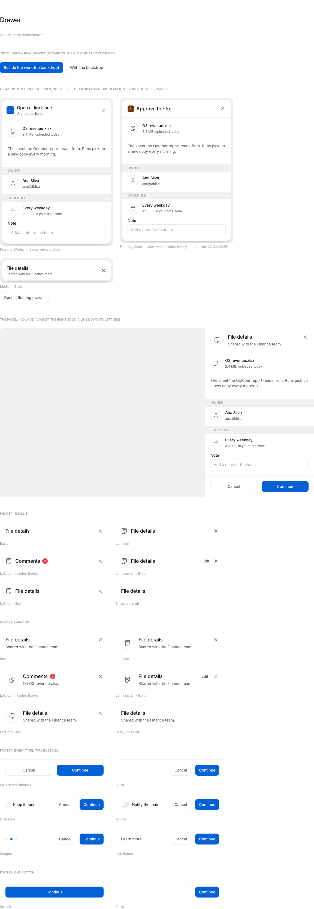
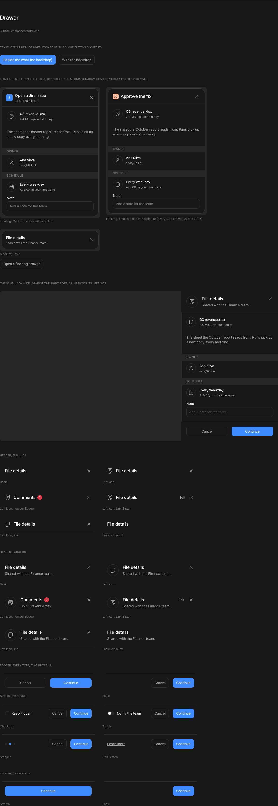

<!-- Copied from the design copy (neutrino-frontend-v3) by scripts/sync.mjs. Edit it there, then run `npm run sync`. -->

# Drawer

| | |
|---|---|
| Figma | [Drawer](https://www.figma.com/design/Ao3YVgFYdQIF0znq2ToqVl?node-id=486-7366) page |
| Status | Written 18 Oct 2026; coded 19 Oct 2026 |
| Code | [`src/components/ds/drawer.tsx`](../../src/components/ds/drawer.tsx) |
| Sizes | [`src/styles/sizes/drawer.css`](../../src/styles/sizes/drawer.css) |
| Demo | [`src/gallery/sections/drawer.tsx`](../../src/gallery/sections/drawer.tsx) |

## Light and dark

**Light**



**Dark**



## Use it

```tsx
import {
  Drawer,
  DrawerTrigger,
  DrawerClose,
  DrawerContent,
  DrawerPanel,
  DrawerHeader,
  DrawerBody,
  DrawerSection,
  DrawerFooter,
} from "@/components/ds/drawer";
```

Every size and state, working: run `npm run dev` and open [localhost:3100/#drawer](http://localhost:3100/#drawer).

## Spec

Status: written 18 Oct 2026, measured from the Figma. Its proposals stand until Nitesh reviews every component together on one canvas.

Figma, on the Drawer page (486:7366) of https://www.figma.com/design/Ao3YVgFYdQIF0znq2ToqVl:

* "Drawer Header [1.1]" (node 3187:2897): the top of a drawer, with its title and close button.
* "Drawer Footer [1.1]" (node 4096:21416): the bottom of a drawer, with its buttons.
* The drawer panel itself is not a component in the Figma. Its size and edges come from "Drawer [Examples]" (4108:52461), the two "Drawer [Prototype]" frames (4108:53206, 4108:53502) and the eight "Drawer" Blocks frames.

The rule for this page: shape, size, spacing, type and states come exactly from the Figma. Colours are the tokens the Figma frame uses, with our palette's values (`../colors/colors.md`). Every number here becomes a size token, so it can be changed later in one place (`../README.md`, "Sizes work the same way").

### Rules

1. A panel that slides in from the right edge to show details or a longer form, while the page stays in view, is this Drawer: the panel with its Header, body and Footer. Never build a side panel by hand.
2. A short question that blocks the page is the Modal (`modal.md`), not a Drawer.
3. Something missing? Stop and ask Nitesh, then add it here first.

### What it has

| Part | Options |
|---|---|
| Panel | Header, body, Footer, stacked top to bottom, the full height of the screen |
| Header type | Basic (words only), Left Icon |
| Header size | Small (title only), Large (title and description) |
| Header extras | Close button (on by default), a number Badge after the title, a Link Button before the close button, a line along the bottom |
| Footer type | Stretch, Basic, Checkbox, Toggle, Stepper, Link Button |
| Footer buttons | Two (Cancel and Continue) or one |

### Layout

#### The panel

| Part | Value |
|---|---|
| Width | 400 in every drawer in the Figma |
| Height | The full height of the screen |
| Where | Against the right edge of the screen |
| Fill | `bg/white-0` |
| Edge | A 1px `stroke/soft-200` line down its left side (the Prototype) |
| Corner | None |
| Shadow | None |
| Backdrop | None in the Figma: the page stays as it is (see Open) |

The Header sits at the top and the Footer at the bottom; the body fills the space between.

#### The panel, floating (Nitesh, 21 Oct 2026)

His drawer frame (Figma 198333:66011) and the Blocks frames float the panel. Built as `floating` on `DrawerContent` and `DrawerPanel`; docked stays the default.

| Part | Value |
|---|---|
| Where | 8 in from the top, right and bottom (`--spacing-drawer-inset`) |
| Corner | 20 (`--radius-drawer-floating`) |
| Edge | None; the shadow's 1px ring draws the outline |
| Shadow | `custom-shadows/medium` as `--shadow-drawer` (eight layers, light). On dark only its 1px ring, in `stroke/soft-200` (shadows.md) |

The Workflow Studio's step drawer floats (`revamp/step-drawer.md`).

#### The Header

| Size | Height | Padding | Gap | Words |
|---|---|---|---|---|
| Small | 64 | 20 | 12 | Title `text-label-lg` (18/24, 500) |
| Large | 88 | 20 | 16 | Title `text-label-lg`, then a description in `text-paragraph-sm` (14/20, 400), 4 apart |
| Medium (Neutrino, 21 Oct 2026) | 74 | 16 on every side (Nitesh: top and bottom equal) | 10 | A 28 x 28 picture (corner 6: an app's tile, a logo, an icon), the title `text-label-md` (16/24, 500), then a line in `text-paragraph-xs` (12/16), 2 apart. Both truncate. Nitesh's sketch v2 for the step drawer |

* The icon, Small: a bare 24 x 24 icon. Large: the Key Icon, Large (48 x 48, padding 12, a 24 x 24 icon), Stroke style (`key-components.md`).
* The picture, Small (Neutrino, 22 Oct 2026, every Workflow Studio step drawer): a 24 x 24 picture, corner 6, 8 before the title: an app's logo or a step's kind tile, the same as the step's card (`picture`, sizes `drawer-header-sm-picture`, `-picture-gap`). On the Components page under Floating.
* Small centres everything on one line. Large keeps the icon and the close button at the top.
* The close button: the Compact Button, Ghost, Large (24 x 24), at the right end of the row.
* The number Badge (off by default): the Badge, Filled, Red, Medium (20), Number on (`badge.md`), 8 after the title.
* The Link Button (off by default): Gray, Medium (20), no underline, just before the close button, the row's gap apart.
* The line (off by default): the Content Divider, Line type (`content-divider.md`), along the bottom.
* The words fill the space between the icon and the close button.

#### The body

* Not a component. Sections with padding 20 on every side, 16 between items (several use 12).
* Sections are split by the Content Divider, Solid Text type (a 28 tall grey band with a word, `content-divider.md`). A section that follows a Solid Text band starts 12 below it.

#### The Footer

| Part | Value |
|---|---|
| Height | 80 |
| Padding | 20 |
| Gap | 16 between the left part and the buttons |
| Buttons | Button, Medium (40) (`button.md`): Neutral Stroke "Cancel", then Primary Filled "Continue", 16 apart, on the right |
| Edge | A 1px `stroke/soft-200` line along the top, inside |

| Footer type | On the left |
|---|---|
| Stretch | Nothing: the two buttons share the full width equally, 16 apart. The Figma's default |
| Basic | Nothing |
| Checkbox | A Checkbox Label, one line (`checkbox.md`) |
| Toggle | A Switch Label, one line (`switch.md`) |
| Stepper | The Stepper Dot, Small (`step-indicator.md`) |
| Link Button | A Link Button, Gray, Medium (20), underlined (`button.md`, "Other button families") |

The Drawer's footer is roomier than the Modal's: padding 20, gaps 16 and Medium (40) buttons, where the Modal has 16/20, 12 and Small (36).

### Colours

| Part | Token |
|---|---|
| Panel, Header, body, Footer | `bg/white-0` |
| Panel's left edge, Footer's top line, Header's line | `stroke/soft-200` |
| Title | `text/strong-950` |
| Description | `text/sub-600` |
| Icon (Small, bare) | `icon/sub-600` |
| Key Icon (Large) | its own: `bg/white-0`, 1px `stroke/soft-200` edge, `--shadow-card`, icon `icon/sub-600` |
| Close button | its own, icon `icon/sub-600` |

Every colour is the Figma frame's own token; nothing moved.

The title and description clear the product's paragraph margin (`styles/typography.css` gives every `p` 1.25em above and below), so the header keeps its height inside product screens.

### Where this differs from the Figma

| Figma | Ours | Why |
|---|---|---|
| Some Blocks frames use older loose copies of the parts: a 76 tall footer, one with 28 left padding, a 140 tall header built by hand | The Header and Footer [1.1] above | Old copies; the [1.1] parts are the components |
| The Footer's Link Button word has no text style (Inter 14/20, 500, -0.6%) | `text-label-sm` (14/20, 500) | It matches Label/Small exactly; a slip on the Link Button |

### Open

* **Two looks for the panel.** Decided 21 Oct 2026: both exist; the step drawer floats (Nitesh's drawer frame floats). Earlier note: the Examples and the Prototype dock the panel to the right edge, full height, with a left edge line and no corner or shadow. The eight Blocks frames float it instead: 8 in from the top, right and bottom, corner 20, no edge, and the Figma's `custom-shadows/medium` (eight layers: inside 0 up 1, blur 1, spread -0.5, `#333333` at 6%; a 1px ring of `#F5F5F5`; then 0 down 48 blur 48 spread -24, 0/24/24/-12, 0/12/12/-6, 0/6/6/-3 at 4%, 0/3/3/-1.5 at 2%, 0/1/1/0.5 at 4%, all `#333333`). Proposed: docked, as on the Drawer page's own Examples and Prototype. If Nitesh prefers floating, it becomes `--shadow-drawer`, and its light `#F5F5F5` ring needs a dark value.
* **The backdrop.** No drawer in the Figma has one. `colors.md` already lists `overlay/gray` as "behind modals and drawers". Proposed: no backdrop for a drawer that sits beside the work; `overlay/gray`, as on the Modal, when the drawer must be closed before the page can be used again. Ask Nitesh which drawers are which.
* **Width.** Every drawer is 400. Proposed: one width, 400; on a phone the drawer takes the full width.
* **Scrolling.** The Figma's bodies always fit. Proposed: the Header and Footer stay put and the body scrolls between them, with the Scroll (`scroll.md`).
* The Figma has no focus look of its own here: the close button and the footer buttons use their own focus rings (`button.md`).

### Build order

The Header uses the Compact Button, the Key Icon, the Badge, the Link Button and the Content Divider; the Footer uses the Button, the Checkbox Label, the Switch Label, the Stepper Dot and the Link Button. Build those first.

### In code (to decide when building)

* Today's `components/ui/sheet.tsx` is the stock shadcn one (Radix Dialog), used in 2 product files (`components/shell/bottom-bar.tsx`, `components/workspace-data-sources/workspace-catalog-drawer.tsx`) and 2 tests. Its backdrop is `bg-black/80`; the panel is three quarters of the screen wide up to 384, with a 16 gap between its parts. The Drawer replaces how it looks; its name can stay.
* Some screens draw their own right-side panels (`components/workflow-builder/runs-panel.tsx`, the connections drawer in `components/connections/`); they move to this Drawer when rebuilt.
