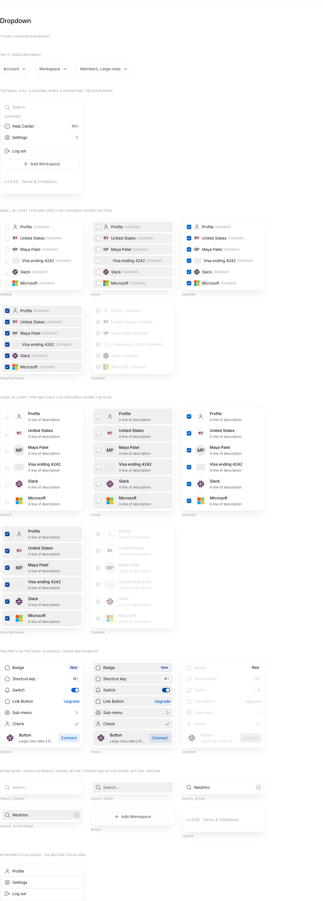
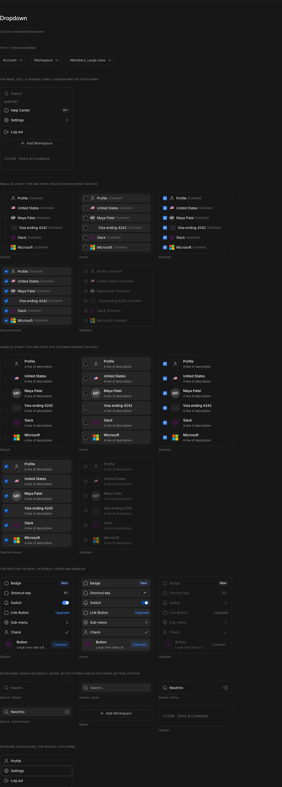

<!-- Copied from the design copy (neutrino-frontend-v3) by scripts/sync.mjs. Edit it there, then run `npm run sync`. -->

# Dropdown

| | |
|---|---|
| Figma | [Dropdown](https://www.figma.com/design/Ao3YVgFYdQIF0znq2ToqVl?node-id=166999-140904) page |
| Status | Written 18 Oct 2026; coded 19 Oct 2026 |
| Code | [`src/components/ds/dropdown.tsx`](../../src/components/ds/dropdown.tsx) |
| Sizes | [`src/styles/sizes/dropdown.css`](../../src/styles/sizes/dropdown.css) |
| Demo | [`src/gallery/sections/dropdown.tsx`](../../src/gallery/sections/dropdown.tsx) |

## Light and dark

**Light**



**Dark**



## Use it

```tsx
import {
  Dropdown,
  DropdownTrigger,
  DropdownSub,
  DropdownContent,
  DropdownSubContent,
  DropdownPanel,
  DropdownGroup,
  DropdownHeading,
  DropdownSeparator,
  DropdownPicture,
  DropdownRow,
  DropdownItem,
  DropdownCheckboxItem,
  DropdownSubTrigger,
  DropdownSearch,
  DropdownButtonRow,
  DropdownCaption,
} from "@/components/ds/dropdown";
```

Every size and state, working: run `npm run dev` and open [localhost:3100/#dropdown](http://localhost:3100/#dropdown).

## Spec

Status: written 18 Oct 2026, measured from the Figma. Its proposals stand until Nitesh reviews every component together on one canvas.

Figma, on the Dropdown page (166999:140904) of https://www.figma.com/design/Ao3YVgFYdQIF0znq2ToqVl:

* "Dropdown Items [1.1]" (node 379:6629): the rows.
* "Dropdown Misc Items [1.1]" (node 414:8031): a search row, a button row and a small-print row.
* The menu that holds them is drawn in the page's examples and blocks (for example node 166999:144512), not as a component.

The rule for this page: shape, size, spacing, type and states come exactly from the Figma. Colours are the tokens the Figma frame uses, with our palette's values (`../colors/colors.md`). Every number here becomes a size token, so it can be changed later in one place (`../README.md`, "Sizes work the same way").

### Rules

1. A list of actions or links that opens from a button, an avatar or a "more" icon: Dropdown. Picking a value in a form: Select (`select.md`), which opens this same menu.
2. Every menu in the product is this menu with these rows. Never draw a menu or a menu row by hand.
3. Something missing? Stop and ask Nitesh, then add it here first.

### The menu

| Part | Value |
|---|---|
| Width | 300 in the Figma; it follows the use |
| Padding | 8 |
| Gap between rows | 4 |
| Corner | 16 |
| Fill | `bg/white-0` |
| Edge | 1px `stroke/soft-200`, inside |
| Shadow | `--shadow-menu`: the Figma's `regular-shadow/medium`, 0 down 16, blur 32, spread -12, `#0E121B` at 10% |
| Between groups | A Content Divider, Line Spacing (4 tall) (`content-divider.md`) |
| Group heading | A Content Divider, Text (24 tall, `text-subheading-xs uppercase` (12/16, 500) in `text/soft-400`), such as "SUPPORT" in the blocks |

Rows fill the menu's width (284 inside a 300 menu).

### Rows (Dropdown Items)

#### What it has

| Property | Options |
|---|---|
| Size | Small (36), Large (56) |
| State | Default, Hover, Selected, Selected Hover, Disabled |
| Type | Basic (an icon), Country (a flag), Avatar, Provider (a card brand), Brand, Company |
| Left, optional | A Checkbox before the picture; the picture on or off |
| Words | The label and an optional "(Sublabel)"; Large adds a description |
| Right, optional | A Badge, a shortcut key, a Switch, a Link Button (Small rows) or a Button (Large rows), a right icon (a chevron for a sub-menu, or a check) |

#### Layout

| Size | Height | Padding | Gap | Corner | Picture | Label |
|---|---|---|---|---|---|---|
| Small | 36 | 8 | 8 | 8 | 20 x 20 | `text-paragraph-sm` (14/20, 400) |
| Large | 56 | 8 | 12 | 10 | 40 x 40 | `text-label-sm` (14/20, 500) |

* Left to right: the Checkbox (Medium, 20 x 20, `checkbox.md`), the picture, the words (they fill the space), the Badge, the shortcut key, the Switch, the Link Button or Button, the right icon.
* Words: the label and "(Sublabel)" in a row, 4 apart. "(Sublabel)" in `text-paragraph-xs` (12/16, 400). On Large the description sits 4 under the label, in `text-paragraph-xs`.
* Small pictures: 20 x 20, except the Provider's card logo, 26 x 20.
* Large pictures: an Avatar is 40 x 40 on its own. Anything else sits in a 40 circle with a 1px `stroke/soft-200` edge inside and `--shadow-card`, no fill: an icon or a flag at 20 (padding 10), a brand or company logo at 24 (padding 8), a card logo at 32 x 24.
* Badge: Lighter, Blue, Medium (20) (`badge.md`).
* Shortcut key: a key box with padding 2 top and bottom, 6 sides, corner 4, `bg/white-0`, a 1px `stroke/soft-200` edge inside; the key ("⌘1") in `text-subheading-xs uppercase`.
* Switch: 32 x 20 (`switch.md`).
* Small rows: a Link Button, Primary, Medium (20). Large rows: a Button, Primary, Lighter, X-Small (32) (`button.md`).
* Right icon: 20 x 20.

#### Colours

| State | Fill | Label | "(Sublabel)" | Description | Icons | Shortcut key |
|---|---|---|---|---|---|---|
| Default | `bg/white-0` | `text/strong-950` | `text/soft-400` | `text/sub-600` | `icon/sub-600` | `text/sub-600` |
| Hover | `bg/weak-50` | `text/strong-950` | `text/soft-400` | `text/sub-600` | `icon/sub-600` | `text/sub-600` |
| Selected | `bg/white-0` | `text/strong-950` | `text/soft-400` | `text/sub-600` | `icon/sub-600` | `text/sub-600` |
| Selected Hover | `bg/weak-50` | `text/strong-950` | `text/soft-400` | `text/sub-600` | `icon/sub-600` | `text/sub-600` |
| Disabled | `bg/white-0` | `text/disabled-300` | `text/disabled-300` | `text/disabled-300` | `icon/disabled-300` | `text/disabled-300` |

* Hover changes only the fill.
* Selected looks like Default: the pick shows as the Checkbox or Switch turning On, or, in a Select, a check on the right (`select.md`).
* The parts follow the row: on Hover the Checkbox and Switch show their Hover; in Disabled the Checkbox, Switch and Link Button show their Disabled and the Badge turns Gray.
* In Disabled, flags, avatars and logos show at 48%, and the Large picture circle loses its shadow.
* The Figma's dark examples use the same tokens: on dark the menu is Gray 800, a step above the page.

### Extra rows (Dropdown Misc Items)

320 wide in the Figma; in a menu they fill its width. No corner and no edge.

| Type | Height | Padding | What it is |
|---|---|---|---|
| Search | 36 | 8 | A 20 x 20 search icon and the words, 8 apart; a 20 x 20 clear icon on the right while typing |
| Button | 48 | 8 | One Button, Neutral, Stroke, X-Small (32), full width ("Add Workspace") |
| Caption | 36 | 8 | One line of small print ("v.1.5.69 · Terms & Conditions") |

Words in every type: `text-paragraph-sm`.

| Search state | Fill | Search icon | Words | Clear icon |
|---|---|---|---|---|
| Default | `bg/white-0` | `icon/soft-400` | `text/soft-400` | none |
| Hover | `bg/weak-50` | `icon/sub-600` | `text/sub-600` | none |
| Active (typing) | `bg/white-0` | `icon/sub-600` | `text/strong-950` | `icon/soft-400` |
| Active Hover | `bg/weak-50` | `icon/sub-600` | `text/strong-950` | `icon/soft-400` |

Caption words: `text/soft-400`.

Every colour is the Figma frame's own token; nothing moved. The one colour the Figma types in directly is the menu's shadow, `#0E121B` at 10%; it becomes a shadow token with the others.

### Open

* Keyboard: the Figma has no focus look for a row. Proposed: the Neutral focus ring (2px `bg/white-0`, then 4px `state/faded/light`, outside, no blur) around the row the keyboard is on; it fits inside the menu's 8 padding. To decide with Nitesh: the Hover fill instead, as many menus do.
* "(Sublabel)" is `text/soft-400` here, but `text/sub-600` on the Checkbox Label, the Content Label and the Command Menu rows. Kept as drawn.
* The Large row's picture circle has no fill, so on Hover it shows the row's grey; the Command Menu's circle is `bg/white-0`. Kept as drawn.
* Dark theme: the menu's shadow is a dark shadow and hardly shows on a dark page. Proposed: give `--shadow-menu` its own dark value when shadows become tokens (today's dark `--shadow-card` is a faint inset line).

### Build order

The rows use the Checkbox, the Switch, the Badge, the Avatar, the Link Button, the Button, the flags and logos; the menu uses the Content Divider. Build after those pages. A Basic row with no extras can be built now. The Select (`select.md`) is built on this menu.

### In code (to decide when building)

* Today's `components/ui/dropdown-menu.tsx` is the stock shadcn one (Radix Dropdown Menu), used in 11 files, among them the playground's Versions menu. The Dropdown replaces how it looks; its name can stay.
* The shadow becomes `--shadow-menu: 0 16px 32px -12px rgba(14, 18, 27, 0.1)` when shadows move into the token build. The Select's list, the Popover and the Command Menu share it.
