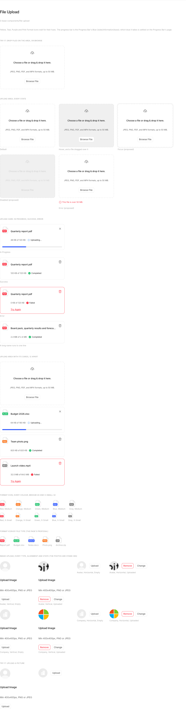
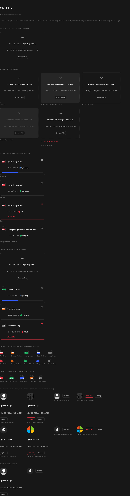

<!-- Copied from the design copy (neutrino-frontend-v3) by scripts/sync.mjs. Edit it there, then run `npm run sync`. -->

# File Upload

| | |
|---|---|
| Figma | [File Upload](https://www.figma.com/design/Ao3YVgFYdQIF0znq2ToqVl?node-id=450-9364) page |
| Status | Written 18 Oct 2026; coded 19 Oct 2026 |
| Code | [`src/components/ds/file-upload.tsx`](../../src/components/ds/file-upload.tsx) |
| Sizes | [`src/styles/sizes/file-upload.css`](../../src/styles/sizes/file-upload.css) |
| Demo | [`src/gallery/sections/file-upload.tsx`](../../src/gallery/sections/file-upload.tsx) |

## Light and dark

**Light**



**Dark**



## Use it

```tsx
import {
  FileFormatIcon,
  FileUploadArea,
  FileUploadCard,
  FileUploadList,
  ImageUpload,
} from "@/components/ds/file-upload";
```

Every size and state, working: run `npm run dev` and open [localhost:3100/#file-upload](http://localhost:3100/#file-upload).

## Spec

Status: written 18 Oct 2026, measured from the Figma. Its proposals stand until Nitesh reviews every component together on one canvas.

Figma, on the File Upload page (450:9364) of https://www.figma.com/design/Ao3YVgFYdQIF0znq2ToqVl:

* "File Upload Area [1.1]" (node 450:9413): the box to drop files on, or browse for them.
* "File Upload Cards [1.1]" (node 451:409): one card per file, while it uploads, when done, or when it failed.
* "File Format Icons [1.1]" (node 450:17234): the small page with the file type on it ("PDF").
* "Image Upload [1.1]" (node 452:653): a profile picture or company logo with its Upload, Remove and Change buttons.

The rule for this page: shape, size, spacing, type and states come exactly from the Figma. Colours are the tokens the Figma frame uses, with our palette's values (`../colors/colors.md`). Every number here becomes a size token, so it can be changed later in one place (`../README.md`, "Sizes work the same way").

### Rules

1. Adding files is the File Upload Area, with one File Upload Card under it for each file. A person's picture or a company's logo is the Image Upload. Never build a drop zone or a file row by hand.
2. Show a file's type with the File Format Icon.
3. Something missing? Stop and ask Nitesh, then add it here first.

### What it has

| Part | Property | Options |
|---|---|---|
| Upload Area | State | Default, Hover |
| Upload Card | State | In Progress (uploading, with a progress bar), Success (completed), Error (failed, with Try Again) |
| Format Icon | Size | Medium (40), X-Small (32) |
| Format Icon | Colour | Red, Orange, Yellow, Green, Teal, Blue, Purple, Pink, Gray |
| Image Upload | Type | Avatar (a person), Company (a logo) |
| Image Upload | State | Empty (Upload), Uploaded (Remove and Change) |
| Image Upload | Alignment | Vertical (picture, words and buttons), Horizontal (picture and buttons only) |

### Layout

#### Upload Area

| Part | Value |
|---|---|
| Width | Its container's width; the Figma draws it 400 wide |
| Height | 202 with the Figma's words |
| Padding | 32 on every side |
| Gap | 20, everything centred, top to bottom: icon, words, button |
| Corner | 12 |
| Edge | 1px dashed (5 on, 5 off), inside |
| Icon | 24 x 24, an upload cloud |
| Words | Two lines, 6 apart, centred: "Choose a file or drag & drop it here." in `text-label-sm` (14/20, 500); "JPEG, PNG, PDF, and MP4 formats, up to 50 MB." in `text-paragraph-xs` (12/16, 400) |
| Button | "Browse File": the Button, Neutral, Stroke, X-Small (32) (`button.md`) |

#### Upload Card

| Part | Value |
|---|---|
| Width | Its container's width; the Figma draws it 400 wide |
| Height | 94 In Progress, 72 Success, 100 Error |
| Padding | 16 top, right and bottom; 14 left |
| Corner | 12 |
| Edge | 1px, inside |
| Rows | The file row, then the progress bar (In Progress only), 16 apart |
| File row | A row with a 12px gap: the Format Icon (Medium, 40), the words (filling the space), the button on the right, all at the top |
| Words | The file name in `text-label-sm` (14/20, 500); 4 under it, a line in `text-paragraph-xs` (12/16, 400): the size ("0 KB of 120 KB"), a "∙", then the status. 4 apart |
| Status | A 16 x 16 icon and a word ("Uploading...", "Completed", "Failed"), 4 apart |
| Try Again (Error) | A Link Button, Error, Medium (20), underlined, 8 under the words |
| Button on the right | A Compact Button, Large (24): a 20 x 20 close icon while uploading, a bin when done or failed |
| Progress bar | The Progress Bar (its own page later): 6 tall, fully round, the card's inner width |

Cards stack under the Upload Area, 12 apart (from the Figma's Blocks frame).

#### Format Icon

A small page with a label on its left edge.

| Part | Medium (40) | X-Small (32) |
|---|---|---|
| Space it takes | 40 x 40 | 32 x 32 |
| The page | 32 x 40, corner 6, a 1.5px edge inside | 26 x 32, corner 4.8, a 1.2px edge |
| Folded corner | 12 x 12, top right, the same edge | 10 x 10 |
| Label | 28 x 16, 18 from the top, its left edge 4 outside the page; padding 2 top and bottom, 3 sides, corner 4 | 24 x 14, 14 from the top, corner 3 |
| Label words | `text-subheading-2xs uppercase` (11/12, 500): "PDF" | the same, scaled |

X-Small is the Medium drawing scaled to 80%, label and all.

#### Image Upload

| Part | Vertical | Horizontal |
|---|---|---|
| Picture | 64 x 64, fully round | 56 x 56, fully round |
| Gap after the picture | 20 | 20 |
| Words | A column: "Upload Image" in `text-label-md` (16/24, 500), then "Min 400x400px, PNG or JPEG" in `text-paragraph-sm` (14/20, 400), 4 apart | none |
| Buttons | 12 under the words | centred on the picture |

The buttons are Buttons, X-Small (32) (`button.md`): Empty shows "Upload" (Neutral, Stroke); Uploaded shows "Remove" (Error, Stroke) and "Change" (Neutral, Stroke), 12 apart.

The picture:

| Type | Empty | Uploaded |
|---|---|---|
| Avatar | The Avatar's placeholder person (`avatar.md`) | The person's photo, as the Avatar |
| Company | A building drawing on a grey circle | The company's logo, fully round |

### Colours

#### Upload Area

| State | Fill | Edge | Icon | First line | Second line |
|---|---|---|---|---|---|
| Default | `bg/white-0` | `stroke/sub-300`, dashed | `icon/sub-600` | `text/strong-950` | `text/sub-600` |
| Hover | `bg/weak-50` | `stroke/sub-300`, dashed | `icon/sub-600` | `text/strong-950` | `text/sub-600` |

#### Upload Card

| Part | In Progress | Success | Error |
|---|---|---|---|
| Fill | `bg/white-0` | `bg/white-0` | `bg/white-0` |
| Edge | `stroke/soft-200` | `stroke/soft-200` | `state/error/base` |
| File name | `text/strong-950` | `text/strong-950` | `text/strong-950` |
| Size and "∙" | `text/sub-600` | `text/sub-600` | `text/sub-600` |
| Status icon | A spinner, `primary/base` | A filled tick in a circle, `state/success/base` | A filled warning circle, `state/error/base` |
| Status word | `text/strong-950` | `text/strong-950` | `text/strong-950` |
| Button on the right | Ghost, `icon/sub-600` | Ghost, `icon/sub-600` | Modifiable, `state/error/base` |
| Progress bar | Track `bg/soft-200`, fill `state/information/base` | | |

The card has no shadow.

#### Format Icon

| Part | Token |
|---|---|
| Page and folded corner | `bg/white-0`, edge `stroke/sub-300` |
| Label | `state/<colour>/base` |
| Label words | `static/white` |

| Colour | Token | In our palette |
|---|---|---|
| Red | `state/error` | Red |
| Orange | `state/warning` | Amber |
| Yellow | `state/away` | not in the palette yet |
| Green | `state/success` | Green |
| Teal | `state/verified` | not in the palette yet |
| Blue | `state/information` | Blue |
| Purple | `state/feature` | not in the palette yet |
| Pink | `state/highlighted` | not in the palette yet |
| Gray | `state/faded` | Gray |

#### Image Upload

| Part | Token |
|---|---|
| "Upload Image" | `text/strong-950` |
| "Min 400x400px, PNG or JPEG" | `text/sub-600` |
| Company placeholder | The circle `bg/soft-200`; two white buildings, `static/white` behind and `static/white` at 80% in front, with windows in `bg/soft-200` |
| Avatar and logo | Their own colours (`avatar.md`) |

The buttons keep their own colours (`button.md`).

The Examples frame shows the Image Upload in the dark theme too: the tokens flip on their own.

Every other colour is the Figma frame's own token; the moves are listed below.

### Where this differs from the Figma

| Figma | Ours | Why |
|---|---|---|
| The Format Icon's "PDF" has no text style: Inter Semi Bold (600) 11 | `text-subheading-2xs uppercase` (11/12, 500) | Every word uses a type style, and no 600 on words |
| The "Browse File" button has 8 on its sides; the X-Small Button has 6 | The X-Small Button as it is | A Button's padding is never changed from outside (`button.md`) |
| The Avatar placeholder's circle is the raw `neutral/gray/200` | The Avatar's Gray placeholder (`state/faded/light`, as `avatar.md` decided) | Components use tokens only |
| The company placeholder's front building is a raw white at 80% | `static/white` at 80% | Components use tokens only |

### Open

* **The progress bar's blue.** The fill is `state/information/base`, which is our Blue 700 (#0047A2) on light, darker than the Primary blue the Figma's picture shows. Proposed: `primary/base`, to match the spinner next to it. To settle on the Progress Bar's own page.
* **The card's left padding is 14, the other sides 16.** Perhaps on purpose, since the page icon has white space on its left. Kept as in the Figma; Nitesh to say.
* **No drag-over look for the Upload Area.** Proposed: the Hover look while a file is dragged over it.
* **No keyboard focus, disabled or error look for the Upload Area** (for a file that is too big or the wrong type). Proposed: focus, the Neutral focus ring (2px `bg/white-0`, then 4px `state/faded/light`, outside, no blur); disabled, `bg/weak-50` with every word and the icon in the disabled tokens; error, the message under the area in the Hint Text's Error look (`key-components.md`). Nitesh to say.
* **Which colour for which file type.** The Figma shows "PDF" in every colour. Proposed: PDF Red, spreadsheets Green, documents Blue, images Orange, anything else Gray, until Nitesh picks.
* **Missing hues.** Yellow (`state/away`), Purple (`state/feature`) and Pink (`state/highlighted`) are not in the palette yet. The Figma's "Teal" icon uses `state/verified` (Sky), not `state/stable` (Teal); neither is in the palette yet. Until they are, use the five colours that are.
* **No look while a picture uploads** in the Image Upload. Proposed: ask Nitesh; the File Upload Card's spinner is the nearest thing.

### Build order

The Button (`button.md`), the Avatar (`avatar.md`), the Compact Button and the Link Button (both families on the Button page, no page of their own yet) and the Progress Bar (its page comes later). The Upload Area and the Format Icon can be built now.

### In code (to decide when building)

* There is no shared upload component in code. Seven files draw their own file input (`components/excel-upload-tab.tsx`, `components/data-sources-tab.tsx`, `components/report-bug/report-bug-dialog.tsx`, `components/studio/ui.tsx`, `components/integration-forms/csv-form.tsx`, `components/integration-forms/pdf-form.tsx`, `components/chat/refined/composer.tsx`); the first two also take dropped files. They move to the Upload Area and Cards when rebuilt.
* Today's `components/ui/progress.tsx` is the stock Radix one, used in 5 files (two of them upload dialogs: `components/connectors/upload-dialog.tsx`, `components/dialogs/pdf-upload-dialog.tsx`). The Progress Bar page will replace how it looks.
* The product's spinner is `components/ui/spinner.tsx` (used in 69 files); its 16 size could be the uploading icon. Ask Nitesh.
* A CSS dashed border cannot set a 5 on, 5 off dash. Draw the edge with an SVG (or a repeating background) to match.
* The Format Icon and the company placeholder are pictures: draw them once as SVG, with the colours as tokens.
