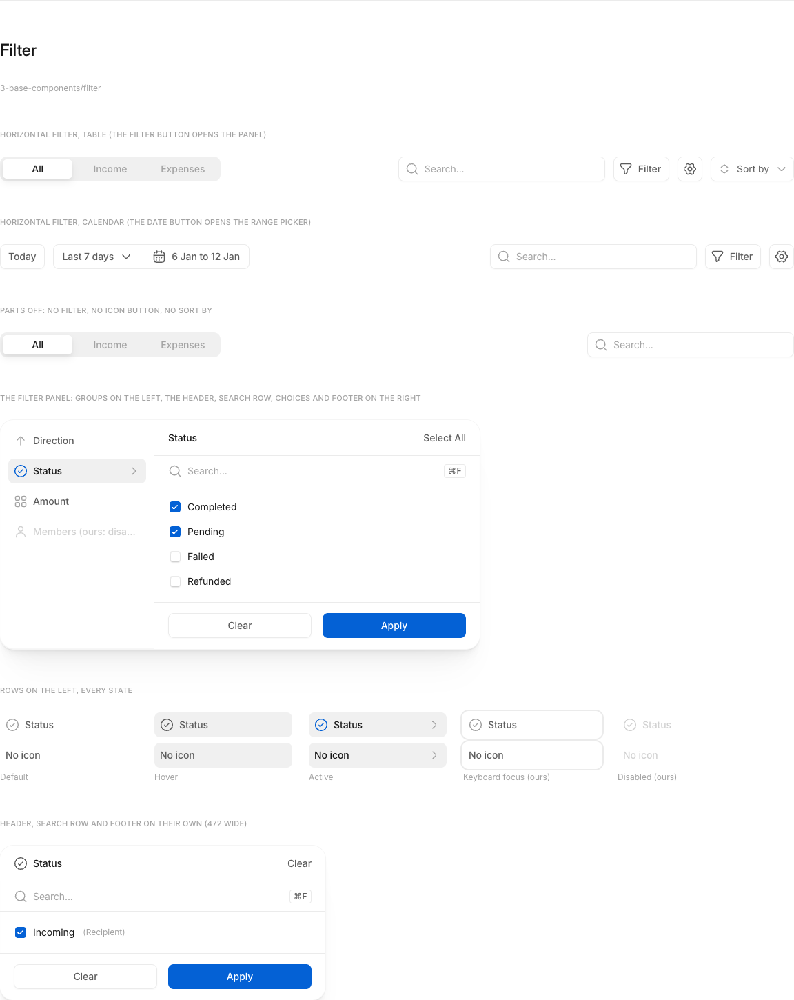
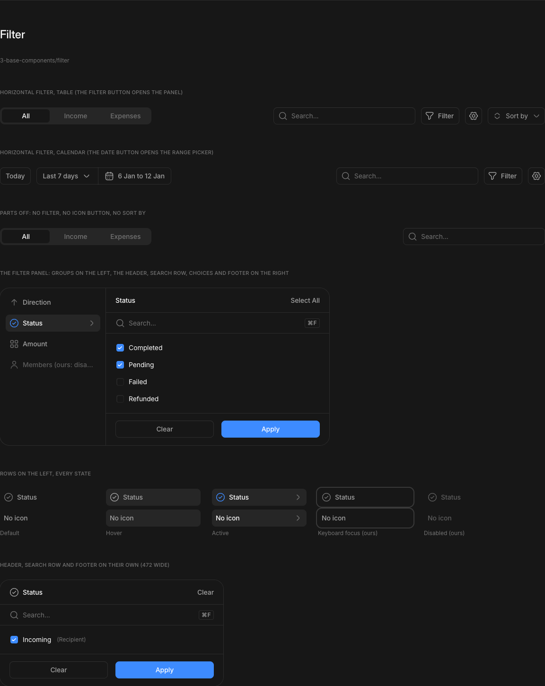

<!-- Copied from the design copy (neutrino-frontend-v3) by scripts/sync.mjs. Edit it there, then run `npm run sync`. -->

# Filter

| | |
|---|---|
| Figma | [Filter](https://www.figma.com/design/Ao3YVgFYdQIF0znq2ToqVl?node-id=3880-66172) page |
| Status | Written 18 Oct 2026; coded 19 Oct 2026 |
| Code | [`src/components/ds/filter.tsx`](../../src/components/ds/filter.tsx) |
| Sizes | [`src/styles/sizes/filter.css`](../../src/styles/sizes/filter.css) |
| Demo | [`src/gallery/sections/filter.tsx`](../../src/gallery/sections/filter.tsx) |

## Light and dark

**Light**



**Dark**



## Use it

```tsx
import {
  FilterItem,
  FilterHeader,
  FilterSearchRow,
  FilterChoices,
  FilterChoice,
  FilterFooter,
  FilterPanel,
  HorizontalFilter,
} from "@/components/ds/filter";
```

Every size and state, working: run `npm run dev` and open [localhost:3100/#filter](http://localhost:3100/#filter).

## Spec

Status: written 18 Oct 2026, measured from the Figma. Its proposals stand until Nitesh reviews every component together on one canvas.

Figma, on the Filter page (3880:66172) of https://www.figma.com/design/Ao3YVgFYdQIF0znq2ToqVl:

* "Horizontal Filter [1.1]" (node 4370:6018): the bar of filters above a table or a calendar.
* "Vertical Filter Items [1.1]" (node 4379:1183): the rows down the left of the filter panel.
* "Vertical Filter Header [1.1]" (node 4379:2209) and "Vertical Filter Footer [1.1]" (node 4415:863): the top and bottom of the panel's right side.
* The filter panel itself is drawn in the page's blocks (for example node 166999:140380), not as a component.

The rule for this page: shape, size, spacing, type and states come exactly from the Figma. Colours are the tokens the Figma frame uses, with our palette's values (`../colors/colors.md`). Every number here becomes a size token, so it can be changed later in one place (`../README.md`, "Sizes work the same way").

### Rules

1. The bar above a table or a calendar (search, filter, sort, a date range): Horizontal Filter. The panel that opens from its Filter button, with the filter groups on the left and their choices on the right: the filter panel.
2. Both are made only of the parts named here (Button, Button Group, Segmented Control, Text Input, Select, Checkbox, Radio, Content Divider). Never draw them by hand.
3. Something missing? Stop and ask Nitesh, then add it here first.

### Horizontal Filter

#### What it has

| Property | Options |
|---|---|
| Type | Calendar, Table |
| Parts that can be off | Search, the Filter button, the icon button, Sort by |

#### Layout

* One row, 36 tall, the full width of the page (1104 in the Figma), 12 between the parts. Every part is its Small (36) size.
* Calendar: on the left, a "Today" Button (Neutral, Stroke) and a Button Group of two (a "Last 7 days" choice with a down arrow, and a calendar icon with the date range). On the right: Search, Filter and the icon button.
* Table: on the left, a Segmented Control (320 wide in the Figma, three options: All, Income, Expenses). On the right: Search, Filter, the icon button and Sort by.

| Part | What it is |
|---|---|
| Search | The Text Input, Search type, Small (36), 300 wide (`text-input.md`); the table's Blocks show a shortcut key in it, "⌘1" (`searchShortcut`; the page listens for the key and focuses the field through `searchRef`, 23 Oct 2026) |
| Filter | A Button, Neutral, Stroke, Small, with a filter icon before the word (`button.md`) |
| Icon button | A Button, Neutral, Stroke, Small, icon only (36 x 36); a settings icon in the Figma |
| Sort by | The Select, Basic, Small (36), as wide as its words, with a sort icon (`select.md`) |
| Date choices | The Button Group, Small (36) (`button-group.md`) |
| Views | The Segmented Control (`segmented-control.md`) |

The bar has no fill, edge or type of its own; every colour comes from its parts.

### The filter panel

Measured from the page's five blocks.

| Part | Value |
|---|---|
| Panel | 696 wide, height follows the content, corner 20, `bg/white-0`, no edge, `--shadow-filter` (below) |
| Left column | 224 wide, padding 12, rows 8 apart, a 1px `stroke/soft-200` line on its right |
| Right side | 472 wide: the header, an optional search row, the choices, the footer |
| Search row | 44 tall, padding 12 top and bottom, 20 sides, gap 8, a 1px `stroke/soft-200` line under it: a 20 x 20 search icon in `icon/soft-400`, "Search..." in `text-paragraph-sm` (14/20, 400) `text/soft-400`, and a shortcut key box (as on the Dropdown, `dropdown.md`) |
| Choices | Padding 20. Rows 16 apart: Checkbox Labels (`checkbox.md`) or Radio Labels (`radio.md`), each with an optional note 12 after it on the right ("(Recipient)") in `text-paragraph-xs` (12/16, 400) `text/soft-400`. Fields (the Text Input) 12 apart |
| Group heading | A Content Divider, Solid Text (28 tall), such as "DIRECTION" (`content-divider.md`) |
| Date choice | A month picker (From and To); it belongs to the Date Picker page, later |

`--shadow-filter` is the Figma's `custom-shadows/medium`, eight layers:

1. Inside: 0 up 1, blur 1, spread -0.5, `#333333` at 6%.
2. A 1px ring (0 offset, no blur, spread 1) in `state/faded/lighter`.
3. 0 down 48, blur 48, spread -24, `#333333` at 4%.
4. 0 down 24, blur 24, spread -12, `#333333` at 4%.
5. 0 down 12, blur 12, spread -6, `#333333` at 4%.
6. 0 down 6, blur 6, spread -3, `#333333` at 4%.
7. 0 down 3, blur 3, spread -1.5, `#333333` at 2%.
8. 0 down 1, blur 1, spread 0.5, `#333333` at 4%.

#### Rows on the left (Vertical Filter Items)

* 36 tall, filling the column (200 in the Figma), padding 8, gap 8, corner 8.
* An optional 20 x 20 icon, then the word in `text-label-sm` (14/20, 500), filling the space. Active adds a 20 x 20 chevron on the right.

| State | Fill | Icon | Word | Chevron |
|---|---|---|---|---|
| Default | `bg/white-0` | `icon/soft-400` | `text/sub-600` | none |
| Hover | `bg/weak-50` | `icon/sub-600` | `text/sub-600` | none |
| Active | `bg/weak-50` | `primary/base` | `text/strong-950` | `icon/soft-400` |

#### Header (Vertical Filter Header)

* 52 tall, padding 16 top and bottom, 20 sides, gap 8, `bg/white-0`, a 1px `stroke/soft-200` line at the bottom. It takes the right side's width (400 in the Figma).
* On the left: an optional 20 x 20 icon in `icon/sub-600` and the title in `text-label-sm` `text/strong-950`, 8 apart.
* On the right: an optional Link Button, Gray, Medium (20) (`button.md`): "Clear" in the Figma, "Select All" in the blocks.

#### Footer (Vertical Filter Footer)

* 68 tall, padding 16 top and bottom, 20 sides, `bg/white-0`, a 1px `stroke/soft-200` line on top.
* Two Buttons, Small (36), sharing the width, 16 apart: Neutral, Stroke ("Clear") and Primary, Filled ("Apply").

Every colour is the Figma frame's own token; nothing moved. The colours the Figma types in directly are the panel shadow's `#333333` layers; they become a shadow token with the others.

### Where this differs from the Figma

| Figma | Ours | Why |
|---|---|---|
| The Calendar bar's left group has an 11px gap | 12, like the rest of the bar | 11 is not on the spacing scale; a slip |
| The Sort by Select carries a second card shadow on its outer frame | Only the Select's own shadow | The shadow was doubled |
| The panel has corner 20 and `custom-shadows/medium` in the five blocks, but corner 16, a `stroke/soft-200` edge and no shadow in the two prototypes | Corner 20 and `--shadow-filter` | The majority rule |

### Open

* Every other floating panel (the Dropdown's menu, the Popover, the Command Menu) has corner 16, a 1px `stroke/soft-200` edge and `--shadow-menu`. The filter panel's blocks differ. To ask Nitesh: should it match them?
* Keyboard focus on the left rows: none in the Figma. Proposed: the Neutral focus ring (2px `bg/white-0`, then 4px `state/faded/light`, outside, no blur).
* Disabled rows: none in the Figma. Proposed: no fill, icon `icon/disabled-300`, word `text/disabled-300`, as the Dropdown's Disabled row.
* The left rows are close to the vertical Tab Menu's rows (`tab-menu.md`) but not the same (icon `icon/soft-400` at rest, the word stays `text/sub-600` on Hover, an 8 gap, not 6). Kept as drawn; Nitesh may want one row for both.
* Dark theme: the panel's shadow is dark grey with a `state/faded/lighter` ring; check it on dark when shadows become tokens.

### Build order

The Horizontal Filter uses the Button, the Button Group, the Segmented Control, the Text Input (Search) and the Select. The panel uses the Link Button, the Button, the Checkbox Label, the Radio Label, the Text Input and the Content Divider; its Date choice waits for the Date Picker. Build after those pages.

### In code (to decide when building)

* Nothing in `components/ui` is this bar or panel. The nearest is `components/data-table-filter.tsx` (a filter for data tables built from Command, Popover, Calendar, Checkbox, Slider and Tabs), used in 1 file, `components/dataframe-display.tsx`. It takes this look when rebuilt.
* `components/workflow-builder/filter-node.tsx` and `filter-config-panel.tsx` are the workflow builder's Filter step, a different thing.
* The panel's shadow becomes `--shadow-filter: inset 0 -1px 1px -0.5px rgba(51, 51, 51, 0.06), 0 0 0 1px var(--state-faded-lighter), 0 48px 48px -24px rgba(51, 51, 51, 0.04), 0 24px 24px -12px rgba(51, 51, 51, 0.04), 0 12px 12px -6px rgba(51, 51, 51, 0.04), 0 6px 6px -3px rgba(51, 51, 51, 0.04), 0 3px 3px -1.5px rgba(51, 51, 51, 0.02), 0 1px 1px 0.5px rgba(51, 51, 51, 0.04)` when shadows move into the token build.
