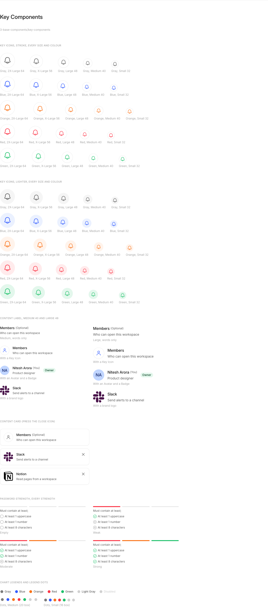
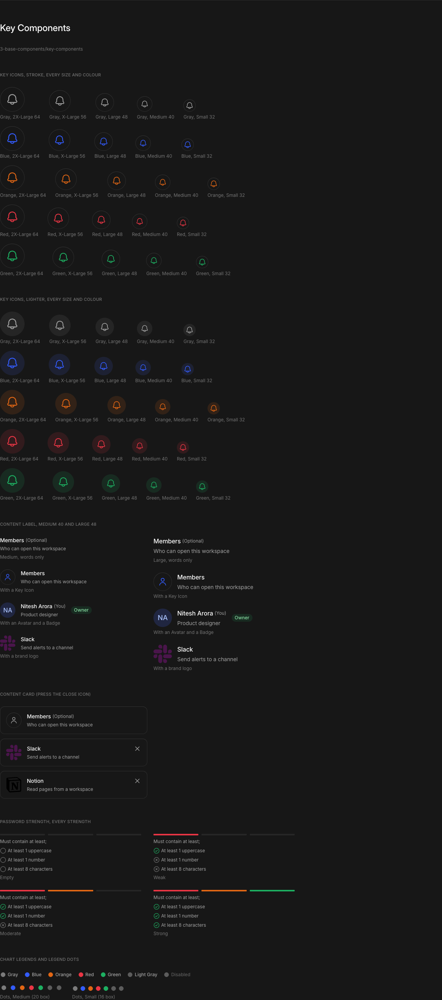
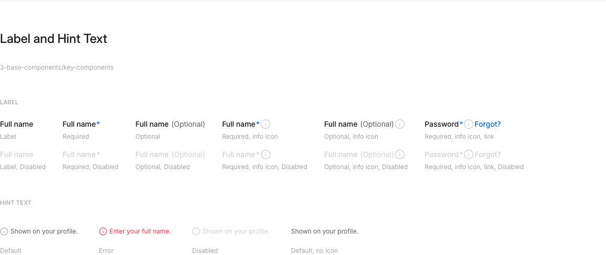
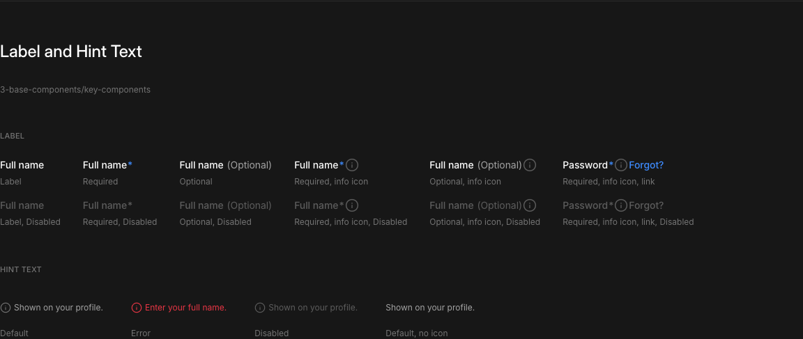

<!-- Copied from the design copy (neutrino-frontend-v3) by scripts/sync.mjs. Edit it there, then run `npm run sync`. -->

# Key Components

| | |
|---|---|
| Figma | [Key Components](https://www.figma.com/design/Ao3YVgFYdQIF0znq2ToqVl?node-id=263-1844) page |
| Status | Approved, 18 Oct 2026; coded 19 Oct 2026 |
| Code | [`src/components/ds/key-components.tsx`](../../src/components/ds/key-components.tsx), [`src/components/ds/label.tsx`](../../src/components/ds/label.tsx) |
| Sizes | [`src/styles/sizes/key-components.css`](../../src/styles/sizes/key-components.css), [`src/styles/sizes/label.css`](../../src/styles/sizes/label.css) |
| Demo | [`src/gallery/sections/key-components.tsx`](../../src/gallery/sections/key-components.tsx), [`src/gallery/sections/label.tsx`](../../src/gallery/sections/label.tsx) |

## Light and dark

### Key Components

**Light**



**Dark**



### Label and Hint Text

**Light**



**Dark**



## Use it

```tsx
import {
  KeyIcon,
  ContentLabel,
  ContentCard,
  PasswordStrength,
  LegendDot,
  ChartLegend,
} from "@/components/ds/key-components";
import { FieldLabel, HintText } from "@/components/ds/label";
```

Every size and state, working: run `npm run dev` and open [localhost:3100/#key-components](http://localhost:3100/#key-components).

## Spec

Status: approved by Nitesh, 18 Oct 2026.

Figma: the Key Components page (263:1844) of https://www.figma.com/design/Ao3YVgFYdQIF0znq2ToqVl. Small parts the other components are made of.

The rule for this page: shape, size, spacing, type and states come exactly from the Figma. Colours are the tokens the Figma frame uses, with our palette's values (`../colors/colors.md`). Every number here becomes a size token, so it can be changed later in one place (`../README.md`, "Sizes work the same way").

### Rules

1. Build these once and reuse them. The Text Input's label, the Checkbox Card's words and every icon in a circle are these parts.
2. Something missing? Stop and ask Nitesh, then add it here first.

### Label (node 266:2814)

The label above a field (used by the Text Input, Text Area and others).

* A row with a 1px gap: the label, `*`, "(Optional)", an info icon (20 x 20), and an optional Link Button.
* Label and `*`: `text-label-sm` (14/20, 500). "(Optional)": `text-paragraph-sm` (14/20, 400).

| Part | Normal | Disabled |
|---|---|---|
| Label | `text/strong-950` | `text/disabled-300` |
| `*` | `primary/base` | `text/disabled-300` |
| "(Optional)" | `text/sub-600` | `text/disabled-300` |
| Info icon | `icon/disabled-300` | `icon/disabled-300` |

### Hint Text (node 266:5284)

The line under a field.

* A row with a 4px gap: an optional 16 x 16 icon, then the text in `text-paragraph-xs` (12/16).

| State | Icon | Text |
|---|---|---|
| Default | `icon/soft-400` | `text/sub-600` |
| Error | `state/error/base` | `state/error/base` |
| Disabled | `icon/disabled-300` | `text/disabled-300` |

### Content Label (node 2945:5539)

A title and a line of description, with an optional picture on the left and an optional Badge or Switch on the right.

| Size | Title | Description | Picture | Height |
|---|---|---|---|---|
| Medium (40) | `text-label-sm` (14/20) | `text-paragraph-xs` (12/16) | 40 | 40 |
| Large (48) | `text-label-md` (16/24) | `text-paragraph-sm` (14/20) | 48 | 48 |

* Title row: the title, then an optional "(Sublabel)" in `text-paragraph-xs` `text/sub-600`, 4px apart. Title and description 4px apart.
* Picture, words and the right-hand part sit in a row with a 14px gap.
* Picture: a Key Icon, an Avatar, a brand or a company logo.
* Title `text/strong-950`, description `text/sub-600`.

### Content Card (node 2942:9503)

The Content Label in a card, with a close icon on the right: the same card as the Checkbox Card (`checkbox.md`), 360 wide in the Figma, 72 tall, padding 16, gap 14, corner 12, `bg/white-0`, a 1px `stroke/soft-200` edge, `--shadow-card`. The close icon is 20 x 20, `icon/sub-600`.

### Key Icons (node 263:1850)

An icon in a circle.

| Size | Circle | Padding | Icon |
|---|---|---|---|
| 2X-Large | 64 | 16 | 32 |
| X-Large | 56 | 14 | 28 |
| Large | 48 | 12 | 24 |
| Medium | 40 | 10 | 20 |
| Small | 32 | 6 | 20 |

| Style | Circle | Edge | Icon |
|---|---|---|---|
| Stroke | `bg/white-0`, `--shadow-card` | 1px `stroke/soft-200` | Gray: `icon/sub-600`; any other colour: `state/<colour>/base` |
| Lighter | `state/<colour>/lighter` | none | Gray: `icon/sub-600`; any other colour: `state/<colour>/base` |

Colours: Gray (`faded`), Blue (`information`), Orange (`warning`), Red (`error`), Green (`success`), and Yellow, Purple, Pink, Teal (not in the palette yet).

### Password Strength (node 327:8202)

Shown under a password field.

* A column with an 8px gap: three bars, a line of text, then the conditions.
* Bars: a row of three, 4 tall, corner 1.2, 8px apart, sharing the width.
* Text "Must contain at least;" and each condition: `text-paragraph-xs` (12/16), `text/sub-600`.
* Each condition: a 16 x 16 icon and its text, 4px apart.

| Strength | Bar 1 | Bar 2 | Bar 3 |
|---|---|---|---|
| Empty | `bg/soft-200` | `bg/soft-200` | `bg/soft-200` |
| Weak | `state/error/base` | `bg/soft-200` | `bg/soft-200` |
| Moderate | `state/error/base` | `state/warning/base` | `bg/soft-200` |
| Strong | `state/error/base` | `state/warning/base` | `state/success/base` |

A condition that is met: a ticked circle in `state/success/base`. Not met: an empty circle (or a cross once typing has started) in `icon/soft-400`.

### Chart Legends (node 2942:9934) and Legend Dots (node 2942:9880)

* Legend: a 16 x 16 dot and its word, 4px apart. Word: `text-label-xs` (12/16), `text/sub-600`; Disabled `text/disabled-300`.
* Dot: Medium a 12 x 12 circle in a 20 x 20 box (Small: a 16 box), with a 2px `stroke/white-0` ring.
* Dot colours: `state/<colour>/base` for Gray, Blue, Orange, Red, Green, Yellow, Purple, Sky, Pink, Teal; Light Gray and Disabled `icon/disabled-300`.

Chart colours are not decided yet (`../colors/colors.md`, "Outside the tokens"). The legends follow the state colours until they are.

### Payment Icons (node 2942:9995)

Eight drawn icons for bills: Water, Gas, Electricity, Donate, Internet, Phone, Rent, Tax. They are pictures, used as they are; they come in only if a screen needs them.

Every colour on this page is the Figma frame's own token; nothing moved.

### Where this differs from the Figma

| Figma | Ours | Why |
|---|---|---|
| The Teal Key Icon uses `state/verified` (sky) | `state/stable` (teal) | A slip in the Figma; Teal is `stable` everywhere else |

### Open

* Yellow, Purple, Sky, Pink and Teal have no hue in our palette yet (the same as the Badge).
