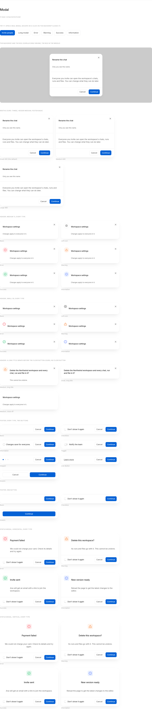
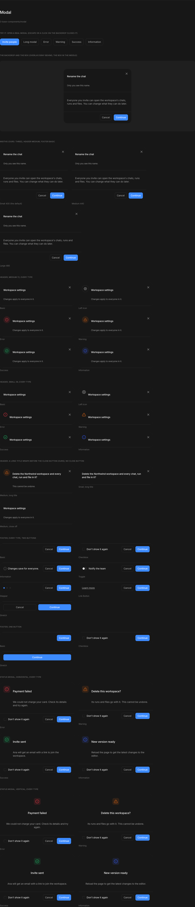

<!-- Copied from the design copy (neutrino-frontend-v3) by scripts/sync.mjs. Edit it there, then run `npm run sync`. -->

# Modal

| | |
|---|---|
| Figma | [Modal](https://www.figma.com/design/Ao3YVgFYdQIF0znq2ToqVl?node-id=466-4630) page |
| Status | Written 18 Oct 2026; coded 19 Oct 2026 |
| Code | [`src/components/ds/modal.tsx`](../../src/components/ds/modal.tsx) |
| Sizes | [`src/styles/sizes/modal.css`](../../src/styles/sizes/modal.css) |
| Demo | [`src/gallery/sections/modal.tsx`](../../src/gallery/sections/modal.tsx) |

## Light and dark

**Light**



**Dark**



## Use it

```tsx
import {
  Modal,
  ModalTrigger,
  ModalClose,
  ModalContent,
  ModalBox,
  ModalBackdrop,
  ModalHeader,
  ModalBody,
  ModalFooter,
  StatusModalContent,
} from "@/components/ds/modal";
```

Every size and state, working: run `npm run dev` and open [localhost:3100/#modal](http://localhost:3100/#modal).

## Spec

Status: written 18 Oct 2026, measured from the Figma. Its proposals stand until Nitesh reviews every component together on one canvas.

Figma, on the Modal page (466:4630) of https://www.figma.com/design/Ao3YVgFYdQIF0znq2ToqVl:

* "Modal Header [1.1]" (node 466:4778): the top of a modal, with its title and close button.
* "Modal Footer [1.1]" (node 472:566): the bottom of a modal, with its buttons.
* "Status Modals [1.1]" (node 480:1372): a ready-made modal for error, warning, success and information.
* "Modal Overlay [1.1]" (node 480:2474): the backdrop behind a modal.
* The modal box itself is not a component in the Figma. Its size, corner and shadow come from the Status Modals and the composed modals in "Modals [Examples]" (3320:17876), "Modal [Prototype]" (3325:9913) and the Blocks frames.

The rule for this page: shape, size, spacing, type and states come exactly from the Figma. Colours are the tokens the Figma frame uses, with our palette's values (`../colors/colors.md`). Every number here becomes a size token, so it can be changed later in one place (`../README.md`, "Sizes work the same way").

### Rules

1. A box that sits over the page and waits for an answer (confirm, a short form, a setting) is this Modal: the backdrop, then the box with its Header, body and Footer. Never build a dialog by hand.
2. Panels that slide in from the side are the Drawer (`drawer.md`), not a Modal.
3. Something missing? Stop and ask Nitesh, then add it here first.

### What it has

| Part | Options |
|---|---|
| Backdrop | One look, the whole screen |
| Box | Header, body, Footer, stacked top to bottom |
| Header type | Basic (words only), Left Icon, Error, Warning, Success, Information |
| Header size | Medium (title and description), Small (title only) |
| Footer type | Basic, Checkbox, Information, Toggle, Stepper, Link Button, Stretch |
| Footer buttons | Two (Cancel and Continue) or one. The confirm button may take the Button's Error tone for a delete, and be disabled while it runs (`confirmProps`, 26 Oct 2026) |
| Status Modal type | Error, Warning, Success, Information |
| Status Modal alignment | Horizontal (icon left of the words), Vertical (icon above, centred) |

### Layout

#### The backdrop

* Covers the whole screen, under the box. `overlay/gray` (the Figma's `overlay/overlay-gray`).
* The box sits in the middle of the screen, across and down.

#### The box

| Part | Value |
|---|---|
| Width | 400 in most of the Figma's modals; 440 for the Status Modals and the parts on their own; 480 once ("Integration Settings") |
| Height | Follows the content |
| Corner | 20. The Header and Footer have no corners of their own; the box clips them |
| Fill | `bg/white-0` |
| Edge | 1px `stroke/soft-200`, inside |
| Shadow | The Figma's `regular-shadow/medium`: 0 down 16, blur 32, spread -12, `#0E121B` at 10% |

#### The Header

| Size | Height | Padding | Gap | Words |
|---|---|---|---|---|
| Medium | 72 | 16 top, right and bottom; 20 left | 14 after the icon | Title `text-label-sm` (14/20, 500), description `text-paragraph-xs` (12/16, 400), 4 apart |
| Small | 56 | 16 top, right and bottom; 20 left | 12 after the icon | Title `text-label-sm` only |

* The icon, Medium: a 40 x 40 circle, padding 10, a 20 x 20 icon. Small: a bare 24 x 24 icon, no circle.
* The close button: the Compact Button, Ghost, Large (24 x 24), 16 from the top and 16 from the right. It floats over the header's right side; it is not part of the row.
* A 1px `stroke/soft-200` line along the bottom, inside.
* The words fill the space from the icon to the right padding.

#### The body

* Not a component. Padding 20 on every side, 20 between items (one example uses 12). `bg/white-0`.

#### The Footer

| Part | Value |
|---|---|
| Height | 68 |
| Padding | 16 top and bottom, 20 sides |
| Gap | 12 between the left part and the buttons |
| Buttons | Button, Small (36) (`button.md`): Neutral Stroke "Cancel", then Primary Filled "Continue", 12 apart, on the right |
| Edge | A 1px `stroke/soft-200` line along the top, inside |

| Footer type | On the left |
|---|---|
| Basic | Nothing |
| Checkbox | A Checkbox Label, one line ("Don't show it again") (`checkbox.md`) |
| Information | A 20 x 20 info icon, then a line of words in `text-paragraph-sm` (14/20), 6 apart |
| Toggle | A Switch Label, one line (`switch.md`) |
| Stepper | The Stepper Dot, Small (`step-indicator.md`) |
| Link Button | A Link Button, Gray, Medium (20), underlined (`button.md`, "Other button families") |
| Stretch | Nothing: the two buttons share the full width equally, 12 apart |

#### The Status Modal

| Part | Value |
|---|---|
| Box | 440 wide, the box above (corner 20, edge, shadow) |
| Top part | Padding 20, gap 16 between the icon and the words |
| Icon | A 40 x 40 rounded square, corner 10, padding 8, a 24 x 24 icon |
| Title | `text-label-md` (16/24, 500) |
| Description | `text-paragraph-sm` (14/20, 400), 4 below the title |
| Footer | The Modal Footer, Checkbox type |

* Horizontal: icon on the left, words on the right, both at the top. 176 tall with a two-line description.
* Vertical: icon above the words, everything centred, words centred. 232 tall with a two-line description.

### Colours

#### Backdrop and box

| Part | Token |
|---|---|
| Backdrop | `overlay/gray` |
| Box, Header, body, Footer | `bg/white-0` |
| Box edge, Header and Footer lines | `stroke/soft-200` |

#### Header

| Type | Icon circle (Medium) | Icon | Title | Description | Close icon |
|---|---|---|---|---|---|
| Basic | none | none | `text/strong-950` | `text/sub-600` | `icon/sub-600` |
| Left Icon | `bg/white-0`, 1px `stroke/soft-200` edge, `--shadow-card` (see "Where this differs") | `icon/sub-600` | `text/strong-950` | `text/sub-600` | `icon/sub-600` |
| Error | `state/error/lighter` | `state/error/base` | `text/strong-950` | `text/sub-600` | `icon/sub-600` |
| Warning | `state/warning/lighter` | `state/warning/base` | `text/strong-950` | `text/sub-600` | `icon/sub-600` |
| Success | `state/success/lighter` | `state/success/base` | `text/strong-950` | `text/sub-600` | `icon/sub-600` |
| Information | `state/information/lighter` | `state/information/base` | `text/strong-950` | `text/sub-600` | `icon/sub-600` |

On Small the bare icon takes the Icon colour of its type.

#### Footer and Status Modal

| Part | Token |
|---|---|
| Information footer: icon | `icon/disabled-300` |
| Information footer: words | `text/strong-950` |
| Status icon square | `state/<type>/lighter` |
| Status icon | `state/<type>/base` |
| Status title | `text/strong-950` |
| Status description | `text/sub-600` |

Every colour is the Figma frame's own token; nothing moved. The shadow is a Figma effect style with a typed-in colour; it becomes a shadow token with the others.

### Where this differs from the Figma

| Figma | Ours | Why |
|---|---|---|
| The Header sizes are named "Medium (80)" and "Small (56)" | Medium is 72 tall, as the frame measures | The name was a slip; the frame is 72 |
| The box's shadow and edge change from modal to modal: the Status Modals and Examples use an edge and `regular-shadow/medium`; the Prototype drops the edge; the Blocks use `custom-shadows/medium` and no edge | Always the edge and `regular-shadow/medium` | The only modal that is a component (Status Modals) and the Examples agree; one look for every modal |
| The Left Icon circle is drawn by hand, without a shadow | The Key Icon, Medium (40), Stroke (`key-components.md`), with its `--shadow-card` | One icon circle everywhere; the Drawer's header uses the Key Icon |
| The footer's Link Button word has no text style (Inter 14/20, 500, -0.6%) | `text-label-sm` | It matches Label/Small exactly; a slip on the Link Button |

### Open

* **Widths.** The Figma uses 400, 440 and 480. Proposed: three widths, Small 400, Medium 440, Large 480, with 400 the default.
* **The close button floats over the words.** The title and description run all the way to the right padding, under the close button, so a long title would touch it. The Basic Small header is also 52 tall, not 56, because the floating button does not count. Proposed: put the close button in the header's row (12 or 14 after the words), so long titles wrap before it and every Small header is 56.
* **The backdrop in dark.** `overlay/gray` in dark is Gray 700 at 56% laid over a Gray 900 page, so it greys the page a little lighter instead of dimming it. Check it on the canvas in dark; `overlay/scrim` (black at 40% in dark) may suit better.
* **Small screens.** The Figma shows no phone layout. Proposed: the box keeps a 16px gutter on each side and the body scrolls when the box is taller than the screen.
* The Figma has no focus look of its own here: the close button and the footer buttons use their own focus rings (`button.md`).

### Build order

The Header uses the Compact Button and the Key Icon; the Footer uses the Button, the Checkbox Label, the Switch Label, the Stepper Dot and the Link Button. Build those first. The box and backdrop can be built now.

### In code (to decide when building)

* Today's `components/ui/dialog.tsx` is the stock shadcn one (Radix Dialog), used in about 45 files; `components/ui/alert-dialog.tsx` in 15. Its backdrop is `bg-black/80`, it is `max-w-lg` (512) with padding 24, corner 8. The Modal replaces how both look; their names can stay.
* Radix already traps focus inside the box, closes on Escape and on a click on the backdrop. Keep that.
* The shadow becomes `--shadow-modal: 0 16px 32px -12px rgba(14, 18, 27, 0.1)` when shadows move into the token build.
