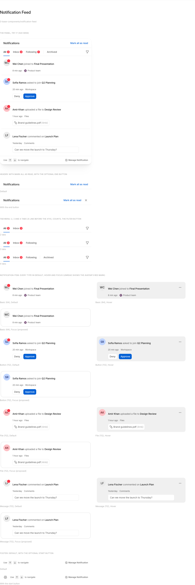
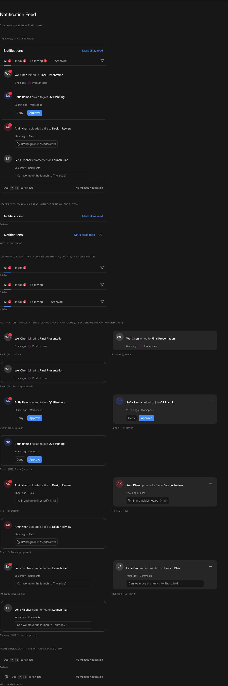

<!-- Copied from the design copy (neutrino-frontend-v3) by scripts/sync.mjs. Edit it there, then run `npm run sync`. -->

# Notification Feed

| | |
|---|---|
| Figma | [Notification Feed](https://www.figma.com/design/Ao3YVgFYdQIF0znq2ToqVl?node-id=4096-21398) page |
| Status | Written 18 Oct 2026; coded 19 Oct 2026 |
| Code | [`src/components/ds/notification-feed.tsx`](../../src/components/ds/notification-feed.tsx) |
| Sizes | [`src/styles/sizes/notification-feed.css`](../../src/styles/sizes/notification-feed.css) |
| Demo | [`src/gallery/sections/notification-feed.tsx`](../../src/gallery/sections/notification-feed.tsx) |

## Light and dark

**Light**



**Dark**



## Use it

```tsx
import {
  NotificationFeed,
  NotificationFeedHeader,
  NotificationFeedTabs,
  NotificationFeedList,
  NotificationQuiet,
  NotificationItem,
  NotificationFeedFooter,
} from "@/components/ds/notification-feed";
```

Every size and state, working: run `npm run dev` and open [localhost:3100/#notification-feed](http://localhost:3100/#notification-feed).

## Spec

Status: written 18 Oct 2026, measured from the Figma. Its proposals stand until Nitesh reviews every component together on one canvas.

Figma, on the Notification Feed page (4096:21398) of https://www.figma.com/design/Ao3YVgFYdQIF0znq2ToqVl:

* "Notifications Header [1.1]" (node 4308:1004): the title bar.
* "Notifications Tab Menu [1.1]" (node 4349:46656): the tabs under it.
* "Notifications Items [1.1]" (node 4308:731): one notification.
* "Notifications Footer [1.1]" (node 4308:5526): the bar at the bottom.
* The Examples frame (4316:44104) puts them together in one panel.

The rule for this page: shape, size, spacing, type and states come exactly from the Figma. Colours are the tokens the Figma frame uses, with our palette's values (`../colors/colors.md`). Every number here becomes a size token, so it can be changed later in one place (`../README.md`, "Sizes work the same way").

### Rules

1. The list of a person's notifications (who did what, with an action to take) is this panel. A single message that pops up on its own is a Notification (`alert.md`); a record of everything that happened in a place is the Activity Feed (`activity-feed.md`).
2. Build the panel only from the four parts on this page, in this order: Header, Tab Menu, the list of items, Footer.
3. Something missing? Stop and ask Nitesh, then add it here first.

### The panel

| Part | Value |
|---|---|
| Panel | 540 wide, corner 20, `bg/white-0`, shadow `--shadow-notification-feed` (below), no edge of its own |
| Order | Header, Tab Menu, the list, Footer, stacked with no gaps |
| The list | Padding 8; items 4px apart, with a Content Divider (Line Spacing, 4 tall: `content-divider.md`) between each two; a 1px `stroke/soft-200` line along its bottom |

The shadow is the Figma's `custom-shadows/medium`, eight layers:

| Layer | Offset down | Blur | Spread | Colour |
|---|---|---|---|---|
| Inner | -1 | 1 | -0.5 | `#333333` at 6% |
| Edge | 0 | 0 | 1 | `state/faded/lighter` |
| Drop | 48 | 48 | -24 | `#333333` at 4% |
| Drop | 24 | 24 | -12 | `#333333` at 4% |
| Drop | 12 | 12 | -6 | `#333333` at 4% |
| Drop | 6 | 6 | -3 | `#333333` at 4% |
| Drop | 3 | 3 | -1.5 | `#333333` at 2% |
| Drop | 1 | 1 | 0.5 | `#333333` at 4% |

The 1px Edge layer is what draws the panel's outline.

### Header

| Part | Value |
|---|---|
| Bar | 56 tall, padding 16 top and bottom, 20 sides, gap 16, `bg/white-0`, a 1px `stroke/soft-200` line along the bottom |
| Title "Notifications" | `text-label-md` (16/24, 500), `text/strong-950`, filling the space |
| "Mark all as read" | Link Button, Primary, Medium (20), no underline: `text-label-sm` (14/20, 500), `primary/base` |
| Optional end button | A Compact Button, Ghost, Large (24), fully round, on the right (off in the Figma) |

### Tab Menu

| Part | Value |
|---|---|
| Bar | 48 tall, padding 14 top and bottom, 20 sides, `bg/white-0`, a 1px `stroke/soft-200` line along the bottom |
| Tabs | 2, 3 or 4 (All, Inbox, Following, Archived), 20px apart, from the left |
| Tab | The Tab Menu's horizontal tab (`tab-menu.md`): the word in `text-label-sm`, an optional Badge after it, 4px apart |
| Count on a tab | The Badge: Filled, Red, Small (16), a number in `text-subheading-2xs uppercase` (11/12) (`badge.md`) |
| Divider | With 4 tabs, a 20 tall upright 1px `stroke/soft-200` line before the last tab |
| Filter button | A Compact Button, Ghost, Large (24), fully round, a filter icon in `icon/sub-600`, 12 from the right edge |

| Part | Default | Active |
|---|---|---|
| Word | `text/sub-600` | `text/strong-950` |
| Line under the tab | none | 2px `primary/base`, the width of the tab, on the bar's bottom line |

Hover follows the Tab Menu (`tab-menu.md`): the word turns `text/strong-950`.

### Notification item

#### What it has

| Property | Options |
|---|---|
| Type | Basic (words only), Button (two buttons below), File (a file below), Message (a quoted message below) |
| State | Default, Hover |
| Unread | The Avatar's Notification mark (a red dot on its top right), from the examples |

#### Layout

| Part | Value |
|---|---|
| Item | The list's width (524 in the Figma), padding 12, corner 12 |
| Row | The avatar, the words, and on hover the more button, 14px apart (see "Where this differs") |
| Avatar | 40 (`avatar.md`); unread adds its Notification mark (18) |
| Words | A column with a 4px gap: the label, then the detail line |
| Detail line | The time ("8 min ago"), a dot (∙), then an optional 16 x 16 picture (a company logo) and the description, 6px apart; the parts 4px apart |
| More button | Hover only: a Compact Button, Ghost, Large (24), in a 40 x 40 space with padding 8, on the right |

| Type | What sits under the words | Gap above it | Height in the Figma |
|---|---|---|---|
| Basic | nothing | | 64 |
| Button | Two Buttons, X-Small (32), 10px apart: Neutral Stroke ("Deny") and Primary Filled ("Approve") (`button.md`) | 16 | 112 |
| File | A file chip: 36 tall, padding 8, gap 4, corner 8, `bg/white-0`, a 1px `stroke/soft-200` edge inside, `--shadow-card`; a 20 x 20 paperclip icon, the file name and its size "(4mb)" 2px apart | 12 | 112 |
| Message | A quoted message: 36 tall, padding 8 top and bottom, 12 sides, corners 4 top left and 8 the others, `bg/white-0`, a 1px `stroke/soft-200` edge inside, `--shadow-card` | 12 | 112 |

#### Type and colours

| Part | Type | Colour |
|---|---|---|
| Label: names and things ("Wei Chen", "Final Presentation") | `text-label-sm` (14/20, 500) | `text/strong-950` |
| Label: the words between them ("joined to") | `text-paragraph-sm` (14/20, 400) | `text/sub-600` |
| Time and description | `text-paragraph-xs` (12/16, 400) | `text/sub-600` |
| The dot | `text-paragraph-xs` | `text/soft-400` |
| File name | `text-paragraph-sm` | `text/sub-600` |
| File size | `text-paragraph-sm` | `text/soft-400` |
| Paperclip icon | | `icon/sub-600` |
| Message | `text-paragraph-sm` | `text/sub-600` |
| More button icon | | `icon/sub-600` |

The component draws the label as one plain `text-label-sm` line; the examples mix the two styles as above.

| State | Fill | More button |
|---|---|---|
| Default | `bg/white-0` | hidden |
| Hover | `bg/weak-50` | shown |

### Footer

| Part | Value |
|---|---|
| Bar | 48 tall, padding 14 top and bottom, 20 sides, gap 16, `bg/white-0`, no line of its own (the list above has one) |
| Left: "Use ↑ ↓ to navigate" | The words and two keys, 8px apart. Words `text-paragraph-xs` (12/16), `text/sub-600` |
| A key | 20 x 20, padding 2, corner 4, `bg/weak-50`, a 1px `stroke/soft-200` edge inside, a 16 x 16 arrow in `icon/sub-600` |
| Right: "Manage Notification" | Link Button, Gray, Small (16): a 16 x 16 settings icon in `icon/sub-600` and the words in `text-label-xs` (12/16, 500), `text/sub-600`, 4px apart |
| Optional start button | A Compact Button, Ghost, Large (24), on the left (off in the Figma) |

Every colour is the Figma frame's own token; nothing moved. The colours the Figma types in directly are the panel shadow's `#333333` layers; they become a shadow token with the others.

### Where this differs from the Figma

| Figma | Ours | Why |
|---|---|---|
| The item's gap between avatar, words and more button is 15 | 14 | 15 is not on the spacing scale; 14 is the Content Label's gap beside its 40 picture (`key-components.md`) |
| The quoted message's bottom right corner is 10 (the others 8, top left 4) | 8 | A slip; the Activity Feed's comment bubble keeps one small corner and the rest equal |

### Open

* **Off the spacing scale:** the header, tab bar and footer pad 20 at the sides, and the tabs sit 20 apart; the Figma's spacing scale jumps from 16 to 24. Kept as drawn. The size build needs a 20 step, or these move to 16 or 24.
* **Not quite the Tab Menu.** Here the tabs are 20 apart (24 on the Tab Menu page) and the bar has only a bottom line (top and bottom on the Tab Menu). Ask whether this is simply the Tab Menu.
* **The count Badge on dark.** It is Filled Red with a white number; on dark our `state/error/base` is Red 500, 3.8:1 under white (4.5:1 is the bar). The same issue is open on the Badge (`badge.md`).
* **No keyboard focus look** on items, tabs, the more button, the filter button or the keys. Proposed: the Neutral focus ring (2px `bg/white-0`, then 4px `state/faded/light`, outside, no blur); the Primary Approve button keeps its own ring (`button.md`).
* **Not drawn:** how tall the panel gets and how the list scrolls, what each tab and the filter button show, the empty state (no notifications), and what opens the panel. Proposed: the list scrolls inside the panel while the header, tabs and footer stay put. Ask Nitesh.
* The page's "Blocks" frames (for example 166926:7027) show other notification panels built from different parts (Key Icons instead of avatars, an "Archive All" button). They are layouts, not components; ask Nitesh if one of them should replace this panel.

### Build order

Made of the Avatar (with its Notification mark), the Badge, the Tab Menu's tabs, the Button (X-Small), the Content Divider, the Link Button and the Compact Button. The Link Button and the Compact Button have no page yet (`button.md`, "Other button families"); build after them.

### In code (to decide when building)

* There is no notification panel in code yet.
* The panel shadow becomes `--shadow-notification-feed: inset 0 -1px 1px -0.5px rgba(51, 51, 51, 0.06), 0 0 0 1px var(--state-faded-lighter), 0 48px 48px -24px rgba(51, 51, 51, 0.04), 0 24px 24px -12px rgba(51, 51, 51, 0.04), 0 12px 12px -6px rgba(51, 51, 51, 0.04), 0 6px 6px -3px rgba(51, 51, 51, 0.04), 0 3px 3px -1.5px rgba(51, 51, 51, 0.02), 0 1px 1px 0.5px rgba(51, 51, 51, 0.04)` when shadows move into the token build.
* The ↑ ↓ keys should really move between items, as the footer says.
