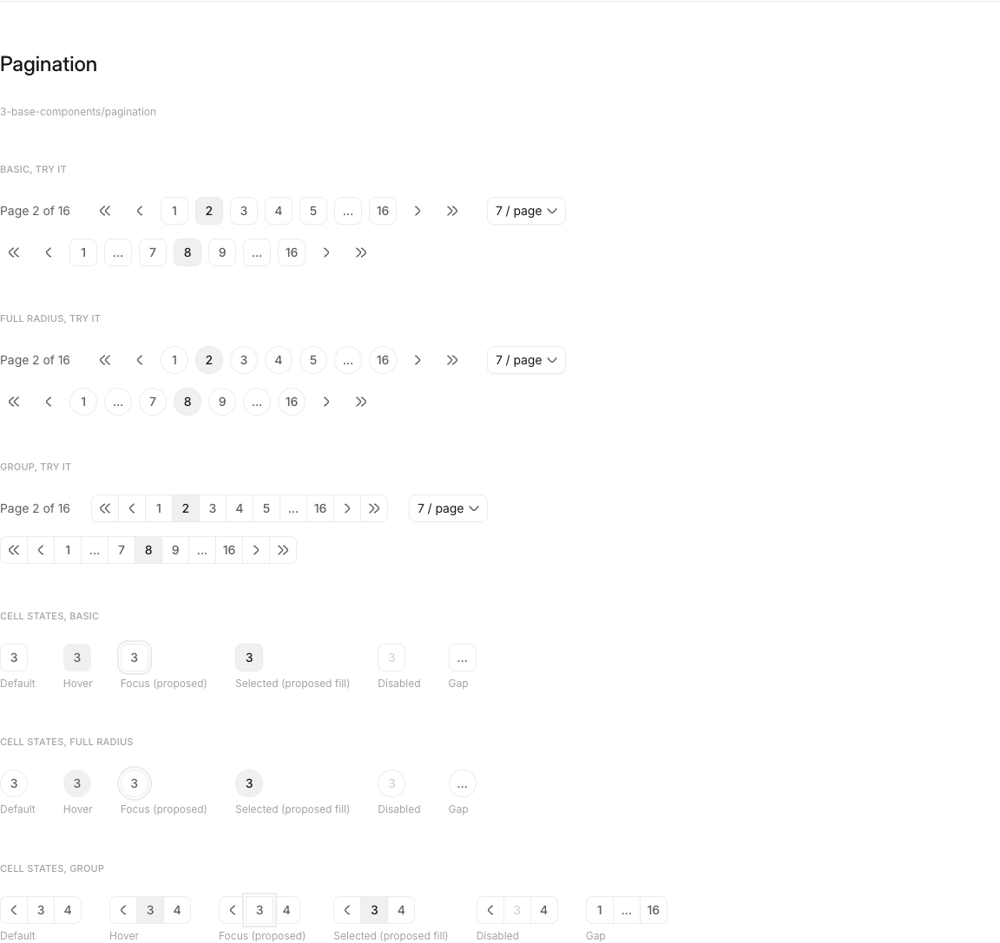
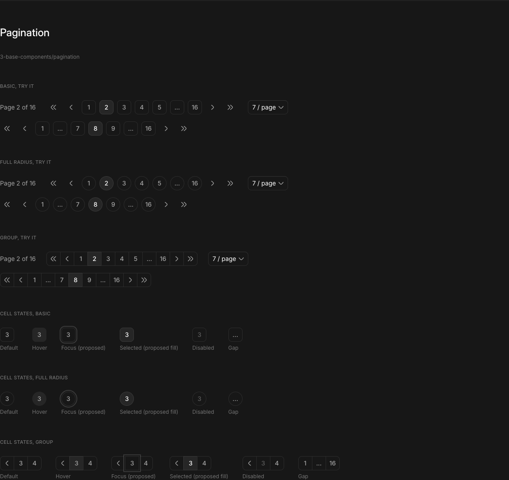

<!-- Copied from the design copy (neutrino-frontend-v3) by scripts/sync.mjs. Edit it there, then run `npm run sync`. -->

# Pagination

| | |
|---|---|
| Figma | [Pagination](https://www.figma.com/design/Ao3YVgFYdQIF0znq2ToqVl?node-id=486-8465) page |
| Status | Written 18 Oct 2026; coded 19 Oct 2026 |
| Code | [`src/components/ds/pagination.tsx`](../../src/components/ds/pagination.tsx) |
| Sizes | [`src/styles/sizes/pagination.css`](../../src/styles/sizes/pagination.css) |
| Demo | [`src/gallery/sections/pagination.tsx`](../../src/gallery/sections/pagination.tsx) |

## Light and dark

**Light**



**Dark**



## Use it

```tsx
import { PaginationCell, PaginationGap, Pagination } from "@/components/ds/pagination";
```

Every size and state, working: run `npm run dev` and open [localhost:3100/#pagination](http://localhost:3100/#pagination).

## Spec

Status: written 18 Oct 2026, measured from the Figma. Its proposals stand until Nitesh reviews every component together on one canvas.

Figma: "Pagination Group [1.1]" (node 513:3892) and "Pagination Cells [1.1]" (node 513:3681), on the Pagination page (486:8465) of https://www.figma.com/design/Ao3YVgFYdQIF0znq2ToqVl.

The rule for this page: shape, size, spacing, type and states come exactly from the Figma. Colours are the tokens the Figma frame uses, with our palette's values (`../colors/colors.md`). Every number here becomes a size token, so it can be changed later in one place (`../README.md`, "Sizes work the same way").

### Rules

1. Moving through pages of a long list or table is this Pagination.
2. Something missing? Stop and ask Nitesh, then add it here first.

### What it has

| Property | Options |
|---|---|
| Type | Basic (separate square cells), Full Radius (separate round cells), Group (cells joined into one bar, like the Button Group) |
| Cell state | Default, Hover, Selected (the current page), Disabled |

### Layout

The row has three parts, 24px apart, 32 tall:

| Part | What it is |
|---|---|
| Left | "Page 2 of 16" in `text-paragraph-sm` (14/20), `text/sub-600` |
| Middle | First, Previous, the page cells, Next, Last; 8px apart. A gap is shown as a "..." cell |
| Right | How many per page: a small Select ("7 / page"), X-Small (32) |

* First, Previous, Next and Last: icon-only Buttons, Neutral, Ghost, X-Small (32) (`button.md`).
* Page cell: 32 x 32, padding 6, corner 8 (Full Radius: fully round), the number in `text-label-sm` (14/20, 500), centred.
* Group type: the arrows and cells joined in one bar with a 1px `stroke/soft-200` edge and corner 8, like the Button Group (`button-group.md`).

### Colours

| Cell state | Fill | Edge | Number |
|---|---|---|---|
| Default | `bg/white-0` | 1px `stroke/soft-200` | `text/sub-600` |
| Hover | `bg/weak-50` | none | `text/sub-600` |
| Selected | `bg/white-0` | 1px `stroke/soft-200` | `text/strong-950` |
| Disabled | `bg/white-0` | 1px `stroke/soft-200` | `text/disabled-300` |

Every colour is the Figma frame's own token; nothing moved.

### Open

* **The current page barely stands out.** Selected differs from Default only by a darker number. The Figma's own example marks the current page with the Hover grey instead. Proposed: Selected gets the `bg/weak-50` fill and the `text/strong-950` number.
* The Figma has no keyboard focus look. Proposed: the Neutral focus ring around the cell, as on the Button Group.

### Build order

The "per page" picker is the Select. Build it after the Select page.

### In code (to decide when building)

* There is no pagination in code yet; tables page with their own controls today.
