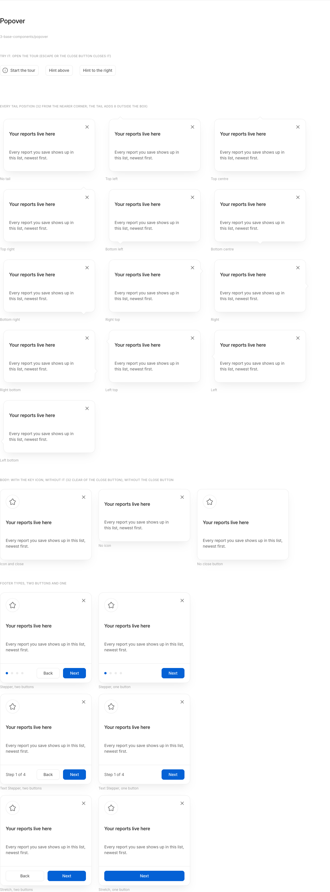
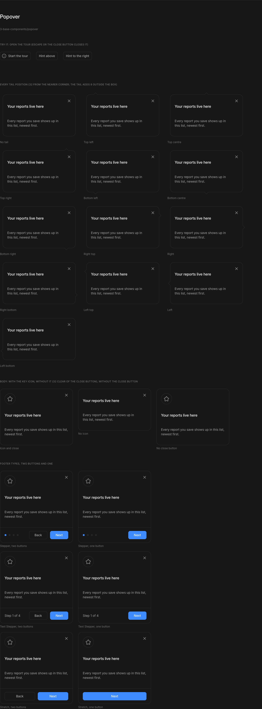

<!-- Copied from the design copy (neutrino-frontend-v3) by scripts/sync.mjs. Edit it there, then run `npm run sync`. -->

# Popover

| | |
|---|---|
| Figma | [Popover](https://www.figma.com/design/Ao3YVgFYdQIF0znq2ToqVl?node-id=553-22099) page |
| Status | Written 18 Oct 2026; coded 19 Oct 2026 |
| Code | [`src/components/ds/popover.tsx`](../../src/components/ds/popover.tsx) |
| Sizes | [`src/styles/sizes/popover.css`](../../src/styles/sizes/popover.css) |
| Demo | [`src/gallery/sections/popover.tsx`](../../src/gallery/sections/popover.tsx) |

## Light and dark

**Light**



**Dark**



## Use it

```tsx
import { PopoverFooter, PopoverPanel, Popover } from "@/components/ds/popover";
```

Every size and state, working: run `npm run dev` and open [localhost:3100/#popover](http://localhost:3100/#popover).

## Spec

Status: written 18 Oct 2026, measured from the Figma. Its proposals stand until Nitesh reviews every component together on one canvas.

Figma, on the Popover page (553:22099) of https://www.figma.com/design/Ao3YVgFYdQIF0znq2ToqVl:

* "Popover [1.1]" (node 4431:81573): the box with its tail, in 12 positions.
* "Popover Footer [1.1]" (node 4456:83048): its footer, in three types.

The rule for this page: shape, size, spacing, type and states come exactly from the Figma. Colours are the tokens the Figma frame uses, with our palette's values (`../colors/colors.md`). Every number here becomes a size token, so it can be changed later in one place (`../README.md`, "Sizes work the same way").

### Rules

1. A box that points at one thing and explains it, with a title, a few lines and actions (a step of a product tour, a "new here" hint): Popover. A one-line hint on hover: Tooltip (`tooltip.md`). A list of actions: Dropdown (`dropdown.md`).
2. Something missing? Stop and ask Nitesh, then add it here first.

### What it has

| Property | Options |
|---|---|
| Tail | On or off, and where it sits: top left, top centre, top right, bottom left, bottom centre, bottom right, right top, right, right bottom, left top, left, left bottom |
| Icon | On or off: a Key Icon at the top |
| Close button | On or off |
| Footer | On or off. Stepper (dots), Text Stepper ("Step 1 of 4") or Stretch (two buttons sharing the width); one button or two |

### Layout

| Part | Value |
|---|---|
| Box | Width follows the use: 320 in the Figma, 372 in its example. Corner 16, `bg/white-0`, a 1px `stroke/soft-200` edge inside, `--shadow-menu` |
| Body | Padding 20, gap 16: the Key Icon, then the words |
| Key Icon | Stroke, Gray, Large (48, icon 24) (`key-components.md`) |
| Words | The title, then the description 4 under it |
| Title | `text-label-md` (16/24, 500) |
| Description | `text-paragraph-sm` (14/20, 400) |
| Close button | A Compact Button, Ghost, Large (24 x 24), 16 from the top and 16 from the right, over the body |
| Line | 1px `stroke/soft-200` between the body and the footer |
| Footer | Padding 16 top and bottom, 20 sides, gap 12, `bg/white-0` |
| Tail | 16 x 8, outside the box, `bg/white-0` with a 1px `stroke/soft-200` edge; the box's edge does not show where the tail joins it |
| Tail position | 32 in from the box's nearer corner (left, right, top or bottom); centred on the centre variants |

#### Footer types

| Type | On the left | On the right |
|---|---|---|
| Stepper | The Stepper Dot, Small (`step-indicator.md`) | The buttons |
| Text Stepper | "Step 1 of 4" in `text-paragraph-sm` | The buttons |
| Stretch | | Two buttons sharing the full width |

* Buttons: Neutral, Stroke ("Back") and Primary, Filled ("Next"), Small (36) (`button.md`), 12 apart. In the Stepper types the Figma draws each 80 wide.
* One button or two (the Figma's "Double Button").

### Colours

| Part | Token |
|---|---|
| Box, tail and footer | `bg/white-0` |
| Edge, tail edge and the line | `stroke/soft-200` |
| Title | `text/strong-950` |
| Description and "Step 1 of 4" | `text/sub-600` |
| Close button | its own (`icon/sub-600`) |
| Dots | the Stepper Dot's own: `primary/base` for the current step, `bg/soft-200` for the others |

The Figma's dark example uses the same tokens: the box turns Gray 800 on dark.

Every colour is the Figma frame's own token; nothing moved. The one colour the Figma types in directly is the shadow, `#0E121B` at 10% (the Dropdown's `--shadow-menu`).

### Where this differs from the Figma

| Figma | Ours | Why |
|---|---|---|
| The box is 320 wide on the six top and bottom variants and 312 on the six side variants, where the tail takes 8 of the 320 | The box keeps its width whichever side the tail is on; the tail adds 8 outside it | The tail should not change the box, as on the Tooltip |

### Open

* With the icon off, the title runs under the close button in the Figma. Proposed: keep 32 clear on the right of the words when there is no icon.
* How it opens and closes (on click, on Escape, where keyboard focus goes) is not in the Figma. Proposed: focus moves to the first button when it opens; Escape and the close button close it.
* Dark theme: the same shadow question as the Dropdown (`dropdown.md`, Open).

### Build order

The Popover uses the Key Icon (`key-components.md`), the Compact Button and the Button (`button.md`) and the Stepper Dot (`step-indicator.md`). Build after those.

### In code (to decide when building)

* Today's `components/ui/popover.tsx` is the stock shadcn one (Radix Popover), used in 13 files (and 2 tests). There it is a plain floating box (the variable picker, the date picker, the artifacts tray), not a tour step. To decide when building: those plain boxes take the Dropdown's menu look, and this Popover is the tour box.
* `components/ui/hover-card.tsx` (3 files) is a similar floating box.
* The shadow is `--shadow-menu` (`dropdown.md`).
