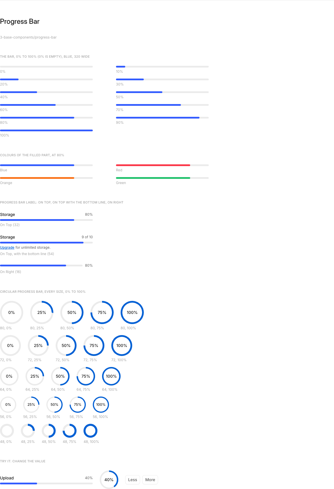
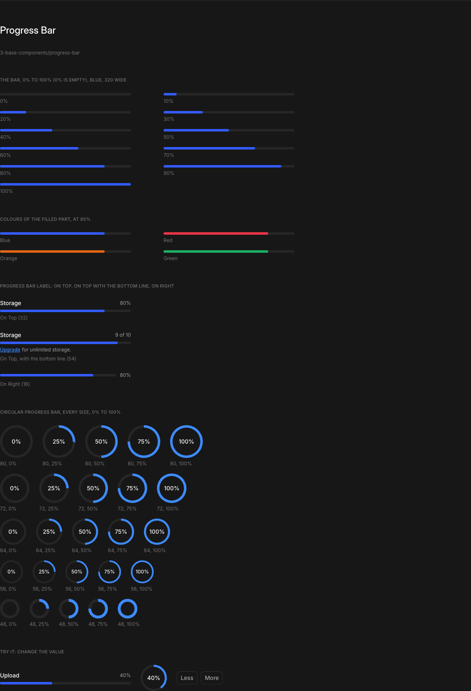

<!-- Copied from the design copy (neutrino-frontend-v3) by scripts/sync.mjs. Edit it there, then run `npm run sync`. -->

# Progress Bar

| | |
|---|---|
| Figma | [Progress Bar](https://www.figma.com/design/Ao3YVgFYdQIF0znq2ToqVl?node-id=450-17758) page |
| Status | Written 18 Oct 2026; coded 19 Oct 2026 |
| Code | [`src/components/ds/progress-bar.tsx`](../../src/components/ds/progress-bar.tsx) |
| Sizes | [`src/styles/sizes/progress-bar.css`](../../src/styles/sizes/progress-bar.css) |
| Demo | [`src/gallery/sections/progress-bar.tsx`](../../src/gallery/sections/progress-bar.tsx) |

## Light and dark

**Light**



**Dark**



## Use it

```tsx
import { ProgressBar, ProgressBarLabel, ProgressBarLink, CircularProgressBar } from "@/components/ds/progress-bar";
```

Every size and state, working: run `npm run dev` and open [localhost:3100/#progress-bar](http://localhost:3100/#progress-bar).

## Spec

Status: written 18 Oct 2026, measured from the Figma. Its proposals stand until Nitesh reviews every component together on one canvas.

Figma, on the Progress Bar page (450:17758) of https://www.figma.com/design/Ao3YVgFYdQIF0znq2ToqVl:

* "Progress Bar [1.1]" (node 450:17821): the bar, 0% to 100%.
* "Progress Bar Line [1.1]" (node 450:17810): the filled part, in five colours.
* "Progress Bar Label [1.1]" (node 515:3758): the bar with a title, the value and an optional line below.
* "Circular Progress Bar [1.1]" (node 466:4652): a ring with the value in the middle.

The rule for this page: shape, size, spacing, type and states come exactly from the Figma. Colours are the tokens the Figma frame uses, with our palette's values (`../colors/colors.md`). Every number here becomes a size token, so it can be changed later in one place (`../README.md`, "Sizes work the same way").

### Rules

1. How far a task has got (an upload, storage used, a quota) is this Progress Bar: the bar in rows and cards, the circle where there is room for a square.
2. Show the value next to it (the Label), unless the row already says it.
3. Something missing? Stop and ask Nitesh, then add it here first.

### The bar

#### What it has

| Property | Options |
|---|---|
| Value | 0% to 100% (the Figma draws every 10%; in code any value) |
| Colour of the filled part | Blue, Red, Orange, Green (Empty is the track's own colour) |

#### Layout

| Part | Value |
|---|---|
| Track | 6 tall, fully round, the width of its container (320 in the Figma) |
| Filled part | 6 tall, fully round, from the left edge, as wide as the value (80% of 320 is 256) |

#### Colours

| Part | Token |
|---|---|
| Track | `bg/soft-200` |
| Filled part, Blue | `state/information/base` |
| Filled part, Red | `state/error/base` |
| Filled part, Orange | `state/warning/base` (our Amber) |
| Filled part, Green | `state/success/base` |

### Progress Bar Label

#### What it has

| Property | Options |
|---|---|
| Type | On Top (title and value above the bar), On Right (value after the bar) |
| Show Bottom | On Top only: an optional line under the bar (a link and a sentence) |

#### Layout

| Type | Layout | Height |
|---|---|---|
| On Top | A column with a 6px gap: the title row, the bar, the optional bottom line | 32, or 54 with the bottom line |
| On Right | A row with an 8px gap, centred: the bar (filling the space), then the value | 16 |

* Title row: the title fills the space, the value sits on the right, 6px apart, centred on the line.
* Bottom line: a link (Link Button, Primary, Small (16), underlined) and a sentence, 4px apart (in the Figma, "Upgrade" and a line about unlimited storage).

#### Type and colours

| Part | Type | Colour |
|---|---|---|
| Title | `text-label-sm` (14/20, 500) | `text/strong-950` |
| Value ("80%", "9 of 10") | `text-paragraph-xs` (12/16, 400) | `text/sub-600` |
| Link | Link Button, Primary, Small: `text-label-xs` (12/16, 500), underlined | `primary/base` |
| Sentence | `text-paragraph-xs` (12/16, 400) | `text/sub-600` |

### Circular Progress Bar

#### What it has

| Property | Options |
|---|---|
| Size | 80, 72, 64, 56, 48 |
| Value | 0% to 100% (the Figma draws every 25%; in code any value) |

#### Layout

| Size | Ring thickness | The value in the middle |
|---|---|---|
| 80 | 6.4 | `text-label-sm` (14/20, 500) |
| 72 | 5.8 | `text-label-sm` |
| 64 | 5.1 | `text-label-sm` |
| 56 | 4.5 | `text-label-xs` (12/16, 500) |
| 48 | 6.7 | none |

* The ring's hole is 84% of the size (72% at 48), so the thickness is a share of the size.
* The filled part starts at the top and runs clockwise. Its ends are square, not round.
* The value is centred, in a box 12 in from each side.

#### Colours

| Part | Token |
|---|---|
| Ring track | `bg/soft-200` |
| Filled part | `primary/base` |
| Value | `text/strong-950` |

Every colour is the Figma frame's own token, except the one below.

### Where this differs from the Figma

| Figma | Ours | Why |
|---|---|---|
| The underlined link word has no type style (plain Inter Medium 12, underlined) | `text-label-xs`, underlined | A slip inside the Link Button; the numbers match that style exactly |

### Open

* **Two blues.** The bar's Blue is `state/information/base` (Blue 700 on light, Blue 300 on dark); the circle's ring is `primary/base` (Blue 500 on light, Blue 400 on dark). They look different side by side. Proposed: one blue for both; ask Nitesh which.
* **The circle has no colour choice.** The bar comes in Blue, Red, Orange and Green; the ring only in blue. Ask whether the ring takes the same colours.
* **Ring thickness lands on fractions** (6.4, 5.8, 5.1, 4.5, 6.7). Proposed: round to whole pixels when the size tokens are set up (6, 6, 5, 4, 7).
* **Not drawn:** a bar that moves without a value (for work of unknown length), and how the filled part moves when the value changes. Ask Nitesh.
* On dark the filled parts are the bright `base` tokens on a dark track; no words sit on them, so contrast is not an issue here.

### Build order

The bar and the circle can be built now. The Label's bottom line uses the Link Button (Primary, Small), which has no page yet (`button.md`, "Other button families").

### In code (to decide when building)

* Today's `components/ui/progress.tsx` is the stock shadcn one (Radix), used in 5 files (for example `components/deep-research-progress.tsx`, `components/dialogs/pdf-upload-dialog.tsx`). It has an edge round the track and fills with `bg-primary`, shadcn's near-black. The Progress Bar replaces how it looks; its name can stay.
* `components/chat/refined/context-ring.tsx` draws its own 16px ring beside the composer. It is smaller than the circle's smallest size (48); ask Nitesh whether it stays its own or becomes a new Circular size.
* Give the bar and the circle `role="progressbar"` with the value, so screen readers say it.
