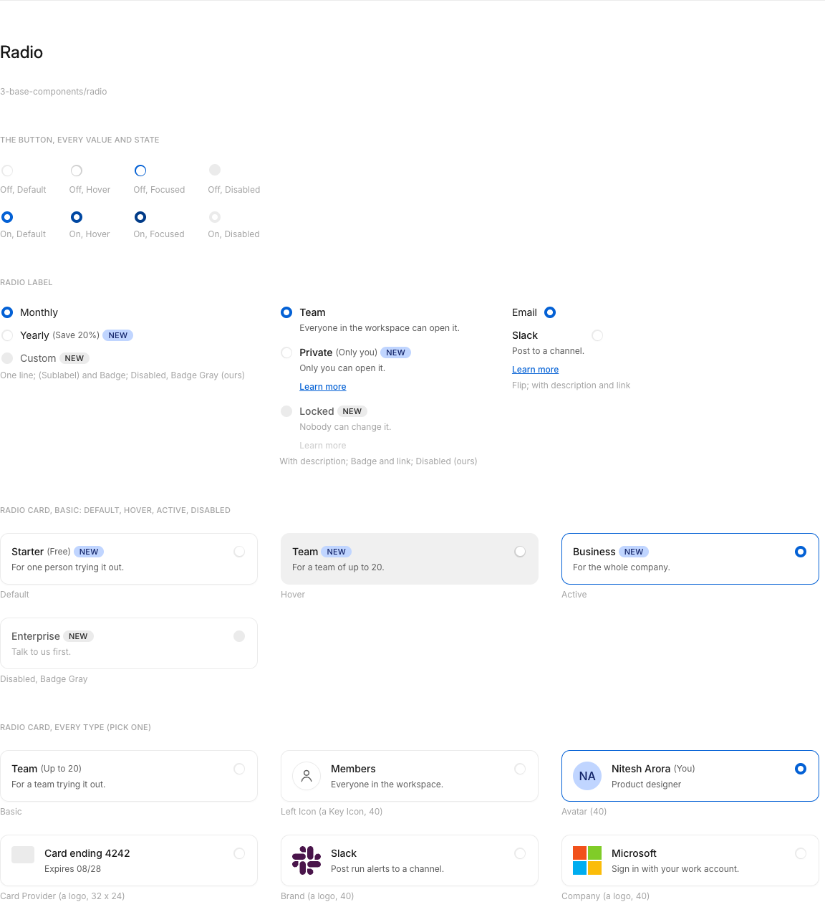
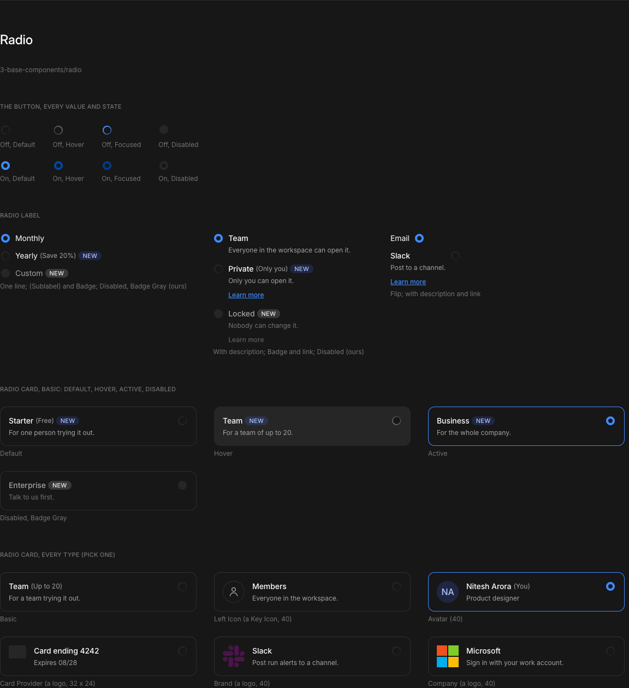

<!-- Copied from the design copy (neutrino-frontend-v3) by scripts/sync.mjs. Edit it there, then run `npm run sync`. -->

# Radio

| | |
|---|---|
| Figma | [Radio](https://www.figma.com/design/Ao3YVgFYdQIF0znq2ToqVl?node-id=515-3884) page |
| Status | Approved, 18 Oct 2026; coded 19 Oct 2026 |
| Code | [`src/components/ds/radio.tsx`](../../src/components/ds/radio.tsx) |
| Sizes | [`src/styles/sizes/radio.css`](../../src/styles/sizes/radio.css) |
| Demo | [`src/gallery/sections/radio.tsx`](../../src/gallery/sections/radio.tsx) |

## Light and dark

**Light**



**Dark**



## Use it

```tsx
import { RadioGroup, Radio, RadioLabel, RadioCard } from "@/components/ds/radio";
```

Every size and state, working: run `npm run dev` and open [localhost:3100/#radio](http://localhost:3100/#radio).

## Spec

Status: approved by Nitesh, 18 Oct 2026.

Figma, on the Radio page (515:3884) of https://www.figma.com/design/Ao3YVgFYdQIF0znq2ToqVl:

* "Radio [1.1]" (node 515:4242): the round button on its own.
* "Radio Label [1.1]" (node 515:4282): the button with its words.
* "Radio Card [1.1]" (node 515:4347): a card you pick, with the button in its corner.

The rule for this page: shape, size, spacing, type and states come exactly from the Figma. Colours are the tokens the Figma frame uses, with our palette's values (`../colors/colors.md`). Every number here becomes a size token, so it can be changed later in one place (`../README.md`, "Sizes work the same way").

The Radio is the Checkbox's twin (`checkbox.md`): the same label, the same card, the same states. Only the button itself differs. Keep the two in step.

### Rules

1. Pick one of a few: Radio. Pick any number: Checkbox. Never style a radio button by hand.
2. A radio always has its words next to it (Radio Label) or sits in a Radio Card.
3. Something missing? Stop and ask Nitesh, then add it here first.

### The button

#### What it has

| Property | Options |
|---|---|
| Size | One size |
| Value | Off, On |
| State | Default, Hover, Focused, Disabled |

#### Size

* It takes 20 x 20. The circle inside is 16 x 16, 2px in from each side.
* Off: an edge with a raised white face. The face is a 13 x 13 circle, 1.5px in, with a small drop shadow (0 down 2, blur 4, spread -2, `#1B1C1D` at 12%). The Checkbox's face shadow has blur 2 and no spread.
* On: the circle filled, with an 8 x 8 dot in the middle.

#### Colours

| State | Off: edge | Off: face | On: fill | On: dot |
|---|---|---|---|---|
| Default | `bg/soft-200` | `bg/white-0` | `primary/base` | `bg/white-0` |
| Hover | `bg/sub-300` | `bg/white-0` | `primary/dark` | `bg/white-0` |
| Focused | `primary/base` | `bg/white-0` | `primary/darkest` | `bg/white-0` |
| Disabled | `bg/soft-200`, no face, no shadow | | `bg/soft-200` | `bg/white-0` |

Focus is shown by the button itself, a blue edge or a darker fill, with no ring around it.

The dot is `bg/white-0`, not `static/white` as the Checkbox's tick is. So on dark the dot is dark grey on the blue, as the Figma has it.

### Radio Label

Exactly the Checkbox Label (`checkbox.md`, "Checkbox Label"), with the Radio in place of the box: one line or with a description, an optional "(Sublabel)", Badge and link, Flip to put the button on the right, the same type, gaps and colours, and the same Disabled look.

### Radio Card

Exactly the Checkbox Card (`checkbox.md`, "Checkbox Card"), with the Radio in place of the box: the six types, 72 tall, 16 padding, 14 gap, corner 12, and the same four states (Active is a `primary/base` edge with the Radio On).

Every colour on this page is the Figma frame's own token; nothing moved. The one colour the Figma types in directly is the face's shadow, `#1B1C1D` at 12%; it becomes a shadow token with the others.

### Where this differs from the Figma

| Figma | Ours | Why |
|---|---|---|
| No Disabled look for the Radio Label | The Radio Card's Disabled look, as agreed for the Checkbox Label on 18 Oct 2026 | Keeps the twins in step |

### Build order

The Radio Card and the Radio Label use the Badge, the Avatar, the Key Icon and the Link Button. Build them after those pages; the button can be built now.

### In code (to decide when building)

* Today's `components/ui/radio-group.tsx` is the stock shadcn one, used in 1 file. The Radio replaces how it looks; its name can stay.
* The face's shadow becomes a shadow token, `--shadow-radio: 0 2px 4px -2px rgba(27, 28, 29, 0.12)`, when shadows move into the token build.
