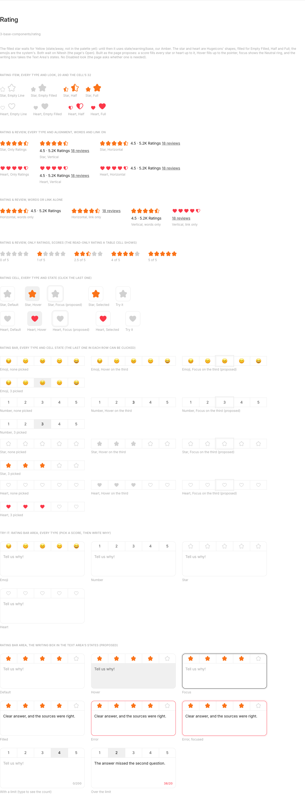
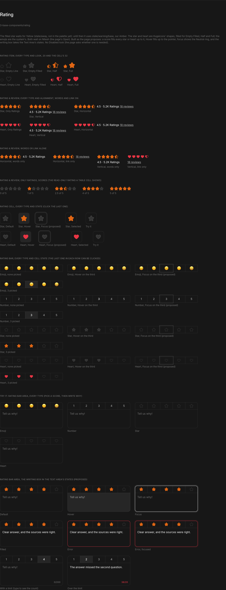

<!-- Copied from the design copy (neutrino-frontend-v3) by scripts/sync.mjs. Edit it there, then run `npm run sync`. -->

# Rating

| | |
|---|---|
| Figma | [Rating](https://www.figma.com/design/Ao3YVgFYdQIF0znq2ToqVl?node-id=532-4130) page |
| Status | Written 18 Oct 2026; coded 19 Oct 2026 |
| Code | [`src/components/ds/rating.tsx`](../../src/components/ds/rating.tsx) |
| Sizes | [`src/styles/sizes/rating.css`](../../src/styles/sizes/rating.css) |
| Demo | [`src/gallery/sections/rating.tsx`](../../src/gallery/sections/rating.tsx) |

## Light and dark

**Light**



**Dark**



## Use it

```tsx
import {
  RatingItem,
  RatingReview,
  RatingCell,
  RatingBar,
  RatingBarArea,
} from "@/components/ds/rating";
```

Every size and state, working: run `npm run dev` and open [localhost:3100/#rating](http://localhost:3100/#rating).

## Spec

Status: written 18 Oct 2026, measured from the Figma. Its proposals stand until Nitesh reviews every component together on one canvas.

Figma, on the Rating page (532:4130) of https://www.figma.com/design/Ao3YVgFYdQIF0znq2ToqVl:

* "Rating Items [1.0]" (node 532:4137): one star or heart, in its four looks.
* "Rating & Review [1.0]" (node 532:4340): five stars or hearts that show a score, with optional words and a link.
* "Rating Cell [1.1]" (node 532:4160): one star or heart in a square button.
* "Rating Bar Items [1.1]" (node 535:4535) and "Rating Bar [1.1]" (node 535:4658): five cells in a row a person picks from.
* "Rating Bar Area [1.1]" (node 535:4994): the Rating Bar on top of a box for written feedback.

The rule for this page: shape, size, spacing, type and states come exactly from the Figma. Colours are the tokens the Figma frame uses, with our palette's values (`../colors/colors.md`). Every number here becomes a size token, so it can be changed later in one place (`../README.md`, "Sizes work the same way").

### Rules

1. Showing a score (a product's 4.5 stars): Rating & Review. Asking a person for a score (feedback on an answer): the Rating Bar, or the Rating Bar Area when they may also write why.
2. Use only the parts, types and states on this page. Never draw stars by hand.
3. Something missing? Stop and ask Nitesh, then add it here first.

### What it has

| Part | Property | Options |
|---|---|---|
| Rating Item | Type | Star, Heart |
| | Look | Empty Line (an outline), Empty Filled (a grey shape), Half, Full |
| Rating & Review | Type | Star, Heart |
| | Alignment | Only Ratings, Vertical (words under the stars), Horizontal (words beside them) |
| | Words | On or off: the score and count, e.g. "4.5 ∙ 5.2K Ratings" |
| | Link | On or off: a link to the reviews, e.g. "18 reviews" |
| Rating Cell | Type | Star, Heart |
| | State | Default, Hover, Selected |
| Rating Bar | Type | Emoji, Number (1 to 5), Star, Heart |
| | Cell state | Default, Hover, Selected |
| Rating Bar Area | Type | Emoji, Number, Star, Heart |

### Layout

#### Rating Item

| Part | Value |
|---|---|
| Box | 20 x 20 |
| Star | 17.5 x 16.9, centred |
| Heart | 15 x 13.8, centred |
| Half | The left half filled, the right half an outline, in the same colour |

In the Rating Cell the item is 32 x 32 and the shapes grow in step (star 28 x 27, heart 24 x 22).

#### Rating & Review

| Part | Value |
|---|---|
| The five items | A row with a 2px gap, 108 x 20 |
| Words and link | A row with a 4px gap, 20 tall |
| Words | `text-paragraph-sm` (14/20, 400) |
| Link | The Link Button (`button.md`), Gray, Medium (20), underlined |
| Vertical | The items above the words and link, 8 apart |
| Horizontal | The items and the words and link in one row, 8 apart |

Everything is set to the top left.

#### Rating Cell

| Part | Value |
|---|---|
| Cell | 56 x 56, padding 12, corner 10 |
| Item | 32 x 32 |
| Edge | 1px, inside |

#### Rating Bar

| Part | Value |
|---|---|
| Bar | 320 x 36 in the Figma: five equal cells, no gap, no corner of its own |
| Cell | 64 x 36; padding 8 top and bottom, 4 at the sides; its content centred |
| Lines | A 1px line between cells, and a 1px edge inside the bar |
| Number | `text-label-sm` (14/20, 500), centred |
| Emoji | A 20 x 20 picture: pensive, confused, neutral, slightly smiling, grinning |
| Star, Heart | The Rating Item, 20 x 20 |

#### Rating Bar Area

| Part | Value |
|---|---|
| Card | 320 x 132 in the Figma, corner 12 (the bar inside is clipped to it), a 1px edge inside, no shadow |
| Top | The Rating Bar, 36 tall |
| Writing box | Padding 12, a 72 tall writing area (three lines), 96 tall in all |
| Placeholder | `text-paragraph-sm` (14/20), e.g. "Tell us why!" |

### Colours

#### Rating Item

| Look | Star | Heart |
|---|---|---|
| Empty Line | outline in `stroke/sub-300` | outline in `stroke/sub-300` |
| Empty Filled | `stroke/sub-300` | `stroke/sub-300` |
| Half, Full | Yellow (`state/away/base`, not in the palette yet) | `state/error/base` |

#### Rating & Review

| Part | Token |
|---|---|
| Words | `text/strong-950` |
| Link | the Link Button's Gray: `text/sub-600` |

#### Rating Cell

| State | Fill | Edge | Shadow | Item |
|---|---|---|---|---|
| Default | `bg/white-0` | `stroke/soft-200` | `--shadow-card` | Empty Filled |
| Hover | `bg/weak-50` | none | none | Full |
| Selected | `bg/white-0` | `stroke/soft-200` | `--shadow-card` | Full |

#### Rating Bar

The bar: `bg/white-0`, its edge and the lines between cells `stroke/soft-200`.

| Cell | Default | Hover | Selected |
|---|---|---|---|
| Emoji | `bg/white-0` | the same as Default | `bg/weak-50` |
| Number | `bg/white-0`, digit `text/sub-600` | digit `text/strong-950` | `bg/weak-50`, digit `text/strong-950` |
| Star, Heart | `bg/white-0`, Empty Line | Empty Filled | `bg/white-0`, Full |

When a score is picked, the Emoji and Number bars show only the picked cell as Selected. The Star and Heart bars in the Figma show all five Full.

#### Rating Bar Area

| Part | Token |
|---|---|
| Card and writing box | `bg/white-0` |
| Card edge | `stroke/soft-200` |
| Placeholder | `text/soft-400` |

Every colour is the Figma frame's own token, apart from the two below.

### Where this differs from the Figma

| Figma | Ours | Why |
|---|---|---|
| The heart is `red/500`, straight from its palette | `state/error/base` | Every colour goes through a token; Red is the error family |
| The star is `yellow/500`, straight from its palette | `state/away/base` (Yellow), once the palette has it | Every colour goes through a token; Yellow is the away family |
| The Link Button's word has no text style (14/20, 500, -0.6%, underlined) | `text-label-sm`, the style it matches | A slip in the Link Button itself; it shows here in "18 reviews" |

### Open

* Yellow has no hue in our palette yet, so the filled star has no token. The nearest, `state/warning/base`, is Amber 700 on light, too brown for a star. The star waits for Yellow, with the other missing hues.
* The empty star and heart use `stroke/sub-300`, a stroke token, as their fill. On dark that is white at 12%, very faint on `bg/white-0`. Nitesh to check on the canvas; `icon/disabled-300` (Gray 600 on dark) is the nearest icon token.
* The Star and Heart bars draw only "none picked" and "all five picked". Proposal: a score of 3 fills the first three, as a rating does, and Hover fills (Empty Filled) every cell up to the pointer.
* The emoji cell has no hover look in the Figma (Hover is the same as Default). An emoji cannot darken like a digit. Nitesh to draw one or say none is needed.
* The Selected fill is not the same in every bar: Emoji and Number take `bg/weak-50`, Star and Heart stay `bg/white-0` and show the pick by the colour. Kept as in the Figma; one rule could follow once Nitesh sees them together.
* The Rating Bar on its own has square corners; it is only drawn rounded inside the Rating Bar Area (corner 12). Nitesh to say whether the bar alone should have a corner.
* No keyboard focus look. Proposal: the Neutral focus ring (2px `bg/white-0`, then 4px `state/faded/light`, outside, no blur) around the Rating Cell and around each cell of the Rating Bar.
* The writing box has no hover, focus or error look of its own. Proposal: it takes the Text Area's (`text-area.md`) states, and the character counter if a limit is needed.
* No Disabled look anywhere on the page. Ask Nitesh if a screen needs one.
* The star and heart are drawn shapes in the Figma. Hugeicons Stroke Rounded gives only the outline, so the filled and half shapes need a solid version (Hugeicons' solid style, or the Figma's own shapes as icons). Nitesh to pick.

### Build order

The Rating Item first; the Rating & Review, Rating Cell and Rating Bar are made of it. The Rating & Review uses the Link Button (`button.md`). The Rating Bar Area uses the Rating Bar and, if Nitesh agrees, the Text Area's writing box (`text-area.md`).

### In code (to decide when building)

* There is no rating component in code today.
* The answer feedback in `components/new-assistant-message.tsx` draws its own five stars (lucide `Star`, 24 x 24, `role="radio"` buttons) above two Textareas. It becomes the Star Rating Bar, or the Rating Bar Area, when rebuilt.
* The thumbs up and down on answers in the same file are not a rating in this Figma; they stay buttons.
* The emojis are pictures in the Figma. In code they can be the same pictures or the system emoji; ask Nitesh which.
