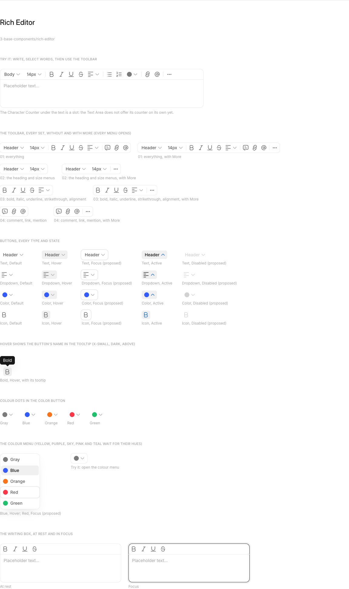
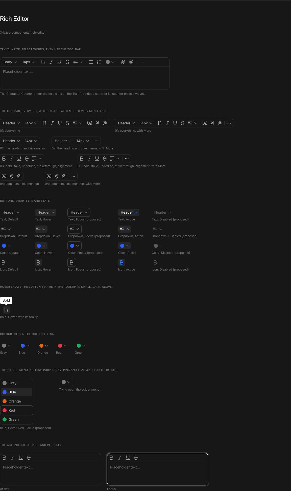

<!-- Copied from the design copy (neutrino-frontend-v3) by scripts/sync.mjs. Edit it there, then run `npm run sync`. -->

# Rich Editor

| | |
|---|---|
| Figma | [Rich Editor](https://www.figma.com/design/Ao3YVgFYdQIF0znq2ToqVl?node-id=164611-20259) page |
| Status | Written 18 Oct 2026; coded 19 Oct 2026 |
| Code | [`src/components/ds/rich-editor.tsx`](../../src/components/ds/rich-editor.tsx) |
| Sizes | [`src/styles/sizes/rich-editor.css`](../../src/styles/sizes/rich-editor.css) |
| Demo | [`src/gallery/sections/rich-editor.tsx`](../../src/gallery/sections/rich-editor.tsx) |

## Light and dark

**Light**



**Dark**



## Use it

```tsx
import {
  RICH_EDITOR_COLORS,
  RICH_EDITOR_TEXT_COLOR,
  RichEditorDot,
  RichEditorButton,
  RichEditorDivider,
  RichEditorToolbar,
  RichEditorColorRow,
  RichEditorColorPanel,
  RichEditorColorMenu,
  RichEditorBox,
} from "@/components/ds/rich-editor";
```

Every size and state, working: run `npm run dev` and open [localhost:3100/#rich-editor](http://localhost:3100/#rich-editor).

## Spec

Status: written 18 Oct 2026, measured from the Figma. Its proposals stand until Nitesh reviews every component together on one canvas.

Figma, on the Rich Editor page (164611:20259) of https://www.figma.com/design/Ao3YVgFYdQIF0znq2ToqVl:

* "Rich Editor [1.1]" (node 166926:17605): the formatting toolbar, in four sets of buttons.
* "Rich Editor Items [1.1]" (node 166251:2701): the toolbar's buttons.
* "Rich Editor Colors [1.1]" (node 166331:4100): the text colour dots.

The rule for this page: shape, size, spacing, type and states come exactly from the Figma. Colours are the tokens the Figma frame uses, with our palette's values (`../colors/colors.md`). Every number here becomes a size token, so it can be changed later in one place (`../README.md`, "Sizes work the same way").

### Rules

1. Text a person formats (headings, bold, lists, links, mentions): the Rich Editor's toolbar, floating over the selected text or on top of the writing box. Plain text with no formatting: the Text Area.
2. Use only the buttons and states on this page. Never draw a formatting toolbar by hand.
3. Something missing? Stop and ask Nitesh, then add it here first.

### What it has

| Part | Property | Options |
|---|---|---|
| Toolbar | Set | 01: everything (the heading and size menus, bold, italic, underline, strikethrough, the alignment menu, comment, link, mention, more). 02: the heading and size menus. 03: bold, italic, underline, strikethrough and the alignment menu. 04: comment, link, mention |
| | More | On or off: the "more" button (three dots) at the end |
| Button | Type | Text (a word and a down arrow: "Header", "14px"), Dropdown (an icon and a down arrow), Color (a colour dot and a down arrow), Icon (an icon alone) |
| | State | Default, Hover, Active |
| Colour dot | Colour | Gray, Blue, Orange, Red, Green, Yellow, Purple, Sky, Pink, Teal |

Groups of buttons are split by a short divider. The Figma's examples also use the list buttons (bulleted, numbered) in the same toolbar.

### Layout

#### Toolbar

| Part | Value |
|---|---|
| Height | 32 |
| Padding | 2 |
| Gap | 2 between buttons and dividers |
| Corner | 8 |
| Edge | 1px, outside (the 32 does not include it) |
| Shadow | `--shadow-card` |
| Width | Follows the buttons (481 for set 01) |

#### Divider

A 1px line, 16 tall, centred in a space 4 wide. With the toolbar's gap it leaves 8 between the buttons either side.

#### Buttons

Every button is 28 tall, corner 6, its parts in a row with a 2px gap.

| Type | Padding | Parts |
|---|---|---|
| Text | 4 top, right and bottom, 10 left | The word in `text-label-sm` (14/20, 500), then a 20 x 20 down arrow |
| Dropdown | 4 | A 20 x 20 icon, then a 20 x 20 down arrow (50 wide) |
| Color | 4 top, right and bottom, 8 left | A 16 x 16 colour dot, then a 20 x 20 down arrow (50 wide) |
| Icon | 4 | A 20 x 20 icon (28 x 28) |

Colour dot: a 16 x 16 circle.

When a menu is open (Active), its down arrow turns into an up arrow.

#### Tooltip and menus

* Hovering a button shows its name in the Tooltip (`tooltip.md`), X-Small, Dark, tail at the bottom centre, above the button.
* The menus (heading, size, alignment, colour, more) are the Dropdown's (no page yet). The Figma's colour menu: 132 wide, padding 4, corner 12, rows 4 apart; each row 32 tall with padding 6, an 8px gap, corner 6: a colour dot and its name in `text-label-sm`, `text/sub-600`; the hovered row `bg/weak-50` with its name in `text/strong-950`.

### Colours

#### Toolbar

| Part | Token |
|---|---|
| Fill | `bg/white-0` |
| Edge | `stroke/soft-200` |
| Divider | `stroke/soft-200` |

#### Buttons

| State | Fill | Word | Icon | Down arrow |
|---|---|---|---|---|
| Default | `bg/white-0` | `text/sub-600` | `icon/sub-600` | `icon/soft-400` |
| Hover | `bg/weak-50` | `text/sub-600` | `icon/sub-600` | `icon/soft-400` |
| Active | `bg/weak-50` | `text/strong-950` | Dropdown: `icon/strong-950`. Icon: `primary/base` | an up arrow in `primary/base` |

Active means two things, as in the Figma: on a Text, Dropdown or Color button its menu is open; on an Icon button the format is on (the text is bold). In both, the blue part shows what is on.

#### Colour dots

| Dot | Token |
|---|---|
| Gray | `state/faded/base` |
| Blue | `state/information/base` |
| Orange | `state/warning/base` |
| Red | `state/error/base` |
| Green | `state/success/base` |
| Yellow, Purple, Sky, Pink, Teal | not in the palette yet |

Every colour is the Figma frame's own token, apart from the colour dots below.

### The toolbar on a writing box (from the Figma's examples)

One of the Figma's examples puts the toolbar on top of a writing box instead of floating it. It is an example, not a component; measured here so it is not guessed:

| Part | Value |
|---|---|
| Box | Corner 12, `bg/white-0`, a 1px `stroke/soft-200` edge inside, `--shadow-card`; 649 x 168 in the example |
| Toolbar row | 36 tall, padding 4, a 4px gap, a 1px `stroke/soft-200` line along its bottom, no corner, edge or shadow of its own |
| Writing area | Padding 12 top, right and bottom, 16 left; the text and the counter 8 apart |
| Placeholder | `text-paragraph-sm` (14/20), `text/soft-400`, "Placeholder text..." |
| Counter | The Text Area's Character Counter (`text-area.md`): "0/200" and the resize handle |

### Where this differs from the Figma

| Figma | Ours | Why |
|---|---|---|
| The colour dots are raw palette colours (`neutral/gray/500`, `blue/500`, `orange/500`, `red/500`, `green/500` ...) | The matching state tokens, as on the Color Picker's dots (`color-picker.md`) | Every colour goes through a token |
| The Gray dot is `neutral/gray/500` here and `neutral/slate/500` on the Color Picker | `state/faded/base` for both | One grey for both |

### Open

* Text colours a person picks are saved with the text, so they may need a fixed set that is the same in both themes, rather than the state tokens. The same question as the Color Picker's dots (`color-picker.md`, Open). Nitesh to decide.
* Yellow, Purple, Sky, Pink and Teal have no hue in our palette yet.
* No keyboard focus look. Proposal: the Neutral focus ring (2px `bg/white-0`, then 4px `state/faded/light`, outside, no blur) around the focused button.
* No Disabled look (a format that cannot be used here). Proposal, as on the Button: no fill, words `text/disabled-300`, icons `icon/disabled-300`.
* The toolbar's edge is outside, where every other component's edge is inside. Kept, so the 2px between the edge and a hovered button stays; Nitesh to confirm.
* The attached writing box (above) differs from the Text Area: padding 12 with 16 on the left, where the Text Area uses 10 with 12 on the left (`text-area.md`). Proposal: the Text Area's field with the toolbar row on top, so the two stay one look. Nitesh to pick.
* The toolbar on a writing box uses a 4px gap and padding 4; the floating toolbar 2 and 2. Kept as two looks for now.

### Build order

The Tooltip (`tooltip.md`) for the button names. The menus need the Dropdown (no page yet). The attached form uses the Text Area's Character Counter (`text-area.md`). The toolbar and its buttons can be built now.

### In code (to decide when building)

* There is no rich text editor in code today, and no editor library in `package.json` (the chat composer is a plain text field). To decide: an editor library restyled to this toolbar.
* The toolbar's edge is outside, so in code it is a 1px ring (a box shadow), not a border, to keep the 32 height and the 2px inner space.
