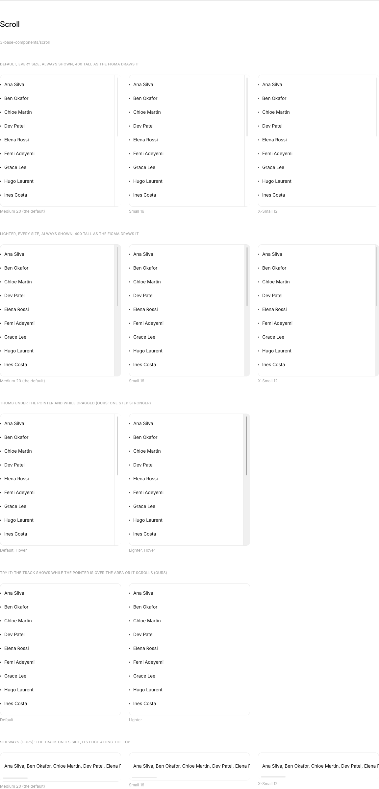
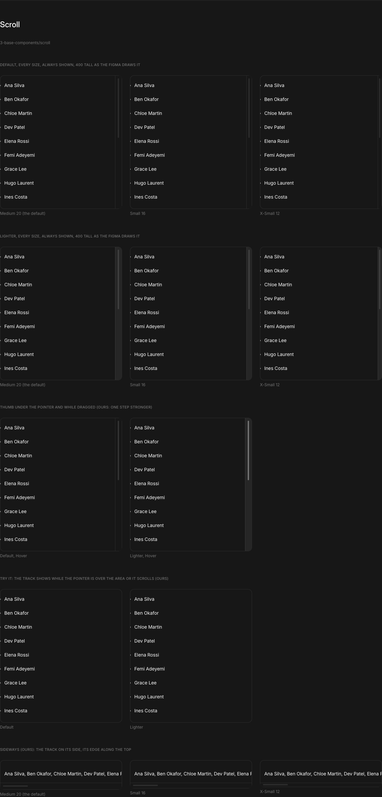

<!-- Copied from the design copy (neutrino-frontend-v3) by scripts/sync.mjs. Edit it there, then run `npm run sync`. -->

# Scroll

| | |
|---|---|
| Figma | [Scroll](https://www.figma.com/design/Ao3YVgFYdQIF0znq2ToqVl?node-id=165475-768) page |
| Status | Written 18 Oct 2026; coded 19 Oct 2026 |
| Code | [`src/components/ds/scroll.tsx`](../../src/components/ds/scroll.tsx) |
| Sizes | [`src/styles/sizes/scroll.css`](../../src/styles/sizes/scroll.css) |
| Demo | [`src/gallery/sections/scroll.tsx`](../../src/gallery/sections/scroll.tsx) |

## Light and dark

**Light**



**Dark**



## Use it

```tsx
import { ScrollArea } from "@/components/ds/scroll";
```

Every size and state, working: run `npm run dev` and open [localhost:3100/#scroll](http://localhost:3100/#scroll).

## Spec

Status: written 18 Oct 2026, measured from the Figma. Its proposals stand until Nitesh reviews every component together on one canvas.

Figma: "Scroll [1.1]" (node 166941:61889) on the Scroll page (165475:768) of https://www.figma.com/design/Ao3YVgFYdQIF0znq2ToqVl. The page's Guidelines (166936:60950) say: Default is the standard look, Lighter a quieter one; Medium is the default size, Small and X-Small are for compact places.

The rule for this page: shape, size, spacing, type and states come exactly from the Figma. Colours are the tokens the Figma frame uses, with our palette's values (`../colors/colors.md`). Every number here becomes a size token, so it can be changed later in one place (`../README.md`, "Sizes work the same way").

### Rules

1. Every scrollbar we style ourselves (a panel, a drawer body, a long menu, a table) is this Scroll. Never style a scrollbar by hand.
2. Medium unless the place is compact; Small or X-Small in tight spaces such as menus.
3. Something missing? Stop and ask Nitesh, then add it here first.

### What it has

| Property | Options |
|---|---|
| Style | Default (white track), Lighter (grey track) |
| Size | Medium, Small, X-Small |
| Direction | Up and down only |

### Layout

| Size | Track width | Thumb | Space each side of the thumb |
|---|---|---|---|
| Medium | 20 | 4 wide | 8 |
| Small | 16 | 4 wide | 6 |
| X-Small | 12 | 4 wide | 4 |

* The track runs the full height of the area it scrolls (the Figma draws it 400).
* The thumb is fully round and centred across the track. In the Figma it is 80 long and sits 8 from the top; in use its length follows how much of the content is in view.
* The track has a 1px edge down its left side, inside, and no corner.

### Colours

| Part | Default | Lighter |
|---|---|---|
| Track | `bg/white-0` | `bg/weak-50` |
| Track's left edge | `stroke/soft-200` | `stroke/soft-200` |
| Thumb | `stroke/soft-200` | `stroke/sub-300` |

The thumb uses line colours as its fill, as in the Figma.

Every colour is the Figma frame's own token; nothing moved.

### Open

* **No hover or dragging look.** The Figma has one state. Proposed: the thumb one step stronger on hover and while dragged (Default to `stroke/sub-300`; Lighter to `icon/soft-400`). Ask Nitesh.
* **The thumb is faint.** In light, the Default thumb is Gray 200 on white. In dark it is white at 9% on Gray 800, close to invisible. Check both on the canvas; the Lighter thumb (`stroke/sub-300`) may be the better default in dark.
* **Ends.** The Figma only shows the thumb at the top, 8 down. Proposed: 8 of space at both ends of the track at every size.
* **No sideways scrollbar.** Wide tables need one. Proposed: the same track and thumb turned on its side, the edge along its top.
* **Always shown or only while scrolling.** Not in the Figma. Proposed: shown while the pointer is over the area or it is scrolling, hidden otherwise, as the system does.

### In code (to decide when building)

* Browsers draw scrollbars themselves. Safari and Chrome can be styled to this page with `::-webkit-scrollbar` (track width, thumb width through a transparent border, colours, round thumb); Firefox only takes `scrollbar-width: thin` and `scrollbar-color`, so it gets the colours but not the exact widths.
* For an exact look everywhere, `components/ui/scroll-area.tsx` (Radix Scroll Area) draws its own track and thumb; it is used in 1 file (`components/connectors/select-tables.tsx`) today.
* `app/globals.css` has `.scrollbar-custom` (a 5px thumb in `--muted-foreground`, used in 1 file) and `.scrollbar-transparent` (hides the scrollbar, used in 9 files). `.scrollbar-custom` becomes this Scroll; keep `.scrollbar-transparent` where a hidden scrollbar is wanted.
