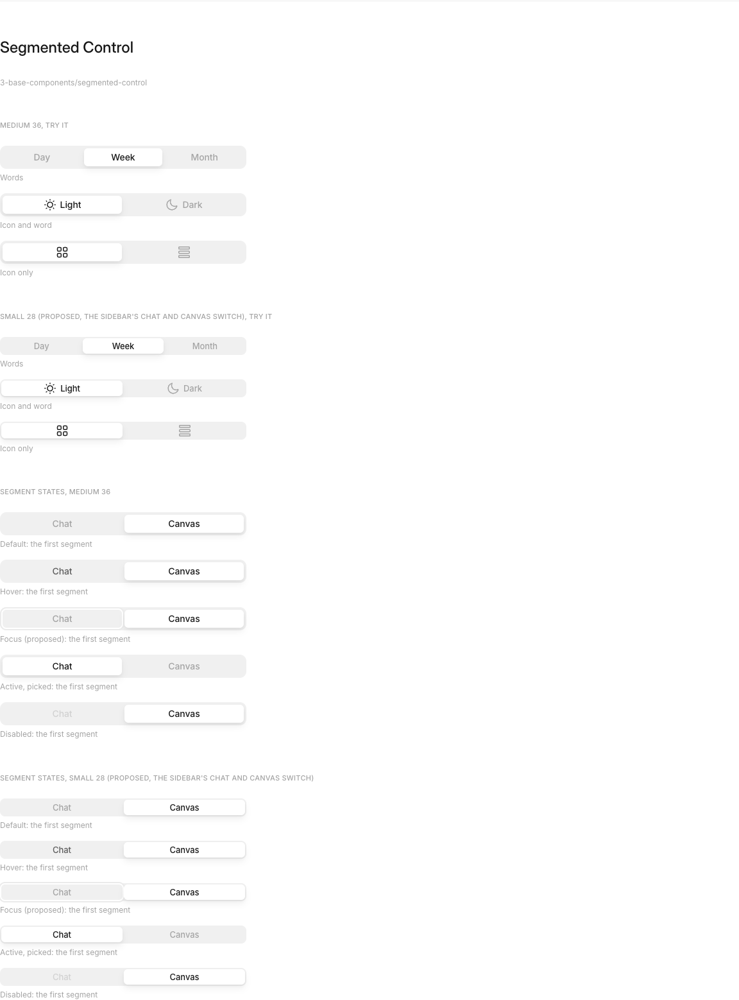
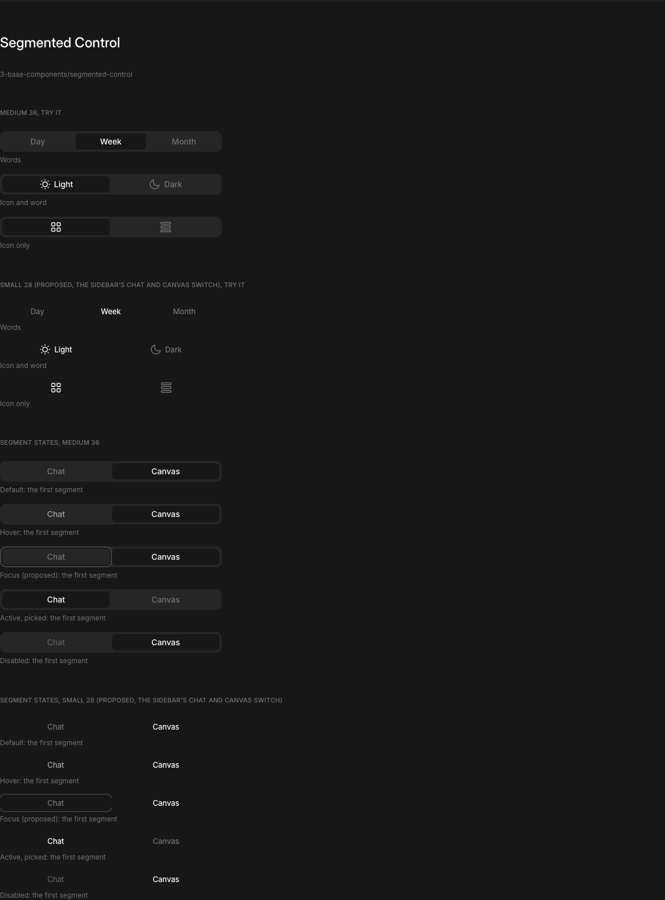

<!-- Copied from the design copy (neutrino-frontend-v3) by scripts/sync.mjs. Edit it there, then run `npm run sync`. -->

# Segmented Control

| | |
|---|---|
| Figma | [Segmented Control](https://www.figma.com/design/Ao3YVgFYdQIF0znq2ToqVl?node-id=553-14953) page |
| Status | Written 18 Oct 2026; coded 19 Oct 2026 |
| Code | [`src/components/ds/segmented-control.tsx`](../../src/components/ds/segmented-control.tsx) |
| Sizes | [`src/styles/sizes/segmented-control.css`](../../src/styles/sizes/segmented-control.css) |
| Demo | [`src/gallery/sections/segmented-control.tsx`](../../src/gallery/sections/segmented-control.tsx) |

## Light and dark

**Light**



**Dark**



## Use it

```tsx
import { SegmentedControl, SegmentedControlItem } from "@/components/ds/segmented-control";
```

Every size and state, working: run `npm run dev` and open [localhost:3100/#segmented-control](http://localhost:3100/#segmented-control).

## Spec

Status: written 18 Oct 2026, measured from the Figma. Its proposals stand until Nitesh reviews every component together on one canvas.

Figma: "Segmented Control [1.1]" (node 2604:114, the control with its label) and its segments (node 2603:2062), on the Segmented Control page (553:14953) of https://www.figma.com/design/Ao3YVgFYdQIF0znq2ToqVl.

The rule for this page: shape, size, spacing, type and states come exactly from the Figma. Colours are the tokens the Figma frame uses, with our palette's values (`../colors/colors.md`). Every number here becomes a size token, so it can be changed later in one place (`../README.md`, "Sizes work the same way").

### Rules

1. Two to a few choices side by side, exactly one picked (a view switch, Day or Week, Light or Dark): Segmented Control.
2. Something missing? Stop and ask Nitesh, then add it here first.

### What it has

| Property | Options |
|---|---|
| Segment content | A word, an icon and a word, or an icon only |
| Segment state | Default, Hover, Active (picked), Disabled |
| Label | The Label above it (`key-components.md`), 6px above the track |

### Layout

| Part | Value |
|---|---|
| Track | 36 tall, padding 4, a 4px gap between segments, corner 10, `bg/weak-50`; full width, the segments share it equally |
| Segment | 28 tall, padding 4, a 6px gap inside, corner 6 |
| Word | `text-label-sm` (14/20, 500), centred |
| Icon | 20 x 20 |
| Picked segment's shadow | Two layers: 0 down 2, blur 4, `#0E121B` at 3%; and 0 down 6, blur 10, `#0E121B` at 6% (the Figma's "components/toggle/switch") |

### Colours

| State | Segment | Word | Icon |
|---|---|---|---|
| Default | no fill | `text/soft-400` | `icon/soft-400` |
| Hover | no fill | `text/sub-600` | `icon/sub-600` |
| Active | `bg/white-0`, with the shadow | `text/strong-950` | `icon/strong-950` |
| Disabled | no fill | `text/disabled-300` | `icon/disabled-300` |

Every colour is the Figma frame's own token; nothing moved. The shadow's colours are typed in; they become a shadow token with the others.

### Open

* **A smaller one is already on screen.** The Chat and Canvas switch at the top of the sidebar (`components/chat-sidebar.tsx`) was made from this Figma and brought down to the rail's scale at Nitesh's ask ("too big for our screen"): a 28 tall track (corner 8) with a 2px inset and gap, 24 tall segments (corner 6), 13px words, the track in the selected-row grey. Proposed: keep it as a Small size of this control, with its own size tokens.
* The Figma has no keyboard focus look. Proposed: the Neutral focus ring around the segment, as on the Button Group.

### In code (to decide when building)

* The sidebar's switch uses `--color-segment-*` and `--radius-segment*` in `styles/theme-tokens.css`. They move to this control's tokens when it is built.
