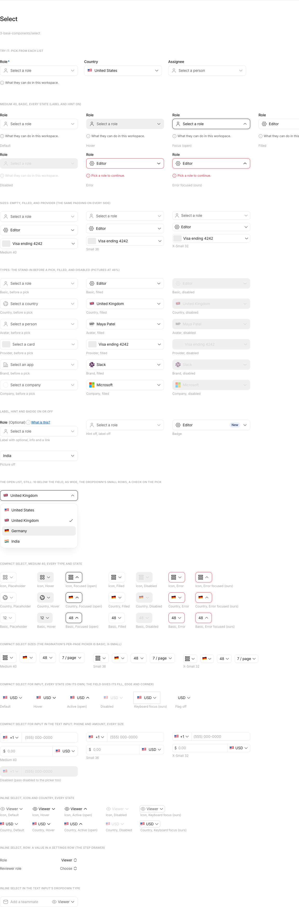
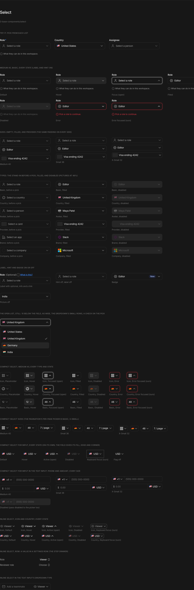

<!-- Copied from the design copy (neutrino-frontend-v3) by scripts/sync.mjs. Edit it there, then run `npm run sync`. -->

# Select

| | |
|---|---|
| Figma | [Select](https://www.figma.com/design/Ao3YVgFYdQIF0znq2ToqVl?node-id=270-1084) page |
| Status | Written 18 Oct 2026; coded 19 Oct 2026 |
| Code | [`src/components/ds/select.tsx`](../../src/components/ds/select.tsx) |
| Sizes | [`src/styles/sizes/select.css`](../../src/styles/sizes/select.css) |
| Demo | [`src/gallery/sections/select.tsx`](../../src/gallery/sections/select.tsx) |

## Light and dark

**Light**



**Dark**



## Use it

```tsx
import {
  SelectItem,
  SelectGroup,
  SelectHeading,
  SelectSeparator,
  Select,
  CompactSelect,
  SelectInputPicker,
  InlineSelect,
} from "@/components/ds/select";
```

Every size and state, working: run `npm run dev` and open [localhost:3100/#select](http://localhost:3100/#select).

## Spec

Status: written 18 Oct 2026, measured from the Figma. Its proposals stand until Nitesh reviews every component together on one canvas.

Figma, on the Select page (270:1084) of https://www.figma.com/design/Ao3YVgFYdQIF0znq2ToqVl:

* "Select [1.1]" (node 270:1085): the full-width field, with its label and hint.
* "Compact Select [1.1]" (node 377:5083): a small picker as wide as its content.
* "Compact Select for Input [1.1]" (node 307:16883): the picker that sits inside a Text Input (a currency or a country code).
* "Inline Select [1.1]" (node 332:4537): a picker with no box, inside a field or a line.

The rule for this page: shape, size, spacing, type and states come exactly from the Figma. Colours are the tokens the Figma frame uses, with our palette's values (`../colors/colors.md`). Every number here becomes a size token, so it can be changed later in one place (`../README.md`, "Sizes work the same way").

### Rules

1. Picking one value from a list: Select. A list of actions (Edit, Delete, Log out): Dropdown (`dropdown.md`). Searching across the whole product: Command Menu (`command-menu.md`).
2. The list that opens is the Dropdown's menu and rows (`dropdown.md`). Never draw a Select's list, or style a `<select>`, by hand.
3. Something missing? Stop and ask Nitesh, then add it here first.

### Select

#### What it has

| Property | Options |
|---|---|
| Size | Medium (40), Small (36), X-Small (32) |
| State | Default (nothing picked), Hover, Focus (open), Filled, Disabled, Error |
| Type | Basic (an icon), Country (a flag), Avatar, Provider (a card brand), Brand, Company |
| Label | On or off: the Label (`key-components.md`) |
| Hint | On or off: the Hint Text (`key-components.md`) |
| Picture on the left | On or off |
| Badge | On or off: a Badge, Lighter, Blue, Medium (20) (`badge.md`), after the words |

#### Layout

Label, field and hint stack top to bottom with a 4px gap. They take the full width of their container; the Figma draws them 300 wide.

| Size | Height | Padding, top and bottom | Padding, left | Padding, right | Gap | Corner |
|---|---|---|---|---|---|---|
| Medium | 40 | 10 | 12 | 10 | 8 | 10 |
| Small | 36 | 8 | 10 | 8 | 8 | 8 |
| X-Small | 32 | 6 | 8 | 6 | 6 | 8 |

These are the Text Input's sizes (`text-input.md`).

* The row: the picture, the words filling the space, the optional Badge, then the arrow.
* Words: `text-paragraph-sm` (14/20, 400) at every size.
* Picture: 20 x 20 (an icon, a flag, an avatar, a brand or company logo).
* Provider: the card logo is 32 x 24, and the field's padding is the same on every side: 8 at Medium, 6 at Small, 4 at X-Small.
* Arrow: 20 x 20, pointing down; pointing up while the list is open.
* Edge: 1px, inside, so it never changes the size.
* Before anything is picked each type shows a stand-in: Country a globe icon, Avatar a person icon, Brand a building icon, Company an empty logo circle, Provider a grey card. Once picked: the real flag, avatar or logo.

#### Colours

| State | Fill | Edge | Shadow or ring | Words | Picture (an icon) | Arrow |
|---|---|---|---|---|---|---|
| Default | `bg/white-0` | `stroke/soft-200` | `--shadow-card` | `text/sub-600` | `icon/soft-400` | `icon/soft-400` |
| Hover | `bg/weak-50` | none | none | `text/sub-600` | `icon/sub-600` | `icon/sub-600` |
| Focus (open) | `bg/white-0` | `stroke/strong-950` | The Neutral focus ring | `text/strong-950` | `icon/sub-600` | `icon/sub-600`, pointing up |
| Filled | `bg/white-0` | `stroke/soft-200` | `--shadow-card` | `text/strong-950` | `icon/sub-600` | `icon/sub-600` |
| Disabled | `bg/weak-50` | none | none | `text/disabled-300` | `icon/disabled-300` | `icon/disabled-300` |
| Error | `bg/white-0` | `state/error/base` | none | `text/strong-950` | `icon/sub-600` | `icon/strong-950` |

* The Neutral focus ring is the Button's (`button.md`): 2px in `bg/white-0`, then 2px more in `state/faded/light`, outside, no blur. The Figma draws it with its `important-focus` style (slate at 16%), which the Button page already maps to `state/faded/light`.
* Flags, avatars and logos keep their own colours. In Disabled they show at 48%.
* The label stays the same in every state, as on the Text Input. The hint follows the Hint Text's Default, Error and Disabled looks (`key-components.md`).

#### The open list

From the Figma's examples (for example node 166999:143191):

* It opens 10 below the field and is as wide as the field.
* It is the Dropdown's menu (`dropdown.md`): padding 8, rows 4 apart, corner 16, `bg/white-0`, a 1px `stroke/soft-200` edge, `--shadow-menu`.
* Its rows are Dropdown Items, Small (36), of the Select's own type (Country rows for a Country Select).
* The picked row is the Selected row, with a 20 x 20 check on the right in `icon/sub-600`.
* The picked row is also filled, `bg/weak-50` (the hover's fill), so it stands out when the list opens (Nitesh, 21 Oct 2026, after OpenAI's inspector).
* An Inline Select `row` list puts the check on the left instead, 16 x 16 in `icon/strong-950` (size `select-mark`). Every row keeps that 20 room, so the words line up.
* While the list is open the field shows its Focus look.

### Compact Select

A small picker with no label or hint, as wide as its content (64 at Medium in the Figma): for a number per page, a flag or an icon.

#### What it has

| Property | Options |
|---|---|
| Type | Icon (an icon only), Country (a flag only), Basic (a short word or number, "48") |
| State | Placeholder, Hover, Focused (open), Filled, Disabled, Error |
| Size | Medium (40), Small (36), X-Small (32) |

#### Sizes

| Size | Height | Padding: Icon | Padding: Country | Padding: Basic | Gap | Corner |
|---|---|---|---|---|---|---|
| Medium | 40 | 10 | 10 | 10, 12 on the left | 4 | 10 |
| Small | 36 | 8 | 8 | 8, 12 on the left | 4 | 8 |
| X-Small | 32 | 6 | 6, 8 on the left | 6, 10 on the left | 2 | 8 |

* Icon 20 x 20, flag 20 x 20 (16 x 16 at X-Small), arrow 20 x 20.
* Word: `text-paragraph-sm`.
* Edge: 1px, inside.

#### Colours

| State | Fill | Edge | Shadow or ring | Word or icon | Arrow |
|---|---|---|---|---|---|
| Placeholder | `bg/white-0` | `stroke/soft-200` | `--shadow-card` | word `text/sub-600`, icon `icon/sub-600` | `icon/soft-400` |
| Hover | `bg/weak-50` | none | none | `text/strong-950`, `icon/strong-950` | `icon/sub-600` |
| Focused (open) | `bg/white-0` | `stroke/strong-950` | The Neutral focus ring | `text/strong-950`, `icon/strong-950` | `icon/strong-950`, pointing up |
| Filled | `bg/white-0` | `stroke/soft-200` | `--shadow-card` | `text/strong-950`, `icon/strong-950` | `icon/sub-600` |
| Disabled | `bg/weak-50` | none | none | `text/disabled-300`, `icon/disabled-300` | `icon/disabled-300` |
| Error | `bg/white-0` | `state/error/base` | none | `text/strong-950`, `icon/strong-950` | `icon/sub-600` |

The flag shows at 48% in Disabled.

### Compact Select for Input

The picker inside the Text Input's Phone and Amount types (`text-input.md`). It has no edge, corner or shadow of its own: the field gives those.

| Size | Height | Padding | Gap | Flag |
|---|---|---|---|---|
| Medium | 40 | 10 top, bottom and left, 8 right | 8 | 20 x 20 |
| Small | 36 | 8 | 8 | 20 x 20 |
| X-Small | 32 | 6 top, bottom and right, 8 left | 6 | 16 x 16 |

* The row: the flag (it can be off), then the code ("USD") and the arrow, 2 apart.
* Code: `text-paragraph-sm`. Arrow: 20 x 20.

| State | Fill | Code | Arrow |
|---|---|---|---|
| Default | `bg/white-0` | `text/strong-950` | `icon/sub-600` |
| Hover | `bg/weak-50` | `text/strong-950` | `icon/strong-950` |
| Active (open) | `bg/white-0` | `text/strong-950` | `icon/strong-950`, pointing up |
| Disabled | `bg/weak-50` | `text/disabled-300` | `icon/disabled-300` |

The flag shows at 48% in Disabled.

### Inline Select

No box and no padding: 20 tall, as wide as its content. The Text Input's Dropdown type uses it.

| Type | Layout |
|---|---|
| Icon | A 20 x 20 icon, then the word and the arrow 2 apart; 4 between the icon and the word |
| Country | A 16 x 16 flag, then the code and the arrow 2 apart; 6 between the flag and the code |

Word: `text-paragraph-sm`. Arrow: 20 x 20.

| State | Icon | Word, Icon type | Word, Country type | Arrow |
|---|---|---|---|---|
| Default | `icon/soft-400` | `text/sub-600` | `text/strong-950` | `icon/sub-600` |
| Hover | `icon/sub-600` | `text/strong-950` | `text/strong-950` | `icon/strong-950` |
| Active (open) | `icon/sub-600` | `text/strong-950` | `text/strong-950` | `icon/strong-950`, pointing up |
| Disabled | `icon/disabled-300` | `text/disabled-300` | `text/disabled-300` | `icon/disabled-300` |

The flag shows at 48% in Disabled.

Every colour is the Figma frame's own token, apart from the focus ring's slate (above); nothing else moved.

#### Inline Select, row (Neutrino, 21 Oct 2026)

A value in a settings row: the row's name on the left in `text-paragraph-compact` and `text/sub-600`, the Inline Select on the right. With `row`, the picked word is `text-paragraph-compact` (13/20) and `text/strong-950` at rest, so the value reads clearly against its name; before a pick it stays `text/sub-600`. In place of the arrow it shows the up-down chevrons (the Sort icon), as OpenAI's inspector (21 Oct 2026). Rows are 32 tall with nothing between them. Used in the Workflow Studio's step drawer (Nitesh's sketch v2).

### Where this differs from the Figma

| Figma | Ours | Why |
|---|---|---|
| In Disabled, the Provider and Company logos stay at full strength while flags, avatars and brand logos drop to 48% | Every picture at 48% in Disabled | The majority rule; the Dropdown's rows do the same |
| The Compact Select keeps its card shadow in Error | No shadow in Error | The Select (all 18 Error variants) and the Text Input drop it; one rule |

### Open

* Error and open: the Figma has no look for a Select in error that has focus. Proposed: the error edge plus the Error focus ring (`state/error/lighter`), as the Text Input's "Error, focused".
* Keyboard focus on the Compact Select for Input and the Inline Select: none in the Figma. Proposed: the Neutral focus ring around the picker.
* The Select's empty words are `text/sub-600`; the Text Input's are `text/soft-400`. Kept as drawn. Nitesh to say if they should match.
* The Select's arrow in Error is `icon/strong-950`, where every other state uses `icon/sub-600` or lighter. Kept as drawn.
* The Compact Select's icons are a step darker than the Select's (`icon/strong-950` where the Select uses `icon/sub-600`). Kept as drawn.
* The Inline Select's word at rest is `text/sub-600` on the Icon type and `text/strong-950` on the Country type. Kept as drawn.

### Build order

The Select uses the Label and the Hint Text (`key-components.md`), the Badge, the Avatar, the flags and logos, and the Dropdown's menu and rows (`dropdown.md`). Build the Dropdown first. The Text Input's Phone, Amount and Dropdown types use the Compact Select for Input and the Inline Select; build those before them.

### In code (to decide when building)

* Today's `components/ui/select.tsx` is the stock shadcn one (Radix Select, lucide icons), used in 12 files. The Select replaces how it looks; its name can stay. Its icons move to Hugeicons through `components/ui/icons.tsx`.
* 11 more files draw a browser `<select>` (most in `components/studio/` and `components/workflow-builder/`). They move to this Select when rebuilt.
* The list's shadow becomes `--shadow-menu: 0 16px 32px -12px rgba(14, 18, 27, 0.1)` (the Figma's `regular-shadow/medium`), shared with the Dropdown, when shadows move into the token build.
