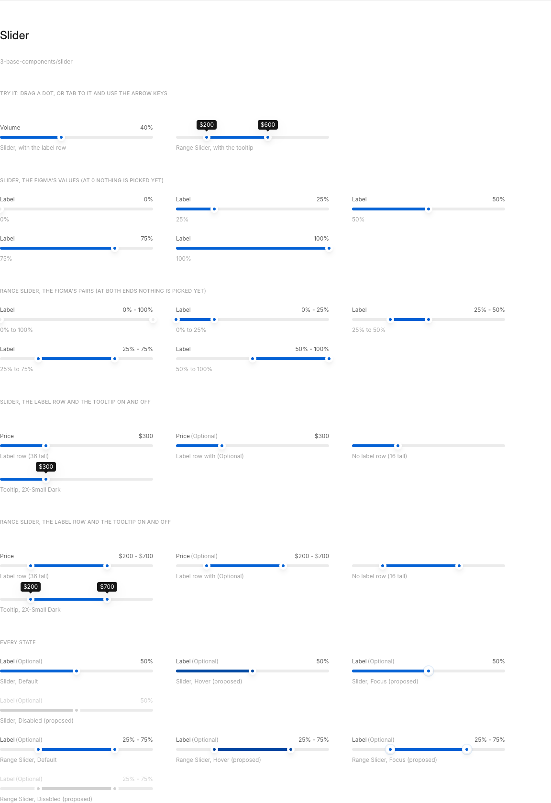
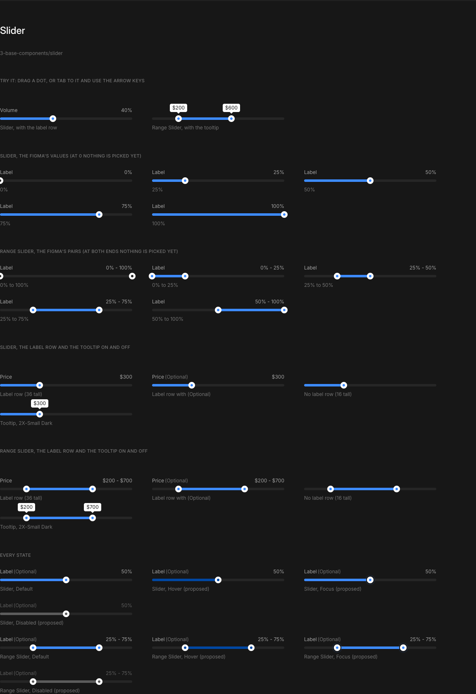

<!-- Copied from the design copy (neutrino-frontend-v3) by scripts/sync.mjs. Edit it there, then run `npm run sync`. -->

# Slider

| | |
|---|---|
| Figma | [Slider](https://www.figma.com/design/Ao3YVgFYdQIF0znq2ToqVl?node-id=2604-3416) page |
| Status | Written 18 Oct 2026; coded 19 Oct 2026 |
| Code | [`src/components/ds/slider.tsx`](../../src/components/ds/slider.tsx) |
| Sizes | [`src/styles/sizes/slider.css`](../../src/styles/sizes/slider.css) |
| Demo | [`src/gallery/sections/slider.tsx`](../../src/gallery/sections/slider.tsx) |

## Light and dark

**Light**



**Dark**



## Use it

```tsx
import { Slider } from "@/components/ds/slider";
```

Every size and state, working: run `npm run dev` and open [localhost:3100/#slider](http://localhost:3100/#slider).

## Spec

Status: written 18 Oct 2026, measured from the Figma. Its proposals stand until Nitesh reviews every component together on one canvas.

Figma, on the Slider page (2604:3416) of https://www.figma.com/design/Ao3YVgFYdQIF0znq2ToqVl:

* "Slider [1.1]" (node 2617:1169): one dot, picks one value.
* "Range Slider [1.1]" (node 2617:1588): two dots, picks a from and a to.

The rule for this page: shape, size, spacing, type and states come exactly from the Figma. Colours are the tokens the Figma frame uses, with our palette's values (`../colors/colors.md`). Every number here becomes a size token, so it can be changed later in one place (`../README.md`, "Sizes work the same way").

### Rules

1. A value picked by dragging along a line (a level, an amount, a temperature): Slider. A from and a to (a price range): Range Slider. A value a person must type exactly: the Text Input.
2. Use only the parts and states on this page. Never style a range input by hand.
3. Something missing? Stop and ask Nitesh, then add it here first.

### What it has

| Property | Options |
|---|---|
| Type | Slider (one dot), Range Slider (two dots) |
| Value | Anywhere along the line. The Figma draws 0%, 25%, 50%, 75% and 100% (Range: the pairs of these) |
| Label row | On or off: the label, an optional "(Optional)", and the value on the right |
| Tooltip | On or off: the value in a small tooltip above each dot |

### Layout

The label row and the slider stack top to bottom with a 4px gap: 36 tall with the label row, 16 without. It takes the full width of its container; the Figma draws it 320 wide.

#### The label row

| Part | Value |
|---|---|
| Row | 16 tall, a 2px gap between its parts |
| Label | `text-paragraph-xs` (12/16, 400), on the left |
| "(Optional)" | `text-paragraph-xs`, right after the label |
| Value | `text-paragraph-xs`, fills the rest of the row, set to the right |

This is the slider's own small label row, not the Text Input's Label (`key-components.md`).

#### The slider

| Part | Value |
|---|---|
| Slider row | 16 tall (the height of the dot) |
| Track | 6 tall, fully round, centred in the row, the full width |
| Filled part | 6 tall, fully round, on top of the track: from the start to the dot (Range: from dot to dot) |
| Dot | A 16 x 16 circle with a 6 x 6 circle in its centre |
| Dot position | The dot's centre sits on the value. At 0 and at the end it hangs 8 past the track's end |
| Dot shadow | Two layers: 0 down 2, blur 4, `#0E121B` at 3%; and 0 down 6, blur 10, `#0E121B` at 6% (the Figma's "components/toggle/switch", the same as the Segmented Control's picked segment) |
| Tooltip | The Tooltip (`tooltip.md`), 2X-Small, Dark, tail at the bottom centre. Centred over the dot, its tail 4 above the dot. It shows the value (the Figma's example: "$300") |

### Colours

| Part | Token |
|---|---|
| Label | `text/sub-600` |
| "(Optional)" | `text/soft-400` |
| Value | `text/sub-600` |
| Track | `bg/soft-200` |
| Filled part | `primary/base` |
| Dot | `static/white`, with its shadow |
| Dot's centre | `primary/base` |

At zero, nothing is picked yet:

* Slider at 0: the dot's centre turns `bg/soft-200`.
* Range Slider with nothing picked: the two dots sit at the two ends, the line between them is `bg/soft-200`, and both centres are `bg/soft-200`.

Every colour is the Figma frame's own token; nothing moved. The one colour the Figma types in directly is the dot's two shadow layers; they become a shadow token with the others.

### Where this differs from the Figma

| Figma | Ours | Why |
|---|---|---|
| In most variants the dot's centre sits on the value; in a few (Slider 0% and 100%, the Range's left dot at 25%, its right dot at 25%) it sits 3 off | Always on the value | One rule for every dot (the majority in the Figma). The colour picker's sliders follow the same rule |

### Open

* No hover, focus, pressed or disabled look in the Figma. Proposals, following the Switch (`switch.md`):
  * Hover: the filled part and the dot's centre turn `primary/dark`.
  * Focus (keyboard): the Primary focus ring around the dot: 2px in `bg/white-0`, then 2px more in `primary/alpha-10`, no blur.
  * Disabled: the filled part and the dot's centre `icon/disabled-300`, the dot without its shadow, the label row `text/disabled-300`.
* No steps or tick marks in the Figma. A slider that snaps to steps looks the same; ask Nitesh if a screen needs visible ticks.
* The Figma names the dot's shadow after the switch ("components/toggle/switch"), but the Switch page's knob uses different values (8% and 6%, see `switch.md`). Nitesh to say whether the two should be one shadow.

### Build order

The Tooltip (`tooltip.md`) for the value above the dot. The slider itself can be built now.

### In code (to decide when building)

* Today's `components/ui/slider.tsx` is the stock shadcn one on Radix Slider, used in 2 files (`components/data-table-filter.tsx`, `components/llm-providers/advanced-settings.tsx`). Radix already gives one or two dots, so both types can be this one component; it replaces how it looks, its name can stay.
* `components/studio/run-console.tsx` draws its own browser range input (the replay position); it moves to the Slider when rebuilt.
* The dot's shadow becomes a shadow token, `--shadow-slider-thumb: 0 2px 4px rgba(14, 18, 27, 0.03), 0 6px 10px rgba(14, 18, 27, 0.06)`, when shadows move into the token build.
