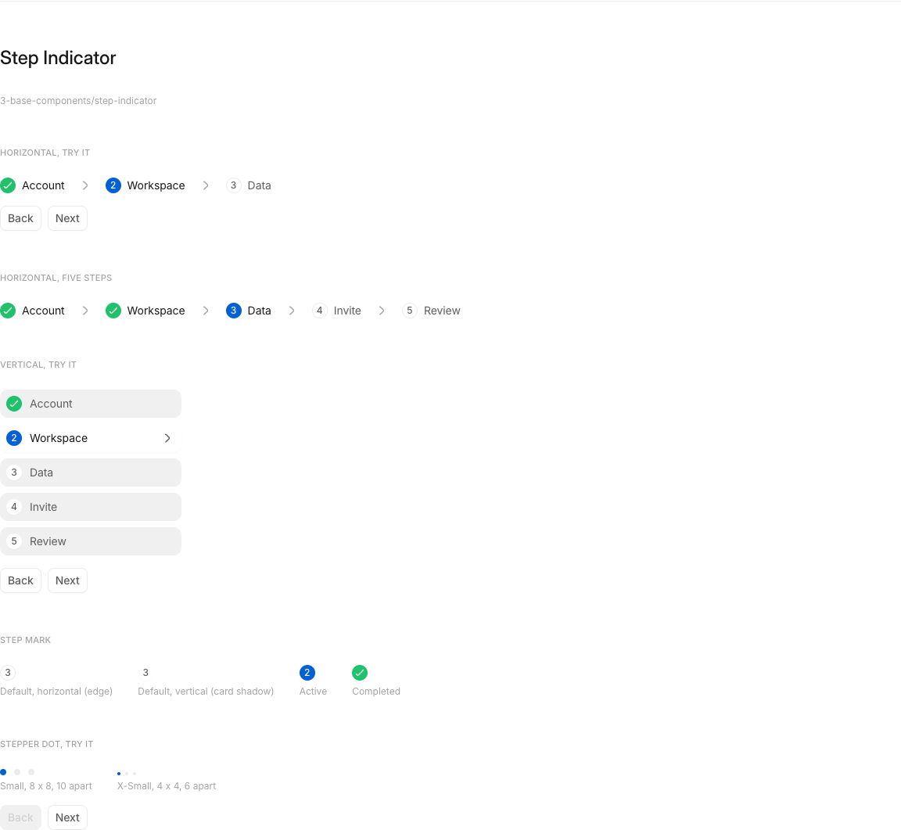
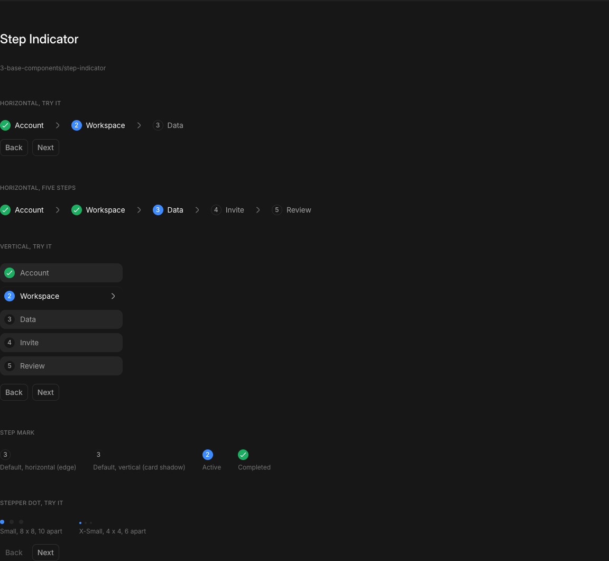

<!-- Copied from the design copy (neutrino-frontend-v3) by scripts/sync.mjs. Edit it there, then run `npm run sync`. -->

# Step Indicator

| | |
|---|---|
| Figma | [Step Indicator](https://www.figma.com/design/Ao3YVgFYdQIF0znq2ToqVl?node-id=479-14388) page |
| Status | Written 18 Oct 2026; coded 19 Oct 2026 |
| Code | [`src/components/ds/step-indicator.tsx`](../../src/components/ds/step-indicator.tsx) |
| Sizes | [`src/styles/sizes/step-indicator.css`](../../src/styles/sizes/step-indicator.css) |
| Demo | [`src/gallery/sections/step-indicator.tsx`](../../src/gallery/sections/step-indicator.tsx) |

## Light and dark

**Light**



**Dark**



## Use it

```tsx
import { StepMark, StepIndicator, StepperDot } from "@/components/ds/step-indicator";
```

Every size and state, working: run `npm run dev` and open [localhost:3100/#step-indicator](http://localhost:3100/#step-indicator).

## Spec

Status: written 18 Oct 2026, measured from the Figma. Its proposals stand until Nitesh reviews every component together on one canvas.

Figma, on the Step Indicator page (479:14388) of https://www.figma.com/design/Ao3YVgFYdQIF0znq2ToqVl:

* "Step Indicator Horizontal [1.1]" (node 3507:28) and its items (3505:3498).
* "Step Indicator Vertical [1.1]" (node 3507:227) and its items (3507:190).
* "Stepper Dot [1.1]" (node 479:14398): three dots for short flows.

The rule for this page: shape, size, spacing, type and states come exactly from the Figma. Colours are the tokens the Figma frame uses, with our palette's values (`../colors/colors.md`). Every number here becomes a size token, so it can be changed later in one place (`../README.md`, "Sizes work the same way").

### Rules

1. A task split into steps a person goes through in order (sign-up, setting up a workflow): Step Indicator.
2. Something missing? Stop and ask Nitesh, then add it here first.

### What it has

| Property | Options |
|---|---|
| Direction | Horizontal, Vertical |
| Steps | 3 to 5 in the Figma |
| Step state | Default (not reached), Active (the current step), Completed |

### The step mark

A 20 x 20 circle, padding 2:

| State | Circle | Inside |
|---|---|---|
| Default | `bg/white-0`, a 1px `stroke/soft-200` edge (horizontal) or `--shadow-card` (vertical) | The number in `text-label-xs` (12/16), `text/sub-600` |
| Active | `primary/base` | The number in `static/white` |
| Completed | `state/success/base` | A tick (10.2 x 7.6) in `static/white` |

### Horizontal

* Steps in a row, 16px apart, with a 20 x 20 chevron in `icon/soft-400` between them.
* Each step: the mark and its word, 8px apart, 20 tall. Word: `text-paragraph-sm` (14/20).
* Word: Default `text/sub-600`; Active and Completed `text/strong-950`.

### Vertical

* Steps in a column, 8px apart. The Figma draws it 232 wide.
* Each step is a row: 36 tall, padding 8, a 10px gap, corner 10. The word fills the row.

| State | Row | Word | Extra |
|---|---|---|---|
| Default | `bg/weak-50` | `text/sub-600` | |
| Active | `bg/white-0`, `--shadow-card` | `text/strong-950` | A 20 x 20 chevron on the right in `icon/sub-600` |
| Completed | `bg/weak-50` | `text/sub-600` | |

### Stepper Dot

Three dots in a row:

| Size | Dot | Gap |
|---|---|---|
| Small | 8 x 8 | 10 |
| X-Small | 4 x 4 | 6 |

The current step's dot is `primary/base`; the others `bg/soft-200`.

Every colour is the Figma frame's own token; nothing moved.

### Open

* Nitesh will change the stepper once he can see it (18 Oct 2026). Expect changes here.

* The Completed mark is white on `state/success/base`. On dark that green is bright today, so the tick is hard to see; it is settled with the status colours (the same issue as the Filled Badge).

### In code (to decide when building)

* `components/ui/vertical-stepper.tsx` (used in 2 files) becomes the vertical Step Indicator.
