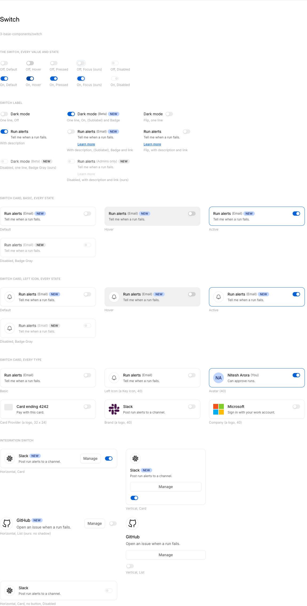
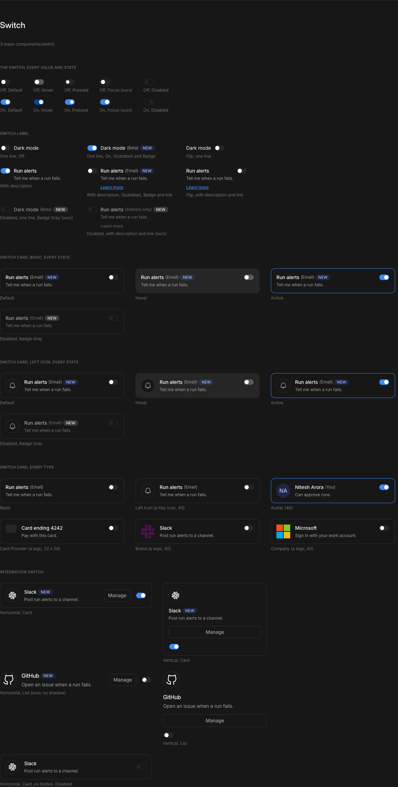

<!-- Copied from the design copy (neutrino-frontend-v3) by scripts/sync.mjs. Edit it there, then run `npm run sync`. -->

# Switch

| | |
|---|---|
| Figma | [Switch](https://www.figma.com/design/Ao3YVgFYdQIF0znq2ToqVl?node-id=379-6649) page |
| Status | Approved, 18 Oct 2026; coded 19 Oct 2026 |
| Code | [`src/components/ds/switch.tsx`](../../src/components/ds/switch.tsx) |
| Sizes | [`src/styles/sizes/switch.css`](../../src/styles/sizes/switch.css) |
| Demo | [`src/gallery/sections/switch.tsx`](../../src/gallery/sections/switch.tsx) |

## Light and dark

**Light**



**Dark**



## Use it

```tsx
import { Switch, SwitchLabel, SwitchCard, IntegrationSwitch } from "@/components/ds/switch";
```

Every size and state, working: run `npm run dev` and open [localhost:3100/#switch](http://localhost:3100/#switch).

## Spec

Status: approved by Nitesh, 18 Oct 2026, with two changes to the Figma (below, under "Where this differs from the Figma").

Figma, on the Switch page (379:6649) of https://www.figma.com/design/Ao3YVgFYdQIF0znq2ToqVl:

* "Switch [1.1]" (node 385:4086): the switch on its own.
* "Switch Label [1.1]" (node 385:4580): the switch with its words.
* "Switch Card [1.1]" (node 385:4733): a card with the switch in its corner.
* "Integration Switch [1.1]" (node 3678:14609): an app or service you turn on, with its logo, a button and the switch.

The rule for this page: shape, size, spacing, type and states come exactly from the Figma. Colours are the tokens the Figma frame uses, with our palette's values (`../colors/colors.md`). Every number here becomes a size token, so it can be changed later in one place (`../README.md`, "Sizes work the same way").

The Switch Label and Switch Card are the Checkbox's (`checkbox.md`) with the switch in place of the box. Keep them in step.

### Rules

1. A setting that takes effect at once, on or off: Switch. A choice that waits for Save: Checkbox.
2. A switch always has its words next to it (Switch Label) or sits in a Switch Card or Integration Switch.
3. Something missing? Stop and ask Nitesh, then add it here first.

### The switch

#### What it has

| Property | Options |
|---|---|
| Size | One size |
| Value | Off, On |
| State | Default, Hover, Pressed, Disabled, Focus (keyboard) |

#### Size

* It takes 32 x 20. The track inside is 28 x 16, 2px in from each side, fully round.
* The knob is a 12 x 12 circle, 2px inside the track: on the left when Off, on the right when On.
* Pressed: the knob shrinks to 10 x 10, staying centred where it was.
* Disabled: the knob is 10 x 10.
* The knob's shadow, two layers: 0 down 2, blur 4, `#0E121B` at 8%; and 0 down 4, blur 8, `#1B1C1D` at 6%.

#### Colours

| State | Off: track | On: track | Knob |
|---|---|---|---|
| Default | `bg/soft-200` | `primary/base` | `static/white`, with its shadow |
| Hover | `bg/sub-300` | `primary/dark` | `static/white`, with its shadow |
| Pressed | `bg/soft-200` | `primary/base` | `static/white`, smaller, with its shadow |
| Disabled | `bg/white-0` with a 1px `stroke/soft-200` edge inside | the same | `bg/soft-200`, no shadow |

Disabled looks the same On and Off apart from where the knob sits.

Focus (keyboard): the switch as it is, plus the Primary focus ring around the track, as on the Primary button: 2px in `bg/white-0`, then 2px more in `primary/alpha-10`, no blur.

### Switch Label

Exactly the Checkbox Label (`checkbox.md`, "Checkbox Label"), with the switch (32 x 20) in place of the box and the same 8px gap: one line or with a description, an optional "(Sublabel)", Badge and link, Flip to put the switch on the right, the same type and colours, and the same Disabled look.

### Switch Card

Exactly the Checkbox Card (`checkbox.md`, "Checkbox Card"), with the switch in place of the box: the six types, 72 tall, 16 padding, 14 gap, corner 12, and the same four states (Active is a `primary/base` edge with the switch On; Disabled shows the switch Disabled).

### Integration Switch

#### What it has

| Property | Options |
|---|---|
| Direction | Horizontal (one row), Vertical (stacked) |
| Style | Card (in a card), List (a plain row in a list) |
| Parts | The brand's logo, a title with an optional Badge, a description, an optional button, the switch |

#### Layout

| Part | Card | List |
|---|---|---|
| Container | Padding 16, gap 14, corner 12, `bg/white-0`, a 1px `stroke/soft-200` edge, `--shadow-card` | No padding, no fill, no edge, no shadow, gap 14 |
| Logo | In a 40 x 40 circle (logo 24), padding 8 | In a 48 x 48 circle (logo 32), padding 8 |
| Logo circle | `bg/white-0`, a 1px `stroke/soft-200` edge, `--shadow-card` | the same |
| Title | `text-label-sm` (14/20), `text/strong-950` | `text-label-md` (16/24), `text/strong-950` |
| Description | `text-paragraph-xs` (12/16), `text/sub-600` | `text-paragraph-sm` (14/20), `text/sub-600` |
| Title and description | 4px apart, the Badge 4px after the title | the same |
| Button | The Button, Neutral, Stroke, Small (36) | the same |

Horizontal: logo, words, button and switch in one row, centred on the row. Vertical: the same parts stacked with a 14px gap; the button takes the full width.

Every colour on this page is the Figma frame's own token; nothing moved. The colours the Figma types in directly are the knob's two shadows; they become shadow tokens with the others.

### Where this differs from the Figma

Agreed with Nitesh, 18 Oct 2026.

| Figma | Ours | Why |
|---|---|---|
| No keyboard focus look (Pressed instead) | The Primary focus ring around the track | Every control needs a visible keyboard focus; the switch is a blue control |
| The Integration Switch's List row carries `--shadow-card` with no fill | No shadow on the List row | It drew a faint shadow under its parts; a slip |

### Build order

The Switch Card, Switch Label and Integration Switch use the Badge, the Avatar, the Key Icon, the Link Button and the Button. Build them after those pages; the switch itself can be built now.

### In code (to decide when building)

* Today's `components/ui/switch.tsx` is the stock shadcn one, used in 14 files. The Switch replaces how it looks; its name can stay.
* The knob's shadow becomes a shadow token, `--shadow-switch-knob: 0 2px 4px rgba(14, 18, 27, 0.08), 0 4px 8px rgba(27, 28, 29, 0.06)`, when shadows move into the token build.
