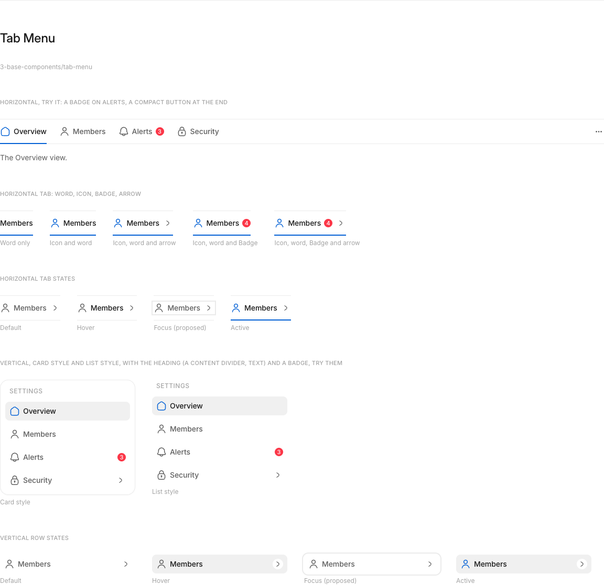
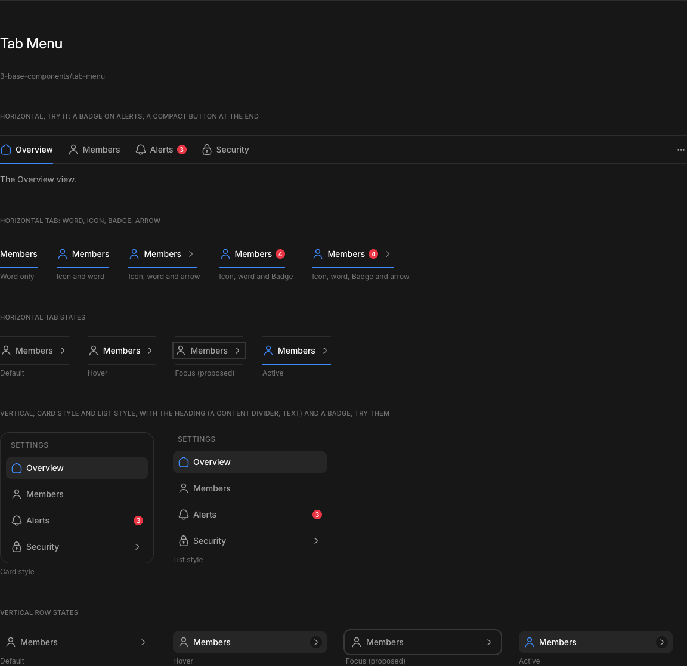

<!-- Copied from the design copy (neutrino-frontend-v3) by scripts/sync.mjs. Edit it there, then run `npm run sync`. -->

# Tab Menu

| | |
|---|---|
| Figma | [Tab Menu](https://www.figma.com/design/Ao3YVgFYdQIF0znq2ToqVl?node-id=553-734) page |
| Status | Written 18 Oct 2026; coded 19 Oct 2026 |
| Code | [`src/components/ds/tab-menu.tsx`](../../src/components/ds/tab-menu.tsx) |
| Sizes | [`src/styles/sizes/tab-menu.css`](../../src/styles/sizes/tab-menu.css) |
| Demo | [`src/gallery/sections/tab-menu.tsx`](../../src/gallery/sections/tab-menu.tsx) |

## Light and dark

**Light**



**Dark**



## Use it

```tsx
import { TabMenu, TabMenuList, TabMenuTrigger, TabMenuContent } from "@/components/ds/tab-menu";
```

Every size and state, working: run `npm run dev` and open [localhost:3100/#tab-menu](http://localhost:3100/#tab-menu).

## Spec

Status: written 18 Oct 2026, measured from the Figma. Its proposals stand until Nitesh reviews every component together on one canvas.

Figma, on the Tab Menu page (553:734) of https://www.figma.com/design/Ao3YVgFYdQIF0znq2ToqVl:

* "Tab Menu Horizontal [1.1]" (node 3511:9958) and its items (3511:9832): tabs across the top of a page.
* "Tab Menu Vertical [1.1]" (node 3516:10411) and its items (3515:10326): tabs down the side.

The rule for this page: shape, size, spacing, type and states come exactly from the Figma. Colours are the tokens the Figma frame uses, with our palette's values (`../colors/colors.md`). Every number here becomes a size token, so it can be changed later in one place (`../README.md`, "Sizes work the same way").

### Rules

1. Switching between views of one page (Overview, Settings, Members): Tab Menu. Two or three choices inside a form or toolbar: Segmented Control (`segmented-control.md`).
2. Something missing? Stop and ask Nitesh, then add it here first.

### Horizontal

#### Layout

| Part | Value |
|---|---|
| Bar | 48 tall, padding 14 top and bottom, full width, `bg/white-0`, a 1px `stroke/soft-200` line top and bottom |
| Tabs | 2 to 6, 24px apart, starting at the left |
| Tab | An optional 20 x 20 icon, the word, an optional Badge, an optional arrow; 6px apart |
| Word | `text-label-sm` (14/20, 500) |
| Arrow | An 18 x 18 chevron in a 20 x 20 circle with `bg/white-0`, padding 1 |
| Active line | 2px in `primary/base`, the width of the tab, on the bar's bottom line |
| End of the bar | An optional Compact Button on the right |

#### Colours

| Part | Default | Hover | Active |
|---|---|---|---|
| Word | `text/sub-600` | `text/strong-950` | `text/strong-950` |
| Icon | `icon/sub-600` | `icon/sub-600` | `primary/base` |
| Arrow | `icon/sub-600` | `icon/sub-600` | `icon/sub-600` |
| Line under the tab | none | none | `primary/base`, 2px |

### Vertical

#### Layout

| Part | Card style | List style |
|---|---|---|
| Container | Padding 10, corner 16, `bg/white-0`, a 1px `stroke/soft-200` edge, `--shadow-card` | No padding, no fill, no edge |
| Gap between rows | 8 | 8 |
| Heading | A Content Divider, Text type (`content-divider.md`), on top | the same |

Each tab is a row: 36 tall, padding 8, corner 8, an optional 20 x 20 icon, the word, an optional Badge and arrow, 6px apart. Word `text-label-sm`. The Figma draws the menu 258 wide.

#### Colours

| Part | Default | Hover | Active |
|---|---|---|---|
| Row | `bg/white-0` | `bg/weak-50` | `bg/weak-50` |
| Word | `text/sub-600` | `text/strong-950` | `text/strong-950` |
| Icon | `icon/sub-600` | `icon/sub-600` | `primary/base` |

Every colour is the Figma frame's own token; nothing moved.

### Where this differs from the Figma

| Figma | Ours | Why |
|---|---|---|
| The vertical Active row carries a blue line placed below the row, where it is clipped and never shows | No line on vertical tabs | The Figma never shows it; the fill and the blue icon mark the active row |

### Open

* The Figma has no keyboard focus look. Proposed: the Neutral focus ring around the tab, as on the Tag.

### In code (to decide when building)

* `components/ui/tabs.tsx` (stock shadcn, used in 1 file) and `components/ui/tabs-bar.tsx` (used in 3 files) become this Tab Menu.
