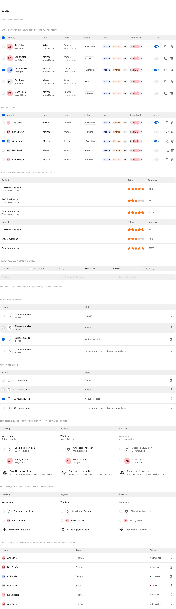
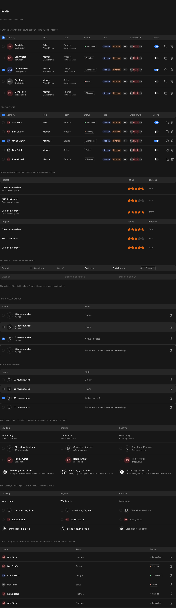

<!-- Copied from the design copy (neutrino-frontend-v3) by scripts/sync.mjs. Edit it there, then run `npm run sync`. -->

# Table

| | |
|---|---|
| Figma | [Table](https://www.figma.com/design/Ao3YVgFYdQIF0znq2ToqVl?node-id=553-14955) page |
| Status | Written 18 Oct 2026; coded 19 Oct 2026 |
| Code | [`src/components/ds/table.tsx`](../../src/components/ds/table.tsx) |
| Sizes | [`src/styles/sizes/table.css`](../../src/styles/sizes/table.css) |
| Demo | [`src/gallery/sections/table.tsx`](../../src/gallery/sections/table.tsx) |

## Light and dark

**Light**



**Dark**



## Use it

```tsx
import {
  Table,
  TableHeader,
  TableHeaderCell,
  TableBody,
  TableGroupRow,
  TableRow,
  TableTextCell,
  TableCell,
  TableNumberCell,
  TableCellInput,
  TableIndexCell,
  TableLogo,
  TableMessage,
  TableFooter,
  TableBulkBar,
} from "@/components/ds/table";
```

Every size and state, working: run `npm run dev` and open [localhost:3100/#table](http://localhost:3100/#table).

## Spec

Status: written 18 Oct 2026, measured from the Figma; coded 19 Oct 2026. The table family (the box, the header, three kinds, groups, picking, totals) decided 23 Oct 2026, below. Try it on `/playground/tables`, where the grouped table Nitesh picked on 23 Oct (the third design, `tables/grouped.tsx`) is back beside it since 24 Oct 2026, for his additions.

Figma, on the Table page (553:14955) of https://www.figma.com/design/Ao3YVgFYdQIF0znq2ToqVl:

* "Table Header Cell [1.1]" (node 587:5793): one cell of the header row.
* "Table Row Cell [1.1]" (node 553:22175): one cell of a body row, 66 variants.
* "Sorting Icons [1.1]" (node 581:2327): the sort arrows in a header cell.
* The table itself (header row, rows, lines between them) is not a component. It comes from "Table [Examples]" (3539:8015) and the six Blocks frames, which all build it the same way.

The rule for this page: shape, size, spacing, type and states come exactly from the Figma. Colours are the tokens the Figma frame uses, with our palette's values (`../colors/colors.md`). Every number here becomes a size token, so it can be changed later in one place (`../README.md`, "Sizes work the same way").

### Rules

1. Every list of records with columns (members, files, runs, invoices, workflows, a sheet of figures) is this Table, in one of its three kinds (below): the header, then the rows, built from these cells. Never draw a table by hand, and never with `<table>`.
2. Pick the kind by the rows: two lines a row (64), one line (48), or a grid of figures to read and edit (36).
3. Pick each column's cell type from "Body cells" below. Something that fits none of them? Stop and ask Nitesh, then add it here first.
4. Above a table that can be searched, filtered or sorted, use the Horizontal Filter (`filter.md`), 16 above the table.

### The table family (decided 23 Oct 2026)

Nitesh asked for one table for the whole product, mixed from three sources: this page's Figma Table (the Blocks, node 167144:147461), his Projects reference ("I love the header": the box, the inset grey header, the outlined status chips), and the grouped table he picked on `/playground/tables` (its pinned header and groups, picking, totals, keys). "Keep it consistent across a two-liner table, a one-liner table, and an Excel kind of table."

#### One look for all three

| Part | Value |
|---|---|
| The box | `bg/white-0`, a 1px `stroke/soft-200` edge inside, corner 12, no shadow; everything 4 inside its edge, so the header's corner 8 nests in the box's 12. `framed={false}` drops it, for a table already inside a card |
| The header | The Figma's: 36 tall, `bg/weak-50`, corner 8, words `text-paragraph-sm` (14/20, 400) `text/sub-600`, 12 at the sides. Pinned at the top while the rows scroll, on a white band that hides the rows behind its corners and the 8 under it |
| Sorting | A column that sorts shows its arrows on hover (and keyboard focus); the sorted column always, its word `text/strong-950` and arrow `icon/sub-600`. Click: up, down, off |
| Sizing columns | Drag a header cell's edge (a 1px `stroke/sub-300` line shows on hover); a double click puts it back |
| Status | The Status Badge, Stroke, with its icon: white, the hairline edge, grey words, the colour in the icon (`badge.md`) |
| Figures | Right aligned in tabular digits, their header word too. A cost: a minus for money lost in `text/strong-950`, a plus for money saved in `state/success/base`, zero in `text/sub-600` |
| A picked row | `primary/alpha-10` over the white (`primary/alpha-16` on hover), mixed into one solid colour (`--table-row-picked` in `styles/sizes/table.css`) so a pinned cell still hides what scrolls under it |
| Row actions | The Compact Button, Ghost, Large, with the vertical "more" icon (`RowActionsIcon`), in a 64 Button column |
| Loading, empty, failed | Three quiet rows while it loads; one line of words, centred, with a Link Button to undo the search; a failed request in `state/error/base`, never an empty table |

#### The three kinds

| | Two-line | One-line | Grid (the Excel kind) |
|---|---|---|---|
| `size` | `xl` | `lg` | `grid` |
| Row | 64 | 48 | 40 |
| Words | A title and a line under it | A title | One value a cell |
| Between rows | The Content Divider's line, rows 12 apart | the same | A 1px `stroke/soft-200` line under every row, and between every two cells; the last row open to the box |
| Row hover | `bg/weak-50`, corner 8 | the same | none: the picked cell shows where you are |
| Pictures | Logo 40, Avatar 40, Key Icon Medium | Logo 32, Avatar 24, Key Icon Small | none |
| Cell sides | 12 (text cells 20 on the right) | the same | 12 |
| Header | 8 above the first row | the same | Sits on the lines: corner 8 on top only, a line under it, a line between every two cells |
| Extra | | A row that opens something takes the focus ring and opens on Enter | Row numbers in a 48 column (`text-paragraph-xs`, `text/soft-400`; the picked cell's row `text/strong-950`); the picked cell a 2px `primary/base` ring inside it; edit in place |

#### What a table can do (all three)

* **Groups**: a group's row is 36, no fill: the fold chevron, its name in `text-label-sm` `text/strong-950`, the count and a summary in `text-paragraph-xs` `text/soft-400`, a total under its column, and a checkbox that picks the group. It is pinned under the header while its rows scroll; the next group's row slides over it. A line before a group, none between its row and its rows.
* **Picking**: a checkbox on every row and in the header (all shown) and on each group; Shift-click picks a range. Picked rows bring the bulk bar: it floats 12 above the box's foot, `bg/white-0`, the hairline edge, the Dropdown's shadow, corner 12: "3 picked", a 16 tall line, Neutral Stroke X-Small Buttons, and a close button.
* **Totals**: a row pinned at the foot, 36, a line above it, `text-paragraph-sm` `text/sub-600`; each total sits under its column in `text/strong-950`.
* **Keys**: with the table focused, the arrows move a row (its focus ring shows), Space picks, Shift-Space picks a range, Escape clears, Cmd-A picks all. In a grid: the arrows and Tab move the picked cell; typing, Enter or a double click edits; Enter saves and moves down, Tab moves right, Escape cancels.
* **Wide tables** scroll sideways inside the box; `sticky` keeps the Leading column (and the totals' first cell) in view.

In code: `Table`, `TableHeader`, `TableHeaderCell`, `TableBody`, `TableGroupRow`, `TableRow`, `TableTextCell`, `TableNumberCell`, `TableCell`, `TableCellInput`, `TableIndexCell`, `TableLogo`, `TableMessage`, `TableFooter`, `TableBulkBar`, `useTablePicks`, `useTableGrid` (`components/ds/table.tsx`). Sizes: `styles/sizes/table.css`.

### What it has

| Part | Options |
|---|---|
| Row height | X-Large (64), Large (48) |
| Row state | Default, Hover, Active (picked: its checkbox or radio is on) |
| Header cell state | Default, Disabled, Empty (a blank cell over a column of buttons) |
| Header cell extras | A checkbox at the start, sort arrows after the word |
| Sort arrows | Default (up and down), Up, Down |
| Body cell types | Text cells in three weights (Leading, Regular, Passive), and eight other cells: Button, Button Group, Toggle, Rating, Progress Bar, Status Badge, Badge Group, Avatar Group |
| Text cell extras | A checkbox or a radio at the start; a picture (icon, avatar, brand, company, card provider, file format); a description line (X-Large only) |

### Layout

#### The table

| Part | Value |
|---|---|
| Width | Its container's width (the Figma draws it 1104) |
| Header row | 36 tall, corner 8, `bg/weak-50`, its cells side by side with no gap |
| Header to first row | 8 |
| Rows | Cells side by side with no gap; corner 12, which rounds a hovered row's grey (8 inside the box, 23 Oct 2026) |
| Between rows | The Content Divider, Line Spacing type (`content-divider.md`): a 1px `stroke/soft-200` line in a 4 tall band, with 4 above and 4 below it. Rows are 12 apart, the line in the middle |
| Columns | Each column has its own width (the Figma uses 48 to 348); a header cell and the body cells below it share that width |

Above the table the Figma puts the Horizontal Filter (Type Table, 36 tall), 16 above the header row: the views (a Segmented Control, 320), then the Search (300, with a "⌘1" key), Filter and Sort by. It is its own component (`filter.md`).

#### Header cell

| Part | Value |
|---|---|
| Height | 36 |
| Padding | 8 top and bottom, 12 sides |
| Gap | 10 after the checkbox |
| Checkbox | Medium (20 x 20) (`checkbox.md`) |
| Word | `text-paragraph-sm` (14/20, 400) |
| Sort arrows | 20 x 20, 2 after the word |
| Empty | 64 wide in the Figma, nothing in it |

#### Body cells

| Part | X-Large (64) | Large (48) |
|---|---|---|
| Height | 64 | 48 |
| Text cell padding | 12 top, bottom and left; 20 right | the same |
| Other cell padding | 12 on every side | the same |
| Gap (text cell) | 12 between checkbox, picture and words | the same |
| Gap (other cells) | 8 | the same |
| Checkbox or radio | Medium, 20 x 20 | the same |
| Key Icon picture | Medium (40), Stroke | Small (32), Stroke |
| Avatar | 40 | 24 |
| Brand or company logo | 40, in a circle | 32, in a circle |
| Card provider, file format icon | 32 | 32 |
| Words | Title, then description 2 below | Title only |

The height is fixed: the picture and words sit in the middle. Title and description each stay on one line and end in "..." when too long.

The brand circle: `bg/white-0`, a 1px `stroke/soft-200` edge inside, `--shadow-card`, padding 6, the logo 28 across on X-Large.

#### Text cell weights

| Priority | Title type | Title colour | Description |
|---|---|---|---|
| Leading (the column that names the row) | `text-label-sm` (14/20, 500) | `text/strong-950` | `text-paragraph-xs` (12/16, 400), `text/sub-600` |
| Regular | `text-paragraph-sm` (14/20, 400) | `text/strong-950` | the same |
| Passive (quiet facts) | `text-paragraph-sm` | `text/sub-600` | the same |

#### Other cells

| Cell | What is in it | Lines up | Width in the Figma |
|---|---|---|---|
| Button | X-Large: an icon-only Button, Neutral, Ghost, X-Small (32) (`button.md`). Large: the Compact Button, Ghost, Large (24) | Centred | 64 |
| Button Group | Two of the same buttons, 8 apart | Right | 96 |
| Toggle | The Switch (32 x 20) (`switch.md`) | Centred | 64 |
| Rating | The Rating, stars only (five 20 x 20 stars, 2 apart) | Left | 132 |
| Progress Bar | The Progress Bar with its value on the right ("80%" in `text-paragraph-xs`, `text/sub-600`, 8 after the bar) | Left | 196 |
| Status Badge | The Status Badge, Stroke (`badge.md`) | Left | 120 |
| Badge Group | Badges, Lighter, Medium (20), 8 apart; the last one a Gray "+4" (`badge.md`) | Left | 178 |
| Avatar Group | The Avatar Group, 24, with a "+9" circle at the end (`avatar.md`) | Left | 156 |

### Colours

#### Header

| Part | Default | Disabled |
|---|---|---|
| Header row and cells | `bg/weak-50` | `bg/weak-50` |
| Word | `text/sub-600` | `text/disabled-300` |
| Sort arrows | `icon/soft-400` | `icon/disabled-300` |
| Checkbox | Default | Disabled |

#### Rows

| Row state | Fill | Checkbox or radio |
|---|---|---|
| Default | `bg/white-0` | Default, off |
| Hover | `bg/weak-50` | Hover, off |
| Active (picked) | `primary/alpha-10` over `bg/white-0` (ours, 23 Oct 2026; the Figma keeps `bg/white-0`) | Default, on |

A hovered row turns every one of its cells grey together, rounded by the row's corner.

| Part | Token |
|---|---|
| Line between rows | `stroke/soft-200` |
| Key Icon picture | its own: `bg/white-0`, 1px `stroke/soft-200`, `--shadow-card`, icon `icon/sub-600` |
| Buttons, Switch, badges, avatars, rating, progress bar | their own pages |

Every colour is the Figma frame's own token; nothing moved. The one raw colour inside the cells, the Rating's `yellow/500`, belongs to the Rating (see Open).

### Where this differs from the Figma

| Figma | Ours | Why |
|---|---|---|
| Five of the Figma's eight tables give each row corner 12; three give it no corner | Corner 12 on every row (8 inside the box) | The majority, and it is what rounds a hovered row's grey |
| No box: the table sits on the page | The box (corner 12, the edge, everything 4 inside) | Nitesh's Projects reference, 23 Oct 2026 |
| Sort arrows always shown | Shown on hover and on the sorted column | Calmer, as the Projects reference and the grouped table; 23 Oct 2026 |
| A picked row keeps its white | Tinted `primary/alpha-10` | The grouped table Nitesh picked; a picked row should read at a glance |
| Rows only | Groups, a totals row, the bulk bar, the grid kind | The table family, 23 Oct 2026 |

### Open

* **Sorting shows no direction colour.** Done 19 Oct 2026: the sorted column's arrow and word in `icon/sub-600` and `text/strong-950`.
* **Picked rows look like resting rows.** Done 23 Oct 2026: a picked row is tinted `primary/alpha-10` (the table family). Nitesh to confirm the blue against a grey.
* The Figma has no keyboard focus look. Built as proposed: a row that opens something, the keyboard's row and a header word that sorts take the Neutral focus ring.
* The Figma has no Disabled row. Ask Nitesh if one is needed.
* The Rating stars use the Figma's raw `yellow/500`; Yellow and Purple are in the palette since 21 Oct 2026 (the Away and Feature states).
* **Long tables.** Built: the header (and a group's row, and the totals) stay put while the rows scroll. The Pagination (`pagination.md`) below a table is still to place.
* **Small screens.** Built: the table scrolls sideways inside its box, `sticky` keeping the Leading column in view.
* **A plus in green.** `state/success/base` on white reads about 2.2:1 for a saved cost; the words beside it carry the meaning. Nitesh to say if figures should stay grey.

### Build order

The cells use the Checkbox, the Radio, the Key Icon, the Avatar, the Avatar Group, the Badge, the Status Badge, the Switch, the Button, the Compact Button, the Rating and the Progress Bar, and the rows are split by the Content Divider. All built (19 Oct 2026), the Horizontal Filter too.

### In code (to decide when building)

* Built as `components/ds/table.tsx` (19 Oct 2026; the family 23 Oct 2026). The chat home's workflows (`components/chat-flow/home-workflows.tsx`) sat on it for a day; since 24 Oct 2026 they are drawn as the flat table on `/playground/tables` instead (Nitesh's pick: the lined rows with the grey header bar).
* `components/ui/refined/table.tsx` (`Table`, `TableHeader`, `TableHeaderCell`, `TableRow`, `TableCell`) is the product's table today, a CSS grid, used in about 18 files. Those screens move to the design system's Table after Nitesh signs off.
* `components/ui/table.tsx` is the stock shadcn `<table>`, used in 6 files (the tenant user and invitation lists, the data frame view, the table editor, a widget, the permissions dialog). Those move to the Table when rebuilt.
