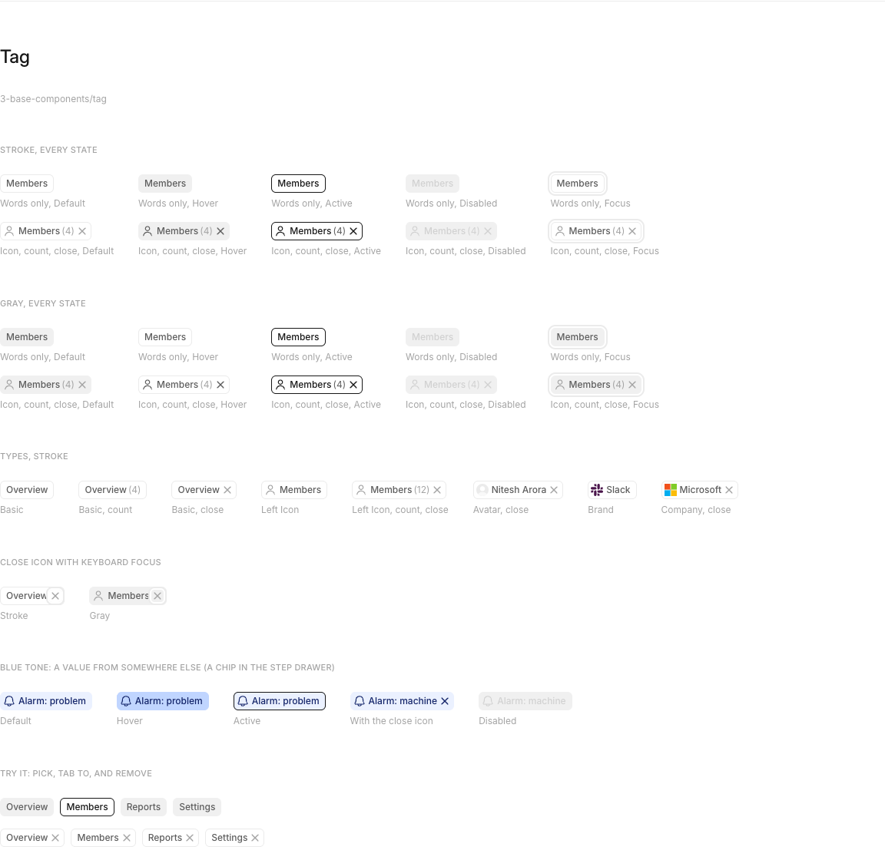
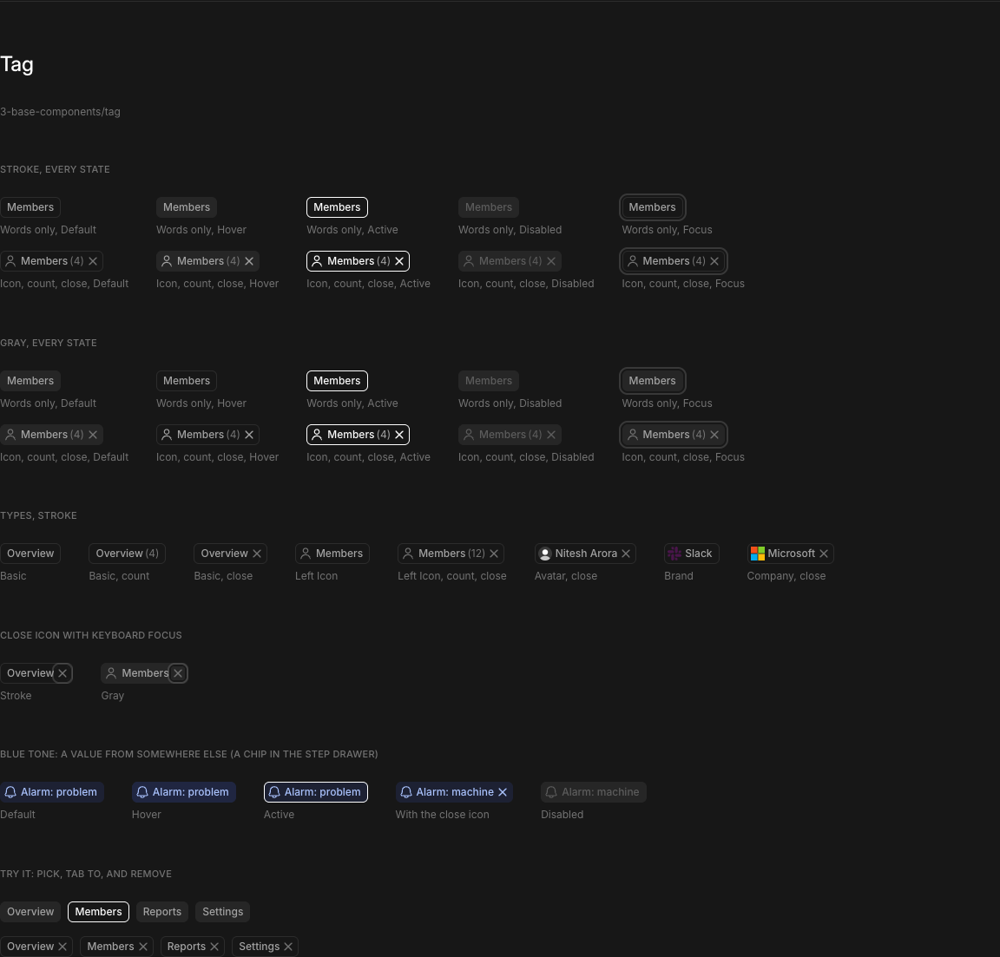

<!-- Copied from the design copy (neutrino-frontend-v3) by scripts/sync.mjs. Edit it there, then run `npm run sync`. -->

# Tag

| | |
|---|---|
| Figma | [Tag](https://www.figma.com/design/Ao3YVgFYdQIF0znq2ToqVl?node-id=417-12348) page |
| Status | Approved, 18 Oct 2026; coded 19 Oct 2026 |
| Code | [`src/components/ds/tag.tsx`](../../src/components/ds/tag.tsx) |
| Sizes | [`src/styles/sizes/tag.css`](../../src/styles/sizes/tag.css) |
| Demo | [`src/gallery/sections/tag.tsx`](../../src/gallery/sections/tag.tsx) |

## Light and dark

**Light**



**Dark**



## Use it

```tsx
import { Tag } from "@/components/ds/tag";
```

Every size and state, working: run `npm run dev` and open [localhost:3100/#tag](http://localhost:3100/#tag).

## Spec

Status: approved by Nitesh, 18 Oct 2026, with two changes to the Figma (below, under "Where this differs from the Figma").

Figma: "Tag [1.1]" (node 431:16147) on the Tag page (417:12348) of https://www.figma.com/design/Ao3YVgFYdQIF0znq2ToqVl.

The rule for this page: shape, size, spacing, type and states come exactly from the Figma. Colours are the tokens the Figma frame uses, with our palette's values (`../colors/colors.md`). Every number here becomes a size token, so it can be changed later in one place (`../README.md`, "Sizes work the same way").

### Rules

1. A small label a person can pick, filter by or remove (a filter, a chosen value in a field, a topic): Tag. A label that only reports a status: Badge.
2. Use only the styles, types and states on this page.
3. Something missing? Stop and ask Nitesh, then add it here first.

### What it has

| Property | Options |
|---|---|
| Size | One size, 24 tall |
| Style | Stroke (white with an edge), Gray (a grey fill) |
| State | Default, Hover, Active (picked), Disabled, Focus (keyboard) |
| Type | Basic (words only), Left Icon, Avatar, Country (a flag), Brand, Company |
| Count | An optional "(4)" after the word |
| Dismiss | An optional close icon at the end, to remove the tag |

### Layout

| Part | Value |
|---|---|
| Height | 24 |
| Corner | 6 |
| Edge | 1px, inside, in the Stroke style and in Active |
| Word | `text-label-xs` (12/16, 500) |
| Count "(4)" | `text-paragraph-xs` (12/16, 400), 2px after the word |
| Close icon | 16 x 16, 2px after the word (or the count) |
| Picture on the left | 16 x 16 (an icon, an avatar, a flag, a brand or company logo), 4px before the word |

Padding (top and bottom are 4 in every case):

| Tag | Left | Right |
|---|---|---|
| Words only | 8 | 8 |
| Words and close | 8 | 4 |
| Picture and words | 4 | 8 |
| Picture, words and close | 4 | 4 |

Width follows the content.

### Colours

#### Fill and edge

| State | Stroke style | Gray style |
|---|---|---|
| Default | `bg/white-0`, `stroke/soft-200` edge | `bg/weak-50`, no edge |
| Hover | `bg/weak-50`, no edge | `bg/white-0`, `stroke/soft-200` edge |
| Active | `bg/white-0`, `stroke/strong-950` edge | the same |
| Disabled | `bg/weak-50`, no edge | the same |

On hover the two styles swap looks.

#### Words and icons, both styles

| State | Word | Count | Picture (an icon) | Close icon |
|---|---|---|---|---|
| Default | `text/sub-600` | `text/soft-400` | `icon/soft-400` | `icon/soft-400` |
| Hover | `text/sub-600` | `text/soft-400` | `icon/sub-600` | `icon/sub-600` |
| Active | `text/strong-950` | `text/sub-600` | `icon/strong-950` | `icon/strong-950` |
| Disabled | `text/disabled-300` | `text/disabled-300` | `icon/disabled-300` | `icon/disabled-300` |

Avatars, flags and logos keep their own colours.

Focus (keyboard): the tag as it is, plus the Neutral focus ring, as on the Button Group: 2px in `bg/white-0`, then 2px more in `state/faded/light`, no blur. A close icon that has focus gets the same ring around the icon.

Every colour is the Figma frame's own token; nothing moved.

#### Blue tone (Neutrino, 21 Oct 2026)

A value that comes from somewhere else: in the Workflow Studio's step drawer, a value from an earlier step ("Alarm: problem") sitting in a field's words. Nitesh's sketch v2 drew these chips blue. `tone="blue"` on either style.

| State | Fill | Words and icons | Edge |
|---|---|---|---|
| Default | `state/information/lighter` | `state/information/dark` (AAA, badge.md) | none |
| Hover | `state/information/light` | `state/information/dark` | none |
| Active | `state/information/lighter` | `state/information/dark` | `state/information/base` |
| Disabled | as every Tag | as every Tag | none |

It is the Badge's Lighter Blue look, so a blue chip and a blue badge read as one family.

### Where this differs from the Figma

Agreed with Nitesh, 18 Oct 2026.

| Figma | Ours | Why |
|---|---|---|
| On hover some tags darken their icons to `icon/sub-600`, others keep `icon/soft-400` | Always `icon/sub-600` on hover | One rule for every tag |
| No keyboard focus look | The Neutral focus ring | Every control needs a visible keyboard focus |

### Build order

The Avatar, Country, Brand and Company types use the Avatar, the flags and the logos. The Basic and Left Icon types can be built now.

### In code (to decide when building)

* The nearest thing in code is `components/ui/refined/chip.tsx` (tones neutral, accent, muted, warn, danger), used in about 29 files. Its neutral tone becomes this Tag; its coloured tones report a status, so they belong to the Badge. Some screens also draw their own chips (`--color-chip`, `--color-chip-active`); they move to this Tag when rebuilt.
* The close icon is its own button inside the tag, so it can be reached and pressed on its own.
