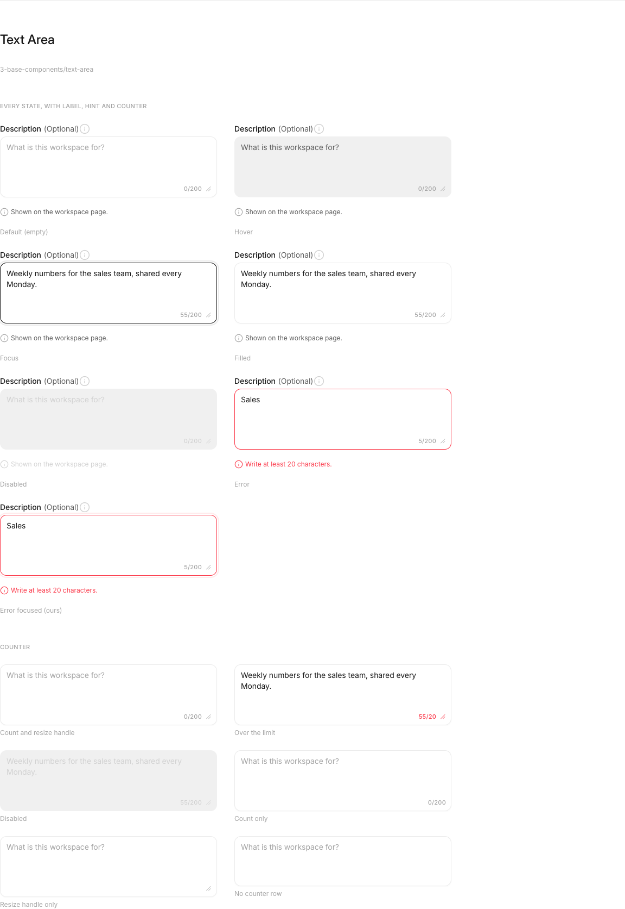
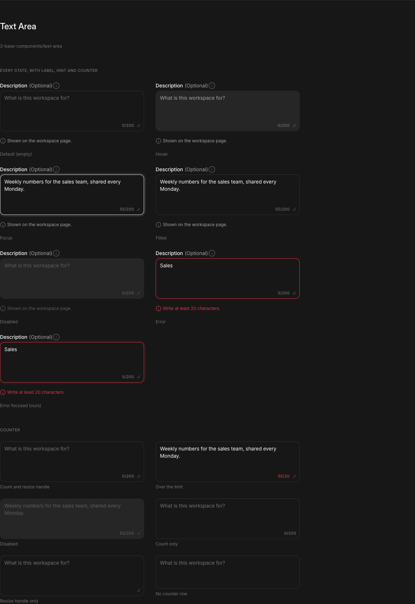

<!-- Copied from the design copy (neutrino-frontend-v3) by scripts/sync.mjs. Edit it there, then run `npm run sync`. -->

# Text Area

| | |
|---|---|
| Figma | [Text Area](https://www.figma.com/design/Ao3YVgFYdQIF0znq2ToqVl?node-id=434-6100) page |
| Status | Approved, 18 Oct 2026; coded 19 Oct 2026 |
| Code | [`src/components/ds/text-area.tsx`](../../src/components/ds/text-area.tsx) |
| Sizes | [`src/styles/sizes/text-area.css`](../../src/styles/sizes/text-area.css) |
| Demo | [`src/gallery/sections/text-area.tsx`](../../src/gallery/sections/text-area.tsx) |

## Light and dark

**Light**



**Dark**



## Use it

```tsx
import { TextArea } from "@/components/ds/text-area";
```

Every size and state, working: run `npm run dev` and open [localhost:3100/#text-area](http://localhost:3100/#text-area).

## Spec

Status: approved by Nitesh, 18 Oct 2026.

Figma: "Text Area [1.1]" (node 435:5725) and its "Character Counter [1.1]" (node 435:5712), on the Text Area page (434:6100) of https://www.figma.com/design/Ao3YVgFYdQIF0znq2ToqVl.

The rule for this page: shape, size, spacing, type and states come exactly from the Figma. Colours are the tokens the Figma frame uses, with our palette's values (`../colors/colors.md`). Every number here becomes a size token, so it can be changed later in one place (`../README.md`, "Sizes work the same way").

### Rules

1. Every text field that takes more than one line is this Text Area, with its label and hint. Never style a `<textarea>` by hand.
2. It shares its label, hint and states with the Text Input (`text-input.md`). Keep the two in step.
3. Something missing? Stop and ask Nitesh, then add it here first.

### What it has

| Property | Options |
|---|---|
| Size | One size |
| State | Default (empty), Hover, Focus, Filled, Disabled, Error, Error focused |
| Label | On or off, the same label row as the Text Input |
| Hint | On or off, the same hint row as the Text Input |
| Counter | On or off: the character count and the resize handle, each on or off |

### Layout

Label, field and hint stack top to bottom with a 4px gap, at the full width of their container. The Figma draws them 400 wide.

The label row and the hint row are exactly the Text Input's (`text-input.md`, "The label row" and "The hint row").

#### The field

| Part | Value |
|---|---|
| Height | 112 to start: 10 + a 72 writing area + 8 + a 12 counter row + 10. It can be made taller with the resize handle |
| Padding | 10 top, 10 right, 10 bottom, 12 left |
| Gap | 8 between the writing area and the counter row |
| Corner | 12 (the Text Input's Medium is 10) |
| Edge | 1px, inside, so it never changes the size |
| Text | `text-paragraph-sm` (14/20, -0.6%), filling the writing area |

#### The counter row

* At the foot of the field, pushed to the right, 12 tall, a 6px gap.
* The count ("0/200"): `text-subheading-2xs uppercase` (11/12, +2%).
* The resize handle: 12 x 12, two short diagonal lines with a 1px stroke.

### Colours

#### The field

| State | Fill | Edge | Shadow or ring | Text |
|---|---|---|---|---|
| Default (empty) | `bg/white-0` | `stroke/soft-200` | `--shadow-card` | `text/soft-400` |
| Hover | `bg/weak-50` | none | none | `text/sub-600` |
| Focus | `bg/white-0` | `stroke/strong-950` | The Neutral focus ring | `text/strong-950` |
| Filled | `bg/white-0` | `stroke/soft-200` | `--shadow-card` | `text/strong-950` |
| Disabled | `bg/weak-50` | none | none | `text/disabled-300` |
| Error | `bg/white-0` | `state/error/base` | none | `text/strong-950` |
| Error, focused | `bg/white-0` | `state/error/base` | The Error focus ring | `text/strong-950` |

The focus rings are the Button's (`button.md`): 2px in `bg/white-0`, then 2px more, outside the field, no blur. The Neutral ring's outer 4px is `state/faded/light`; the Error ring's is `state/error/lighter`.

#### The counter

| Counter state | Count | Resize handle |
|---|---|---|
| Default | `text/soft-400` | `icon/soft-400` |
| Error (over the limit) | `state/error/base` | `state/error/base` |
| Disabled (the field is disabled) | `text/disabled-300` | `icon/disabled-300` |

The counter turns red only when the text is over the limit, not when the field is in Error for another reason.

#### Label and hint

The same as the Text Input: label `text/strong-950`, `*` `primary/base`, "(Optional)" `text/sub-600`, info icon `icon/disabled-300`; hint `text/sub-600` with icon `icon/soft-400`, `text/disabled-300` and `icon/disabled-300` when disabled, `state/error/base` for both in Error.

Every colour is the Figma frame's own token; nothing moved.

### Where this differs from the Figma

| Figma | Ours | Why |
|---|---|---|
| No look for a field in error that has focus | Error, focused: the error edge plus the Error focus ring | The same as the Text Input, agreed with Nitesh on 18 Oct 2026 |
| A loose "Text Area [1.1]/ State7" (node 198129:166181) outside the set | Left out | It is the Hover state again |

### In code (to decide when building)

* Today's `components/ui/textarea.tsx` is the stock shadcn one. The Text Area replaces how it looks; its name can stay.
* The resize handle can be the browser's own vertical resize, drawn over with the Figma's 12 x 12 mark.
