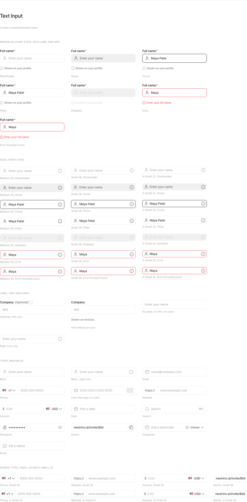
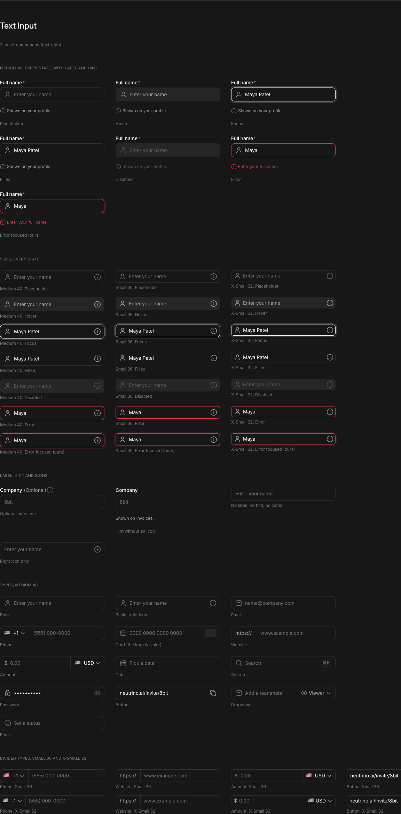

<!-- Copied from the design copy (neutrino-frontend-v3) by scripts/sync.mjs. Edit it there, then run `npm run sync`. -->

# Text Input

| | |
|---|---|
| Figma | [Text Input](https://www.figma.com/design/Ao3YVgFYdQIF0znq2ToqVl?node-id=266-5230) page |
| Status | Approved, 18 Oct 2026; coded 19 Oct 2026 |
| Code | [`src/components/ds/text-input.tsx`](../../src/components/ds/text-input.tsx) |
| Sizes | [`src/styles/sizes/text-input.css`](../../src/styles/sizes/text-input.css) |
| Demo | [`src/gallery/sections/text-input.tsx`](../../src/gallery/sections/text-input.tsx) |

## Light and dark

**Light**



**Dark**



## Use it

```tsx
import { TextInput, TextInputPicker, TextInputInlinePicker } from "@/components/ds/text-input";
```

Every size and state, working: run `npm run dev` and open [localhost:3100/#text-input](http://localhost:3100/#text-input).

## Spec

Status: approved by Nitesh, 18 Oct 2026, with one addition to the Figma (below, under "Where this differs from the Figma").

Figma: "Text Input [1.1]" (node 266:5251) on the Text Input page (266:5230) of https://www.figma.com/design/Ao3YVgFYdQIF0znq2ToqVl.

The rule for this page: shape, size, spacing, type and states come exactly from the Figma. Colours are the tokens the Figma frame uses, with our palette's values (`../colors/colors.md`). Every number here becomes a size token, so it can be changed later in one place (`../README.md`, "Sizes work the same way").

### Rules

1. Every one-line text field in the product is this Text Input, with its label and hint. Never style an `<input>` by hand.
2. Use only the sizes, types and states on this page.
3. Something missing? Stop and ask Nitesh, then add it here first.

### What it has

| Property | Options |
|---|---|
| Size | Medium (40), Small (36), X-Small (32) |
| State | Placeholder (empty), Hover, Focus, Filled, Disabled, Error, Error focused |
| Type | Basic, Email, Phone, Card, Website, Amount, Date, Search, Password, Button, Dropdown, Emoji |
| Label | On or off. A word, then an optional `*`, an optional "(Optional)" and an optional info icon |
| Hint | On or off. An icon and one line of help, or the error message |
| Icons in the field | Left icon on or off; right icon on or off |

Every type is the Basic field plus one extra part (see Types).

### Layout

Label, field and hint stack top to bottom with a 4px gap. They take the full width of their container; the Figma draws them 300 wide.

#### The label row

* A row with a 1px gap: the label, `*`, "(Optional)", the info icon.
* Label: `text-label-sm` (14/20, -0.6%).
* "(Optional)": `text-paragraph-sm` (14/20, -0.6%).
* Info icon: 20 x 20.

#### The field

| Size | Height | Padding, top and bottom | Padding, left | Padding, right | Gap | Corner |
|---|---|---|---|---|---|---|
| Medium | 40 | 10 | 12 | 10 | 8 | 10 |
| Small | 36 | 8 | 10 | 8 | 8 | 8 |
| X-Small | 32 | 6 | 8 | 6 | 6 | 8 |

* Text: `text-paragraph-sm` (14/20, -0.6%) at every size. It fills the space between the icons.
* Icons: 20 x 20 at every size. Hugeicons Stroke Rounded; the Figma uses Remix icons as placeholders.
* Edge: 1px, inside, so it never changes the size.

#### The hint row

* A row with a 4px gap: a 16 x 16 icon, then the text.
* Text: `text-paragraph-xs` (12/16, 0%).

### Colours

#### The field

| State | Fill | Edge | Shadow or ring | Text | Icons |
|---|---|---|---|---|---|
| Placeholder | `bg/white-0` | `stroke/soft-200` | `--shadow-card` | `text/soft-400` | `icon/soft-400` |
| Hover | `bg/weak-50` | none | none | `text/sub-600` | `icon/sub-600` |
| Focus | `bg/white-0` | `stroke/strong-950` | The Neutral focus ring | `text/strong-950` | `icon/sub-600` |
| Filled | `bg/white-0` | `stroke/soft-200` | `--shadow-card` | `text/strong-950` | `icon/sub-600` |
| Disabled | `bg/weak-50` | none | none | `text/disabled-300` | `icon/disabled-300` |
| Error | `bg/white-0` | `state/error/base` | none | `text/strong-950` | `icon/sub-600` |
| Error, focused | `bg/white-0` | `state/error/base` | The Error focus ring | `text/strong-950` | `icon/sub-600` |

The focus rings are the Button's (`button.md`): 2px in `bg/white-0`, then 2px more, outside the field, no blur. The Neutral ring's outer 4px is `state/faded/light`; the Error ring's is `state/error/lighter`.

Hover and Disabled share the same fill and no edge; only the text and icon colours tell them apart. Kept as in the Figma.

#### Label and hint

| Part | Every state | Disabled | Error |
|---|---|---|---|
| Label | `text/strong-950` | same | same |
| `*` (required) | `primary/base` | same | same |
| "(Optional)" | `text/sub-600` | same | same |
| Info icon | `icon/disabled-300` | same | same |
| Hint text | `text/sub-600` | `text/disabled-300` | `state/error/base` |
| Hint icon | `icon/soft-400` | `icon/disabled-300` | `state/error/base` |

Every colour is the Figma frame's own token; nothing moved.

### Types

Each type is the Basic field with one change. Sizes are at Medium; Small and X-Small use the same parts with their own field padding.

| Type | What it adds |
|---|---|
| Basic | Left icon, text, an optional right icon |
| Email | A mail icon on the left |
| Date | A calendar icon on the left |
| Emoji | An emoji (20 x 20) on the left |
| Password | A lock icon on the left; an eye icon on the right in `icon/soft-400` to show or hide. The dots are the text |
| Search | A search icon on the left; on the right a shortcut key: `text-subheading-xs uppercase` in `text/soft-400`, in a box with 2px top and bottom, 6px sides, corner 4, `bg/white-0`, a 1px `stroke/soft-200` edge |
| Card | A card icon on the left; the card brand's logo (32 x 24, corner 4) on the right. The field's top and bottom padding is 8 here, not 10 |
| Website | A prefix box on the left ("https://" in `text/sub-600`, padding 10 top and bottom, 12 sides), divided from the input by a 1px `stroke/soft-200` line |
| Button | An icon-only Neutral Ghost button (40 x 40) on the right, divided from the input by a 1px `stroke/soft-200` line |
| Phone | A country picker on the left (flag, the code in `text/strong-950`, a down arrow in `icon/sub-600`; padding 10 top and bottom, 10 left, 8 right, gap 8), divided from the input by a 1px `stroke/soft-200` line |
| Amount | The currency sign in `text/sub-600` before the number; a currency picker on the right, like Phone's, divided by a 1px `stroke/soft-200` line |
| Dropdown | A small picker inside the field on the right: an icon in `icon/soft-400`, the choice in `text/sub-600`, a down arrow in `icon/sub-600`, gap 4 |

Where a type has a divided part, the field has no padding of its own; the input part keeps the field's padding and the divider is a 1px edge on the side that touches the extra part.

### Where this differs from the Figma

Agreed with Nitesh, 18 Oct 2026.

| Figma | Ours | Why |
|---|---|---|
| No look for a field in error that has focus | Error, focused: the error edge plus the Error focus ring | Typing into a field in error still needs a visible focus, as the Error button has |

### Open

* The Figma disagrees with itself on a disabled field's label: the Text Input keeps it `text/strong-950`, while the standalone Label (`key-components.md`) has a Disabled state in `text/disabled-300`. This page follows the Text Input. Nitesh to pick one for both.

### Other inputs on the same Figma page

Each gets its own page later.

| Family | Figma node | Variants |
|---|---|---|
| Tag Input | 428:4860 | Six states, three sizes |
| Counter Input | 428:5656 | Six states, three sizes |
| Digit Input | 429:5172 | Six states (the one-time code boxes) |
| Inline Input | 429:5195 | Six states |

### In code (to decide when building)

* Today's `components/ui/input.tsx` and `components/ui/label.tsx` are the stock shadcn ones. The Text Input replaces how they look; their names can stay.
* The country and currency pickers (Phone, Amount) and the inline picker (Dropdown) use the Select's parts; build those types after the Select.

### Filled appearance (Neutrino, 21 Oct 2026)

`appearance="filled"`, for the Workflow Studio's drawer, after OpenAI's Agent Builder that Nitesh pointed at: the field is `bg/weak-50` with no edge and no shadow at rest; under the pointer `bg/soft-200`; focused, the Neutral focus ring on the same fill; Disabled `bg/weak-25`; Error keeps the `state/error/base` edge. Sizes, words, icons and the label and hint rows are the same as the Stroke appearance (the Figma's). The step drawer's word fields with chips use the same fill.
