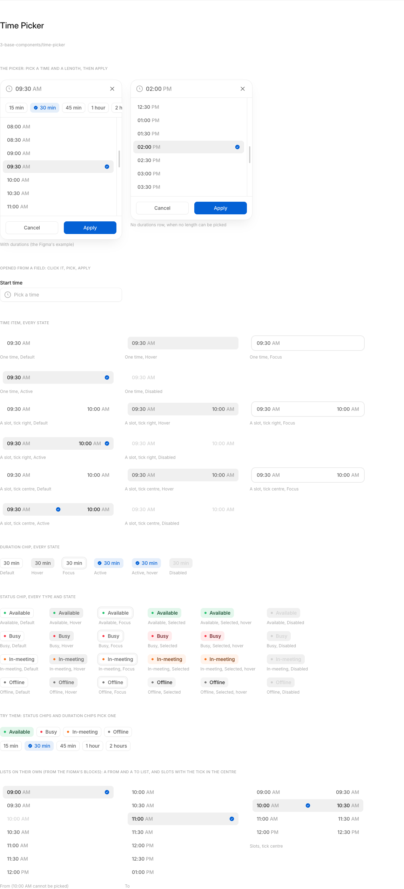
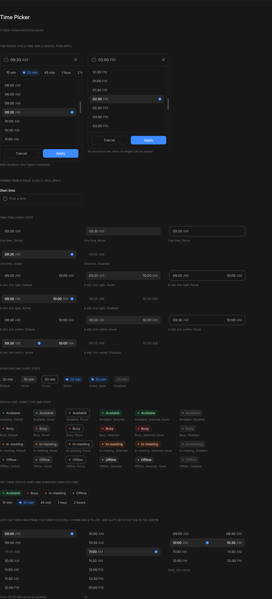

<!-- Copied from the design copy (neutrino-frontend-v3) by scripts/sync.mjs. Edit it there, then run `npm run sync`. -->

# Time Picker

| | |
|---|---|
| Figma | [Time Picker](https://www.figma.com/design/Ao3YVgFYdQIF0znq2ToqVl?node-id=164611-83414) page |
| Status | Written 18 Oct 2026; coded 19 Oct 2026 |
| Code | [`src/components/ds/time-picker.tsx`](../../src/components/ds/time-picker.tsx) |
| Sizes | [`src/styles/sizes/time-picker.css`](../../src/styles/sizes/time-picker.css) |
| Demo | [`src/gallery/sections/time-picker.tsx`](../../src/gallery/sections/time-picker.tsx) |

## Light and dark

**Light**



**Dark**



## Use it

```tsx
import {
  TimeItem,
  TimeList,
  DurationChip,
  StatusChip,
  TimePicker,
  TimePickerPopover,
} from "@/components/ds/time-picker";
```

Every size and state, working: run `npm run dev` and open [localhost:3100/#time-picker](http://localhost:3100/#time-picker).

## Spec

Status: written 18 Oct 2026, measured from the Figma. Its proposals stand until Nitesh reviews every component together on one canvas.

Figma, on the Time Picker page (164611:83414) of https://www.figma.com/design/Ao3YVgFYdQIF0znq2ToqVl:

* "Time Picker Items" (node 165483:5687): one time, or a from and a to time, in the list.
* "Time Picker Select Duration" (node 165483:6046): a duration chip ("30 min").
* "Time Picker Select Status" (node 165596:41348): a status chip ("Available", "Busy").
* The whole picker is not a component in the Figma. It is drawn once, in "Time Picker [Examples]" (node 165641:19376, the picker is node 166102:5347), from the parts above. Its numbers are below, under "The assembled picker".

The rule for this page: shape, size, spacing, type and states come exactly from the Figma. Colours are the tokens the Figma frame uses, with our palette's values (`../colors/colors.md`). Every number here becomes a size token, so it can be changed later in one place (`../README.md`, "Sizes work the same way").

### Rules

1. Picking a time, or a time slot (from and to), is this Time Picker: a list of times, with duration chips above it when a length can be picked. Never use the browser's time input.
2. Status chips are for picking a person's status for a slot (Available, Busy, In-meeting, Offline). A status that is only reported, not picked, is a Badge (`badge.md`).
3. Something missing? Stop and ask Nitesh, then add it here first.

### What it has

| Property | Options |
|---|---|
| Time item: state | Default, Hover, Active (the picked time), Disabled |
| Time item: times | One time on the left, and an optional second time on the right (a slot: from and to) |
| Time item: tick position | Right (at the end of the row), Center (between the two times) |
| Duration chip: state | Default, Hover, Active, Disabled |
| Status chip: type | Available, Busy, In-meeting, Offline |
| Status chip: state | Default, Hover, Selected, Disabled |

### Layout

#### Time item

| Part | Value |
|---|---|
| Height | 36 |
| Width | The list's width (292 in the set, 316 in the example) |
| Padding | 8 top and bottom, 12 sides |
| Gap | 10 between the times and the tick |
| Corner | 8 |
| A time | The numbers ("09:30") and "AM" in a row, 3 apart, both `text-label-sm` (14/20, 500) |
| Left time | Set to the left, filling half the row |
| Right time | Set to the right, filling the other half |
| Tick | A 14 x 14 filled circle with a tick cut out of it. Shown only on the picked item |

#### Duration chip

| Part | Value |
|---|---|
| Height | 28 |
| Padding | 4 top and bottom, 10 sides |
| Gap | 6 |
| Corner | 8 |
| Edge | 1px, inside, where it has one |
| Words | `text-label-sm` (14/20, 500) |
| Tick | A 12 x 12 filled circle with a tick, before the words. Active only |

Width follows the words.

#### Status chip

| Part | Value |
|---|---|
| Height | 28 |
| Padding | 4 top and bottom, 6 left, 10 right |
| Gap | 4 |
| Corner | 8 |
| Edge | 1px, inside, where it has one |
| Dot | A 6 x 6 circle, centred in a 16 x 16 space |
| Words | `text-label-sm` (14/20, 500) |

Width follows the words.

#### The assembled picker

From the Examples frame. Top to bottom:

| Part | Value |
|---|---|
| Picker | 348 wide, 452 tall, corner 20, clips its content |
| Header | 52 tall, padding 14 top and bottom, 16 sides, gap 8, a 1px line under it. A 20 x 20 clock icon, the picked time in `text-label-md` (16/24, 500) filling the space, then a close button: the Compact Button, Ghost, Large (24), fully round |
| Durations | 56 tall, padding 14 top and bottom, 16 sides, duration chips 8 apart, a 1px line under it |
| Times | 280 tall. A column with padding 8, items 2 apart, and a scroll bar on the right |
| Scroll bar | 16 wide, padding 16 top and bottom, 6 sides, a 1px line on its left. The thumb is 4 wide, 48 tall, fully round |
| Footer | 64 tall, padding 14 top and bottom, 16 sides, gap 12, a 1px line above it. Cancel (Button, Neutral, Stroke, Small 36) and Apply (Button, Primary, Filled, Small 36), 80 wide each, on the right |

The example's list shows one time per item. The Blocks frames also show the list on its own under a field, two lists side by side (from and to), and items with two times and the tick in the centre.

### Colours

#### Time item

| State | Fill | Numbers | "AM" | Tick |
|---|---|---|---|---|
| Default | `bg/white-0` | `text/sub-600` | `text/soft-400` | |
| Hover | `bg/weak-50` | `text/sub-600` | `text/soft-400` | |
| Active | `bg/weak-50` | `text/strong-950` | `text/soft-400` | `primary/base` |
| Disabled | `bg/white-0` | `text/disabled-300` | `text/disabled-300` | |

#### Duration chip

| State | Fill | Edge | Shadow | Words | Tick |
|---|---|---|---|---|---|
| Default | `bg/white-0` | `stroke/soft-200` | `--shadow-card` | `text/sub-600` | |
| Hover | `bg/weak-50` | `stroke/soft-200` | none | `text/sub-600` | |
| Active | `primary/alpha-10` | none | none | `primary/base` | `primary/base` |
| Disabled | `bg/weak-50` | none | none | `text/disabled-300` | |

#### Status chip

| State | Fill | Edge | Shadow | Words | Dot |
|---|---|---|---|---|---|
| Default | `bg/white-0` | `stroke/soft-200` | `--shadow-card` | `text/sub-600` | `state/<colour>/base` |
| Hover | `bg/weak-50` | `stroke/soft-200` | none | `text/sub-600` | `state/<colour>/base` |
| Selected | `state/<colour>/lighter` | none | none | `state/<colour>/dark` | `state/<colour>/base` |
| Disabled | `bg/weak-50` | none | none | `text/disabled-300` | `icon/disabled-300` |

| Type | Colour |
|---|---|
| Available | Green, `state/success` |
| Busy | Red, `state/error` |
| In-meeting | Orange, `state/warning` (our Amber) |
| Offline | Gray, `state/faded` |

#### The assembled picker

| Part | Token |
|---|---|
| Picker, header, durations row, list, footer | `bg/white-0` |
| The lines between the parts, the scroll bar's line | `stroke/soft-200` |
| Clock icon | `icon/soft-400` |
| Picked time: numbers | `text/sub-600` |
| Picked time: "AM" | `text/soft-400` |
| Close button | `icon/sub-600` |
| Scroll thumb | `bg/sub-300` |

The Examples frame shows the picker in the dark theme too: the tokens flip on their own.

Every colour is the Figma frame's own token; nothing moved. The colours the Figma types in directly are in the example picker's shadow (below).

The example picker's shadow is the Figma's `custom-shadows/medium`, eight layers: an inner shadow 0 up 1, blur 1, spread -0.5, `#333333` at 6%; a 1px ring (spread 1, no blur) in `state/faded/lighter`, which draws the picker's edge; and six drops, all `#333333`: 0 down 48 blur 48 spread -24 at 4%, 0 down 24 blur 24 spread -12 at 4%, 0 down 12 blur 12 spread -6 at 4%, 0 down 6 blur 6 spread -3 at 4%, 0 down 3 blur 3 spread -1.5 at 2%, 0 down 1 blur 1 spread 0.5 at 4%.

### Open

* **The picker's frame differs from the Date Picker's.** The Date Picker (`date-picker.md`) has a 1px `stroke/soft-200` edge and the one-layer `regular-shadow/medium`; this example has no edge and the eight-layer `custom-shadows/medium`. Its footer is also tighter (padding 14, gap 12, buttons 80 wide, against 16, 16 and half width). Proposed: the Date Picker's frame, edge, shadow (`--shadow-popover`) and footer for both, so every picker looks the same.
* **The durations row is wider than the picker.** In the example the fifth chip is cut off at the edge. Proposed: the row scrolls sideways, with no scroll bar.
* **The 3px gap between "09:30" and "AM"** is not on the spacing scale (2, 4, 6 ...). Proposed: 4, or a plain space between the two words.
* **The tick is a filled circle.** Hugeicons Stroke Rounded draws outlines. Proposed: Hugeicons' tick in a circle, filled in `primary/base`, at 14 (items) and 12 (durations); Nitesh to say if the outline is fine instead.
* **No keyboard focus look.** Proposed: the Neutral focus ring (2px `bg/white-0`, then 4px `state/faded/light`, outside, no blur) on a focused item or chip.
* **No hover on a picked item or chip.** The Active item already has the hover fill. Proposed: a picked chip keeps its picked look on hover.

### Build order

The Button (`button.md`) for Cancel and Apply, and the Compact Button (Ghost, Large 24, fully round; a family on the Button page, no page of its own yet) for the close button. The items and chips can be built now.

### In code (to decide when building)

* The picker may be built from a library and restyled to this page; the look on this page is the target either way.
* There is no time picker in code yet, and no time picker library in `package.json`. No screen uses the browser's time input.
* The picker opens in `components/ui/popover.tsx` (used in 13 files), restyled to the Date Picker's frame.
* The list is a list box: arrow keys move through the times, Enter picks one, and the picked item scrolls into view when the picker opens.
* The status chips are close to the Tag (`tag.md`) and the Badge (`badge.md`) in shape; they stay their own part, with the sizes on this page.
* If the example's shadow is kept, it becomes `--shadow-time-picker` with its eight layers when shadows move into the token build.
