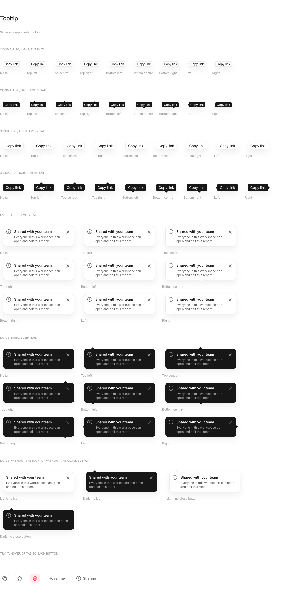
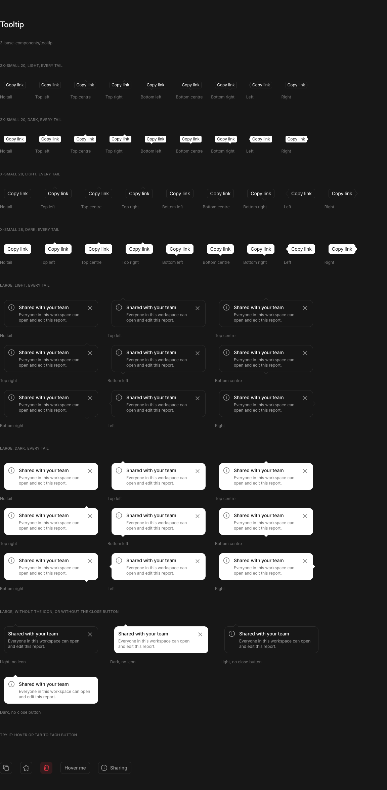

<!-- Copied from the design copy (neutrino-frontend-v3) by scripts/sync.mjs. Edit it there, then run `npm run sync`. -->

# Tooltip

| | |
|---|---|
| Figma | [Tooltip](https://www.figma.com/design/Ao3YVgFYdQIF0znq2ToqVl?node-id=553-14954) page |
| Status | Approved, 18 Oct 2026; coded 19 Oct 2026 |
| Code | [`src/components/ds/tooltip.tsx`](../../src/components/ds/tooltip.tsx) |
| Sizes | [`src/styles/sizes/tooltip.css`](../../src/styles/sizes/tooltip.css) |
| Demo | [`src/gallery/sections/tooltip.tsx`](../../src/gallery/sections/tooltip.tsx) |

## Light and dark

**Light**



**Dark**



## Use it

```tsx
import { TooltipPanel, Tooltip } from "@/components/ds/tooltip";
```

Every size and state, working: run `npm run dev` and open [localhost:3100/#tooltip](http://localhost:3100/#tooltip).

## Spec

Status: approved by Nitesh, 18 Oct 2026, with one change to the Figma (below, under "Where this differs from the Figma").

Figma: "Tooltip [1.1]" (node 2604:269) on the Tooltip page (553:14954) of https://www.figma.com/design/Ao3YVgFYdQIF0znq2ToqVl.

The rule for this page: shape, size, spacing, type and states come exactly from the Figma. Colours are the tokens the Figma frame uses, with our palette's values (`../colors/colors.md`). Every number here becomes a size token, so it can be changed later in one place (`../README.md`, "Sizes work the same way").

### Rules

1. A short hint that shows on hover or focus is this Tooltip. Never use the browser's `title`.
2. Something missing? Stop and ask Nitesh, then add it here first.

### What it has

| Property | Options |
|---|---|
| Size | 2X-Small, X-Small, Large |
| Style | Light (white), Dark (the strongest fill) |
| Tail | On or off, and where it points from: top left, top centre, top right, bottom left, bottom centre, bottom right, left, right |
| Large only | An optional icon on the left, a title, a description, an optional close button |

### Sizes

| Size | Box height | Padding | Corner | Text | Tail |
|---|---|---|---|---|---|
| 2X-Small | 20 | 2 top and bottom, 6 sides | 4 | `text-paragraph-xs` (12/16) | 8 x 4 |
| X-Small | 28 | 4 top and bottom, 10 sides | 6 | `text-paragraph-sm` (14/20) | 12 x 6 |
| Large | grows with the text | 12 | 12 | title `text-label-sm` (14/20), description `text-paragraph-xs` (12/16) | 12 x 6 |

* The tail sits outside the box. On the left and right variants it is 16 (2X-Small), 24 (X-Small) or 28 (Large) from the box's corner; on the centre variants it is centred.
* Large: the icon (20 x 20), the words and the close button (a Compact Button, Ghost, 24 x 24) in a row with a 12px gap; title and description 4px apart. The Figma draws it 280 wide.
* Shadow, two layers: 0 down 1, blur 2, `#0E121B` at 3%; and 0 down 12, blur 24, `#0E121B` at 6%.

### Colours

| Part | Light | Dark |
|---|---|---|
| Box and tail | `bg/white-0` | `bg/strong-950` |
| Edge (box and tail) | 1px `stroke/soft-200` | none |
| Text, title | `text/strong-950` | `text/white-0` |
| Description | `text/sub-600` | `text/soft-400` |
| Icon and close button | `icon/sub-600` | `icon/soft-400` |

The tokens flip with the theme, so in the dark theme the Light tooltip turns dark grey and the Dark tooltip turns white.

Every colour is the Figma frame's own token; nothing moved. The colours the Figma types in directly are the two shadow layers; they become a shadow token with the others.

### Where this differs from the Figma

Agreed with Nitesh, 18 Oct 2026.

| Figma | Ours | Why |
|---|---|---|
| The Dark style's close button is `icon/sub-600` | `icon/soft-400`, like the Dark style's other icon | It read darker than everything around it |

### In code (to decide when building)

* Today's `components/ui/tooltip.tsx` is the stock shadcn one, used in 10 files; the Tooltip replaces how it looks.
* The shadow becomes `--shadow-tooltip: 0 1px 2px rgba(14, 18, 27, 0.03), 0 12px 24px rgba(14, 18, 27, 0.06)` when shadows move into the token build.
