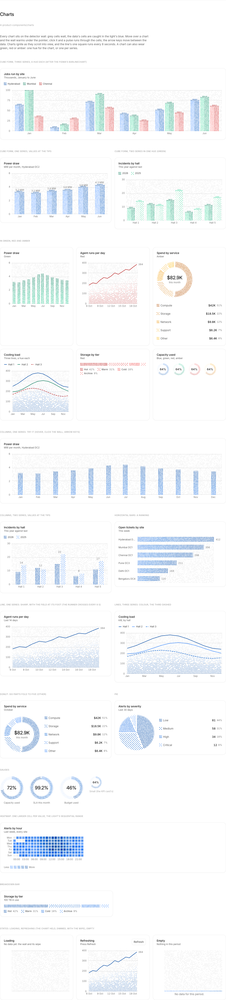
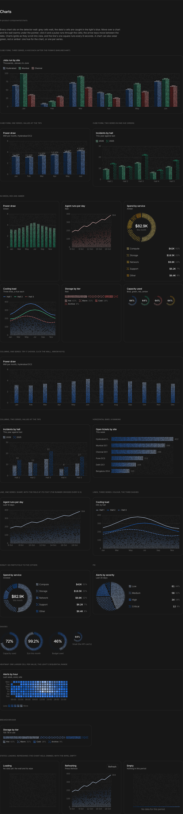

<!-- Copied from the design copy (neutrino-frontend-v3) by scripts/sync.mjs. Edit it there, then run `npm run sync`. -->

# Charts

| | |
|---|---|
| Figma | None: designed in code (see the spec below) |
| Status | Coded 19 Oct 2026 (bar, line, donut and pie, gauge, heatmap, breakdown bar); waits for Nitesh's review |
| Code | [`src/components/ds/chart.tsx`](../../src/components/ds/chart.tsx), [`src/components/ds/neutrino-cells.tsx`](../../src/components/ds/neutrino-cells.tsx), [`src/lib/neutrino-light.ts`](../../src/lib/neutrino-light.ts) |
| Sizes | [`src/styles/sizes/chart.css`](../../src/styles/sizes/chart.css) |
| Demo | [`src/gallery/sections/chart.tsx`](../../src/gallery/sections/chart.tsx) |

## Light and dark

**Light**



**Dark**



## Use it

```tsx
import {
  ChartHues,
  ChartPxBoost,
  ChartCard,
  ChartLegend,
  LineKey,
  BarChart,
  LineChart,
  DonutChart,
  Gauge,
  Heatmap,
  BreakdownBar,
} from "@/components/ds/chart";
import {
  LUT_N,
  CHART_HUES,
  ChartHueContext,
  PATTERNS,
  CellsStill,
  CellCanvas,
  CellSwatch,
} from "@/components/ds/neutrino-cells";
```

Every size and state, working: run `npm run dev` and open [localhost:3100/#charts](http://localhost:3100/#charts).

## Spec

Written 19 Oct 2026. Nitesh asked for the Neutrino effect on every chart: the lines, the bars, the pie, everything, the same effect that lives behind the chat home (`components/chat-flow/home-field.tsx`). There is no Figma frame for charts; this page is ours, built from the home field, the brand's light (`8bit Branding/brand/identity/the-light.md`, the cells form) and the data-viz rules Claude follows. Nitesh reviews it on the Components page.

### The effect, in one sentence

Every chart is drawn on the detector wall: a lattice of small squares where grey cells wait and blue cells are caught. The data lights the cells, in the light's own blue ramp, and the cells behave like the home field's: they ignite on arrival, breathe with the deck's calm twinkle, warm under the cursor, and one square runs along a line. Lines are the one exception: a line is drawn sharp, and the cells carry the field at its foot (Nitesh, 19 Oct 2026: the line made of cells was hard to follow; "make them sharp, and at the bottom show the Neutrino effect").

### Where they are used

* The Components page, under Charts.
* Inside a canvas (27 Oct 2026, Nitesh: "add neutrino effects to our graphs and charts, look to the design system for this, make sure all the graphs are readable"): every line, bar, stacked bar, donut, pie and heatmap on a canvas is drawn with these, inside the canvas's card (`components/da-dashboards/widgets/canvas-chart.tsx`, the card in `editor-canvas.tsx`). A stacked bar draws as columns side by side: there is no stacked form yet. A chart with more than three series draws its three biggest. Scatters, sankeys, funnels, treemaps, radars and waterfalls have no form here yet, so they stay on ECharts in the canvas's colours. The chat's charts are still ECharts.

### Rules

1. Every chart in the product is built from `components/ds/chart.tsx`. Never draw a chart another way (no Recharts, no hand SVG) in product screens.
2. The cells, their colours and their motion come only from the tokens below and the engine in `components/ds/neutrino-cells.ts`. Change the effect there and every chart follows.
3. Words never sit on the light: titles, axis labels, values and legends sit beside the cells, in text tokens, never in the series colour.
4. One source per chart: the light is the data and nothing else. No glow behind a chart, no lit card.

### The wall

| Part | Spec |
|---|---|
| Cell | A 3 x 3 square on a 5 px pitch (`--chart-cell`, `--chart-pitch`), denser than the home's 3 on 7 so a shape reads at chart size. Sparklines use 2 on 4. |
| Waiting cells | About 62% of the cells in the plot, in the wall colour (`--color-chart-cells-rest`: black on light, white on dark) at the wall alpha, each a little different: never an even tile. |
| Tick rows | The row of cells at each value tick sits at twice the wall alpha. They are the gridlines; there are no drawn rules. |
| Caught cells | The data's cells, coloured along the light's ramp (`--chart-cells-ramp`, the same stops as the home field) and mixed in OKLab. Each caught cell takes one of four tones (0.7, 0.8, 0.9, 1): the deck's four tones, raised so the data reads. |
| Partial cells | Where a value ends inside a cell (the top of a bar, a line between two rows) that cell lights by the share it covers, so the shape stays exact to the value. |

The ramp runs from cold to hot in both themes: on dark the hot end is the light (pale, light), on light it is the ink. So "hot" always means the strongest contrast against the card.

### The forms

| Chart | How the cells carry the data |
|---|---|
| Bar (columns) | Each bar is whole columns of cells, at most 24 px wide, grown from the baseline. A panel of the light: cooler at the base, hottest at its own end (the brand's run bars). Bars sit apart, so each is cut dark again. Value labels at the tip when asked. |
| Bar (cube) | `form="cube"`, after Nitesh's Figma BarLineChart (node 198309:63497, an inspiration, 19 Oct 2026): each column a box turned to its front edge. The left half of its cells sits lower on the ramp than the right (on light: a pale left face and a stronger right face, as the Figma; on dark the ramp runs the other way, so the left face is the darker one), and its top is a flat diamond of the hottest cells, one row higher across the middle. Bars up to 48 px (`--chart-cube-max`), 80% of their band. Each face keeps the column's rise, cool at the base. Columns only. |
| Bar (horizontal) | Rows of cells from the label to the value, cool at the label end, hot at the tip; the value sits after the tip. For rankings. |
| Line | A sharp line, 2 px (`--chart-line`), round joins, in the series' colour, exact to the data, drawn left to right as the chart arrives. Under it, the field at the foot: cells rising from the baseline, hottest and densest at the foot, thinning and cooling as they rise, gone before they reach the line, so a dark gap keeps the line alone (the home's glow from the foot). With several series each has its own line and one field sits under the highest. The value of the last point sits at the line's end (one series). One square runs along the line every 8 seconds: the brand's one running signal. |
| Donut and pie | The ring (or disc) of cells, cut into slices by a dark gap of one cell. Slices are sorted largest first and step down the ramp; the share and name sit in the legend. At most five slices; the rest fold into Other. |
| Gauge | A ring of cells lit to the value, the rest of the ring waiting. The value sits in the middle. |
| Heatmap | Each value is one larger cell (12 on a 15 pitch) on the ramp's sequential range; an empty cell waits. A "Less to More" key sits under it. The row names' column takes the width of the longest name, so none is cut (27 Oct 2026). With `fit` (a canvas's card) the cells grow to fill the box, keeping a cell's share of its pitch, never smaller than 12 on 15; each column's name is centred under it and they thin out by their length. |
| Breakdown bar | One band of cells, three rows tall, cut into its parts by a dark column; a legend with the values under it. |
| Sparkline | The line form, small (a 1.5 px line, `--chart-line-sm`, over 2 on 4 cells), with no axes: for the KPI cards. |

### Colour and identity (measured 19 Oct 2026)

The brand keeps one blue, so a chart's series are steps of the light's ramp. Measured with the data-viz palette check (OKLab Delta E, x100):

| Use | Light theme | Dark theme | Result |
|---|---|---|---|
| One series | the hot end (ink) | the hot end (light) | One colour, no legend needed |
| Two series | ink and the ramp at 0.45 (#3886FA) | light and the ramp at 0.62 (#186BDF) | Pass: Delta E 21.5 light, 38 dark; contrast over 3:1 on the card |
| Three series | ink, 0.75, 0.45 | light, 0.8, 0.62 | Fail by colour alone in light (Delta E 6.9 between ink and the next step). So the third series also changes its cells' pattern (sparse), and the series are labelled. Above three: small multiples. |
| Heatmap (sequential) | 0.35 to 1 | 0.55 to 1 | Pass on light; dark starts at 0.55 because 0.35 measured 1.4:1 against the card |

#### Hues (19 Oct 2026)

Nitesh asked to see the charts in other colours ("green, red, or some sort of these"). A chart can wear the light's blue (the default), or the palette's green, red or amber, each on the blue's own ramp and stops (`--chart-cells-ramp-green`, `-red`, `-amber`). Set it on the card, `<ChartCard hue="green">`, or around any chart with `<ChartHues hue="red">`:

* **One hue** for the chart: everything above holds, in that hue (series step down its ramp and change pattern).
* **A hue per series**, `hue={["blue", "green", "red"]}`: the hue tells the series apart, so each sits at the hot end in solid cells. The first hue is also the chart's own (the wall's warmth, a line's field, the runner). A line in its own hue sits at `--chart-cells-hue-line` (1 on light, 0.8 on dark, where every hue's hot end is nearly white).

Purple, teal, sky and pink wait for palette scales of their own.

On a canvas (27 Oct 2026) a chart with two or three series wears a hue per series, blue, amber, green in that order (red stays for what is bad), and its legend and rows follow: in one blue, the second and third series' checkered and sparse cells faded into the wall on a canvas's narrow charts. One series keeps the blue.

Patterns carry identity next to colour: in bars the first series lights every cell, the second a checkerboard, the third one cell in four; in lines the first two are solid and the third dashed. The legend and the tooltip key each series the way its marks are drawn: cells for bars, a short stroke for lines.

### Interaction

* **Bars, slices, heatmap cells:** the datum under the pointer is the hit target (its whole band, gap included). It heats: its cells climb the ramp and brighten, the others dim a little. A tooltip shows the value (strong) and the name.
* **Lines:** a crosshair finds the nearest point: a column of cells lights under it, a larger square marks each series' point, and one tooltip lists every series at that point.
* **The wall answers the cursor**, as the home's signal form does: cells warm in blue under the pointer and fade behind it; a click sends a small pulse through them.
* **Keyboard:** the plot takes focus (the Primary focus ring). The arrow keys move between data, with the same tooltip; screen readers hear the value.
* **A table view** of every chart's data is always in the page for screen readers.

### Motion

| Moment | Spec |
|---|---|
| Arrival | When a chart first scrolls into view its cells ignite in order: bars from the baseline up (each bar a little after the one before), a line draws from left to right with its field, slices round the ring, heatmaps along their rows. About one second. |
| Breathing | The caught cells keep the deck's calm twinkle: each holds a state 1.2 to 2 s and steps in 90 ms. |
| The runner | Lines only: one square every 8 s, with a short fading trail. |
| Loading | The wall alone, with a soft band of warm cells wiping across it (the brand's column wipe). On a refresh the last chart stays, dimmed, with the wipe over it: no flash. |
| Reduced motion | Everything shows still: no arrival, twinkle, runner or wipe. Hover still answers. |

The motion sleeps when a chart is out of view.

### States

* **Empty:** the faint wall with one lit row along its foot, and a sentence under it in `text-paragraph-sm` `text/muted` (the brand's product empty state).
* **Loading** and **refresh:** see Motion.

### Type and chrome

| Part | Spec |
|---|---|
| Chart card | `bg/white-0`, a 1px `stroke/soft-200` edge, `--shadow-card`, corner 16, padding 20, 16 between its rows |
| Title, subtitle | `text-label-sm` `text/strong-950`; `text-paragraph-xs` `text/sub-600` |
| Axis labels and ticks | `text-paragraph-xs` `text/muted`, compact numbers (0, 2K, 4K). The category names thin out (every second, third...) by their own length, so a long name ("Facility A", "Corporate") never runs into the next (27 Oct 2026) |
| Legend | Under the title: each series' cell key and its name in `text-label-xs` `text/sub-600`, 16 apart |
| Tooltip | The Tooltip panel (Dark, X-Small): the value first in `text-label-sm`, the name after it, each series keyed by its cells |

### Tokens

Colour (in `styles/theme-tokens.css`, light and dark, all pointing at the home field's, so the home and the charts share one light):
`--chart-cells-ramp`, `--chart-cells-ramp-stops`, `--color-chart-cells-rest`, `--chart-cells-rest-alpha`, `--chart-cells-gain`, `--chart-cells-series` (the ramp positions per series), `--chart-cells-seq` (the heatmap's range), `--chart-cells-ramp-green`, `-red`, `-amber` (the other hues), `--chart-cells-hue-line` (a line in its own hue).

Sizes (in `styles/sizes/chart.css`): the cell and pitch, the heatmap cell, the plot heights, the axis bands, the bar cap, the donut and gauge sizes, the card's padding and gaps.

### Open (for Nitesh)

1. The brand page keeps the light out of repeated components (cards, rows). Here only the data carries it, and the cards stay plain: confirm that this is the Neutrino effect you meant for charts and KPI cards.
2. One blue cannot separate three or more series by colour (measured above). Patterns and labels carry them now; a second data hue would be your decision.
3. Cell size: 3 on 5 is denser than the home's 3 on 7, so the shapes read. Say if you want them closer to the home.
4. The runner runs every 8 s on every line chart; on a dashboard with many lines it may be too much. Alternative: only on hover.
5. Cube form on dark: the ramp runs from dark to light there, so the left face is the darker one (the Figma, on light, has the left face paler). Flip it on dark?
6. Hues: the Figma's purple and teal need palette scales; today a chart has blue, green, red and amber. Which hues should the product offer, and should status colours (red, green) be kept for good and bad only?
