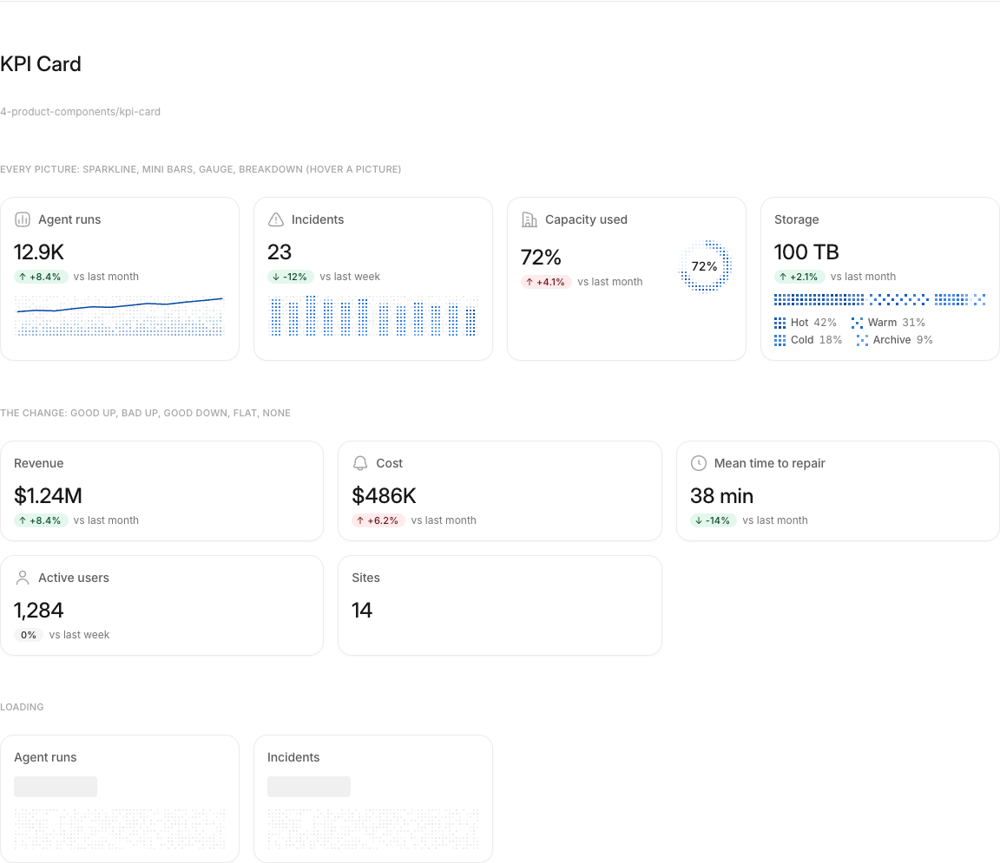
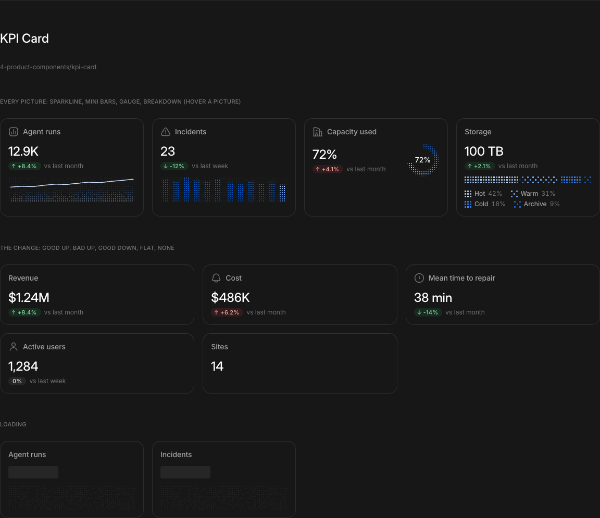

<!-- Copied from the design copy (neutrino-frontend-v3) by scripts/sync.mjs. Edit it there, then run `npm run sync`. -->

# KPI Card

| | |
|---|---|
| Figma | None: designed in code (see the spec below) |
| Status | Coded 19 Oct 2026; waits for Nitesh's review |
| Code | [`src/components/ds/kpi-card.tsx`](../../src/components/ds/kpi-card.tsx) |
| Sizes | [`src/styles/sizes/kpi-card.css`](../../src/styles/sizes/kpi-card.css) |
| Demo | [`src/gallery/sections/kpi-card.tsx`](../../src/gallery/sections/kpi-card.tsx) |

## Light and dark

**Light**



**Dark**



## Use it

```tsx
import { KpiCard } from "@/components/ds/kpi-card";
```

Every size and state, working: run `npm run dev` and open [localhost:3100/#kpi-card](http://localhost:3100/#kpi-card).

## Spec

Written 19 Oct 2026, with the Charts page (`chart.md`). One number that matters, how it moved, and a small picture of how it got there, drawn in the Neutrino cells. There is no Figma frame; this page is ours, after the data-viz stat tile and Nitesh's ask for graphs in KPI cards.

### Anatomy

| Part | Spec |
|---|---|
| Card | `bg/white-0`, a 1px `stroke/soft-200` edge, `--shadow-card`, corner 16, padding 16, 12 between its rows. The card itself never glows: only the picture's cells carry the light. |
| Label | `text-label-sm` `text/sub-600`, sentence case, no colon. An optional 20 x 20 icon before it in `icon/soft-400`. |
| Value | `font-display text-title-h5` (24/32, 500) `text/strong-950`, compact (1,284, 12.9K, $4.2M), proportional figures. |
| Change | A Badge, Lighter, Small, with an up or down arrow and the signed change ("+8.4%"). Green when the move is good, red when it is bad: `good` says which way is good (up for revenue, down for cost or incidents). A flat change is Gray. |
| Period | After the badge, 6 apart: what the change compares with ("vs last month") in `text-paragraph-xs` `text/muted`. |
| Picture | One of: a sparkline (the line form, 48 tall), mini bars (the column form, 48 tall), a gauge (a 64 ring with the share in its middle, beside the number), or a breakdown bar (with its legend under it). Optional. |

The value and the change never sit on the cells. A picture's cells follow every rule on `chart.md`: arrival, breathing, the cursor's warmth; the sparkline's runner only while the card is hovered, so a row of cards stays calm.

### States

* **Loading:** the label, a grey bar where the value goes, and the picture's wall with its wipe.
* **No change:** the badge and the period are left out.
* **Hover:** the picture's tooltip shows the value at a point; the card itself does not move.

### Sizes

In `styles/sizes/kpi-card.css`: padding, gaps, corner, the picture heights and the gauge size.

### Open (for Nitesh)

1. The value is `title-h5` (24). A dashboard's one lead number could be bigger (48): say if one card should lead.
2. The gauge sits beside the number; the other pictures sit under it.
